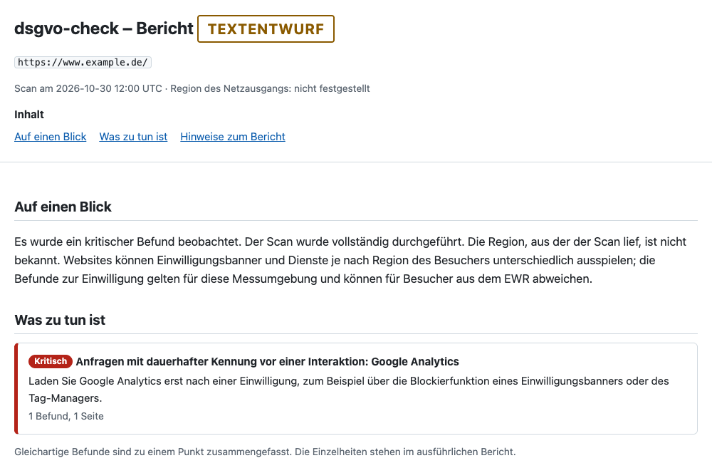
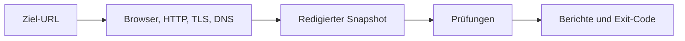
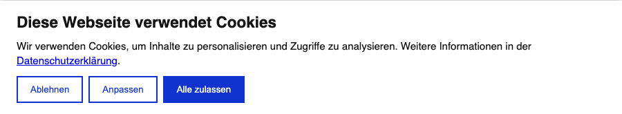
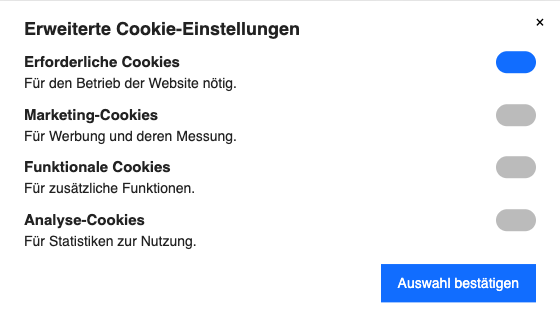

# dsgvo-check

[English](README.md) | Deutsch

dsgvo-check beobachtet, was eine Website lädt und speichert, wie ihr Einwilligungsbanner funktioniert und
wie HTTP, TLS und E-Mail eingerichtet sind. Der Exit-Code macht die Ergebnisse in CI auswertbar.
Die Berichte dokumentieren technische Beobachtungen. Die rechtliche Bewertung liegt bei den Betreibern.

**Stand** · Prototyp 0.1.0 aus dem Quellcode. Die Berichtstexte tragen die Kennzeichnung „Textentwurf“.

- [Schnellstart](#schnellstart)
- [So läuft ein Scan ab](#ablauf-eines-scans)
- [Banner mit Beispielen](#banner)
- [Prüfungen und Befunde](#was-geprüft-wird)
- [CI und Docker](#ci-integration)
- [Konfiguration und Exit-Codes](#konfiguration)
- [Netzwerk und Grenzen](#was-der-scanner-sendet)
- [Entwicklung](#entwicklung)

## Schnellstart

### Voraussetzungen

- Node.js 26 oder neuer. CI testet mit Node.js 26.
- Corepack für die in [package.json](package.json) festgelegte pnpm-Version. Bei Bedarf einmalig
  `npm install --global corepack@0.36.0` ausführen.
- Chromium (Chrome for Testing). Der Installationsschritt unten lädt die passende Version.
- Docker als Alternative zur lokalen Installation. [Zum Docker-Start](#docker)

### Installation

```sh
git clone https://github.com/seed-factory/dsgvo-check.git
cd dsgvo-check
corepack pnpm install
node node_modules/playwright-core/cli.js install --no-shell chromium
corepack pnpm build
```

Unter Linux installiert `node dist/cli.js install --with-deps` mit Root-Rechten die fehlenden Systembibliotheken.

### Erster Scan

```sh
node dist/cli.js https://www.example.de/ --format console,json,html --out ./dsgvo-check-report
```

Ersetze die Beispieladresse durch deine Website. Ein typischer Scan dauert 1–3 Minuten.

| Format    | Ergebnis                                             |
| --------- | ---------------------------------------------------- |
| `console` | Kurzfassung im Terminal                              |
| `json`    | `report.json` mit Befunden und vollständigen Belegen |
| `html`    | `report.html` als eigenständige Datei                |
| `summary` | `summary.md` für CI                                  |
| `pdf`     | `report.pdf` aus derselben HTML-Ansicht              |

### Bericht lesen

Öffne `report.html` für den Überblick über Befunde, unklare Ergebnisse, empfohlene Maßnahmen und beobachtete
Dienste. Darunter stehen die Belege pro Prüfung. `--profile developer` (Standard) behält die Belege. Mit
`--profile owner` bleibt bei HTML und PDF nur die Kurzfassung.
Die Aufnahme von Bannerbildern ist zum Schutz von Besucherdaten ausgesetzt. Der Scan erfasst weiterhin die
Merkmale des Banners.



### Bericht erneut ausgeben

```sh
node dist/cli.js report ./dsgvo-check-report/report.json --format html,pdf --profile owner --lang de --out ./report-export
```

`report` verwendet den vorhandenen JSON-Bericht. Ohne Flags schreibt der Befehl den Entwicklerbericht als HTML auf
Deutsch neben die JSON-Datei. Die Einstellungen `DSGVO_CHECK_REPORT_FORMATS`, `DSGVO_CHECK_REPORT_PROFILES` und
`DSGVO_CHECK_REPORT_LANG` ändern diese Standards.
Bei einem PDF-Druckfehler bleiben JSON und der Scan-Exit-Code erhalten. Ungültiges Eingabe-JSON ergibt Exit-Code 2.

### Mehrere Websites prüfen

```sh
node dist/cli.js --targets sites.txt --profile developer,owner --lang de,en --format console,json,html,pdf --out ./audit
```

`sites.txt` enthält eine URL pro Zeile. Leerzeilen und `#`-Kommentare werden ignoriert. Mehrere URLs lassen sich
auch direkt auf der Kommandozeile angeben.

```text
# Shops
https://www.example.de/
https://shop.example.com/
```

```text
audit/
└── www.example.de/
    ├── report.json
    ├── de/
    │   ├── developer/   report.html, report.pdf
    │   └── owner/       report.html, report.pdf
    └── en/
        ├── developer/   report.html, report.pdf
        └── owner/       report.html, report.pdf
```

| Thema                | Verhalten                                                                                                         |
| -------------------- | ----------------------------------------------------------------------------------------------------------------- |
| Reihenfolge          | Die Websites werden nacheinander geprüft, mit der üblichen Navigationspause dazwischen.                           |
| Verzeichnisse        | Ein Verzeichnis pro Website, benannt nach dem Host. Bei ausdrücklichem Port: `<host>_<port>`.                     |
| Einzelne URL         | Eine einzelne URL ohne `--targets` behält das bisherige Layout.                                                   |
| HTML und PDF         | Bei einem Profil und einer Sprache bleiben sie im Verzeichnis der Website. Sonst: `<sprache>/<profil>/`.          |
| JSON, Konsole        | `report.json`, Konsolenausgabe und `summary.md` entstehen einmal pro Website, in der ersten Sprache von `--lang`. |
| Exit-Code            | Der höchste Exit-Code aller Websites.                                                                             |
| Gescheiterte Website | Sie erhält einen fehlgeschlagenen Bericht. Der Lauf geht mit der nächsten Website weiter.                         |
| Grenze               | Höchstens 20 Websites. `DSGVO_CHECK_SCAN_MAX_TARGETS` ändert die Grenze (1–100).                                  |
| Snapshots            | `--save-snapshot` und `--from-snapshot` gehen nur mit einer einzelnen URL.                                        |
| Befehl `report`      | Nimmt dieselben Listen für `--profile` und `--lang`.                                                              |

### Snapshot speichern und neu auswerten

```sh
node dist/cli.js https://www.example.de/ --save-snapshot scan.snapshot.json
node dist/cli.js --from-snapshot scan.snapshot.json --checks HDR-01,TLS-02 --format console
```

Ein Snapshot speichert die redigierten Beobachtungen zur späteren Auswertung ohne Netzwerk. Der neue Bericht
nennt die ursprüngliche Aufnahmezeit. `scan.evaluatedAt` gibt im JSON die neue Auswertungszeit an.

## Ablauf eines Scans



Die Collectors erfassen technische Fakten. Sie entfernen sensible Daten vor dem Speichern. Die Prüfungen lesen
den Snapshot und liefern Befunde. `--fail-on` bestimmt, ab welcher Stufe ein Befund CI fehlschlagen lässt.

| Browserphase        | Was passiert                                                                                                            |
| ------------------- | ----------------------------------------------------------------------------------------------------------------------- |
| A · Vor der Auswahl | Chromium beobachtet die Startseite, Rechtstexte und ausgewählte Unterseiten.                                            |
| B · Ablehnen        | Ein passender Adapter klickt auf Ablehnen und prüft, ob die Entscheidung nach dem Neuladen und auf Kontrollseiten gilt. |
| C · Akzeptieren     | Ein frisches Profil akzeptiert und besucht die Kontrollseiten zum Vergleich.                                            |

Jede Phase startet mit einem eigenen Browserprofil. Inhalte weiter unten auf einer Seite werden durch
Vergrößern des Browserfensters sichtbar. Dabei löst der Scanner keine Scroll-Eingabe aus.

[Seitenauswahl, Abbrüche und Zertifikatfehler](docs/scan-reference.md#browserablauf) ·
[Architektur für die Entwicklung](docs/architecture.md)

### Banner

Eine Consent-Management-Plattform (CMP) zeigt das Einwilligungsbanner. dsgvo-check hat Adapter für Borlabs,
Cookiebot, Complianz, Usercentrics, CCM19, Real Cookie Banner, CookieHub, Shopware 6, Wix und TYPO3 cookieman.

**Cookiebot** · Der Adapter kann „Ablehnen“ auf der ersten Ebene wählen.



**Wix** · Der Adapter kann in den Einstellungen speichern, wenn nur notwendige Kategorien eingeschaltet sind.



Die Bilder zeigen lokale Testnachbildungen. Weitere Beispiele sind die [erste Wix-Ebene](docs/images/banner-wix-first-layer.png)
und ein [blockierendes Usercentrics-Banner ohne direkte Ablehnung](docs/images/banner-usercentrics.png).

Ein unbekanntes Banner bleibt ohne Klick. CONSENT-04 meldet „Banner nicht erkannt“ als `info`.
[Erkennung, Klickpfade und Bestätigung](docs/scan-reference.md#banner)

## Was geprüft wird

Die Browser-Prüfungen beobachten unter anderem diese typischen Situationen.

- Eine Website lädt eine Schrift oder ein YouTube-Vorschaubild, bevor der Besucher den Banner bedient.
- Ein Tracking-Dienst sendet nach bestätigter Ablehnung auf einer Kontrollseite weiter Anfragen.
- Eine verlinkte Datenschutzerklärung ist erreichbar, erwähnt aber einen beobachteten Dienst nicht.

| ID         | Beobachtung                                                                                                       |
| ---------- | ----------------------------------------------------------------------------------------------------------------- |
| CONSENT-01 | Anfragen an Dritte und Tracking-Hits vor einer Interaktion mit dem Banner                                         |
| CONSENT-02 | Cookies und Web Storage vor Interaktion (Namen, Flags, Laufzeit; **keine Werte**)                                 |
| CONSENT-03 | Tracking ohne erkennbares Einwilligungsbanner                                                                     |
| CONSENT-04 | Erste Banner-Ebene: „Ablehnen“ gleichrangig zu „Akzeptieren“?                                                     |
| CONSENT-05 | Was nach einem bestätigten „Ablehnen“ weiter gesendet oder gespeichert wird                                       |
| TRACK-01   | Dienste-Inventar je Zeitpunkt: vor Interaktion, nach Ablehnung, nach Zustimmung                                   |
| EMBED-01   | Schriften von Drittservern (z. B. Google Fonts)                                                                   |
| EMBED-02   | Karten (z. B. Google Maps) ohne Zwei-Klick-Lösung                                                                 |
| EMBED-03   | Videos und Vorschaubilder (z. B. YouTube, Vimeo) ohne Zwei-Klick-Lösung                                           |
| LEGAL-01   | Impressum und Datenschutzerklärung: verlinkt, erreichbar, nicht vom Banner verdeckt                               |
| LEGAL-02   | Bezeichnungen früherer Rechtslage im Text (z. B. TMG, RStV, TTDSG, Privacy Shield)                                |
| PRIV-01    | Werden beobachtete Dienste in der Datenschutzerklärung genannt?                                                   |
| PRIV-02    | Angaben der Datenschutzerklärung (z. B. „Fonts lokal“) im Abgleich mit den Anfragen                               |
| HDR-01     | Sicherheits-Header: HSTS, CSP, Einbettungsschutz, `nosniff`, Referrer-/Permissions-Policy                         |
| HDR-02     | Softwareversionen in Headern wie `Server` und `X-Powered-By`                                                      |
| TLS-01     | Umleitung von http auf https; Formulare auf http-Seiten, auch verlinkter Beiträge; Links auf eigene http-Adressen |
| TLS-02     | Zertifikat: gültig, vollständige Kette, Restlaufzeit relativ zur Gesamtlaufzeit                                   |
| MAIL-01    | DMARC-Eintrag und Richtlinie, auch der Zieldomain und der E-Mail-Domains im Impressum                             |
| MAIL-02    | SPF-Eintrag (statisch ausgewertet), zusammen mit DMARC derselben Domain                                           |
| MAIL-03    | DKIM-Schlüssel auf den geprüften Selektoren und ihre RSA-Länge, je E-Mail-Domain                                  |

### Varianten

Jede Prüfung kann mehrere Varianten melden; die Meldungs-ID eines Befunds ist `<Prüfung>.<Variante>`.

- Die Tabelle zeigt den Standard-Schweregrad jeder Variante. Sie wird aus `test/data/ruleset` erzeugt.
- Mittlere Konfidenz begrenzt einen Befund auf `warning`, niedrige auf `info`.
- **(fest)** heißt `locked`: Die Variante wird nicht angehoben und zählt nicht für `--fail-on`; die Prüfung bleibt
  `inconclusive`.

<!-- registry:begin: generated from test/data/ruleset by `corepack pnpm registry`, do not edit -->
| ID           | `critical`                                                          | `warning`                                                                                                               | `info`                                                                                                              |
| ------------ | ------------------------------------------------------------------- | ----------------------------------------------------------------------------------------------------------------------- | ------------------------------------------------------------------------------------------------------------------- |
| `CONSENT-01` | `tracking-completed`                                                | `library-loaded`, `first-party-proxy`, `cookieless-ping`                                                                | `third-party-resource`, `unknown-host`, `request-not-completed`                                                     |
| `CONSENT-02` | `tracking-identifier-stored`                                        | `unknown-third-party-persistent`                                                                                        | `unknown-first-party-persistent`, `cmp-cookie-with-uid`, `storage-rejected-or-attempted`                            |
| `CONSENT-03` | `no-banner-strong-tracking`                                         | `no-banner-consent-services`                                                                                            | —                                                                                                                   |
| `CONSENT-04` | `blocking-no-reject`, `close-means-accept`, `nonblocking-no-reject` | `reject-not-actionable`, `reject-ineffective`, `consent-without-action`                                                 | `reject-as-link`, `no-choice-at-first-layer`, `pur-abo`, `banner-not-recognized` (fest), `cmp-not-supported` (fest) |
| `CONSENT-05` | `tracking-after-reject`                                             | `cookieless-ping-after-reject`                                                                                          | `connect-only-after-reject`                                                                                         |
| `TRACK-01`   | —                                                                   | —                                                                                                                       | `service-inventory`                                                                                                 |
| `EMBED-01`   | —                                                                   | `fonts-loaded`, `fonts-in-embed-frame`                                                                                  | `preconnect-only`                                                                                                   |
| `EMBED-02`   | —                                                                   | `maps-loaded`                                                                                                           | —                                                                                                                   |
| `EMBED-03`   | —                                                                   | `video-loaded`                                                                                                          | —                                                                                                                   |
| `LEGAL-01`   | `document-not-found`, `links-broken`                                | `provider-details-without-link`, `link-missing-on-some-pages`, `reachable-via-intermediate`, `footer-covered-by-banner` | `unresolved`                                                                                                        |
| `LEGAL-02`   | —                                                                   | —                                                                                                                       | `outdated-reference`                                                                                                |
| `PRIV-01`    | —                                                                   | `not-named`                                                                                                             | `category-only`, `ambiguous-match`, `named-in-cmp-only`                                                             |
| `PRIV-02`    | `contradiction-replicated`                                          | `contradiction-single`                                                                                                  | `wording-to-review`                                                                                                 |
| `MAIL-01`    | —                                                                   | `record-not-found`, `policy-none`, `record-invalid`                                                                     | `weak-option`, `legacy-pct`                                                                                         |
| `MAIL-02`    | —                                                                   | `record-not-found`, `permissive-qualifier`, `record-invalid`, `softfail-without-enforcement`                            | `softfail-with-enforcement`, `ptr-mechanism`                                                                        |
| `MAIL-03`    | —                                                                   | `key-too-short`, `given-selector-missing`                                                                               | `selectors-not-found`                                                                                               |
| `HDR-01`     | —                                                                   | `hsts-missing`, `anti-framing-missing`, `referrer-policy-permissive`                                                    | `header-missing`                                                                                                    |
| `HDR-02`     | —                                                                   | —                                                                                                                       | `version-header`                                                                                                    |
| `TLS-01`     | `https-unavailable`, `form-on-http-page`                            | `no-redirect`, `client-side-redirect-only`, `internal-http-link`                                                        | `redirect-chain-detail`, `internal-http-link-upgraded`                                                              |
| `TLS-02`     | `certificate-invalid`                                               | `chain-incomplete`, `certificate-expiring`                                                                              | `certificate-expiry-approaching`                                                                                    |
<!-- registry:end -->

### Geplante Prüfungen

Diese Prüfungen sind spezifiziert, aber noch nicht umgesetzt. Die Tabelle nennt die geplanten Varianten.

| ID                   | Thema                                      | `critical`                      | `warning`                                                                    | `info`                                              | Ohne Befund (`reason`)   |
| -------------------- | ------------------------------------------ | ------------------------------- | ---------------------------------------------------------------------------- | --------------------------------------------------- | ------------------------ |
| `EMBED-04`           | CAPTCHA                                    | —                               | `captcha-without-form`                                                       | `captcha-with-form`                                 | —                        |
| `EMBED-05`           | Widgets                                    | —                               | `widget-loaded`                                                              | —                                                   | —                        |
| `CONSENT-06`         | Consent Mode                               | `google-granted-despite-denied` | `default-granted`, `hit-before-default`                                      | —                                                   | `not-observable`         |
| `VULN-01`, `VULN-02` | CMS-Kern; Plugins, Themes und Bibliotheken | `version-listed-kev-or-preauth` | `version-listed`, `eol-major`                                                | `version-unknown`                                   | `source-unavailable`     |
| `TLS-03`             | Mixed Content                              | —                               | `active-mixed-content-blocked`, `passive-upgrade-failed`, `form-action-http` | `passive-auto-upgraded`                             | —                        |
| `TLS-04`             | TLS 1.0/1.1                                | —                               | `legacy-protocol-accepted`                                                   | —                                                   | `handshake-inconclusive` |
| `DNS-01`             | CAA und DNSSEC                             | —                               | `dnssec-bogus`                                                               | `caa-not-found`, `dnssec-unsigned`                  | —                        |
| `HDR-02`             | Cookie-Attribute                           | —                               | `session-cookie-attributes`                                                  | `cookie-attributes`, `cookie-samesite-missing`      | —                        |
| `ADMIN-01`           | Öffentliche WordPress-Angaben              | —                               | `users-and-xmlrpc-exposed`                                                   | `partial-exposure`                                  | —                        |
| `FILE-01`            | Dienstdateien                              | `sensitive-signature`           | `exposed-file`                                                               | `minor-file`                                        | —                        |
| `SEC-01`             | `security.txt`                             | —                               | —                                                                            | `security-txt-not-found`, `security-txt-incomplete` | —                        |
| `BFSG-01`            | Automatische Zugänglichkeitssignale        | —                               | —                                                                            | `axe-rule-observed`                                 | —                        |
| `PERF-01`            | Performance im Labor                       | —                               | —                                                                            | `lab-metrics`                                       | —                        |

- **VULN-01, VULN-02:** Die Stufen gelten bei exakt bestimmter Version; bei einem Versionsbereich liegt jede Variante
  eine Stufe niedriger.
- **ADMIN-01, FILE-01:** nur auf ausdrücklichen Wunsch (Opt-in); der Prototyp sendet solche Anfragen nicht.
- **BFSG-01, PERF-01:** zählen nicht für `--fail-on` (`gating: false`).

## CI-Integration

Führe den Scan in einem separaten Job mit Leserechten und ohne Secrets aus. Die Integrationen verwenden
`ghcr.io/seed-factory/dsgvo-check:<Version>`. Die Beispiele setzen ein veröffentlichtes Tag und Image voraus.

### GitHub Action

```yaml
jobs:
  dsgvo-check:
    runs-on: ubuntu-24.04
    permissions:
      contents: read
    steps:
      - uses: seed-factory/dsgvo-check@v0.1.0
        with:
          url: https://staging.example.de/
          fail-on: critical
```

Der Schritt liefert `exit-code` sowie die Pfade für JSON, HTML und PDF. Die Job Summary und der
Artefakt-Upload sind standardmäßig aktiv. [Alle Eingaben und Ausgaben](action.yml) ·
[Beispiel mit absichtlich fehlschlagendem Job](examples/github-failing/README.md)

### GitLab CI

```yaml
include:
  - remote: https://raw.githubusercontent.com/seed-factory/dsgvo-check/v0.1.0/templates/gitlab/dsgvo-check.gitlab-ci.yml
    integrity: sha256-<base64-sha256-der-datei>

variables:
  DSGVO_CHECK_URL: https://staging.example.de/
```

Das [Template](templates/gitlab/dsgvo-check.gitlab-ci.yml) definiert den Job `dsgvo-check` (Stage `test`, läuft nur
bei gesetztem `DSGVO_CHECK_URL`). Den Wert für `integrity` nennt die Zusammenfassung des Release-Workflows.

Das Template sichert das Berichtsverzeichnis 14 Tage lang als Artefakt. [Template und Variablen](templates/gitlab/dsgvo-check.gitlab-ci.yml)

### Docker

```sh
docker build -t dsgvo-check:dev .
mkdir -p dsgvo-check-report
docker run --rm --user "$(id -u):$(id -g)" --env HOME=/tmp \
  --cap-drop=ALL --security-opt no-new-privileges \
  --read-only --tmpfs /tmp:rw,nosuid,nodev,size=1g \
  --memory=3g --memory-swap=3g --cpus=2 --pids-limit=1024 --shm-size=512m \
  -v "$PWD/dsgvo-check-report:/out" \
  dsgvo-check:dev https://www.example.de/ --out /out --format console,json,html
```

### Isolation

Im Image bildet der Container die Sandbox (`--sandbox container`). Der Lauf oben nutzt ein schreibgeschütztes
Dateisystem, eingeschränkte Rechte und Ressourcenlimits. `/out` muss für die beim Start verwendete UID schreibbar
sein. Ohne `--user` läuft das Image als UID 10001. Lokal verwendet Chromium standardmäßig seine eigene Sandbox.

## Konfiguration

### Optionen

`node dist/cli.js --help` zeigt alle Optionen. Die folgenden Optionen decken die häufigsten Aufrufe ab.

Es lassen sich eine oder mehrere URLs angeben. `--targets` liest sie stattdessen aus einer Datei.

| Option        | Standard               | Wirkung                                                                                 |
| ------------- | ---------------------- | --------------------------------------------------------------------------------------- |
| `--targets`   | keine                  | Datei mit einer URL pro Zeile                                                           |
| `--fail-on`   | `critical`             | `critical`, `warning` oder `none`                                                       |
| `--format`    | `console,json`         | Kommagetrennte Ausgabeformate                                                           |
| `--out`       | `./dsgvo-check-report` | Ausgabeverzeichnis                                                                      |
| `--max-pages` | `6`                    | Seitenbudget der Phase A                                                                |
| `--timeout`   | `8m`                   | Globales Zeitlimit, etwa `90s`                                                          |
| `--checks`    | alle                   | Kommagetrennte Prüfungs-IDs                                                             |
| `--lang`      | `de`                   | `de`, `en` oder beide, kommagetrennt. Die erste gilt für JSON, Konsole und `summary.md` |
| `--profile`   | `developer`            | `developer` mit Belegen, `owner` Kurzfassung oder beide, kommagetrennt (HTML und PDF)   |

### Einstellungen

Der Scanner läuft mit sinnvollen Standardwerten. Ein CLI-Flag hat Vorrang vor der Umgebungsvariable. Danach folgen die lokale `.env` und der Standardwert.
Mit Docker übergibst du Variablen per `--env` oder `--env-file`.
[Alle Variablen mit Standardwerten und Grenzen](.env.example)

### Exit-Codes

| Code | Bedeutung                                                                                                  |
| ---- | ---------------------------------------------------------------------------------------------------------- |
| `0`  | Kein Befund erreicht die Schwelle.                                                                         |
| `1`  | Mindestens ein Befund erreicht die Schwelle.                                                               |
| `2`  | Der Scan oder die Berichtsausgabe scheiterte, eine relevante Prüfung war fehlerhaft oder `--strict` griff. |

Ein nicht durchgeführter Scan oder Schreibfehler hat Vorrang vor einem Befund. Ein Befund hat Vorrang vor
einem einzelnen Prüfungsfehler und vor `--strict`. `--fail-on none` lässt die Schwelle und Prüfungsfehler
bei der Auswertung des Exit-Codes außer Betracht. Die übrigen Scan-Fehler und `--strict` wirken weiterhin.

[Alle Exit-Gründe und ihr Vorrang](docs/scan-reference.md#exit-gründe)

## Was der Scanner sendet

Der Scanner schickt Browser-Navigationen und die folgenden Standardanfragen, sonst nichts. Wer als Betreiber wissen
will, was bei ihm angekommen ist, findet es hier vollständig.

**Browser:** Navigationen der Phasen A, B und C (siehe [Seiten in Phase A](docs/scan-reference.md#seiten-in-phase-a)), eine nach der anderen
mit mindestens 1,5 s Pause. Bei einem abgelehnten Zertifikat der Ziel-URL gehen sie an das Ziel ihrer
HTTP-Weiterleitung, nicht zusätzlich.

**HTTP**, höchstens 2 Anfragen pro Sekunde und Host:

- `robots.txt` des Ursprungs der Startseite;
- höchstens 2 Sitemap-Anfragen (die Sitemap oder ein Sitemap-Index und eine Kind-Sitemap), nur wenn die Links der
  Startseite das Seitenbudget nicht füllen;
- die Umleitungsketten von `http://` und `https://` für den Zielhost und seine `www.`- und Apex-Varianten, dazu die
  Kette auf einem in der Ziel-URL ausdrücklich genannten Port;
- je eine Anfrage an die von der Startseite verlinkten Seiten Impressum und Datenschutzerklärung (nur gleiche Website,
  für die Sicherheits-Header und Versionsangaben);
- für TLS-01 nach dem Browser höchstens 3 Anfragen (`DSGVO_CHECK_HTTP_FORM_TWIN_PAGES`):
  - zuerst an die `http://`-Adressen von Seiten, auf denen Phase A ein Formular gesehen hat;
  - mit dem Rest des Budgets an die `http://`-Adressen von Beiträgen und Artikeln, die die besuchten Seiten als
    Permalink (`rel="bookmark"`) verlinken und die der Browser nicht besucht hat;
  - beides nur, wenn `http://` ihres Hosts ohne Umleitung auf https ausliefert: je ein GET, ohne einer Weiterleitung zu
    folgen und ohne etwas abzusenden, keine Wiederholung und nach 429 oder 503 keine weitere Anfrage an diesen Host.

**TLS:** ein Handshake je Host-Variante (höchstens 3), um das Zertifikat zu lesen. Nach einer Umleitung auf eine andere
Domain kommen höchstens 3 weitere für den Host am Ende der Umleitung und seine `www.`- und Apex-Varianten hinzu.

**DNS:** MX-, SPF-, DMARC- und DKIM-Abfragen beim Resolver des prüfenden Rechners, nicht bei der Website.

- Für die gescannte Domain höchstens 60 Abfragen.
- Nach dem Browser je höchstens 30 weitere für die Domain, auf die die Startseite weiterleitet, und für bis zu 2
  E-Mail-Domains aus dem Impressum.
- DKIM: je E-Mail-Domain höchstens 8 Selektoren (`<selector>._domainkey.<domain>`), nach den übrigen Abfragen und
  innerhalb desselben Budgets.

**Nicht gesendet** werden Anfragen auf offene Dateien oder Admin-Oberflächen, Logins und Formulare. Bot-Schutz,
CAPTCHAs und Geo-Sperren umgeht der Scanner nie: Eine blockierte Website wird als blockiert vermerkt und nicht mit
Tricks erneut aufgerufen.

User-Agent und die IP-Adresse, die Drittanbieter in Phase C sehen: siehe [Nutzungshinweise](#nutzungshinweise). Der
User-Agent bleibt auch dann unverändert, wenn ein Einwilligungsbanner ihn deshalb für einen Crawler hält und sich nicht
öffnet; der Bericht nennt das (siehe [Banner](#banner)).

## Grenzen

- Der Bericht zeigt die Website so, wie ein Desktop-Chromium sie beim ersten Besuch sieht, mit deutscher Sprache und
  Zeitzone (`de-DE`, `Europe/Berlin`). Andere Browser und mobile Layouts sind nicht abgedeckt.
- Consent-Banner und Tracker hängen oft vom Standort der IP-Adresse ab. Scans aus Deutschland oder dem EWR starten
  und `--assume-region de` angeben.
- Abgedeckt sind nur die tatsächlich besuchten Seiten (`--max-pages`).
- Bot-Schutz, Geo-Signale und nicht überprüfbare Zustände können Prüfungen `inconclusive` machen.
- Der Snapshot enthält weder Cookie-Werte noch Werte aus Web Storage oder TC-Strings, auch in gehashter Form.
  URL-Parameter und Header folgen Positivlisten. [Was gespeichert wird](docs/scan-reference.md#keine-werte)
- Die Netzwerkprüfung filtert private, Loopback-, Link-Local- und Metadaten-Adressen bei der Zielprüfung und
  Dokumentnavigation. Subressourcen, DNS-Rebinding und das Ziel hinter einem Proxy liegen außerhalb dieser Grenze.
  Nutze eine isolierte Umgebung ohne Zugriff auf sensible interne Dienste.
- Eine leere Befundliste bestätigt keine Rechtskonformität. [Grenzen der einzelnen Prüfungen](docs/scan-reference.md#einzelne-prüfungen)

## Nutzungshinweise

`dsgvo-check` ist für die Prüfung eigener oder im Auftrag betreuter Websites bestimmt; Berichte über Websites
Dritter sind nicht zur Veröffentlichung vorgesehen. HTTP-Anfragen des Scanners tragen den User-Agent
`dsgvo-check/<version> (passive DSGVO/security check; https://github.com/seed-factory/dsgvo-check)`; der Browser
meldet sich als Chrome mit demselben Token. TLS-Verbindungsaufbauten und DNS-Abfragen tragen keinen User-Agent.
Phase C übermittelt die IP-Adresse des prüfenden Rechners an die Drittanbieter, deren Ressourcen die Website nach
der Annahme im Banner lädt. Mit `--proxy` laufen DNS-Abfragen direkt über den Resolver, nicht über den Proxy.

Derselbe Text steht in `dsgvo-check --help` (Quelle: `test/data/texts/de/core.yaml`, Schlüssel `usageNotes`).

## Entwicklung

```sh
corepack pnpm typecheck
corepack pnpm lint
corepack pnpm test:unit
corepack pnpm test:integration
corepack pnpm build
corepack pnpm test:e2e
```

### Tests

Unit-Tests benötigen weder Browser noch Netzwerk. Integrationstests und E2E-Tests nutzen lokale Server.
`corepack pnpm test:changed` wählt Tests anhand des Diffs zu `main` aus.
[Teststufen, CI und lokale Testumgebung](docs/development.md#tests)

### Canary

Canary misst die Abdeckung und Zuverlässigkeit des Scanners an einer privaten Stichprobe.
`corepack pnpm canary --dry-run` zeigt den Plan ohne Scan. Ein Live-Lauf braucht `--confirm`.
[Vorbereitung, Auswertung und Regeln](docs/development.md#canary)

### Beitragen

[Architektur und Modulübersicht](docs/architecture.md) · [Entwicklungsbefehle und Release](docs/development.md) ·
[Projektregeln und neue Prüfungen](AGENTS.md)

## Lizenz

Apache-2.0. [LICENSE](LICENSE) · [NOTICE](NOTICE)
