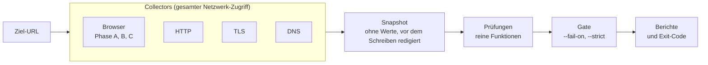

# dsgvo-check

[](https://github.com/seed-factory/dsgvo-check/actions/workflows/ci.yml)
[](LICENSE)
[](#voraussetzungen)

Passiver Scan einer Website auf DSGVO/TDDDG/DDG-Indizien und grundlegende Sicherheitsprobleme, mit Exit-Code für
CI. Der Scanner öffnet die Website in Chromium (Playwright) und hält fest, was **vor** einer Einwilligung passiert,
was sich nach „Ablehnen“ und nach „Alle akzeptieren“ ändert, ob Impressum und Datenschutzerklärung erreichbar sind
und wie Header, TLS und E-Mail-Authentifizierung der Domain konfiguriert sind. Er läuft lokal, als Docker-Image, als
GitHub Action und im GitLab CI und lässt die Pipeline fehlschlagen, sobald ein Befund die gewählte Schwelle erreicht.

Der Bericht beschreibt technische Beobachtungen („beobachtet“, „nicht gefunden in …“), keine rechtliche Bewertung.

> **Status: Prototyp 0.1.0.** 20 Prüfungen, zehn CMP-Adapter; Berichte als JSON, Konsole, HTML und Markdown-Summary,
> PDF auf Wunsch. Der Prototyp prüft die Architektur an echten Websites und ist kein Release 1.0. Die Texte im Bericht
> sind Entwürfe („Textentwurf“). Noch nicht veröffentlicht (kein npm-Paket). Lücken: siehe [Grenzen](#grenzen).

## Inhalt

- [Funktionen](#funktionen)
- [Was geprüft wird](#was-geprüft-wird)
- [So funktioniert es](#so-funktioniert-es)
- [Voraussetzungen](#voraussetzungen)
- [Installation und Build](#installation-und-build)
- [Nutzung](#nutzung)
- [Optionen](#optionen)
- [Konfiguration](#konfiguration)
- [Exit-Codes](#exit-codes)
- [Docker](#docker)
- [CI-Integration](#ci-integration) mit [GitHub Action](#github-action) und [GitLab CI](#gitlab-ci)
- [Was der Scanner sendet](#was-der-scanner-sendet)
- [Grenzen](#grenzen)
- [Nutzungshinweise](#nutzungshinweise)
- [Entwicklung](#entwicklung) mit [Tech-Stack](#tech-stack), [Projektstruktur](#projektstruktur),
  [Befehle](#befehle), [Tests](#tests), [Canary](#canary) und [Release](#release)
- [Beitragen](#beitragen)
- [Lizenz](#lizenz)

## Funktionen

- **Drei Browser-Phasen** mit frischem Profil: vor jeder Interaktion, nach „Ablehnen“, nach „Alle akzeptieren“.
- **20 Prüfungen** zu Einwilligung, Tracking, Einbettungen, Rechtstexten, Sicherheits-Headern, Versionsangaben,
  TLS und E-Mail.
- **Zehn CMP-Adapter** (Borlabs, Cookiebot, Complianz, Usercentrics, CCM19, Real Cookie Banner, CookieHub und die
  Banner von Shopware, Wix und TYPO3-cookieman).
- **Keine Werte:** Cookies, Web Storage und TC-String gelangen nie in Bericht, Snapshot oder Logs, auch nicht gehasht.
- **Berichte** als JSON (mit JSON Schema), Konsole, HTML (eine Datei ohne JavaScript), Markdown-Summary und PDF.
- **CI-tauglich:** Exit-Code nach Schwelle, GitHub Action, GitLab-Template und Docker-Image.
- **Chromium-Sandbox standardmäßig**; im Docker-Image übernimmt der gehärtete Container die Isolation (`--sandbox container`).
- **Snapshots:** Rohdaten speichern und ohne Netz neu auswerten (`--save-snapshot`, `--from-snapshot`).
- **Einstellbar, aber ohne Pflicht:** Jeder Wert hat einen Standard; Schwellen per Umgebungsvariable oder `.env`.
- **Höflich:** Navigationen einzeln mit Pause, wenige HTTP-Anfragen, ehrlicher User-Agent mit Link zum Repository.

## Was geprüft wird

| ID         | Beobachtung                                                                               |
| ---------- | ----------------------------------------------------------------------------------------- |
| CONSENT-01 | Anfragen an Dritte und Tracking-Hits vor einer Interaktion mit dem Banner                 |
| CONSENT-02 | Cookies und Web Storage vor Interaktion (Namen, Flags, Laufzeit; **keine Werte**)         |
| CONSENT-03 | Tracking ohne erkennbares Einwilligungsbanner                                             |
| CONSENT-04 | Erste Banner-Ebene: „Ablehnen“ gleichrangig zu „Akzeptieren“?                             |
| CONSENT-05 | Was nach einem bestätigten „Ablehnen“ weiter gesendet oder gespeichert wird               |
| TRACK-01   | Dienste-Inventar je Zeitpunkt: vor Interaktion, nach Ablehnung, nach Zustimmung           |
| EMBED-01   | Schriften von Drittservern (z. B. Google Fonts)                                           |
| EMBED-02   | Karten (z. B. Google Maps) ohne Zwei-Klick-Lösung                                         |
| EMBED-03   | Videos und Vorschaubilder (z. B. YouTube, Vimeo) ohne Zwei-Klick-Lösung                   |
| LEGAL-01   | Impressum und Datenschutzerklärung: verlinkt, erreichbar, nicht vom Banner verdeckt       |
| LEGAL-02   | Bezeichnungen früherer Rechtslage im Text (z. B. TMG, RStV, TTDSG, Privacy Shield)        |
| PRIV-01    | Werden beobachtete Dienste in der Datenschutzerklärung genannt?                           |
| PRIV-02    | Angaben der Datenschutzerklärung (z. B. „Fonts lokal“) im Abgleich mit den Anfragen       |
| HDR-01     | Sicherheits-Header: HSTS, CSP, Einbettungsschutz, `nosniff`, Referrer-/Permissions-Policy |
| HDR-02     | Softwareversionen in Headern wie `Server` und `X-Powered-By`                              |
| TLS-01     | Umleitung von http auf https; Links der Seiten auf http-Adressen der eigenen Website      |
| TLS-02     | Zertifikat: gültig, vollständige Kette, Restlaufzeit relativ zur Gesamtlaufzeit           |
| MAIL-01    | DMARC-Eintrag und Richtlinie, auch der Zieldomain und der E-Mail-Domains im Impressum     |
| MAIL-02    | SPF-Eintrag (statisch ausgewertet), zusammen mit DMARC derselben Domain                   |
| MAIL-03    | DKIM-Schlüssel auf den geprüften Selektoren und ihre RSA-Länge, je E-Mail-Domain          |

Jede Prüfung kann mehrere Varianten melden. Die Tabelle darunter wird aus `test/data/ruleset` erzeugt und zeigt, welche
Variante mit welchem Standard-Schweregrad gemeldet wird.

<details>
<summary>Varianten und Standard-Schweregrade</summary>

Die Meldungs-ID eines Befunds ist `<Prüfung>.<Variante>`. Die Schweregrade sind die Standardwerte des Regelwerks;
mittlere Konfidenz begrenzt einen Befund auf `warning`, niedrige auf `info`.

<!-- registry:begin: generated from test/data/ruleset by `corepack pnpm registry`, do not edit -->
| ID           | `critical`                                 | `warning`                                                                                                               | `info`                                                                                                  |
| ------------ | ------------------------------------------ | ----------------------------------------------------------------------------------------------------------------------- | ------------------------------------------------------------------------------------------------------- |
| `CONSENT-01` | `tracking-completed`                       | `library-loaded`, `first-party-proxy`, `cookieless-ping`                                                                | `third-party-resource`, `unknown-host`, `request-not-completed`                                         |
| `CONSENT-02` | `tracking-identifier-stored`               | `unknown-third-party-persistent`                                                                                        | `unknown-first-party-persistent`, `cmp-cookie-with-uid`, `storage-rejected-or-attempted`                |
| `CONSENT-03` | `no-banner-strong-tracking`                | `no-banner-consent-services`                                                                                            | —                                                                                                       |
| `CONSENT-04` | `blocking-no-reject`, `close-means-accept` | `reject-not-actionable`, `reject-ineffective`, `consent-without-action`, `nonblocking-no-reject`                        | `reject-as-link`, `no-choice-at-first-layer`, `pur-abo`, `banner-not-recognized`², `cmp-not-supported`² |
| `CONSENT-05` | `tracking-after-reject`                    | `cookieless-ping-after-reject`                                                                                          | `connect-only-after-reject`                                                                             |
| `TRACK-01`   | —                                          | —                                                                                                                       | `service-inventory`                                                                                     |
| `EMBED-01`   | —                                          | `fonts-loaded`                                                                                                          | `preconnect-only`                                                                                       |
| `EMBED-02`   | —                                          | `maps-loaded`                                                                                                           | —                                                                                                       |
| `EMBED-03`   | —                                          | `video-loaded`                                                                                                          | —                                                                                                       |
| `LEGAL-01`   | `document-not-found`, `links-broken`       | `provider-details-without-link`, `link-missing-on-some-pages`, `reachable-via-intermediate`, `footer-covered-by-banner` | `unresolved`                                                                                            |
| `LEGAL-02`   | —                                          | —                                                                                                                       | `outdated-reference`                                                                                    |
| `PRIV-01`    | —                                          | `not-named`                                                                                                             | `category-only`, `ambiguous-match`                                                                      |
| `PRIV-02`    | `contradiction-replicated`                 | `contradiction-single`                                                                                                  | `wording-to-review`                                                                                     |
| `MAIL-01`    | —                                          | `record-not-found`, `policy-none`, `record-invalid`                                                                     | `weak-option`, `legacy-pct`                                                                             |
| `MAIL-02`    | —                                          | `record-not-found`, `permissive-qualifier`, `record-invalid`, `softfail-without-enforcement`                            | `softfail-with-enforcement`, `ptr-mechanism`                                                            |
| `MAIL-03`    | —                                          | `key-too-short`, `given-selector-missing`                                                                               | `selectors-not-found`                                                                                   |
| `HDR-01`     | —                                          | `hsts-missing`, `anti-framing-missing`, `referrer-policy-permissive`                                                    | `header-missing`                                                                                        |
| `HDR-02`     | —                                          | —                                                                                                                       | `version-header`                                                                                        |
| `TLS-01`     | `https-unavailable`, `form-on-http-page`   | `no-redirect`, `client-side-redirect-only`, `internal-http-link`                                                        | `redirect-chain-detail`, `internal-http-link-upgraded`                                                  |
| `TLS-02`     | `certificate-invalid`                      | `chain-incomplete`, `certificate-expiring`                                                                              | `certificate-expiry-approaching`                                                                        |
<!-- registry:end -->

² Fest vorgegeben (`locked`): wird nicht angehoben und zählt nicht für `--fail-on`; die Prüfung bleibt `inconclusive`.

</details>

### Geplante Prüfungen

Diese Prüfungen sind spezifiziert, aber noch nicht umgesetzt. Die Tabelle nennt die geplanten Varianten je Schweregrad.

| ID                    | Thema                                      | `critical`                      | `warning`                                                                    | `info`                                              | Ohne Befund (`reason`)   |
| --------------------- | ------------------------------------------ | ------------------------------- | ---------------------------------------------------------------------------- | --------------------------------------------------- | ------------------------ |
| `EMBED-04`            | CAPTCHA                                    | —                               | `captcha-without-form`                                                       | `captcha-with-form`                                 | —                        |
| `EMBED-05`            | Widgets                                    | —                               | `widget-loaded`                                                              | —                                                   | —                        |
| `CONSENT-06`          | Consent Mode                               | `google-granted-despite-denied` | `default-granted`, `hit-before-default`                                      | —                                                   | `not-observable`         |
| `VULN-01`, `VULN-02`³ | CMS-Kern; Plugins, Themes und Bibliotheken | `version-listed-kev-or-preauth` | `version-listed`, `eol-major`                                                | `version-unknown`                                   | `source-unavailable`     |
| `TLS-03`              | Mixed Content                              | —                               | `active-mixed-content-blocked`, `passive-upgrade-failed`, `form-action-http` | `passive-auto-upgraded`                             | —                        |
| `TLS-04`              | TLS 1.0/1.1                                | —                               | `legacy-protocol-accepted`                                                   | —                                                   | `handshake-inconclusive` |
| `DNS-01`              | CAA und DNSSEC                             | —                               | `dnssec-bogus`                                                               | `caa-not-found`, `dnssec-unsigned`                  | —                        |
| `HDR-02`              | Cookie-Attribute                           | —                               | `session-cookie-attributes`                                                  | `cookie-attributes`, `cookie-samesite-missing`      | —                        |
| `ADMIN-01`⁴           | Öffentliche WordPress-Angaben              | —                               | `users-and-xmlrpc-exposed`                                                   | `partial-exposure`                                  | —                        |
| `FILE-01`⁴            | Dienstdateien                              | `sensitive-signature`           | `exposed-file`                                                               | `minor-file`                                        | —                        |
| `SEC-01`              | `security.txt`                             | —                               | —                                                                            | `security-txt-not-found`, `security-txt-incomplete` | —                        |
| `BFSG-01`⁵            | Automatische Zugänglichkeitssignale        | —                               | —                                                                            | `axe-rule-observed`                                 | —                        |
| `PERF-01`⁵            | Performance im Labor                       | —                               | —                                                                            | `lab-metrics`                                       | —                        |

³ Die Stufen gelten bei exakt bestimmter Version; bei einem Versionsbereich liegt jede Variante eine Stufe niedriger.  
⁴ Nur auf ausdrücklichen Wunsch (Opt-in); der Prototyp sendet solche Anfragen nicht.  
⁵ Zählt nicht für `--fail-on` (`gating: false`).

## So funktioniert es



Nur die Collectors greifen aufs Netz zu und entfernen sensible Werte, bevor etwas in den Snapshot gelangt. Die
Prüfungen sind reine Funktionen über diesem Snapshot; Schweregrade, Varianten und Texte liegen als Daten in
`test/data`, nicht im Code. Das Gate bestimmt aus den Befunden den Exit-Code. Weil der Snapshot alle Rohdaten enthält,
lässt sich ein Scan mit `--from-snapshot` ohne Netz erneut auswerten. Der Bericht nennt dann Zeitpunkt und Dauer der
Aufnahme; wann neu ausgewertet wurde, steht im ausführlichen Bericht und in `report.json` (`scan.evaluatedAt`).

### Ablauf im Browser

Jede Phase startet mit einem frischen Browserprofil in einem temporären Verzeichnis.

| Phase | Aktion                                                                                | Seiten                                                                                    |
| ----- | ------------------------------------------------------------------------------------- | ----------------------------------------------------------------------------------------- |
| A     | Ohne Interaktion beobachten                                                           | Startseite, Impressum, Datenschutzerklärung, Kontakt und weitere Seiten bis `--max-pages` |
| B     | „Ablehnen“ über den CMP-Adapter klicken, Zustand prüfen, Startseite neu laden, prüfen | Startseite und bis zu 2 Kontrollseiten (`DSGVO_CHECK_BROWSER_MAX_CONTROL_PAGES`, 0 bis 5) |
| C     | „Alle akzeptieren“ klicken                                                            | Dieselben Kontrollseiten; entfällt, wenn Phase B keinen Adapter erkannt hat               |

- `--max-pages` begrenzt die Seitenzahl in Phase A (Standard 6). Die weiteren Seiten bekommen, was nach Startseite,
  Impressum, Datenschutzerklärung, Kontakt- und Zwischenseiten übrig bleibt, beim Standard also 2. Impressum und
  Datenschutzerklärung werden unabhängig davon besucht. Fehlt der Link, probiert der Scanner `/impressum` und
  `/datenschutz`; diese Aufrufe zählen dann an Stelle der verlinkten Seite.
- Die weiteren Seiten kommen aus den Links der Startseite: zuerst je Gruppe von Stichwörtern höchstens eine Seite, in
  dieser Reihenfolge: Video, Anfahrt und Standort, Geschichte, Über uns, Team, Karriere, Referenzen, Termin, Blog und
  News, Newsletter, Shop, Galerie, Leistungen und Produkte (Liste: `test/data/browser/pages.yaml`). Zwei Seiten
  desselben Bereichs (`/unternehmen/geschichte`, `/unternehmen/team`) dürfen aus verschiedenen Gruppen kommen. Reicht
  das nicht, folgen Links der Navigation und Einträge der Sitemap, je URL-Bereich eine Seite.
- Andere Sprachversionen der Website sind nie weitere Seiten: ein anderes Sprachpräfix als das der Startseite (`/en/`
  neben `/de/`), ein Sprachumschalter („EN“, „English“, eine Flagge ohne Text auf `/en/`), ein `hreflang` einer
  anderen Sprache. Das Sprachpräfix der Startseite selbst zählt nicht als Bereich: Auf einer Startseite `/de/` bleiben
  `/de/kontakt/anfahrt/` und `/de/unternehmen/geschichte/` wählbar.
- Kontrollseiten sind Seiten aus Phase A mit eingebetteten Inhalten: iframes und Platzhalter von Drittanbietern, neue
  Hosts gegenüber der Startseite. Karten, Videos (auch Vorschaubilder), Schriften und Widgets aus dem Dienstekatalog
  zählen mehr als unbekannte Hosts. iframes von Einwilligungsanbietern und iframes ganz außerhalb der Seite (etwa ein
  4×4-Hilfsframe bei −9999 px) zählen nicht. Seiten auf dem Ursprung der Startseite, auf der B und C klicken, gehen
  vor, weil ein Einwilligungs-Cookie dieses Hosts auf einem anderen Host nicht gilt. Seiten eines anderen Ursprungs
  kommen nur zum Zug, wenn keine Seite des Ursprungs übrig ist, und tragen im Plan den Grund `other-origin`.
- Verlinkt die Seite mit dem Link auf die Datenschutzerklärung weitere Datenschutzhinweise der Website (etwa
  „Datenschutz Kurse“ oder „Datenschutzhinweise Bewerbung“ im Seitenfuß), liest der Scanner danach bis zu einen davon
  (`DSGVO_CHECK_BROWSER_MAX_SUPPLEMENTARY_POLICIES`, 0 bis 3), den am besten passenden Link zuerst. Zählt nur ein Link,
  dessen Text ein Datenschutzwort ist oder damit beginnt und der nicht im Inhaltsbereich oder einer Seitenleiste
  steht: Ein Artikel über Datenschutz ist kein Hinweis der Website. Diese Aufrufe zählen wie die Rechtstexte nicht
  gegen `--max-pages`, halten aber die Pause zwischen Navigationen und das Zeitbudget ein. Andere Sprachversionen der
  Datenschutzerklärung (`/en/datenschutz/` hinter „EN“) werden nur vermerkt, nicht aufgerufen; Links auf
  Einstellungsdialoge („Datenschutz-Einstellungen“) bleiben unberührt.
- Fehlt der Link auf das Impressum, liest der Scanner die ohnehin geöffneten Seiten mit: die Startseite, die
  Kontaktseite und Zwischenseiten wie „Über uns“. Weisen die Überschriften im Inhalt einer Kontakt- oder Zwischenseite
  sie als Impressum aus, gilt das Impressum als über diese Seite gefunden. Sonst bleibt ihr Text für LEGAL-01, das darin
  nach Angaben eines Impressums sucht (Registereintrag, USt-IdNr., Vertretungsberechtigte, § 5 DDG, § 18 Abs. 2 MStV).
  Dafür gibt es keine zusätzlichen Seitenaufrufe.
- Jede Seite bleibt mindestens 6 s (Phase A) bzw. 4 s (B und C) offen, bis der Netzverkehr ruhig ist; Obergrenzen:
  20 s bzw. 12 s.
- Erst nach den Feststellungen zum ersten Bildschirm (Banner, Screenshot, Links, Rechtstexte) vergrößert der Scanner
  das Fenster auf die Höhe der Seite, höchstens auf 10 000 Pixel (`DSGVO_CHECK_BROWSER_REVEAL_MAX_HEIGHT_PX`), wartet
  bis zu 3 s, bis der Netzverkehr ruhig ist (`DSGVO_CHECK_BROWSER_REVEAL_DWELL_MS`, 0 schaltet das ab), und stellt das
  Fenster vor der nächsten Navigation zurück. So laden Karten, Videos und andere Inhalte unterhalb des ersten
  Bildschirms wie bei einem Besucher, der nach unten scrollt. Gescrollt wird nicht: Die Seite erhält kein Scroll-,
  Maus- oder Tastaturereignis, Phase A bleibt ohne Interaktion, und ein Banner, das Scrollen als Einwilligung wertet,
  wird nicht ausgelöst. In B und C geschieht das auf der Startseite erst nach dem Klick (in B auf der neu geladenen
  Seite) und danach auf den Kontrollseiten. Seiten, die ins Fenster passen, sich nicht scrollen lassen (etwa unter
  einem blockierenden Banner) oder selbst nach unten gescrollt haben, bleiben, wie sie sind. Anfragen danach tragen in
  `report.json` `afterReveal: true`.
- Ob die Ablehnung oder Zustimmung auf einer Kontrollseite gilt, liest der Scanner dort am Banner ab. Zeigt es sich
  erneut oder liegt ihm keine Antwort vor (etwa weil das Cookie der Antwort nur für den Host der Startseite gilt und die
  Kontrollseite auf `www` liegt), zählen CONSENT-05 und TRACK-01 die Seite nicht als Seite nach Ablehnung bzw.
  Zustimmung: Was sie sendet oder speichert, gilt nicht als Befund nach der Ablehnung, die Seite nicht als ausgewertet
  (Einschränkung `reject-not-in-effect` bzw. `accept-not-in-effect`, Status `partial`). Eine Seite auf einem anderen
  Host, die die gespeicherte Antwort liest (Cookie für die ganze Domain), zählt.
- B und C entfallen auch, wenn der Zielhost drosselt (429/503) oder das Zeitbudget erschöpft ist.
- Sperrt Bot-Schutz eine weitere Seite (`SCAN-BLOCKED`) oder drosselt der Zielhost (`SCAN-THROTTLED`), nennt der Bericht
  die Prüfungen, denen dadurch Beobachtungen fehlen: für eine gesperrte Seite die Prüfungen, die Seiten ihrer Art lesen
  (etwa LEGAL-01, LEGAL-02, PRIV-01 und PRIV-02 die Datenschutzerklärung), in Phase A zusätzlich TLS-01, das die Links
  jeder Seite liest, und beim Impressum MAIL-01 bis MAIL-03, die die E-Mail-Domains des Impressums abfragen. Liest
  Phase A eine Seite für einen Rechtstext, den ihre Art nicht nennt (eine Seite für Datenschutzerklärung und Impressum,
  die Kontaktseite und Zwischenseiten, solange ein Rechtstext fehlt), nennt der Bericht auch dessen Prüfungen: LEGAL-01,
  LEGAL-02 und beim Impressum MAIL-01 bis MAIL-03, bei der Datenschutzerklärung PRIV-01 und PRIV-02. Drosselung in
  Phase A betrifft neben den Browser-Prüfungen ebenso TLS-01 und MAIL-01 bis MAIL-03.
- Wird das globale Zeitlimit nach der Startseite erreicht, bleiben die Beobachtungen im Bericht; nicht ausgeführte
  Phasen gelten als abgeschnitten, Prüfungen ohne Daten enden mit Status `error` (`timeout`).
- Nimmt die TLS-Prüfung das Zertifikat der Ziel-URL nicht als gültig an, ruft der Browser sie nicht auf. Leitet ihre
  unverschlüsselte Adresse (`http://`, Standardport) auf einen anderen Host weiter und wurde jedes Zertifikat auf
  diesem Weg als gültig angenommen, laufen die Phasen A, B und C dort, mit derselben Prüfung der Zertifikate wie sonst.
  Der Bericht nennt das (`SCAN-TLS-FALLBACK`, in `report.json` unter `scan.entry`); TLS-02 meldet das Zertifikat der
  Ziel-URL weiterhin. Eine Weiterleitung, die über ein abgelehntes Zertifikat läuft, zählt nicht. Liefert der Browser
  dort keine auswertbare Seite (Challenge, Fehlerstatus, Zeitlimit) oder kommt er nicht bis dorthin, entfallen die
  Browser-Prüfungen wie ohne den Versuch (`tls-fallback-failed`); der Scan schlägt deshalb nicht fehl.
  `DSGVO_CHECK_SCAN_TLS_FALLBACK=off` schaltet das ab.

### Banner

Eigene Adapter gibt es für Borlabs, Cookiebot, Complianz, Usercentrics, CCM19, Real Cookie Banner und CookieHub sowie
für die eingebauten Banner von Shopware 6, Wix und der TYPO3-Erweiterung cookieman. Geklickt wird nur über sie.

- CONSENT-04 bewertet oberhalb von `info` nur bei Erkennung mit hoher Konfidenz.
- Fehlt auf der ersten Ebene eines erkannten Banners die Ablehnung, meldet CONSENT-04 `warning`, wenn das Banner die
  Seite nicht blockiert (`nonblocking-no-reject`, etwa nur „Cookie-Einstellungen“ und „Zustimmen“), und `critical`,
  wenn es sie blockiert und „Zustimmen“ anbietet (`blocking-no-reject`). Eine Schließen-Schaltfläche (×) zählt nie als
  Ablehnen: Der Scanner klickt im Besuch mit Ablehnung dann nichts, und CONSENT-05 bleibt `inconclusive`.
- Ein anderes Banner wird nur heuristisch erkannt: CONSENT-04 meldet `info` „Banner nicht erkannt“ (Status
  `inconclusive`), der Scanner klickt nicht.
- Sieht die Heuristik einen bannerähnlichen Kasten mit einem Einwilligungswort (auf der Seite oder in einem iframe, das
  auf dem ersten Bildschirm sichtbar ist), wertet ihn aber nicht als Banner, und hat er einen Bannernamen, eine
  Ablehnen- oder Annehmen-Schaltfläche, das Wort „Cookie“ und eine Einstellungsschaltfläche oder, als fester Kasten
  oder Dialog, das Wort „Cookie“ und ein weiteres Einwilligungswort neben Schaltflächen, die das Lexikon nicht lesen
  kann, schließt CONSENT-03 nicht auf „kein Einwilligungsbanner“: Die Prüfung bleibt `inconclusive`, CONSENT-04 meldet
  `info` „Banner nicht erkannt“, und die Befundtexte nennen das Banner „beobachtet, aber nicht erkannt“. Ein bloßes „OK“
  oder „Verstanden“ unter einem Versand- oder Datenschutzhinweis ist keine solche Schaltfläche.
- Ein Banner zeigt sich auf jeder Seite, bis der Besucher antwortet: Was die Heuristik nur auf einer Unterseite findet
  (ein festes Inhaltsverzeichnis der Datenschutzerklärung, eine eingebettete Datenschutzerklärung), gehört zu dieser
  Seite und ist kein Banner; es zählt auf der Startseite oder auf mindestens zwei Seiten
  (`DSGVO_CHECK_CMP_MIN_CANDIDATE_PAGES`). Was der Besucher nicht sieht (verdeckt, abgeschnitten, durchsichtig oder in
  einem verborgenen iframe), zählt ebenso wenig.
- In Snapshots ohne diese Angabe der Heuristik zeigt derselbe Link eines Containers mit Bannernamen auf zwei Seiten nur,
  dass das Vorhandensein eines Banners nicht feststellbar ist: CONSENT-03 bis CONSENT-05 bleiben `inconclusive`, ohne
  Befund.
- Schaltflächen mit Abo- oder Zahlungswörtern („abonnieren“, „Pur-Abo“, „bezahlen“) klickt der Scanner nie als
  Ablehnen oder Annehmen. Verneinte oder eingeschränkte Zustimmungen („Nicht alle akzeptieren“, „Ich akzeptiere keine
  Cookies“, „Nur Statistik akzeptieren“) klickt er nie als Annehmen, als Ablehnen nur, wenn das Markup des Anbieters
  sie als Ablehnen-Schaltfläche ausweist. Eine Verneinung der Cookie-Art („Nicht notwendige Cookies ablehnen“) bleibt
  ein Ablehnen, eine Zustimmung zu den nicht notwendigen Cookies („Ich akzeptiere nicht notwendige Cookies“) ist nie
  ein Ablehnen. Eine Zustimmung nur zu den notwendigen Cookies, auch ohne „nur“ („Erforderliche Cookies erlauben“,
  „Accept necessary“), ist nie ein Annehmen; die Formulierungen aus dem Lexikon sind ein Ablehnen, wenn daneben nur
  Cookie-, Notwendigkeits- und Hinweiswörter wie „empfohlen“ stehen („Accept necessary and analytics cookies“ ist weder
  Ablehnen noch Annehmen).
- Shopware vermerkt die Antwort im Cookie `cookie-preference` und die Erlaubnis jedes optionalen Cookies in einem
  eigenen Berechtigungs-Cookie. Gelesen werden nur die Namen der Berechtigungs-Cookies von Shopware selbst
  (`google-analytics-enabled`, `google-ads-enabled`, `wishlist-enabled`, `youtube-video`, `vimeo-video`; `consentCookies`
  in `test/data/cmp/adapters.yaml`), nie Werte. Ein Ablehnen gilt als bestätigt, wenn erst der Klick `cookie-preference`
  gesetzt hat, keines dieser Cookies vorhanden ist und beides nach dem Neuladen so bleibt (`cookie:known-flags-absent`).
  Berechtigungs-Cookies von Plugins kennt der Scanner nicht; die Bestätigung schließt sie nicht aus. Ein Annehmen gilt
  als bestätigt, wenn der Klick mindestens eines dieser Cookies gesetzt hat; die übrigen bietet die Installation
  womöglich nicht an. Da Shopware beim Annehmen zuerst die Cookie-Liste des Shops lädt, wartet der Scanner auf die
  Antwort bis zu `DSGVO_CHECK_CMP_WAIT_MS`. Setzt das Ablehnen eines der Berechtigungs-Cookies oder keine Antwort, gilt
  es als nicht bestätigt: CONSENT-05 bleibt `inconclusive` ohne Befund, CONSENT-04 meldet „Ablehnung nicht bestätigt“
  (`warning`).
- Einen Zustand, den der Klick unverändert ließ (eine schon vorher gespeicherte Antwort), liest das Neuladen nur noch
  einmal: Er bestätigt das Ablehnen bei keinem Banner. „Ablehnung nicht bestätigt“ meldet CONSENT-04 nur, wenn der
  Zustand nach dem Klick keine Antwort zeigt oder eine Kategorie erlaubt; sonst bleibt es bei der Einschränkung
  `reject-unverified` ohne Befund.
- Shopware und Wix gelten nur mit ihrem Banner (oder dem Banner-Skript von Wix) als erkannt, nicht allein durch die
  Kennungen der Plattform.
- CCM19 legt seinen Dialog verborgen und mit deaktivierten Bedienelementen in die Seite und öffnet ihn später. Ist er
  auf dem ersten Bildschirm der Phasen B und C nach der Wartezeit auf das Banner (`DSGVO_CHECK_CMP_WAIT_MS`) noch so
  und keine Antwort gespeichert, klickt der Scanner nichts: CONSENT-04 und CONSENT-05 bleiben `inconclusive`
  („Einwilligungsbanner dem Scanner nicht geöffnet“), ohne Befund, ebenso CONSENT-03, wenn vor einer Interaktion
  einwilligungsbedürftige Dienste geladen wurden. Über das, was Besucher sehen, sagt der Bericht dann nichts.
- Findet der erste passende Container-Selektor eines Adapters nur verborgene Elemente, zählt ein späterer, wenn sein
  Element eine sichtbare Schaltfläche oder einen sichtbaren Link zeigt: Eine verborgene Vorlage verdeckt so nicht den
  offenen Dialog, und ein Rahmen, von dem bei geschlossenem Banner nur der eigene Kasten zu sehen ist, gilt nicht als
  Banner.
- Hat der Scanner im Besuch mit Zustimmung angenommen, obwohl sich der Dialog im Besuch mit Ablehnung nicht öffnete,
  nennt die Übersicht nur die Ablehnung als nicht geprüft.
- Verhält sich ein Banner wie gegenüber einem Bot oder meldet es einen Standort außerhalb des EWR, werden die
  betroffenen Prüfungen `inconclusive`, nicht zu Befunden.

## Voraussetzungen

| Komponente     | Anforderung                                                                                           |
| -------------- | ----------------------------------------------------------------------------------------------------- |
| Node.js        | ≥ 26 (`.node-version`); nur diese Version wird getestet. `engine-strict` weist ältere Versionen ab.   |
| pnpm           | 12.16.1 über `corepack` (`packageManager` in `package.json`); ein globales pnpm ist nicht nötig.      |
| Chromium       | Chrome for Testing im neuen Headless-Modus (kein Headless-Shell), installiert über `playwright-core`. |
| Linux          | Systembibliotheken für Chromium: `dsgvo-check install --with-deps` (Root) oder das Docker-Image.      |
| Docker         | Optional: für Image, GitHub Action und GitLab-Template.                                               |
| Betriebssystem | Die CI läuft auf Ubuntu 24.04; lokal wird unter macOS entwickelt. Andere Systeme sind nicht getestet. |

- Node 26 liefert `corepack` nicht mehr mit: einmal `npm install --global corepack@0.36.0` (so auch CI und Image).
- Die Chromium-Sandbox braucht unprivilegierte User-Namespaces. Unter Ubuntu 24.04 schränkt AppArmor sie ein; der
  Testjob der CI setzt dafür `sudo sysctl -w kernel.apparmor_restrict_unprivileged_userns=0`. Das Docker-Image braucht
  das nicht: Dort läuft Chromium ohne eigene Sandbox im [gehärteten Container](#isolation).

## Installation und Build

Der Prototyp ist nicht auf npm; man baut ihn aus dem Quellcode.

```sh
git clone https://github.com/seed-factory/dsgvo-check.git
cd dsgvo-check
corepack pnpm install
node node_modules/playwright-core/cli.js install --no-shell chromium
corepack pnpm build
```

- `corepack pnpm build` übersetzt TypeScript nach `dist/` und schreibt `schema/report.schema.json` (JSON Schema des
  Berichts, aus den zod-Schemas erzeugt; nicht im Git).
- Der Einstiegspunkt ist `node dist/cli.js`.
- Unter Linux fehlen oft Systembibliotheken: `node dist/cli.js install --with-deps` (Root) installiert sie.
- `COREPACK_ENABLE_DOWNLOAD_PROMPT=0` unterdrückt die Download-Rückfrage von corepack beim ersten Aufruf.

## Nutzung

```sh
node dist/cli.js https://www.example.de/ --format console,json,html --out ./dsgvo-check-report
```

Ein Scan dauert meist 1–3 Minuten und schreibt nach `--out`:

- `report.json` und `report.html` (eine Datei ohne JavaScript),
- `summary.md` mit `--format summary`,
- `artifacts/banner-B.jpg` bei erkanntem Banner (abschaltbar mit `--no-screenshots`),
- `report.pdf` nur mit `--format html,pdf`. Ein Druckfehler führt zu einer Warnzeile; Exit-Code und JSON bleiben.

Die erste Seite von `report.html` und `report.pdf` richtet sich an die Betreiberin oder den Betreiber der Website: Die
Kopfzeile nennt Zeitpunkt des Scans und Region des Netzausgangs, „Auf einen Blick“ fasst zusammen, was beobachtet wurde
und welche Prüfungen kein abschließendes Ergebnis haben, „Was zu tun ist“ nennt je Befundart eine Empfehlung, und
„Beobachtete Dienste“ zeigt, wann welcher Dienst geladen wurde. Danach folgen die Einzelheiten für Entwickler. Mit
`--detail brief` entfällt dieser Teil: Der kurze Bericht besteht aus der ersten Seite und dem Hinweis. Gleiche Anfragen,
Cookies und Speichereinträge eines Befunds erscheinen im ausführlichen Bericht einmal, mit ihrer Anzahl im Auszug und
der Seitenliste; Seiten, Header und Anfragen ohne Kennung einer Seite stehen als Liste mit einer Zeile je Eintrag.
`report.json` behält jeden Beleg mit allen Feldern.

### Bericht erneut ausgeben

Einen vorhandenen JSON-Bericht gibt der Befehl `report` ohne erneuten Scan aus. Ungültiges oder fremdes JSON endet mit
Exit-Code 2.

```sh
node dist/cli.js report ./dsgvo-check-report/report.json --format html,pdf --lang de --out ./report-export
```

- Ohne Flags rendert `report` HTML auf Deutsch. `DSGVO_CHECK_REPORT_LANG` und `DSGVO_CHECK_REPORT_FORMATS` (auch aus
  `.env`, siehe [Konfiguration](#konfiguration)) ändern diese Standardwerte, ein Flag geht vor.
- `--detail full|brief` (Standard `full`, Einstellung `DSGVO_CHECK_REPORT_DETAIL`) wählt den ausführlichen oder den
  kurzen Bericht. Es gilt für HTML und PDF; JSON, Konsole und `summary.md` bleiben gleich.
- Ist `DSGVO_CHECK_REPORT_FORMATS` nicht gesetzt, bleibt es bei `html`: `console,json` ist nur der Standard eines Scans.
- `DSGVO_CHECK_REPORT_OUT_DIR` gilt nur für Scans; `report` schreibt neben die Eingabedatei oder nach `--out`.

### Snapshot speichern und neu auswerten

```sh
node dist/cli.js https://www.example.de/ --save-snapshot scan.snapshot.json
node dist/cli.js --from-snapshot scan.snapshot.json --checks HDR-01,TLS-02 --format console
```

Der Snapshot enthält die Rohdaten des Scans (ohne Cookie-, Storage- und TC-String-Werte). `*.snapshot.json` steht in
`.gitignore`.

## Optionen

Vollständig: `dsgvo-check --help`. Befehle: Scan (Standard), `report <report.json>` und `install [--with-deps]`.

| Option                              | Standard                       | Bedeutung                                                                                                        |
| ----------------------------------- | ------------------------------ | ---------------------------------------------------------------------------------------------------------------- |
| `--fail-on critical\|warning\|none` | `critical`                     | Schwelle für Exit-Code 1                                                                                         |
| `--format <liste>`                  | `console,json`                 | Ausgabeformate: `console`, `json`, `html`, `summary`, `pdf` (PDF nur ausdrücklich)                               |
| `--out <dir>`                       | `./dsgvo-check-report`         | Ausgabeverzeichnis                                                                                               |
| `--max-pages <n>`                   | `6`                            | Seiten in Phase A                                                                                                |
| `--timeout <dauer>`                 | `8m`                           | Globales Zeitlimit, z. B. `8m` oder `90s`                                                                        |
| `--assume-region eea\|de`           | nicht gesetzt                  | Standort des Scanners laut Nutzerangabe                                                                          |
| `--proxy <url>`                     | kein Proxy                     | HTTP-Proxy (nur `http://`, CONNECT) für Browser, HTTP und TLS; DNS läuft direkt                                  |
| `--strict`                          | aus                            | Nicht eindeutige Ergebnisse, `--sandbox off` und ungeprüfte Region führen zu Exit-Code 2                         |
| `--sandbox require\|off\|container` | `require` (Image: `container`) | Chromium-Sandbox; `off` nur bewusst, im Bericht als `SCAN-SANDBOX-OFF` vermerkt; `container` nur im Docker-Image |
| `--no-screenshots`                  | aus                            | Keine Banner-Screenshots                                                                                         |
| `--save-snapshot <file>`            | –                              | Rohdaten speichern                                                                                               |
| `--from-snapshot <file>`            | –                              | Snapshot ohne Netz neu auswerten (die URL entfällt)                                                              |
| `--checks <ids>`                    | alle                           | Nur diese Prüfungen, z. B. `EMBED-01,HDR-01`                                                                     |
| `--lang de\|en`                     | `de`                           | Sprache des Berichts                                                                                             |
| `--detail full\|brief`              | `full`                         | HTML und PDF: `full` mit Belegen für Entwickler, `brief` kurz, mit Handlungsempfehlungen für Betreiber           |
| `--verbose`                         | aus                            | Ausführliche Logs auf stderr                                                                                     |

## Konfiguration

Der Scanner läuft ohne jede Konfiguration: Jeder Wert hat einen Standard. Schwellen, Zeitlimits und Grenzen lassen
sich zusätzlich über Umgebungsvariablen der Form `DSGVO_CHECK_<ABSCHNITT>_<NAME>` setzen, etwa
`DSGVO_CHECK_BROWSER_QUIET_WINDOW_MS`, `DSGVO_CHECK_HTTP_MAX_REDIRECTS` oder `DSGVO_CHECK_TLS_EXPIRING_DAYS`. Die
Einheit steht im Namen (`_MS` Millisekunden, `_BYTES` Bytes, `_DAYS` Tage, `_PX` CSS-Pixel, `_BITS` Bit). Eine
Datei `.env` ist nicht nötig; liegt im aktuellen Verzeichnis eine, wird sie gelesen.

- **Vorrang:** Flag, Umgebungsvariable, `.env`, Standardwert. Eine bereits gesetzte Umgebungsvariable wird von `.env`
  nicht überschrieben.
- **Nur `DSGVO_CHECK_*`:** Andere Einträge der Datei bleiben unberührt und gelangen nicht in die Umgebung von Chromium.
- **Alle Einstellungen** mit Standardwert und Beschreibung stehen in [.env.example](.env.example). Die Datei wird aus
  dem Schema in `src/core/config` erzeugt (`corepack pnpm env:example`).
- **Ungültige Werte** enden mit Exit-Code 2 (`invalid-config`) und nennen Variable, Quelle und Grund in der Sprache
  von `--lang`.
- **Abweichungen** von den Standardwerten stehen im Bericht unter „Abweichende Einstellungen“ (ohne Proxy-URL).

Drei Werte lassen sich nur verlängern, damit der Scanner höflich bleibt:

| Variable                                  | Mindestwert | Bedeutung                                                  |
| ----------------------------------------- | ----------- | ---------------------------------------------------------- |
| `DSGVO_CHECK_BROWSER_NAVIGATION_PAUSE_MS` | 1500        | Pause zwischen zwei Navigationen                           |
| `DSGVO_CHECK_BROWSER_RETRY_DELAY_MS`      | 3000        | Pause vor dem einen Wiederholungsversuch nach 429 oder 5xx |
| `DSGVO_CHECK_HTTP_MIN_INTERVAL_MS`        | 500         | Abstand zwischen zwei Anfragen an denselben Host           |

Im Docker-Image und in der GitHub Action gelangen nur `HOME` und `NO_COLOR` in den Container. Einstellungen übergibt
man beim manuellen `docker run` mit `--env` oder `--env-file`:

```sh
docker run --rm --env HOME=/tmp --env DSGVO_CHECK_BROWSER_QUIET_WINDOW_MS=3000 \
  --env-file scan.env dsgvo-check:dev https://www.example.de/ --out /out
```

## Exit-Codes

| Code | Bedeutung                                                                                                  |
| ---- | ---------------------------------------------------------------------------------------------------------- |
| `0`  | Kein Befund erreicht die Schwelle `--fail-on`.                                                             |
| `1`  | Mindestens ein Befund erreicht die Schwelle, auch wenn andere Prüfungen fehlschlugen.                      |
| `2`  | Scan nicht durchgeführt, eine für die Schwelle relevante Prüfung fehlgeschlagen oder ein `--strict`-Grund. |

Vorrang: Scan nicht durchgeführt (`2`) vor Befund (`1`) vor Prüfungsfehler oder `--strict` (`2`) vor `0`. Ein Fehler
bei der optionalen PDF-Ausgabe ändert den Exit-Code nicht.

Alle zutreffenden Gründe stehen in `report.json` unter `summary.exitReasons`, nicht nur der entscheidende:

| Grund                      | Bedeutung                                                                                                      | Exit |
| -------------------------- | -------------------------------------------------------------------------------------------------------------- | ---- |
| `threshold`                | Ein Befund erreicht `--fail-on`.                                                                               | 1    |
| `unreachable`              | Ziel nicht erreichbar (DNS, Verbindung, Zeitüberschreitung oder 5xx der Startseite).                           | 2    |
| `blocked`                  | WAF, Challenge oder 403 auf der Startseite.                                                                    | 2    |
| `timeout`                  | Globales Zeitlimit vor Ende von Phase A der Startseite, oder eine relevante Prüfung wurde dadurch abgebrochen. | 2    |
| `sandbox-unavailable`      | Die Chromium-Sandbox startete nicht (`--sandbox require`).                                                     | 2    |
| `invalid-input`            | Ungültige Argumente, Einstellungen oder URL; Zieladresse nicht öffentlich; Browser fehlt.                      | 2    |
| `internal-error`           | Interner Fehler, Abbruch durch SIGINT/SIGTERM oder Watchdog.                                                   | 2    |
| `report-write-failed`      | Ein angeforderter Bericht ließ sich nicht schreiben; bereits geschriebene Dateien bleiben.                     | 2    |
| `check-error:<ID>`         | Eine relevante Prüfung endete mit Status `error`.                                                              | 2    |
| `strict:inconclusive:<ID>` | Nur mit `--strict`: Eine relevante Prüfung war nicht eindeutig.                                                | 2    |
| `strict:sandbox-off`       | Nur mit `--strict`: `--sandbox off`.                                                                           | 2    |
| `strict:egress-unverified` | Nur mit `--strict`: Standort ungeprüft (kein `--assume-region`) bei aktiven CONSENT-Prüfungen.                 | 2    |

`check-error` und die `strict`-Gründe ergeben nur dann Exit-Code `2`, wenn kein `threshold` vorliegt; sonst gilt `1`.
Mit `--fail-on none` entfallen `threshold` und `check-error`; `--strict` wirkt davon unabhängig.

## Docker

Das Image enthält den Scanner samt Chromium.

```sh
docker build -t dsgvo-check:dev .
docker run --rm dsgvo-check:dev --help
```

### Isolation

Im Image ist der Container die Sandbox: Er läuft als Nicht-Root-Nutzer, ohne Linux-Capabilities, mit
schreibgeschütztem Dateisystem und Ressourcenlimits unter Dockers Standard-seccomp-Profil, ohne `docker.sock`,
Workspace und Secrets, und lebt nur für die Dauer eines Scans. Chromium startet deshalb mit `--sandbox container`
(gesetzt über `DSGVO_CHECK_BROWSER_SANDBOX=container` im Image) ohne eigene Sandbox. Das ist kein Warnfall wie
`--sandbox off`: Der Bericht trägt den Modus `container`, es gibt weder `SCAN-SANDBOX-OFF` noch `strict:sandbox-off`.
Außerhalb des Images ist `container` ungültig (Exit-Code 2); dort bleibt die Chromium-Sandbox der Standard.

Die Isolation hängt an Container und Browser: Das Image aktuell halten, denn das festgelegte Chrome bekommt
Sicherheitskorrekturen nur mit Aktualisierungen von `playwright-core`.

### Scan im Container

```sh
mkdir -p dsgvo-check-report
docker run --rm --user "$(id -u):$(id -g)" --env HOME=/tmp \
  -v "$PWD/dsgvo-check-report:/out" \
  dsgvo-check:dev https://www.example.de/ --out /out --format console,json,html
```

Ohne `--user` läuft das Image als Nutzer `10001`; ihm muss das Ausgabeverzeichnis gehören, sonst endet der Scan mit
Exit-Code 2 (Bericht nicht geschrieben). Der Container gibt den Exit-Code der CLI zurück.

### Gehärteter Lauf

Mit denselben Flags wie die [GitHub Action](#github-action): keine Linux-Capabilities, schreibgeschütztes
Dateisystem (außer `/tmp` und `/out`), begrenzte Ressourcen. Sonst wird nichts eingehängt: kein `docker.sock`, kein
Workspace, keine Secrets.

```sh
docker run --rm \
  --user "$(id -u):$(id -g)" \
  --cap-drop=ALL --security-opt no-new-privileges \
  --read-only --tmpfs /tmp:rw,nosuid,nodev,size=1g --env HOME=/tmp \
  --memory=3g --memory-swap=3g --cpus=2 --pids-limit=1024 --shm-size=512m \
  --volume "$PWD/dsgvo-check-report:/out" \
  dsgvo-check:dev https://www.example.de/ --out /out --format console,json,html,summary
```

## CI-Integration

Der Scan sollte in einem eigenen Job ohne Secrets und ohne Schreibrechte laufen: Der Scanner öffnet fremde Seiten.
GitHub Action und GitLab-Template starten das Image `ghcr.io/seed-factory/dsgvo-check:<Version>` mit der Version aus
`package.json`.

### GitHub Action

```yaml
jobs:
  dsgvo-check:
    runs-on: ubuntu-24.04
    permissions:
      contents: read
    steps:
      - uses: seed-factory/dsgvo-check@v0.1.0
        with:
          url: https://staging.example.de/
          fail-on: critical
```

**Eingaben**

| Eingabe           | Standard                                 | Bedeutung                                                                        |
| ----------------- | ---------------------------------------- | -------------------------------------------------------------------------------- |
| `url`             | – (Pflicht)                              | Ziel-URL (`http://` oder `https://`)                                             |
| `fail-on`         | `critical`                               | Schwelle: `critical`, `warning` oder `none`                                      |
| `format`          | `console,json,html`                      | Formate; PDF nur ausdrücklich (`console,json,html,pdf`)                          |
| `out`             | `dsgvo-check-report`                     | Berichtsverzeichnis, relativ zum Workspace oder absolut                          |
| `extra-args`      | leer                                     | Weitere CLI-Optionen, an Leerzeichen getrennt; Optionen der Action haben Vorrang |
| `image`           | `ghcr.io/seed-factory/dsgvo-check:0.1.0` | Scanner-Image nach Versions-Tag                                                  |
| `memory`          | `3g`                                     | Speicherlimit des Containers                                                     |
| `cpus`            | `2`                                      | CPU-Limit des Containers                                                         |
| `pids-limit`      | `1024`                                   | Prozesslimit des Containers                                                      |
| `job-summary`     | `true`                                   | Hängt die Summary an den Job an (fügt `summary` zu `format` hinzu)               |
| `upload-artifact` | `true`                                   | Lädt das Berichtsverzeichnis hoch                                                |
| `artifact-name`   | `dsgvo-check-report`                     | Name des Artefakts                                                               |
| `retention-days`  | `14`                                     | Aufbewahrung des Artefakts in Tagen                                              |

**Ausgaben:** `exit-code` (0, 1 oder 2) sowie `json-path`, `html-path` und `pdf-path` (leer, wenn die Datei fehlt;
`pdf-path` bleibt bei einem Druckfehler leer).

- Der Schritt gibt den Exit-Code des Scans weiter: Der Job schlägt bei `1` (Befunde) und `2` (Scan nicht
  durchgeführt) fehl und schreibt eine Annotation dazu.
- Der Container läuft gehärtet: Nicht-Root, `--cap-drop=ALL`, `no-new-privileges`, Dockers Standard-seccomp-Profil,
  schreibgeschütztes Dateisystem, Ressourcenlimits, ohne Secrets und ohne `docker.sock`; er ist die [Isolation](#isolation).
- Die Eingaben gelangen über Umgebungsvariablen in die Shell, nicht per Textersetzung in den Befehl.
- Nur berichten, ohne den Job fehlschlagen zu lassen: `fail-on: none` (nur Scan-Fehler geben Exit-Code 2) oder
  `continue-on-error: true` am Schritt und Auswertung von `steps.<id>.outputs.exit-code`. `continue-on-error` lässt auch
  Exit-Code `2` durch.
- Die Action bindet man mit einem Versions-Tag ein (`@v0.1.0`), nicht mit einem Branch.

Beispiel mit absichtlich rotem Build: [examples/github-failing](examples/github-failing/README.md).

### GitLab CI

```yaml
include:
  - remote: https://raw.githubusercontent.com/seed-factory/dsgvo-check/v0.1.0/templates/gitlab/dsgvo-check.gitlab-ci.yml
    integrity: sha256-<base64-sha256-der-datei>

variables:
  DSGVO_CHECK_URL: https://staging.example.de/
```

Das [Template](templates/gitlab/dsgvo-check.gitlab-ci.yml) definiert den Job `dsgvo-check` (Stage `test`, läuft nur
bei gesetztem `DSGVO_CHECK_URL`). Der Wert für `integrity` steht in der Zusammenfassung des Release-Workflows.

| Variable                 | Standard                                 | Bedeutung                                |
| ------------------------ | ---------------------------------------- | ---------------------------------------- |
| `DSGVO_CHECK_URL`        | leer (Job läuft nicht)                   | Ziel-URL                                 |
| `DSGVO_CHECK_FAIL_ON`    | `critical`                               | Schwelle für Exit-Code 1                 |
| `DSGVO_CHECK_FORMAT`     | `console,json,html,summary`              | Ausgabeformate; ein PDF nur ausdrücklich |
| `DSGVO_CHECK_OUT`        | `dsgvo-check-report`                     | Berichtsverzeichnis                      |
| `DSGVO_CHECK_EXTRA_ARGS` | leer                                     | Weitere CLI-Optionen                     |
| `DSGVO_CHECK_IMAGE`      | `ghcr.io/seed-factory/dsgvo-check:0.1.0` | Scanner-Image nach Versions-Tag          |

- Das Berichtsverzeichnis wird bei jedem Ausgang als Artefakt gesichert (14 Tage, Zugriff ab Developer). Ein Befund
  oder Scan-Fehler lässt die Pipeline fehlschlagen (`allow_failure: false`); wer Befunde (Exit-Code 1) tolerieren will,
  setzt am Job `allow_failure: exit_codes: [1]`.
- `entrypoint: [""]` ist nötig, weil der ENTRYPOINT des Images sonst das `script` des Jobs übernähme; die CLI liegt
  unter `/usr/local/bin/dsgvo-check`.
- Die Sandbox-Einstellung kommt aus dem Image (`container`); weitere Optionen lassen sich über `DSGVO_CHECK_EXTRA_ARGS` übergeben.

## Was der Scanner sendet

Der Scanner schickt Browser-Navigationen und die folgenden Standardanfragen, sonst nichts. Wer als Betreiber wissen
will, was bei ihm angekommen ist, findet es hier vollständig.

- **Browser:** Navigationen der Phasen A, B und C (siehe [Ablauf im Browser](#ablauf-im-browser)), jeweils eine nach
  der anderen mit mindestens 1,5 s Pause. Bei einem abgelehnten Zertifikat der Ziel-URL gehen sie an das Ziel ihrer
  HTTP-Weiterleitung, nicht zusätzlich.
- **HTTP** (höchstens 2 Anfragen pro Sekunde und Host):
  - `robots.txt` des Ursprungs der Startseite;
  - höchstens 2 Sitemap-Anfragen, nur wenn die Links der Startseite das Seitenbudget nicht füllen (die Sitemap oder ein
    Sitemap-Index und eine Kind-Sitemap);
  - die Umleitungsketten von `http://` und `https://` für den Zielhost und seine `www.`- und Apex-Varianten, dazu die
    Kette auf einem in der Ziel-URL ausdrücklich genannten Port;
  - je eine Anfrage an die von der Startseite verlinkten Seiten Impressum und Datenschutzerklärung (nur gleiche
    Website, für die Sicherheits-Header und Versionsangaben).
- **TLS:** ein Handshake je Host-Variante (höchstens 3), um das Zertifikat zu lesen; nach einer Umleitung auf eine
  andere Domain höchstens 3 weitere für den Zielhost und seine `www.`- und Apex-Varianten.
- **DNS:** MX-, SPF-, DMARC- und DKIM-Abfragen beim Resolver des prüfenden Rechners, nicht bei der Website: für die
  gescannte Domain höchstens 60 Abfragen; nach dem Browser je höchstens 30 weitere für die Domain, auf die die
  Startseite weiterleitet, und für bis zu 2 E-Mail-Domains aus dem Impressum. DKIM: je E-Mail-Domain höchstens 8
  Selektoren (`<selector>._domainkey.<domain>`), nach den übrigen Abfragen und innerhalb desselben Budgets.

Nicht gesendet werden Anfragen auf offene Dateien oder Admin-Oberflächen, Logins und Formulare. Der Scanner versucht
nie, Bot-Schutz, CAPTCHAs oder Geo-Sperren zu umgehen: Eine blockierte Website wird als blockiert vermerkt und nicht
mit Tricks erneut aufgerufen. Phase C („Alle akzeptieren“) lässt die Website ihre Ressourcen von Drittanbietern laden;
diese erhalten dann die IP-Adresse des prüfenden Rechners. HTTP-Anfragen tragen einen ehrlichen User-Agent mit Link zum
Repository (siehe [Nutzungshinweise](#nutzungshinweise)).

## Grenzen

- **Kein Rechtsrat.** Ein Befund ist ein technisches Indiz. Ein leerer Bericht ist keine Freigabe: Er bedeutet nicht,
  dass die Website den Vorgaben entspricht.
- **Nur passiv.** Keine Logins, Formulare oder Umgehung von CAPTCHA, Bot-Schutz und Geo-Sperren. Probes auf offene
  Dateien (`.git`, `.env`, Backups) und Admin-Oberflächen gibt es im Prototyp nicht. Die Option des Nutzers ersetzt
  nicht die Erlaubnis des Website-Betreibers.
- **Keine Werte.** Werte von Cookies, Web Storage und TC-String landen weder im Bericht noch im Snapshot, auch nicht
  gehasht. Query-Parameter werden bis auf eine Allowlist durch `[redacted]` ersetzt, `mailto:`-Adressen bis auf die
  Domain maskiert. Von Headern wie `Server` und `X-Powered-By` bleiben nur Produkt und Version (`PHP/7.2.34`), ohne
  Kommentare wie `(Ubuntu)`. Das temporäre Browserprofil enthält die Cookies der Website: Es wird nach jeder Phase
  entfernt, Reste eines mit SIGKILL beendeten Scans räumt der nächste Scan auf.
- **Messumgebung.** Banner reagieren auf Standort, IP-Reputation und Headless-Merkmale: Ein Scan aus einem
  Rechenzentrum außerhalb der EU kann andere Ergebnisse liefern. Der Prototyp prüft den Standort nicht selbst; mit
  `--strict` und ohne `--assume-region` endet ein Scan mit CONSENT-Prüfungen daher mit Exit-Code 2
  (`strict:egress-unverified`), sofern kein Befund Exit-Code 1 auslöst.
- **Nur die 20 Prüfungen oben.** Die [geplanten Prüfungen](#geplante-prüfungen) fehlen. Im Berichtsschema sind
  Baseline und Suppressions vorgesehen, die Logik dazu fehlt; es gibt keine JUnit-Ausgabe und keine SOCKS-Proxys.
- **Banner:** Nur die zehn Adapter bedienen ein Banner; andere werden heuristisch erkannt und führen höchstens zu
  `info`. CCM19 öffnet seinen Dialog für einen automatisierten Browser unter Umständen nicht; das meldet der Scanner
  als `inconclusive`, nicht als Befund. Der User-Agent bleibt dabei unverändert, `navigator.webdriver` wird nicht
  verborgen. Ein Shopware-Ablehnen bestätigt der Scanner an den Berechtigungs-Cookies von Shopware selbst; die von
  Plugins bleiben unberücksichtigt. Ob eine Entscheidung gilt, prüft er je Seite: Kontrollseiten, auf denen das Banner
  erneut erscheint oder keine Antwort kennt, bleiben für CONSENT-05 und TRACK-01 unausgewertet.
- **LEGAL-01** erkennt Angaben eines Impressums an Wörtern und bewertet ihre Vollständigkeit nicht. Hält ein
  Abschnitt mit seinen Unterabschnitten mindestens 3 der 5 Bereiche (`DSGVO_CHECK_LEGAL_IMPRESSUM_MIN_GROUPS`), meldet
  die Prüfung statt „nicht gefunden“ die Warnung `provider-details-without-link`. In der Datenschutzerklärung zählen
  dafür nur ein Abschnitt „Impressum“ und der Seitenfuß, weil sie auch Firmenangaben von Auftragsverarbeitern nennt.
- **LEGAL-02** sucht nur die Bezeichnungen aus dem Wörterbuch
  [test/data/legal/outdated-references.yaml](test/data/legal/outdated-references.yaml): TMG, RStV, TTDSG, EU-US
  Privacy Shield, Safe Harbor, Richtlinie 95/46/EG und ausdrücklich „BDSG a. F.“ (das BDSG selbst gilt weiter und
  zählt nicht). Gelesen werden die HTML-Fassungen von Impressum und Datenschutzerklärung (deutsch oder englisch) und
  die weiteren Datenschutzhinweise der Website, ohne nicht angezeigten Text; eine Seite, die beides ist, ergibt einen
  Befund je Bezeichnung. Ein Satz beginnt mit einem Großbuchstaben, „§“ oder einer Zahl. Ein Satz, der die
  Bezeichnung als frühere nennt („vormals § 5 TMG“, „für ungültig erklärt“) oder zusammen mit der Nachfolgeregelung
  („§ 5 TMG bzw. § 5 DDG“, „Data Privacy Framework“), zählt nicht. Das kann einen Satz übersehen, der beides tut; ein
  Hinweis im Nachbarsatz zählt dagegen nicht für ihn. Fehlt ein Dokument, liegt es nur als PDF oder in einer anderen
  Sprache vor oder ist es abgeschnitten, nennt die Prüfung das als Einschränkung (`partial`), ohne lesbares Dokument
  ist sie `inconclusive` (`no-documents`). Die Befunde sind `info`; ob eine Angabe rechtlich erheblich ist, bewertet
  die Prüfung nicht.
- **Nach dem Ablehnen** bewertet CONSENT-05 nur Tracking (Analyse, Werbung, Sitzungsaufzeichnung). Schriften,
  Karten und Videos, die danach weiter laden, melden EMBED-01, EMBED-02 und EMBED-03: Titel und Text sagen, ob sie
  vor der Interaktion, nach dem Ablehnen oder zu beiden Zeitpunkten geladen wurden und ob der Zustand der CMP das
  Ablehnen bestätigt. Als „nach bestätigter Ablehnung“ zählt nur eine Seite, auf der das Ablehnen laut den Fakten der
  CMP gilt: Das Banner erscheint dort nicht wieder. Schriften, die ein Kartenrahmen oder ein Videoplayer lädt, nennen
  EMBED-02 und EMBED-03 mit; einen eigenen EMBED-01-Befund gibt es dafür nicht.
- **Videos (EMBED-03)** werden je Einbettung gemeldet: Was ein Player-Rahmen lädt, gehört zu dessen Dienst, auch die
  Vorschaubilder und Videodaten von YouTube, die ein Player von youtube-nocookie.com abruft; ein Vorschaubild auf der
  Seite selbst bleibt beim Dienst, von dem es stammt. Als Vorschaubild gilt ein Bild nur mit der Signatur des
  Dienstekatalogs (`/vi/` auf `ytimg.com`, `/video/` auf `i.vimeocdn.com`), ein Beacon-Bild des Players
  (`generate_204`) nicht. Die Seite eines Player-Rahmens ist die Seite, auf der sein Dokument geladen wurde, auch wenn
  ein Beacon des Players erst beim Wechsel zur nächsten Seite gesendet wird. Was ein Player speichert, meldet
  CONSENT-02 als eigenen, verknüpften Befund. Ein Videorahmen im Seitenaufbau, der beim Besuch nichts lädt, ergibt
  keinen Befund, sondern die Einschränkung `video-embed-not-loaded`. Ist die Seite, die der Scanner für einen Link mit
  einem Wort der Gruppe `video` gewählt hat („Video“, „Videos“, „Mediathek“, Liste in `test/data/browser/pages.yaml`),
  nicht auswertbar, ergibt das ohne Video auf anderen Seiten `inconclusive` (`video-page-not-evaluable`), mit Video
  die Einschränkung gleichen Namens.
- **PRIV-01** liest den Text der Datenschutzerklärung auf derselben Seite und in Frames, dazu die weiteren
  Datenschutzhinweise der Website, die Phase A gelesen hat: Eine Nennung in einem davon gilt als Nennung. Andere
  Sprachversionen werden nicht gelesen. Sie und weitere Hinweise, die als PDF, in einer anderen Sprache, abgeschnitten
  oder gar nicht vorliegen, ergeben die Einschränkung `supplement-not-evaluated` (Status `partial`); die
  Datenschutzerklärung selbst wird trotzdem ausgewertet. Verneinungen werden nicht ausgewertet; die Konfidenz ist daher
  höchstens `medium`.
- **PRIV-02** erkennt nur die Angaben aus dem Wörterbuch
  [test/data/legal/claims.yaml](test/data/legal/claims.yaml) (deutsch und englisch, in HTML-Datenschutzerklärungen):
  lokal eingebunden, keine Verbindung, erst nach Einwilligung geladen. Ein Satz zählt, wenn er den Dienst nennt oder
  unter einer Überschrift mit dem Dienst steht. Angaben mit Vorbehalt („sofern“, „kann“), in nicht angezeigtem Text,
  zusammen mit dem externen Abruf im selben Satz, in Sätzen zu mehreren Diensten oder in Sätzen über 200 Zeichen
  werden nicht gewertet (`claim-ambiguous`); eine Verneinung vor der Angabe („nicht lokal“, „not installed locally“)
  hebt sie auf. Abweichung in mindestens zwei Beobachtungen (Phase und Seite,
  `DSGVO_CHECK_LEGAL_POLICY_CLAIM_MIN_CONTEXTS`) ist `critical`, in einer `warning`. Beschreibt dasselbe Dokument
  auch den Abruf von einer Quelle außerhalb der Website („von Google“, „Drittanbieter“) oder wurden nur Abrufe ohne
  Antwort und Verbindungsvorbereitungen beobachtet, ist es `info`. Schriften, die der Frame einer eingebetteten Karte
  lädt, gehören zur Karte; nach „Alle akzeptieren“ zählen Anfragen auf Seiten mit Karten- oder Videodienst im
  Hauptdokument nicht. Weitere Datenschutzhinweise der Website liest PRIV-02 nicht, nur die Datenschutzerklärung.
  Ohne Befund ist die Datenschutzerklärung nicht als zutreffend bestätigt.
- **Unterhalb des ersten Bildschirms** zeigt der Scanner eine Seite nur bis 10 000 Pixel Höhe: Was darunter liegt,
  bleibt ungesehen, und EMBED-01, EMBED-02 und EMBED-03 nennen die Einschränkung `reveal-height-capped`. Inhalte, die
  erst auf ein Scroll-Ereignis hin nachladen oder in einem eigenen Scrollbereich der Seite liegen, sieht er nicht. Mit
  `DSGVO_CHECK_BROWSER_REVEAL_DWELL_MS=0` bleibt es beim ersten Bildschirm; der Bericht nennt dann die
  Beobachtungslücke `below-fold-not-revealed`.
- **Nur wenige Seiten.** Phase A sieht die Startseite, die Rechtstexte, die Kontaktseite und so viele weitere Seiten,
  wie `--max-pages` erlaubt; sie stammen aus den Links der Startseite und ihrer Sitemap. Einbettungen auf anderen
  Unterseiten bleiben unbeobachtet. Die Stichwörter werden als Wortteile gesucht („Firmengeschichte“ zählt zu
  Geschichte), daher kann auf Portalen auch ein Artikel als weitere Seite gewählt werden.
- **Nicht ausgewertet:** Datenschutzerklärungen als PDF, aufklappbare Menüs, pagehide-Beacons nach dem Ablehnen.
- **E-Mail-Domains (MAIL-01 bis MAIL-03):** Geprüft werden die gescannte Domain, nach einer Weiterleitung der Startseite
  auf eine andere Domain auch deren Domain, und die Domains von bis zu 2 E-Mail-Adressen aus dem Impressum (zuerst
  Adressen im Text, dann `mailto:`-Links im Inhalt der Impressumsseite; Freemail-Anbieter wie `gmx.de` nicht, Liste in
  `test/data/dns/mail-domains.yaml`). Jede Domain bekommt eigene Befunde; die Adresse im Impressum belegt nicht, wer
  die Domain betreibt. Adressen aus der Datenschutzerklärung, aus DMARC-Berichtsadressen und von anderen Seiten werden
  nicht abgefragt. Ohne gelesenes Impressum (nur MAIL-Prüfungen gewählt, Zertifikat ungültig ohne Weiterleitung auf
  einen anderen Host, Impressum nicht gefunden) bleibt das im Ergebnis vermerkt („E-Mail-Domains aus dem Impressum in
  diesem Lauf nicht erhoben“).
  Adressen in der Form `name(at)domain.de` oder `name [at] domain.de` werden wie andere Adressen bis auf die Domain
  maskiert.
- **DKIM (MAIL-03):** Selektoren sind frei wählbar, und DNS verrät nicht, welche es gibt. Abgefragt werden je Domain
  zuerst die Selektoren aus `DSGVO_CHECK_DNS_DKIM_SELECTORS` (`selector` für jede Domain oder `domain/selector`), dann
  die festen Selektoren eines erkannten Anbieters (Microsoft 365: `selector1`, `selector2`, erkannt nur an MX-Eintrag
  unter `mail.protection.outlook.com` oder, bei DANE mit DNSSEC, unter `mx.microsoft` und SPF-include zusammen), dann
  übliche Namen (Liste in `test/data/dns/dkim.yaml`), höchstens
  `DSGVO_CHECK_DNS_DKIM_MAX_SELECTORS` (8). Ohne Schlüssel unter den angegebenen oder festen Selektoren meldet der
  Scanner `given-selector-missing` (`warning`), sonst nur `selectors-not-found` (`info`): Ein Schlüssel unter einem
  anderen Namen bleibt unsichtbar. Ein veröffentlichter Schlüssel belegt nicht, dass E-Mails signiert werden.
  RSA-Schlüssel unter `DSGVO_CHECK_DNS_DKIM_MIN_RSA_BITS` (1024, nach RFC 8301; anhebbar) ergeben `key-too-short`;
  Ed25519 hat keine RSA-Länge. Domains mit Null-MX oder ganz ohne MX- und SPF-Eintrag werden nicht abgefragt.
  Fehlgeschlagene Abfragen, ein aufgebrauchtes Budget, nicht lesbare oder widerrufene Schlüssel (leeres `p=`) und
  erwartete Selektoren über der Grenze ergeben keinen Befund. Zeitüberschreitungen bei DKIM-Abfragen halten die
  Abfragen der nächsten Domain nicht an.
- **Versionsangaben (HDR-02)** stammen nur aus den Headern `Server`, `X-Powered-By`, `X-Generator`,
  `X-Redirect-By`, `X-AspNet-Version` und `X-AspNetMvc-Version` von Startseite, Impressum und Datenschutzerklärung
  und nur in der Form `Produkt/Version`. Nicht gespeichert werden Kommentare in Klammern, Text in Anführungszeichen
  und Text, der ohne Leerzeichen an beiden hängt, Produktnamen mit Punkt oder in der Form einer Kennung (Hash, UUID),
  Versionen in der Form eines Hostnamens, mit Hash im Zusatz oder aus vier Zahlen wie eine IPv4-Adresse (also auch
  `openresty/1.21.4.1`) und alles nach den ersten vier Paaren. Ein Produktname aus einem Wort lässt sich von einem
  Rechnernamen ohne Punkt nicht unterscheiden. `<meta name="generator">` wird nicht gelesen. Ob eine Version
  Schwachstellen hat, bewertet die Prüfung nicht. Snapshots älterer Versionen enthalten die Angaben nicht: HDR-02
  bleibt dort `inconclusive`.
- **http-Links (TLS-01)** zählen nur, wenn sie in Phase A auf einer https-Seite der Website beobachtet wurden und auf
  `http://` eines Hosts derselben Domain zeigen. Ob ein solcher Link umleitet, entscheidet die Abfrage der Startseite
  (`/`) des Hosts, nicht der verlinkte Pfad; abgefragt werden nur die angegebene Adresse, www und die Domain selbst,
  für andere Hosts bleibt die Konfidenz `medium`. Ohne Browser (`--checks TLS-01`) bewertet TLS-01 nur die
  http-Adressen; lief der Browser nicht, nennt die Prüfung die Einschränkung.
- **Abgelehntes Zertifikat der Ziel-URL.** Die Browser-Prüfungen laufen dann nur auf dem Ziel einer HTTP-Weiterleitung
  auf einen anderen Host mit gültigen Zertifikaten, also nicht auf der angegebenen Adresse. Liefert `http://` die
  Seite selbst aus, leitet es auf HTTPS desselben Hosts weiter oder nennt die Ziel-URL einen Port oder eine IP-Adresse,
  entfallen sie (`SCAN-TLS-BLOCKED` nennt den Grund). Hinter `--proxy` ist das Urteil über die Zertifikate unbekannt,
  der Browser wechselt dann nicht. Ohne TLS-02 (`--checks`) wird das Zertifikat nicht vorab geprüft: Der Browser ruft
  die Ziel-URL auf und bricht beim Zertifikat ab, ohne Fortsetzung.
- **Netzwerkgrenze (SSRF).** Geprüft werden die Zieladresse vor dem Start und jede Navigation von Dokumenten und
  Frames (private, Loopback-, Link-local- und Metadaten-Adressen). Nicht abgedeckt: Subressourcen, DNS-Rebinding und das
  Ziel hinter einem `--proxy`. Den Scanner nicht in einem Netz mit sensiblen internen Diensten und nicht in Jobs mit
  Secrets laufen lassen.

## Nutzungshinweise

`dsgvo-check` ist für die Prüfung eigener oder im Auftrag betreuter Websites bestimmt; Berichte über Websites
Dritter sind nicht zur Veröffentlichung vorgesehen. HTTP-Anfragen des Scanners tragen den User-Agent
`dsgvo-check/<version> (+https://github.com/seed-factory/dsgvo-check; passive DSGVO/security check)`; der Browser
meldet sich als Chrome mit demselben Token. TLS-Verbindungsaufbauten und DNS-Abfragen tragen keinen User-Agent.
Phase C übermittelt die IP-Adresse des prüfenden Rechners an die Drittanbieter, deren Ressourcen die Website nach
der Annahme im Banner lädt. Mit `--proxy` laufen DNS-Abfragen direkt über den Resolver, nicht über den Proxy.

Derselbe Text steht in `dsgvo-check --help` (Quelle: `test/data/texts/de/core.yaml`, Schlüssel `usageNotes`).

## Entwicklung

### Tech-Stack

TypeScript 7 (nativer `tsc`, Ausgabe nach `dist/`, ohne Bundler) auf Node.js ≥ 26, pnpm über corepack. Alle Versionen
sind exakt gepinnt (`.npmrc`: `save-exact=true`). Eine neue Abhängigkeit braucht eine permissive Lizenz (MIT,
Apache-2.0, BSD, ISC, MPL-2.0); NC-, SA- und GPL-Daten kommen nicht in die Lieferung.

| Laufzeit-Abhängigkeit | Version | Zweck                                                                 |
| --------------------- | ------- | --------------------------------------------------------------------- |
| `playwright-core`     | 1.64.1  | Chromium-Steuerung (Chrome for Testing), CDP                          |
| `undici`              | 8.12.3  | HTTP-Client der Probes                                                |
| `commander`           | 15.0.0  | Kommandozeile                                                         |
| `zod`                 | 4.6.7   | Schemas für Bericht, Einstellungen und Daten; erzeugt das JSON Schema |
| `yaml`                | 2.9.1   | Lesen der Datenfiles in `test/data`                                   |
| `tldts`               | 7.4.19  | Registrierbare Domain und Public Suffix List                          |
| `canonicalize`        | 5.1.0   | Kanonisches JSON (RFC 8785) für Fingerabdrücke von Befunden           |

| Entwicklungs-Abhängigkeit | Version       | Zweck                                              |
| ------------------------- | ------------- | -------------------------------------------------- |
| `typescript`              | 7.0.2         | Typprüfung und Build                               |
| `vitest`                  | 5.0.5         | Testläufer                                         |
| `@biomejs/biome`          | 2.6.4         | Lint und Formatierung                              |
| `ajv`, `ajv-formats`      | 8.20.0, 3.0.1 | Prüft Berichte gegen das JSON Schema               |
| `dns2`                    | 3.1.1         | Fake-DNS-Server für die Integrationstests          |
| `@peculiar/x509`          | 3.1.0         | Testzertifikate (braucht `reflect-metadata` 0.2.2) |
| `@types/node`             | 26.6.6        | Node-Typen                                         |

### Projektstruktur

```text
dsgvo-check/
├── src/
│   ├── cli.ts, scan.ts      # Kommandozeile; Ablauf eines Scans
│   ├── collectors/          # gesamter Netzwerk-Zugriff: browser, http, tls, dns; redigieren vor dem Schreiben
│   ├── cmp/                 # Banner-Erkennung und CMP-Adapter
│   ├── derive/              # abgeleitete Fakten (Dienste-Katalog, Klassifikation)
│   ├── checks/              # Prüfungen als reine Funktionen über dem Snapshot (browser, http, dns)
│   ├── core/                # Snapshot, Einstellungen, Redaktion, Regelwerk, Gate, Berichtsschema
│   └── reporters/           # JSON, Konsole, HTML, Summary, PDF
├── test/
│   ├── data/                # Regelwerk, Texte, Dienste-Katalog, Wörterbücher, Berichtsvorlage (auch im Image)
│   ├── unit/  integration/  e2e/  live/
│   ├── fixture-server/      # lokale Server mit Fake-Drittanbietern für L2 und L3
│   └── fixtures/, utils/    # Snapshots, Berichte, Test-Helfer
├── scripts/                 # Generatoren (Register, .env.example, Schema) und Canary-Runner
├── canary/                  # sites.example.yaml; echtes Korpus und Ergebnisse nur lokal
├── templates/gitlab/        # GitLab-CI-Template
├── examples/                # Beispiel mit absichtlich rotem Build
├── .github/                 # CI, Release, Hilfsskripte (TypeScript)
├── action.yml, Dockerfile, .env.example
└── schema/                  # report.schema.json; erzeugt von `build`, nicht im Git
```

Den vollständigen Baum und die Architektur beschreibt [docs/architecture.md](docs/architecture.md) (auf Russisch).

### Befehle

| Befehl                                              | Wirkung                                                               |
| --------------------------------------------------- | --------------------------------------------------------------------- |
| `corepack pnpm install`                             | Abhängigkeiten installieren                                           |
| `corepack pnpm build`                               | `tsc` nach `dist/`, dazu `schema/report.schema.json`                  |
| `corepack pnpm typecheck` und `corepack pnpm lint`  | Typprüfung; Biome-Lint (`corepack pnpm format` formatiert)            |
| `corepack pnpm test`                                | Unit-Tests (dasselbe wie `test:unit`)                                 |
| `corepack pnpm test:integration`                    | Integrationstests mit echtem Chromium                                 |
| `corepack pnpm test:e2e`                            | End-to-End-Tests gegen das gebaute CLI                                |
| `corepack pnpm test:live`                           | Live-Tests gegen echte Websites (nie Teil von `test`)                 |
| `corepack pnpm registry` und `registry:check`       | Variantentabelle in diesem README erzeugen bzw. auf Abweichung prüfen |
| `corepack pnpm env:example` und `env:example:check` | `.env.example` aus dem Einstellungsschema erzeugen bzw. prüfen        |
| `corepack pnpm canary`                              | Canary-Runner (siehe [Canary](#canary))                               |

### Tests

| Stufe | Ort                   | Inhalt                                                                                | Netz         |
| ----- | --------------------- | ------------------------------------------------------------------------------------- | ------------ |
| L0    | `test/unit/core/**`   | Vollständigkeit des Registers, Stoppwörter, Berichtsschema, Importgraph der Prüfungen | keins        |
| L1    | `test/unit/**`        | Prüfungen auf Snapshot-Ausschnitten, Kern (Gate, Bewertung, Konfiguration, …)         | keins        |
| L2    | `test/integration/**` | Echtes Chromium (Chrome for Testing), undici, `node:tls`, dns2, lokale Server         | nur Loopback |
| L3    | `test/e2e/**`         | Gebautes CLI, Docker-Image, Action                                                    | nur Loopback |
| live  | `test/live/**`        | Echte Websites; nie Teil von `corepack pnpm test`                                     | Internet     |

Eine Datei: `corepack pnpm vitest run test/unit/core/evaluation/gate.test.ts`. Der Docker-Teil von L3 ist optional:
`DSGVO_E2E_IMAGE=dsgvo-check:dev corepack pnpm vitest run --project e2e test/e2e/docker.e2e.test.ts`.

**Parallele Läufe.** Testdateien laufen parallel, standardmäßig mit einem Worker je logischem Kern. `DSGVO_TEST_WORKERS`
(Zahl oder Anteil der Kerne, z. B. `4` oder `50%`) überschreibt das; setzen lässt es sich in der Umgebung oder in
`.env` (siehe den Block „tests“ am Ende von `.env.example`). `1` startet die Dateien nacheinander. Die CI setzt `4`
(Referenzrunner mit 4 vCPU und 16 GB); eine GitHub-Repository-Variable `DSGVO_TEST_WORKERS` überschreibt das. Ziel für
einen vollständigen Lauf auf dem Referenzrunner: 10 Minuten. Damit sich L2- und L3-Dateien nicht stören, bekommt jede
Datei ein eigenes `TMPDIR`, Server hören auf Port 0 und Zeitmessungen laufen am Client.

**L2-Netz und Fixture-Server.** Chromium und Node-Clients laden Ziel und Fake-Drittanbieter (`www.google-analytics.com`,
`fonts.googleapis.com`, …) ohne Internet aus `test/fixture-server`, mit echtem TLS, Cookies und Drittanbieter-Kontext.

- Chromium bekommt `--host-resolver-rules`: Port 80 und 443 gehen auf die Ports des Fixture-Servers, jeder andere Port
  scheitert mit `ERR_NAME_NOT_RESOLVED`. Hostname und SNI bleiben erhalten; Root und Netz-Namespaces sind nicht nötig.
  Ein Proxy, die Ports 80/443 oder `page.route` hätten das Verhalten des Browsers verändert.
- Alle gültigen Leaf-Zertifikate teilen einen Schlüssel, dessen SPKI-Hash Chromium vertraut; abgelaufene, falsche und
  selbstsignierte haben eigene Schlüssel und bleiben fehlerhaft. Node vertraut der Test-CA.
- Eine Website liegt in `test/fixture-server/sites/<modul>/<site>/` und wird in `test/fixture-server/sites.ts`
  deklariert. Ziele tragen `.test`-Hostnamen; Fake-Drittanbieter dürfen echte Namen tragen, weil sie den Rechner nie
  verlassen. Inhalte schreibt man von Hand (kopierter CMP- oder Anbietercode wäre ein Lizenzproblem). Fake-DNS für die
  MAIL-Prüfungen: `startFakeDns` in `test/integration/dns/dns-server.ts`.

**Fixtures für Prüfungen (L1).** Jede Variante braucht Fixtures `violation`, `clean`, `inconclusive` und ein
Gegenbeispiel; `registry-completeness.test.ts` führt alle aus und vergleicht Status und Varianten. Browser:
`test/unit/checks/browser/scenarios/<id>.ts`; DNS: `test/unit/checks/dns/fixtures.ts`; HTTP: JSON unter
`test/fixtures/snapshots/http/<ID>/`.

**CI.** `.github/workflows/ci.yml` läuft auf Ubuntu 24.04. Der Job `test` (Node 26) führt Typprüfung, Lint,
Unit-, Integrations- (echtes Chromium mit Sandbox) und End-to-End-Tests und prüft das gepackte CLI; der Job `docker`
baut das Image und testet Image und Action. Ein Beispielbericht (HTML und PDF) wird als Artefakt hochgeladen.

### Canary

Der Canary ist ein passiver Messlauf des Scanners über eine **lokale, nie eingecheckte** Stichprobe öffentlicher
Websites. Er misst den **Scanner**, nicht die Websites: wie oft Prüfungen `inconclusive`, `skipped` oder `error` enden,
wie oft Bot-Modus, Geo-Modus, Blockaden und nicht erreichbare Hosts auftreten (`SCAN-BOTMODE`, `SCAN-GEO`,
`SCAN-BLOCKED`, `SCAN-HTTP-BLOCKED`, `SCAN-UNREACHABLE`), ob die CMP-Erkennung zum erwarteten CMP passt, wie lange
Scans dauern und welche Fehler beim Sammeln am häufigsten sind.

Im Repository liegt nur `canary/sites.example.yaml` mit fiktiven Hosts und allen Eingabefeldern. Das echte Korpus
gehört nach `canary/sites.yaml` (in `.gitignore`) oder in eine private Datei, die `--sites` übergibt.

```sh
cp canary/sites.example.yaml canary/sites.yaml   # dann die fiktiven Einträge ersetzen
corepack pnpm canary --dry-run                   # Plan ausgeben, nichts scannen
corepack pnpm canary --confirm                   # vollständiger Lauf, Ergebnisse in canary/results/<runId>/
corepack pnpm canary:summary <runId>             # SUMMARY.md und summary.json ohne Website-Namen
```

Alle Optionen: `node scripts/canary/main.ts --help`. Ein unterbrochener Lauf lässt sich mit `--run-id` fortsetzen;
`--reanalyze <runId>` wertet gespeicherte Snapshots ohne Netz neu aus.

Die Regeln sind Teil des Werkzeugs, keine Empfehlung:

- **Passiv:** Nur der unter [Was der Scanner sendet](#was-der-scanner-sendet) beschriebene Verkehr; blockierte Websites
  werden als blockiert vermerkt, nicht mit Tricks erneut versucht.
- **Geringe Last:** 3 Websites parallel (höchstens 5), pro Worker mindestens 1,5 s Pause zwischen Websites (Standard
  5 s); im Korpus steht jede registrierbare Domain nur einmal.
- **Ergebnisse bleiben lokal:** `canary/results/` steht in `.gitignore`; keine Veröffentlichung mit Namen, keine
  Weitergabe an ein CRM, keine Abmahnungen, Beschwerden oder Akquise. Zusammenfassungen enthalten ohne `--with-sites`
  keine Website-Namen.
- **Keine Anschuldigungen:** Die Aufnahme ins Korpus sagt nichts über eine Website; nur Organisationen, keine
  Privatpersonen. `selectionReason` nennt nur Fakten, der Validator lehnt Wertungswörter ab.
- **Bestätigung zuerst:** Ohne `--confirm` gibt der Runner nur den Plan aus.
- **Opt-out:** Betreiber erreichen das Projekt über das im User-Agent verlinkte Repository. Bei einem Widerspruch:
  Lauf stoppen, Website aus dem Korpus entfernen, ihr Verzeichnis aus allen lokalen Läufen löschen, Zusammenfassungen
  neu erzeugen.
- **Minimale Daten:** Snapshots enthalten keine Cookie-, Storage- oder TC-String-Werte, Query-Strings sind redigiert.
  Rohergebnisse nach der Auswertung löschen; behalten wird nur die Zusammenfassung ohne Namen.

### Release

Ein Release startet man von Hand: Workflow **Release** (`.github/workflows/release.yml`) mit der Version aus
`package.json`. Er

1. prüft, dass die Version zu `package.json` passt, das Tag `v<Version>` noch nicht existiert und weder Regelwerk noch
   deutsche Texte als Entwurf (`draft`) markiert sind,
2. baut das Image und führt die Docker-End-to-End-Tests dagegen aus,
3. veröffentlicht `ghcr.io/seed-factory/dsgvo-check:<Version>`,
4. setzt das Tag `v<Version>` und schreibt in die Zusammenfassung das Image, den `uses:`-Verweis der Action und den
   `integrity`-Wert für das GitLab-Template.

Die Image-Version in `action.yml`, im GitLab-Template und im `Dockerfile` folgt `package.json`
(`test/e2e/delivery-config.e2e.test.ts` prüft das). In `uses:` stehen immer Versions-Tags.

## Beitragen

Die Regeln für Beiträge, auch für KI-Agenten, stehen in [AGENTS.md](AGENTS.md) (auf Russisch), dort auch die Schritte
für eine neue Prüfung. Die wichtigsten:

- **Nur passiv:** Keine Logins, Formulare oder Umgehung von Bot-Schutz; Pausen und Abfragelimits nur verschärfen.
- **Keine Werte** von Cookies, Web Storage oder TC-String in Snapshot, Bericht und Logs.
- **Fakten statt Rechtsbewertung:** Texte nur in `test/data/texts`, Formulierungen wie „beobachtet“; ein Test sperrt
  Wertungswörter.
- **Prüfungen sind reine Funktionen** ohne Playwright und I/O; Schweregrade und Varianten stehen als Daten in
  `test/data/ruleset`, neue Schwellen und Limits im Einstellungsschema (`src/core/config/schema.ts`).
- **Jede Variante braucht Tests** (`violation`, `clean`, `inconclusive`, Gegenbeispiel); Unit- und Integrationstests
  nutzen kein Internet.
- **Ergebnisse von Scans fremder Websites** werden nicht eingecheckt.

Nach einer Änderung an Varianten: `corepack pnpm registry`; nach einer Änderung an Einstellungen:
`corepack pnpm env:example`. Vor einem Beitrag: `corepack pnpm typecheck && corepack pnpm lint && corepack pnpm test`.

## Lizenz

Apache-2.0 ([LICENSE](LICENSE), [NOTICE](NOTICE)).
