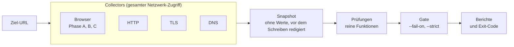

# dsgvo-check

[](https://github.com/seed-factory/dsgvo-check/actions/workflows/ci.yml)
[](LICENSE)
[](#voraussetzungen)

Passiver Scan einer Website auf DSGVO/TDDDG/DDG-Indizien und grundlegende Sicherheitsprobleme, mit Exit-Code für
CI. Der Bericht beschreibt technische Beobachtungen („beobachtet“, „nicht gefunden in …“), keine rechtliche Bewertung.

**Status:** Prototyp 0.1.0, kein Release 1.0 und noch kein npm-Paket. Der Prototyp prüft die Architektur an echten
Websites. Die Texte im Bericht sind Entwürfe
(„Textentwurf“). Lücken: [Grenzen](#grenzen).

## Inhalt

- [Was dsgvo-check tut](#was-dsgvo-check-tut)
- [Schnellstart](#schnellstart)
- [CI-Integration](#ci-integration)
- [Konfiguration](#konfiguration)
- [Was geprüft wird](#was-geprüft-wird)
- [Was der Scanner sendet](#was-der-scanner-sendet)
- [Grenzen](#grenzen)
- [Nutzungshinweise](#nutzungshinweise)
- [Entwicklung](#entwicklung)
- [Lizenz](#lizenz)

## Was dsgvo-check tut

Der Scanner öffnet die Website in Chromium (Playwright) und hält fest:

- was **vor** einer Einwilligung geladen und gespeichert wird;
- was sich nach „Ablehnen“ und nach „Alle akzeptieren“ ändert;
- ob Impressum und Datenschutzerklärung verlinkt und erreichbar sind;
- wie Sicherheits-Header, TLS und E-Mail-Authentifizierung der Domain konfiguriert sind.

Eigenschaften:

- **20 Prüfungen** zu Einwilligung, Tracking, Einbettungen, Rechtstexten, Headern, Versionsangaben, TLS und E-Mail.
- **Zehn CMP-Adapter** für verbreitete Einwilligungsbanner, siehe [Banner](#banner).
- **Keine Werte:** Cookies, Web Storage und TC-String gelangen nie in Bericht, Snapshot oder Logs, auch nicht gehasht.
- **Berichte** als JSON (mit JSON Schema), Konsole, HTML (eine Datei ohne JavaScript), Markdown-Summary und PDF.
- **CI-tauglich:** Exit-Code nach Schwelle, GitHub Action, GitLab-Template und Docker-Image.
- **Snapshots:** Rohdaten speichern und ohne Netz neu auswerten.
- **Ohne Pflichtkonfiguration:** Jeder Wert hat einen Standard; Schwellen per Umgebungsvariable oder `.env`.
- **Höflich:** Navigationen einzeln mit Pause, wenige HTTP-Anfragen, ehrlicher User-Agent mit Link zum Repository.

## Schnellstart

### Voraussetzungen

| Komponente     | Anforderung                                                                                           |
| -------------- | ----------------------------------------------------------------------------------------------------- |
| Node.js        | ≥ 26 (`.node-version`); nur diese Version wird getestet. `engine-strict` weist ältere Versionen ab.   |
| pnpm           | 12.16.1 über `corepack` (`packageManager` in `package.json`); ein globales pnpm ist nicht nötig.      |
| Chromium       | Chrome for Testing im neuen Headless-Modus (kein Headless-Shell), installiert über `playwright-core`. |
| Linux          | Systembibliotheken für Chromium: `dsgvo-check install --with-deps` (Root) oder das Docker-Image.      |
| Docker         | Optional: für Image, GitHub Action und GitLab-Template.                                               |
| Betriebssystem | Die CI läuft auf Ubuntu 24.04; lokal wird unter macOS entwickelt. Andere Systeme sind nicht getestet. |

- Node 26 liefert `corepack` nicht mehr mit: einmal `npm install --global corepack@0.36.0` (so auch CI und Image).
- Die Chromium-Sandbox braucht unprivilegierte User-Namespaces. Unter Ubuntu 24.04 schränkt AppArmor sie ein; der
  Testjob der CI setzt dafür `sudo sysctl -w kernel.apparmor_restrict_unprivileged_userns=0`. Das Docker-Image braucht
  das nicht (siehe [Isolation](#isolation)).

### Installation

Der Prototyp ist nicht auf npm; man baut ihn aus dem Quellcode.

```sh
git clone https://github.com/seed-factory/dsgvo-check.git
cd dsgvo-check
corepack pnpm install
node node_modules/playwright-core/cli.js install --no-shell chromium
corepack pnpm build
```

- `build` übersetzt TypeScript nach `dist/` und schreibt `schema/report.schema.json`, das JSON Schema des Berichts aus
  den zod-Schemas (nicht im Git).
- Der Einstiegspunkt ist `node dist/cli.js`.
- Unter Linux installiert `node dist/cli.js install --with-deps` (Root) fehlende Systembibliotheken.
- `COREPACK_ENABLE_DOWNLOAD_PROMPT=0` unterdrückt die Download-Rückfrage von corepack beim ersten Aufruf.

### Erster Scan

```sh
node dist/cli.js https://www.example.de/ --format console,json,html --out ./dsgvo-check-report
```

Ein Scan dauert meist 1–3 Minuten. In `--out` liegen danach:

| Datei                    | Wann                                           | Inhalt                                             |
| ------------------------ | ---------------------------------------------- | -------------------------------------------------- |
| `report.json`            | Format `json`                                  | Alle Befunde und Belege mit allen Feldern          |
| `report.html`            | Format `html`                                  | Bericht als eine Datei ohne JavaScript             |
| `report.pdf`             | Format `pdf`, nur ausdrücklich (`html,pdf`)    | Derselbe Bericht als PDF                           |
| `summary.md`             | Format `summary`                               | Markdown-Zusammenfassung, etwa für die Job Summary |
| `artifacts/banner-B.jpg` | Banner erkannt; `--no-screenshots` schaltet ab | Screenshot des Banners                             |

Ein Druckfehler beim PDF ergibt eine Warnzeile; Exit-Code und JSON bleiben.

### Bericht lesen

Die erste Seite von `report.html` und `report.pdf` richtet sich an die Betreiberin oder den Betreiber der Website:

- **Kopfzeile:** Zeitpunkt des Scans und Region des Netzausgangs.
- **Auf einen Blick:** was beobachtet wurde und welche Prüfungen kein abschließendes Ergebnis haben.
- **Was zu tun ist:** je Befundart eine Empfehlung.
- **Beobachtete Dienste:** wann welcher Dienst geladen wurde.

Danach folgen die Einzelheiten für Entwickler. Gleiche Anfragen, Cookies und Speichereinträge eines Befunds erscheinen
dort einmal, mit ihrer Anzahl im Auszug und der Seitenliste; Seiten, Header und Anfragen ohne Kennung einer Seite
stehen als Liste mit einer Zeile je Eintrag. `report.json` behält jeden Beleg mit allen Feldern.

Mit `--detail brief` entfallen die Einzelheiten: Der kurze Bericht besteht aus der ersten Seite und dem Hinweis.

### Bericht erneut ausgeben

Der Befehl `report` gibt einen vorhandenen JSON-Bericht ohne erneuten Scan aus:

```sh
node dist/cli.js report ./dsgvo-check-report/report.json --format html,pdf --lang de --out ./report-export
```

- Ohne Flags rendert `report` HTML auf Deutsch. `DSGVO_CHECK_REPORT_LANG` und `DSGVO_CHECK_REPORT_FORMATS` (auch aus
  `.env`) ändern diese Standardwerte, ein Flag geht vor.
- Ist `DSGVO_CHECK_REPORT_FORMATS` nicht gesetzt, bleibt es bei `html`: `console,json` ist nur der Standard eines Scans.
- `--detail full|brief` (Standard `full`, Einstellung `DSGVO_CHECK_REPORT_DETAIL`) gilt für HTML und PDF; JSON,
  Konsole und `summary.md` bleiben gleich.
- `DSGVO_CHECK_REPORT_OUT_DIR` gilt nur für Scans; `report` schreibt neben die Eingabedatei oder nach `--out`.
- Ungültiges oder fremdes JSON endet mit Exit-Code 2.

### Snapshot speichern und neu auswerten

```sh
node dist/cli.js https://www.example.de/ --save-snapshot scan.snapshot.json
node dist/cli.js --from-snapshot scan.snapshot.json --checks HDR-01,TLS-02 --format console
```

- Der Snapshot enthält die Rohdaten des Scans, ohne Cookie-, Storage- und TC-String-Werte. `*.snapshot.json` steht
  in `.gitignore`.
- Ein neu ausgewerteter Bericht nennt Zeitpunkt und Dauer der Aufnahme. Wann neu ausgewertet wurde, steht im
  ausführlichen Bericht und in `report.json` (`scan.evaluatedAt`).

## CI-Integration

- Den Scan in einem eigenen Job ohne Secrets und ohne Schreibrechte laufen lassen: Der Scanner öffnet fremde Seiten.
- GitHub Action und GitLab-Template starten das Image `ghcr.io/seed-factory/dsgvo-check:<Version>` mit der Version
  aus `package.json`.
- Eingebunden wird mit einem Versions-Tag (`@v0.1.0`), nicht mit einem Branch.

### GitHub Action

```yaml
jobs:
  dsgvo-check:
    runs-on: ubuntu-24.04
    permissions:
      contents: read
    steps:
      - uses: seed-factory/dsgvo-check@v0.1.0
        with:
          url: https://staging.example.de/
          fail-on: critical
```

| Eingabe           | Standard                                 | Bedeutung                                                                        |
| ----------------- | ---------------------------------------- | -------------------------------------------------------------------------------- |
| `url`             | – (Pflicht)                              | Ziel-URL (`http://` oder `https://`)                                             |
| `fail-on`         | `critical`                               | Schwelle: `critical`, `warning` oder `none`                                      |
| `format`          | `console,json,html`                      | Formate; PDF nur ausdrücklich (`console,json,html,pdf`)                          |
| `out`             | `dsgvo-check-report`                     | Berichtsverzeichnis, relativ zum Workspace oder absolut                          |
| `extra-args`      | leer                                     | Weitere CLI-Optionen, an Leerzeichen getrennt; Optionen der Action haben Vorrang |
| `image`           | `ghcr.io/seed-factory/dsgvo-check:0.1.0` | Scanner-Image nach Versions-Tag                                                  |
| `memory`          | `3g`                                     | Speicherlimit des Containers                                                     |
| `cpus`            | `2`                                      | CPU-Limit des Containers                                                         |
| `pids-limit`      | `1024`                                   | Prozesslimit des Containers                                                      |
| `job-summary`     | `true`                                   | Hängt die Summary an den Job an (fügt `summary` zu `format` hinzu)               |
| `upload-artifact` | `true`                                   | Lädt das Berichtsverzeichnis hoch                                                |
| `artifact-name`   | `dsgvo-check-report`                     | Name des Artefakts                                                               |
| `retention-days`  | `14`                                     | Aufbewahrung des Artefakts in Tagen                                              |

| Ausgabe                              | Inhalt                                                                        |
| ------------------------------------ | ----------------------------------------------------------------------------- |
| `exit-code`                          | `0`, `1` oder `2`                                                             |
| `json-path`, `html-path`, `pdf-path` | Pfad der Datei; leer, wenn sie fehlt (`pdf-path` auch nach einem Druckfehler) |

- Der Schritt gibt den Exit-Code des Scans weiter: Der Job schlägt bei `1` (Befunde) und `2` (Scan nicht
  durchgeführt) fehl und schreibt eine Annotation dazu.
- Der Container läuft gehärtet wie unter [Isolation](#isolation) beschrieben.
- Die Eingaben gelangen über Umgebungsvariablen in die Shell, nicht per Textersetzung in den Befehl.
- Nur berichten, ohne den Job fehlschlagen zu lassen: `fail-on: none` (nur Scan-Fehler geben Exit-Code 2) oder
  `continue-on-error: true` am Schritt und Auswertung von `steps.<id>.outputs.exit-code`. `continue-on-error` lässt auch
  Exit-Code `2` durch.

Beispiel mit absichtlich rotem Build: [examples/github-failing](examples/github-failing/README.md).

### GitLab CI

```yaml
include:
  - remote: https://raw.githubusercontent.com/seed-factory/dsgvo-check/v0.1.0/templates/gitlab/dsgvo-check.gitlab-ci.yml
    integrity: sha256-<base64-sha256-der-datei>

variables:
  DSGVO_CHECK_URL: https://staging.example.de/
```

Das [Template](templates/gitlab/dsgvo-check.gitlab-ci.yml) definiert den Job `dsgvo-check` (Stage `test`, läuft nur
bei gesetztem `DSGVO_CHECK_URL`). Den Wert für `integrity` nennt die Zusammenfassung des Release-Workflows.

| Variable                 | Standard                                 | Bedeutung                                |
| ------------------------ | ---------------------------------------- | ---------------------------------------- |
| `DSGVO_CHECK_URL`        | leer (Job läuft nicht)                   | Ziel-URL                                 |
| `DSGVO_CHECK_FAIL_ON`    | `critical`                               | Schwelle für Exit-Code 1                 |
| `DSGVO_CHECK_FORMAT`     | `console,json,html,summary`              | Ausgabeformate; ein PDF nur ausdrücklich |
| `DSGVO_CHECK_OUT`        | `dsgvo-check-report`                     | Berichtsverzeichnis                      |
| `DSGVO_CHECK_EXTRA_ARGS` | leer                                     | Weitere CLI-Optionen                     |
| `DSGVO_CHECK_IMAGE`      | `ghcr.io/seed-factory/dsgvo-check:0.1.0` | Scanner-Image nach Versions-Tag          |

- Das Berichtsverzeichnis wird bei jedem Ausgang als Artefakt gesichert (14 Tage, Zugriff ab Developer).
- Ein Befund oder Scan-Fehler lässt die Pipeline fehlschlagen (`allow_failure: false`). Wer Befunde (Exit-Code 1)
  tolerieren will, setzt am Job `allow_failure: exit_codes: [1]`.
- `entrypoint: [""]` ist nötig, weil der ENTRYPOINT des Images sonst das `script` des Jobs übernähme; die CLI liegt
  unter `/usr/local/bin/dsgvo-check`.
- Die Sandbox-Einstellung kommt aus dem Image (`container`); weitere Optionen gehen über `DSGVO_CHECK_EXTRA_ARGS`.

### Docker

Das Image enthält den Scanner samt Chromium.

```sh
docker build -t dsgvo-check:dev .
docker run --rm dsgvo-check:dev --help
```

Scan mit Bericht im aktuellen Verzeichnis:

```sh
mkdir -p dsgvo-check-report
docker run --rm --user "$(id -u):$(id -g)" --env HOME=/tmp \
  -v "$PWD/dsgvo-check-report:/out" \
  dsgvo-check:dev https://www.example.de/ --out /out --format console,json,html
```

- Ohne `--user` läuft das Image als Nutzer `10001`. Ihm muss das Ausgabeverzeichnis gehören, sonst endet der Scan
  mit Exit-Code 2 (Bericht nicht geschrieben).
- Der Container gibt den Exit-Code der CLI zurück.
- Einstellungen übergibt man mit `--env` oder `--env-file` (siehe [Einstellungen](#einstellungen)).

Gehärteter Lauf mit denselben Flags wie die GitHub Action:

```sh
docker run --rm \
  --user "$(id -u):$(id -g)" \
  --cap-drop=ALL --security-opt no-new-privileges \
  --read-only --tmpfs /tmp:rw,nosuid,nodev,size=1g --env HOME=/tmp \
  --memory=3g --memory-swap=3g --cpus=2 --pids-limit=1024 --shm-size=512m \
  --volume "$PWD/dsgvo-check-report:/out" \
  dsgvo-check:dev https://www.example.de/ --out /out --format console,json,html,summary
```

### Isolation

Im Image ist der Container die Sandbox:

- Nicht-Root-Nutzer, keine Linux-Capabilities, `no-new-privileges`, Dockers Standard-seccomp-Profil.
- Schreibgeschütztes Dateisystem (außer `/tmp` und `/out`) und Ressourcenlimits.
- Kein `docker.sock`, kein Workspace, keine Secrets; der Container lebt nur für die Dauer eines Scans.

Chromium startet deshalb ohne eigene Sandbox, mit `--sandbox container` (im Image gesetzt über
`DSGVO_CHECK_BROWSER_SANDBOX=container`).

- Das ist kein Warnfall wie `--sandbox off`: Der Bericht trägt den Modus `container`, es gibt weder
  `SCAN-SANDBOX-OFF` noch `strict:sandbox-off`.
- Außerhalb des Images ist `container` ungültig (Exit-Code 2); dort bleibt die Chromium-Sandbox der Standard.
- Das Image aktuell halten: Das festgelegte Chrome bekommt Sicherheitskorrekturen nur mit Aktualisierungen von
  `playwright-core`.

## Konfiguration

### Optionen

Vollständig: `dsgvo-check --help`. Befehle: Scan (Standard), `report <report.json>` und `install [--with-deps]`.

| Option                              | Standard                       | Bedeutung                                                                                                        |
| ----------------------------------- | ------------------------------ | ---------------------------------------------------------------------------------------------------------------- |
| `--fail-on critical\|warning\|none` | `critical`                     | Schwelle für Exit-Code 1                                                                                         |
| `--format <liste>`                  | `console,json`                 | Ausgabeformate: `console`, `json`, `html`, `summary`, `pdf` (PDF nur ausdrücklich)                               |
| `--out <dir>`                       | `./dsgvo-check-report`         | Ausgabeverzeichnis                                                                                               |
| `--max-pages <n>`                   | `6`                            | Seiten in Phase A                                                                                                |
| `--timeout <dauer>`                 | `8m`                           | Globales Zeitlimit, z. B. `8m` oder `90s`                                                                        |
| `--assume-region eea\|de`           | nicht gesetzt                  | Standort des Scanners laut Nutzerangabe                                                                          |
| `--proxy <url>`                     | kein Proxy                     | HTTP-Proxy (nur `http://`, CONNECT) für Browser, HTTP und TLS; DNS läuft direkt                                  |
| `--strict`                          | aus                            | Nicht eindeutige Ergebnisse, `--sandbox off` und ungeprüfte Region führen zu Exit-Code 2                         |
| `--sandbox require\|off\|container` | `require` (Image: `container`) | Chromium-Sandbox; `off` nur bewusst, im Bericht als `SCAN-SANDBOX-OFF` vermerkt; `container` nur im Docker-Image |
| `--no-screenshots`                  | aus                            | Keine Banner-Screenshots                                                                                         |
| `--save-snapshot <file>`            | –                              | Rohdaten speichern                                                                                               |
| `--from-snapshot <file>`            | –                              | Snapshot ohne Netz neu auswerten (die URL entfällt)                                                              |
| `--checks <ids>`                    | alle                           | Nur diese Prüfungen, z. B. `EMBED-01,HDR-01`                                                                     |
| `--lang de\|en`                     | `de`                           | Sprache des Berichts                                                                                             |
| `--detail full\|brief`              | `full`                         | HTML und PDF: `full` mit Belegen für Entwickler, `brief` kurz, mit Handlungsempfehlungen für Betreiber           |
| `--verbose`                         | aus                            | Ausführliche Logs auf stderr                                                                                     |

### Einstellungen

Der Scanner läuft ohne Konfiguration. Schwellen, Zeitlimits und Grenzen lassen sich über Umgebungsvariablen der Form
`DSGVO_CHECK_<ABSCHNITT>_<NAME>` ändern, etwa `DSGVO_CHECK_BROWSER_QUIET_WINDOW_MS` oder
`DSGVO_CHECK_TLS_EXPIRING_DAYS`. Die Einheit steht im Namen: `_MS` Millisekunden, `_BYTES` Bytes, `_DAYS` Tage, `_PX`
CSS-Pixel, `_BITS` Bit.

- **Alle Einstellungen** mit Standardwert und Beschreibung: [.env.example](.env.example).
- **`.env`:** nicht nötig; liegt im aktuellen Verzeichnis eine, wird sie gelesen. Nur `DSGVO_CHECK_*` zählt; andere
  Einträge bleiben unberührt und gelangen nicht in die Umgebung von Chromium.
- **Vorrang:** Flag, Umgebungsvariable, `.env`, Standardwert. `.env` überschreibt keine gesetzte Umgebungsvariable.
- **Ungültige Werte** enden mit Exit-Code 2 (`invalid-config`) und nennen Variable, Quelle und Grund in der Sprache
  von `--lang`.
- **Abweichungen** von den Standardwerten stehen im Bericht unter „Abweichende Einstellungen“ (ohne Proxy-URL).
- **Docker und Action:** Im Image und in der GitHub Action gelangen nur `HOME` und `NO_COLOR` in den Container. Beim
  eigenen `docker run` übergibt man Einstellungen mit `--env` oder `--env-file`:

```sh
docker run --rm --env HOME=/tmp --env DSGVO_CHECK_BROWSER_QUIET_WINDOW_MS=3000 \
  --env-file scan.env dsgvo-check:dev https://www.example.de/ --out /out
```

Drei Werte lassen sich nur verlängern, damit der Scanner höflich bleibt:

| Variable                                  | Mindestwert | Bedeutung                                                  |
| ----------------------------------------- | ----------- | ---------------------------------------------------------- |
| `DSGVO_CHECK_BROWSER_NAVIGATION_PAUSE_MS` | 1500        | Pause zwischen zwei Navigationen                           |
| `DSGVO_CHECK_BROWSER_RETRY_DELAY_MS`      | 3000        | Pause vor dem einen Wiederholungsversuch nach 429 oder 5xx |
| `DSGVO_CHECK_HTTP_MIN_INTERVAL_MS`        | 500         | Abstand zwischen zwei Anfragen an denselben Host           |

### Exit-Codes

| Code | Bedeutung                                                                                                  |
| ---- | ---------------------------------------------------------------------------------------------------------- |
| `0`  | Kein Befund erreicht die Schwelle `--fail-on`.                                                             |
| `1`  | Mindestens ein Befund erreicht die Schwelle, auch wenn andere Prüfungen fehlschlugen.                      |
| `2`  | Scan nicht durchgeführt, eine für die Schwelle relevante Prüfung fehlgeschlagen oder ein `--strict`-Grund. |

- **Vorrang:** Scan nicht durchgeführt (`2`) vor Befund (`1`) vor Prüfungsfehler oder `--strict` (`2`) vor `0`.
- Ließ sich ein angeforderter Bericht nicht schreiben (`report-write-failed`), gilt `2`, auch bei einem Befund.
- `check-error` und die `strict`-Gründe ergeben nur ohne `threshold` Exit-Code `2`; sonst gilt `1`.
- Mit `--fail-on none` entfallen `threshold` und `check-error`; `--strict` wirkt davon unabhängig.
- Ein Fehler bei der optionalen PDF-Ausgabe ändert den Exit-Code nicht.

Alle zutreffenden Gründe stehen in `report.json` unter `summary.exitReasons`, nicht nur der entscheidende:

| Grund                      | Bedeutung                                                                                                      | Exit |
| -------------------------- | -------------------------------------------------------------------------------------------------------------- | ---- |
| `threshold`                | Ein Befund erreicht `--fail-on`.                                                                               | 1    |
| `unreachable`              | Ziel nicht erreichbar (DNS, Verbindung, Zeitüberschreitung oder 5xx der Startseite).                           | 2    |
| `blocked`                  | WAF, Challenge oder 403 auf der Startseite.                                                                    | 2    |
| `timeout`                  | Globales Zeitlimit vor Ende von Phase A der Startseite, oder eine relevante Prüfung wurde dadurch abgebrochen. | 2    |
| `sandbox-unavailable`      | Die Chromium-Sandbox startete nicht (`--sandbox require`).                                                     | 2    |
| `invalid-input`            | Ungültige Argumente, Einstellungen oder URL; Zieladresse nicht öffentlich; Browser fehlt.                      | 2    |
| `internal-error`           | Interner Fehler, Abbruch durch SIGINT/SIGTERM oder Watchdog.                                                   | 2    |
| `report-write-failed`      | Ein angeforderter Bericht ließ sich nicht schreiben; bereits geschriebene Dateien bleiben.                     | 2    |
| `check-error:<ID>`         | Eine relevante Prüfung endete mit Status `error`.                                                              | 2    |
| `strict:inconclusive:<ID>` | Nur mit `--strict`: Eine relevante Prüfung war nicht eindeutig.                                                | 2    |
| `strict:sandbox-off`       | Nur mit `--strict`: `--sandbox off`.                                                                           | 2    |
| `strict:egress-unverified` | Nur mit `--strict`: Standort ungeprüft (kein `--assume-region`) bei aktiven CONSENT-Prüfungen.                 | 2    |

## Was geprüft wird

| ID         | Beobachtung                                                                                                       |
| ---------- | ----------------------------------------------------------------------------------------------------------------- |
| CONSENT-01 | Anfragen an Dritte und Tracking-Hits vor einer Interaktion mit dem Banner                                         |
| CONSENT-02 | Cookies und Web Storage vor Interaktion (Namen, Flags, Laufzeit; **keine Werte**)                                 |
| CONSENT-03 | Tracking ohne erkennbares Einwilligungsbanner                                                                     |
| CONSENT-04 | Erste Banner-Ebene: „Ablehnen“ gleichrangig zu „Akzeptieren“?                                                     |
| CONSENT-05 | Was nach einem bestätigten „Ablehnen“ weiter gesendet oder gespeichert wird                                       |
| TRACK-01   | Dienste-Inventar je Zeitpunkt: vor Interaktion, nach Ablehnung, nach Zustimmung                                   |
| EMBED-01   | Schriften von Drittservern (z. B. Google Fonts)                                                                   |
| EMBED-02   | Karten (z. B. Google Maps) ohne Zwei-Klick-Lösung                                                                 |
| EMBED-03   | Videos und Vorschaubilder (z. B. YouTube, Vimeo) ohne Zwei-Klick-Lösung                                           |
| LEGAL-01   | Impressum und Datenschutzerklärung: verlinkt, erreichbar, nicht vom Banner verdeckt                               |
| LEGAL-02   | Bezeichnungen früherer Rechtslage im Text (z. B. TMG, RStV, TTDSG, Privacy Shield)                                |
| PRIV-01    | Werden beobachtete Dienste in der Datenschutzerklärung genannt?                                                   |
| PRIV-02    | Angaben der Datenschutzerklärung (z. B. „Fonts lokal“) im Abgleich mit den Anfragen                               |
| HDR-01     | Sicherheits-Header: HSTS, CSP, Einbettungsschutz, `nosniff`, Referrer-/Permissions-Policy                         |
| HDR-02     | Softwareversionen in Headern wie `Server` und `X-Powered-By`                                                      |
| TLS-01     | Umleitung von http auf https; Formulare auf http-Seiten, auch verlinkter Beiträge; Links auf eigene http-Adressen |
| TLS-02     | Zertifikat: gültig, vollständige Kette, Restlaufzeit relativ zur Gesamtlaufzeit                                   |
| MAIL-01    | DMARC-Eintrag und Richtlinie, auch der Zieldomain und der E-Mail-Domains im Impressum                             |
| MAIL-02    | SPF-Eintrag (statisch ausgewertet), zusammen mit DMARC derselben Domain                                           |
| MAIL-03    | DKIM-Schlüssel auf den geprüften Selektoren und ihre RSA-Länge, je E-Mail-Domain                                  |

### Varianten

Jede Prüfung kann mehrere Varianten melden; die Meldungs-ID eines Befunds ist `<Prüfung>.<Variante>`.

- Die Tabelle zeigt den Standard-Schweregrad jeder Variante. Sie wird aus `test/data/ruleset` erzeugt.
- Mittlere Konfidenz begrenzt einen Befund auf `warning`, niedrige auf `info`.
- **(fest)** heißt `locked`: Die Variante wird nicht angehoben und zählt nicht für `--fail-on`; die Prüfung bleibt
  `inconclusive`.

<!-- registry:begin: generated from test/data/ruleset by `corepack pnpm registry`, do not edit -->
| ID           | `critical`                                                          | `warning`                                                                                                               | `info`                                                                                                              |
| ------------ | ------------------------------------------------------------------- | ----------------------------------------------------------------------------------------------------------------------- | ------------------------------------------------------------------------------------------------------------------- |
| `CONSENT-01` | `tracking-completed`                                                | `library-loaded`, `first-party-proxy`, `cookieless-ping`                                                                | `third-party-resource`, `unknown-host`, `request-not-completed`                                                     |
| `CONSENT-02` | `tracking-identifier-stored`                                        | `unknown-third-party-persistent`                                                                                        | `unknown-first-party-persistent`, `cmp-cookie-with-uid`, `storage-rejected-or-attempted`                            |
| `CONSENT-03` | `no-banner-strong-tracking`                                         | `no-banner-consent-services`                                                                                            | —                                                                                                                   |
| `CONSENT-04` | `blocking-no-reject`, `close-means-accept`, `nonblocking-no-reject` | `reject-not-actionable`, `reject-ineffective`, `consent-without-action`                                                 | `reject-as-link`, `no-choice-at-first-layer`, `pur-abo`, `banner-not-recognized` (fest), `cmp-not-supported` (fest) |
| `CONSENT-05` | `tracking-after-reject`                                             | `cookieless-ping-after-reject`                                                                                          | `connect-only-after-reject`                                                                                         |
| `TRACK-01`   | —                                                                   | —                                                                                                                       | `service-inventory`                                                                                                 |
| `EMBED-01`   | —                                                                   | `fonts-loaded`, `fonts-in-embed-frame`                                                                                  | `preconnect-only`                                                                                                   |
| `EMBED-02`   | —                                                                   | `maps-loaded`                                                                                                           | —                                                                                                                   |
| `EMBED-03`   | —                                                                   | `video-loaded`                                                                                                          | —                                                                                                                   |
| `LEGAL-01`   | `document-not-found`, `links-broken`                                | `provider-details-without-link`, `link-missing-on-some-pages`, `reachable-via-intermediate`, `footer-covered-by-banner` | `unresolved`                                                                                                        |
| `LEGAL-02`   | —                                                                   | —                                                                                                                       | `outdated-reference`                                                                                                |
| `PRIV-01`    | —                                                                   | `not-named`                                                                                                             | `category-only`, `ambiguous-match`, `named-in-cmp-only`                                                             |
| `PRIV-02`    | `contradiction-replicated`                                          | `contradiction-single`                                                                                                  | `wording-to-review`                                                                                                 |
| `MAIL-01`    | —                                                                   | `record-not-found`, `policy-none`, `record-invalid`                                                                     | `weak-option`, `legacy-pct`                                                                                         |
| `MAIL-02`    | —                                                                   | `record-not-found`, `permissive-qualifier`, `record-invalid`, `softfail-without-enforcement`                            | `softfail-with-enforcement`, `ptr-mechanism`                                                                        |
| `MAIL-03`    | —                                                                   | `key-too-short`, `given-selector-missing`                                                                               | `selectors-not-found`                                                                                               |
| `HDR-01`     | —                                                                   | `hsts-missing`, `anti-framing-missing`, `referrer-policy-permissive`                                                    | `header-missing`                                                                                                    |
| `HDR-02`     | —                                                                   | —                                                                                                                       | `version-header`                                                                                                    |
| `TLS-01`     | `https-unavailable`, `form-on-http-page`                            | `no-redirect`, `client-side-redirect-only`, `internal-http-link`                                                        | `redirect-chain-detail`, `internal-http-link-upgraded`                                                              |
| `TLS-02`     | `certificate-invalid`                                               | `chain-incomplete`, `certificate-expiring`                                                                              | `certificate-expiry-approaching`                                                                                    |
<!-- registry:end -->

### Geplante Prüfungen

Diese Prüfungen sind spezifiziert, aber noch nicht umgesetzt. Die Tabelle nennt die geplanten Varianten.

| ID                   | Thema                                      | `critical`                      | `warning`                                                                    | `info`                                              | Ohne Befund (`reason`)   |
| -------------------- | ------------------------------------------ | ------------------------------- | ---------------------------------------------------------------------------- | --------------------------------------------------- | ------------------------ |
| `EMBED-04`           | CAPTCHA                                    | —                               | `captcha-without-form`                                                       | `captcha-with-form`                                 | —                        |
| `EMBED-05`           | Widgets                                    | —                               | `widget-loaded`                                                              | —                                                   | —                        |
| `CONSENT-06`         | Consent Mode                               | `google-granted-despite-denied` | `default-granted`, `hit-before-default`                                      | —                                                   | `not-observable`         |
| `VULN-01`, `VULN-02` | CMS-Kern; Plugins, Themes und Bibliotheken | `version-listed-kev-or-preauth` | `version-listed`, `eol-major`                                                | `version-unknown`                                   | `source-unavailable`     |
| `TLS-03`             | Mixed Content                              | —                               | `active-mixed-content-blocked`, `passive-upgrade-failed`, `form-action-http` | `passive-auto-upgraded`                             | —                        |
| `TLS-04`             | TLS 1.0/1.1                                | —                               | `legacy-protocol-accepted`                                                   | —                                                   | `handshake-inconclusive` |
| `DNS-01`             | CAA und DNSSEC                             | —                               | `dnssec-bogus`                                                               | `caa-not-found`, `dnssec-unsigned`                  | —                        |
| `HDR-02`             | Cookie-Attribute                           | —                               | `session-cookie-attributes`                                                  | `cookie-attributes`, `cookie-samesite-missing`      | —                        |
| `ADMIN-01`           | Öffentliche WordPress-Angaben              | —                               | `users-and-xmlrpc-exposed`                                                   | `partial-exposure`                                  | —                        |
| `FILE-01`            | Dienstdateien                              | `sensitive-signature`           | `exposed-file`                                                               | `minor-file`                                        | —                        |
| `SEC-01`             | `security.txt`                             | —                               | —                                                                            | `security-txt-not-found`, `security-txt-incomplete` | —                        |
| `BFSG-01`            | Automatische Zugänglichkeitssignale        | —                               | —                                                                            | `axe-rule-observed`                                 | —                        |
| `PERF-01`            | Performance im Labor                       | —                               | —                                                                            | `lab-metrics`                                       | —                        |

- **VULN-01, VULN-02:** Die Stufen gelten bei exakt bestimmter Version; bei einem Versionsbereich liegt jede Variante
  eine Stufe niedriger.
- **ADMIN-01, FILE-01:** nur auf ausdrücklichen Wunsch (Opt-in); der Prototyp sendet solche Anfragen nicht.
- **BFSG-01, PERF-01:** zählen nicht für `--fail-on` (`gating: false`).

### Ablauf eines Scans



- Nur die Collectors greifen aufs Netz zu. Sie entfernen sensible Werte, bevor etwas in den Snapshot gelangt.
- Die Prüfungen sind reine Funktionen über dem Snapshot. Schweregrade, Varianten und Texte liegen als Daten in
  `test/data`, nicht im Code.
- Das Gate bestimmt aus den Befunden den Exit-Code.
- Aufbau des Codes: [docs/architecture.md](docs/architecture.md) (auf Russisch).

Im Browser laufen drei Phasen, jede mit einem frischen Profil in einem temporären Verzeichnis:

| Phase | Aktion                                                                                | Seiten                                                                                    |
| ----- | ------------------------------------------------------------------------------------- | ----------------------------------------------------------------------------------------- |
| A     | Ohne Interaktion beobachten                                                           | Startseite, Impressum, Datenschutzerklärung, Kontakt und weitere Seiten bis `--max-pages` |
| B     | „Ablehnen“ über den CMP-Adapter klicken, Zustand prüfen, Startseite neu laden, prüfen | Startseite und bis zu 2 Kontrollseiten (`DSGVO_CHECK_BROWSER_MAX_CONTROL_PAGES`, 0 bis 5) |
| C     | „Alle akzeptieren“ klicken                                                            | Dieselben Kontrollseiten                                                                  |

### Seiten in Phase A

- **Budget:** `--max-pages` (Standard 6) begrenzt die Seitenzahl in Phase A. Die weiteren Seiten bekommen, was nach
  Startseite, Impressum, Datenschutzerklärung, Kontakt- und Zwischenseiten übrig bleibt, beim Standard also 2. Eine
  gemeinsame Seite für Impressum und Datenschutzerklärung zählt einmal.
- **Rechtstexte** werden unabhängig vom Budget besucht. Fehlt der Link, probiert der Scanner `/impressum` und
  `/datenschutz`; diese Aufrufe zählen an Stelle der verlinkten Seite.
- **Weitere Seiten** kommen aus den Links der Startseite: zuerst je Gruppe von Stichwörtern höchstens eine Seite, in
  dieser Reihenfolge: Video, Anfahrt und Standort, Geschichte, Über uns, Team, Karriere, Referenzen, Termin, Blog und
  News, Newsletter, Shop, Galerie, Leistungen und Produkte (Liste: `test/data/browser/pages.yaml`). Zwei Seiten
  desselben Bereichs (`/unternehmen/geschichte`, `/unternehmen/team`) dürfen aus verschiedenen Gruppen kommen. Reicht
  das nicht, folgen Links der Navigation und Einträge der Sitemap, je URL-Bereich eine Seite.
- **Andere Sprachversionen** sind nie weitere Seiten: ein anderes Sprachpräfix als das der Startseite (`/en/` neben
  `/de/`), ein Sprachumschalter („EN“, „English“, eine Flagge ohne Text auf `/en/`), ein `hreflang` einer anderen
  Sprache.
- **Das eigene Sprachpräfix** zählt nicht als Bereich: Auf einer Startseite `/de/` bleiben `/de/kontakt/anfahrt/` und
  `/de/unternehmen/geschichte/` wählbar, ebenso auf einer Startseite ohne Präfix mit `lang="de"`, deren Umschalter
  „DE“ nach `/de/` führt.
- **Links auf Rechtstexte:** Die Sprache der Startseite geht vor; eine andere Sprachversion wird nur gewählt, wenn die
  Website keine andere verlinkt.

Weitere Datenschutzhinweise:

- Verlinkt die Seite mit dem Link auf die Datenschutzerklärung weitere Datenschutzhinweise der Website (etwa
  „Datenschutz Kurse“ oder „Datenschutzhinweise Bewerbung“ im Seitenfuß), liest der Scanner danach bis zu einen davon
  (`DSGVO_CHECK_BROWSER_MAX_SUPPLEMENTARY_POLICIES`, 0 bis 3), den am besten passenden Link zuerst.
- Es zählt nur ein Link, dessen Text ein Datenschutzwort ist oder damit beginnt und der nicht im Inhaltsbereich oder
  einer Seitenleiste steht: Ein Artikel über Datenschutz ist kein Hinweis der Website.
- Diese Aufrufe zählen wie die Rechtstexte nicht gegen `--max-pages`, halten aber die Pause zwischen Navigationen und
  das Zeitbudget ein.
- Andere Sprachversionen der Datenschutzerklärung (`/en/datenschutz/` hinter „EN“) werden nur vermerkt, nicht
  aufgerufen, auch wenn die Seite der eigenen Sprache nicht als Datenschutzerklärung bestätigt wurde.
- Links auf Einstellungsdialoge („Datenschutz-Einstellungen“) bleiben unberührt.

Fehlt der Link auf das Impressum, liest der Scanner die ohnehin geöffneten Seiten mit: Startseite, Kontaktseite und
Zwischenseiten wie „Über uns“. Dafür gibt es keine zusätzlichen Seitenaufrufe.

- Weisen die Überschriften im Inhalt einer Kontakt- oder Zwischenseite sie als Impressum aus, gilt das Impressum als
  über diese Seite gefunden.
- Sonst bleibt ihr Text für LEGAL-01, das darin nach Angaben eines Impressums sucht (Registereintrag, USt-IdNr.,
  Vertretungsberechtigte, § 5 DDG, § 18 Abs. 2 MStV).

### Auf jeder Seite

- **Wartezeit:** Jede Seite bleibt mindestens 6 s (Phase A) bzw. 4 s (B und C) offen, bis der Netzverkehr ruhig ist;
  Obergrenzen 20 s bzw. 12 s.
- **Erster Bildschirm zuerst:** Banner, Screenshot, Links und Rechtstexte werden festgestellt, bevor das Fenster
  vergrößert wird.
- **Unterhalb des ersten Bildschirms:** Danach vergrößert der Scanner das Fenster auf die Höhe der Seite, höchstens auf
  10 000 Pixel (`DSGVO_CHECK_BROWSER_REVEAL_MAX_HEIGHT_PX`), wartet bis zu 3 s auf ruhigen Netzverkehr
  (`DSGVO_CHECK_BROWSER_REVEAL_DWELL_MS`, 0 schaltet das ab) und stellt das Fenster vor der nächsten Navigation zurück.
  So laden Karten, Videos und andere Inhalte wie bei einem Besucher, der nach unten scrollt.
- **Gescrollt wird nicht:** Die Seite erhält kein Scroll-, Maus- oder Tastaturereignis. Phase A bleibt ohne
  Interaktion, und ein Banner, das Scrollen als Einwilligung wertet, wird nicht ausgelöst.
- In B und C geschieht das auf der Startseite erst nach dem Klick (in B auf der neu geladenen Seite), danach auf den
  Kontrollseiten.
- Seiten, die ins Fenster passen, sich nicht scrollen lassen (etwa unter einem blockierenden Banner) oder selbst nach
  unten gescrollt haben, bleiben, wie sie sind.
- Anfragen nach dem Vergrößern tragen in `report.json` `afterReveal: true`.

### Kontrollseiten in Phase B und C

- **Auswahl:** Seiten aus Phase A mit eingebetteten Inhalten: iframes und Platzhalter von Drittanbietern, neue Hosts
  gegenüber der Startseite. Karten, Videos (auch Vorschaubilder), Schriften und Widgets aus dem Dienstekatalog zählen
  mehr als unbekannte Hosts.
- **Nicht gezählt:** iframes von Einwilligungsanbietern und iframes ganz außerhalb der Seite (etwa ein
  4×4-Hilfsframe bei −9999 px).
- **Ursprung:** Seiten auf dem Ursprung der Startseite, auf der B und C klicken, gehen vor, weil ein
  Einwilligungs-Cookie dieses Hosts auf einem anderen Host nicht gilt. Seiten eines anderen Ursprungs kommen nur zum
  Zug, wenn keine Seite des Ursprungs übrig ist, und tragen im Plan den Grund `other-origin`.
- **Gilt die Entscheidung?** Das liest der Scanner auf jeder Kontrollseite am Banner ab. Zeigt es sich erneut oder
  liegt ihm keine Antwort vor (etwa weil das Cookie der Antwort nur für den Host der Startseite gilt und die
  Kontrollseite auf `www` liegt), zählen CONSENT-05 und TRACK-01 die Seite nicht als Seite nach Ablehnung bzw.
  Zustimmung. Was sie sendet oder speichert, gilt dann nicht als Befund nach der Ablehnung, und die Seite gilt nicht als
  ausgewertet (Einschränkung `reject-not-in-effect` bzw. `accept-not-in-effect`, Status `partial`).
- Eine Seite auf einem anderen Host, die die gespeicherte Antwort liest (Cookie für die ganze Domain), zählt.

### Abbruch und fehlende Phasen

- Phase C entfällt, wenn Phase B keinen Adapter erkannt hat.
- B und C entfallen, wenn der Zielhost drosselt (429/503) oder das Zeitbudget erschöpft ist.
- Wird das globale Zeitlimit nach der Startseite erreicht, bleiben die Beobachtungen im Bericht. Nicht ausgeführte
  Phasen gelten als abgeschnitten, Prüfungen ohne Daten enden mit Status `error` (`timeout`).

Sperrt Bot-Schutz eine weitere Seite (`SCAN-BLOCKED`) oder drosselt der Zielhost (`SCAN-THROTTLED`), nennt der Bericht
die Prüfungen, denen dadurch Beobachtungen fehlen:

| Fall                                                    | Betroffene Prüfungen                                                                                                                |
| ------------------------------------------------------- | ----------------------------------------------------------------------------------------------------------------------------------- |
| Gesperrte Seite                                         | die Prüfungen, die Seiten ihrer Art lesen (die Datenschutzerklärung etwa LEGAL-01, LEGAL-02, PRIV-01, PRIV-02)                      |
| Gesperrte Seite in Phase A                              | zusätzlich TLS-01, das die Links jeder Seite liest                                                                                  |
| Gesperrtes Impressum                                    | zusätzlich MAIL-01 bis MAIL-03, die die E-Mail-Domains des Impressums abfragen                                                      |
| Gesperrte Seite, die Phase A für einen Rechtstext liest | auch dessen Prüfungen: Impressum LEGAL-01, LEGAL-02, MAIL-01 bis MAIL-03; Datenschutzerklärung LEGAL-01, LEGAL-02, PRIV-01, PRIV-02 |
| Drosselung in Phase A                                   | die Browser-Prüfungen, TLS-01 und MAIL-01 bis MAIL-03                                                                               |

„Für einen Rechtstext lesen“ meint eine Seite, die beides ist (Datenschutzerklärung und Impressum), und Kontakt- und
Zwischenseiten, solange ein Rechtstext fehlt.

### Abgelehntes Zertifikat der Ziel-URL

Nimmt die TLS-Prüfung das Zertifikat der Ziel-URL nicht als gültig an, ruft der Browser sie nicht auf.

- **Ausweichen:** Leitet die unverschlüsselte Adresse (`http://`, Standardport) auf einen anderen Host weiter und
  wurde jedes Zertifikat auf diesem Weg als gültig angenommen, laufen die Phasen A, B und C dort, mit derselben
  Prüfung der Zertifikate wie sonst. Der Bericht nennt das (`SCAN-TLS-FALLBACK`, in `report.json` unter
  `scan.entry`); TLS-02 meldet weiterhin das Zertifikat der Ziel-URL.
- **Kein Ausweichen:** wenn eine Weiterleitung über ein abgelehntes Zertifikat läuft, `http://` die Seite selbst
  ausliefert oder auf HTTPS desselben Hosts weiterleitet, oder die Ziel-URL einen Port oder eine IP-Adresse nennt.
  Die Browser-Prüfungen entfallen dann; `SCAN-TLS-BLOCKED` nennt den Grund.
- **Ausweichen scheitert:** Liefert der Browser dort keine auswertbare Seite (Challenge, Fehlerstatus, Zeitlimit) oder
  kommt er nicht bis dorthin, entfallen die Browser-Prüfungen wie ohne den Versuch (`tls-fallback-failed`); der Scan
  schlägt deshalb nicht fehl.
- **Bot- oder WAF-Schutz** am Ziel der Weiterleitung nennen Übersicht, `SCAN-TLS-BLOCKED`
  (`fallback: bot-protection`), Konsole und Zusammenfassung mit den Bezeichnungen seiner Signale (etwa
  `header:x-vercel-mitigated`); umgangen wird er nicht. Ein Status 403 allein ist kein solches Signal und bleibt beim
  allgemeinen Text.
- **Hinter `--proxy`** ist das Urteil über die Zertifikate unbekannt; der Browser wechselt dann nicht.
- **Ohne TLS-02** (`--checks`) wird das Zertifikat nicht vorab geprüft: Der Browser ruft die Ziel-URL auf und bricht
  beim Zertifikat ab, ohne Fortsetzung.
- `DSGVO_CHECK_SCAN_TLS_FALLBACK=off` schaltet das Ausweichen ab.

### Banner

Eigene Adapter gibt es für Borlabs, Cookiebot, Complianz, Usercentrics, CCM19, Real Cookie Banner und CookieHub sowie
für die eingebauten Banner von Shopware 6, Wix und der TYPO3-Erweiterung cookieman. Geklickt wird nur über sie.

Erkennung:

- CONSENT-04 bewertet oberhalb von `info` nur bei Erkennung mit hoher Konfidenz.
- Shopware und Wix gelten nur mit ihrem Banner (oder dem Banner-Skript von Wix) als erkannt, nicht allein durch die
  Kennungen der Plattform.
- Findet der erste passende Container-Selektor eines Adapters nur verborgene Elemente, zählt ein späterer, wenn sein
  Element eine sichtbare Schaltfläche oder einen sichtbaren Link zeigt. Eine verborgene Vorlage verdeckt so nicht den
  offenen Dialog, und ein Rahmen, von dem bei geschlossenem Banner nur der eigene Kasten zu sehen ist, gilt nicht als
  Banner.
- Ein anderes Banner wird nur heuristisch erkannt: CONSENT-04 meldet `info` „Banner nicht erkannt“ (Status
  `inconclusive`), der Scanner klickt nicht.
- Ein Banner zeigt sich auf jeder Seite, bis der Besucher antwortet. Was die Heuristik nur auf einer Unterseite findet
  (ein festes Inhaltsverzeichnis der Datenschutzerklärung, eine eingebettete Datenschutzerklärung), gehört zu dieser
  Seite und ist kein Banner. Es zählt auf der Startseite oder auf mindestens zwei Seiten
  (`DSGVO_CHECK_CMP_MIN_CANDIDATE_PAGES`).
- Was der Besucher nicht sieht (verdeckt, abgeschnitten, durchsichtig oder in einem verborgenen iframe), zählt nicht.

Beobachtet, aber nicht erkannt: Die Heuristik sieht einen bannerähnlichen Kasten mit einem Einwilligungswort (auf der
Seite oder in einem iframe, das auf dem ersten Bildschirm sichtbar ist) und wertet ihn nicht als Banner. Dann schließt
CONSENT-03 nicht auf „kein Einwilligungsbanner“, wenn der Kasten eines davon hat:

- einen Bannernamen;
- eine Ablehnen- oder Annehmen-Schaltfläche;
- ein Cookie-Wort und eine Schaltfläche, die das Lexikon kennt (etwa Einstellungen oder Speichern);
- als fester Kasten oder Dialog ein Cookie-Wort und ein weiteres Einwilligungswort, auch wenn das Lexikon seine
  Schaltflächen nicht lesen kann.

Ein Cookie-Wort zählt nur unverneint („Wir verwenden keine Cookies“ zählt nicht). Ein Kasten im Kopf- oder Fußbereich
der Seite ohne Ablehnen- oder Annehmen-Schaltfläche zählt nicht.

CONSENT-03 bleibt dann `inconclusive`, CONSENT-04 meldet `info` „Banner nicht erkannt“, und die Befundtexte nennen das
Banner „beobachtet, aber nicht erkannt“. Ein bloßes „OK“ oder „Verstanden“ unter einem Versand- oder
Datenschutzhinweis ist keine solche Schaltfläche.

Fehlende Ablehnung auf der ersten Ebene:

- Bietet ein erkanntes Banner „Zustimmen“, aber keine Ablehnung, meldet CONSENT-04 `critical`: `blocking-no-reject`,
  wenn das Banner die Seite blockiert, sonst `nonblocking-no-reject` (etwa nur „Cookie-Einstellungen“ und
  „Zustimmen“).
- Eine Schließen-Schaltfläche (×) zählt nie als Ablehnen.
- Kennt der Adapter die Einstellungsebene, lehnt der Scanner dort ab (siehe unten); CONSENT-04 bewertet weiter die
  erste Ebene.
- Sonst klickt er im Besuch mit Ablehnung nichts, und CONSENT-05 bleibt `inconclusive`. Wurden die Einstellungen
  geöffnet, aber nicht gespeichert, steht der Grund als Einschränkung dabei.

Ablehnen über die Einstellungen (bisher nur Wix, `settingsLayer` in `test/data/cmp/adapters.yaml`):

- Voraussetzung: Die erste Ebene eines mit hoher Konfidenz erkannten Banners bietet keine Ablehnung.
- Der Scanner klickt die Einstellungsschaltfläche des Banners und liest in der Einstellungsebene die Schalter der
  Kategorien, auch optisch verborgene. Die erste Ebene, die bei Wix dahinter offen bleibt, liest er dabei nicht.
- Die Speichern-Schaltfläche des Anbieters (bei Wix „Auswahl bestätigen“) klickt er nur, wenn
  - jede Kategorie, die der Besucher umstellen kann, schon ausgeschaltet ist,
  - kein gesperrter Schalter außer dem für die erforderliche Verarbeitung des Anbieters eingeschaltet ist (bei Wix
    einer, `essentialGroups`) und
  - genau eine solche Schaltfläche des Anbieters zu sehen ist.
- Schalter stellt er nie um. Ist eine Kategorie schon eingeschaltet, klickt er nichts mehr (`preselected-groups`).
- Der Zeitpunkt der Ablehnung ist das Speichern: Was lädt, während die Einstellungen offen sind, zählt als vor der
  Ablehnung. Danach folgen wie sonst die Prüfung des Zustands, das Neuladen und die Kontrollseiten.
- Die Befunde nennen die Ablehnung „über die Einstellungen“.

Welche Schaltfläche als Ablehnen oder Annehmen gilt:

| Beschriftung                                                                                                                     | Ablehnen                                                                                                                     | Annehmen |
| -------------------------------------------------------------------------------------------------------------------------------- | ---------------------------------------------------------------------------------------------------------------------------- | -------- |
| Abo- oder Zahlungswörter („abonnieren“, „Pur-Abo“, „bezahlen“)                                                                   | nie                                                                                                                          | nie      |
| Verneinte oder eingeschränkte Zustimmung („Nicht alle akzeptieren“, „Ich akzeptiere keine Cookies“, „Nur Statistik akzeptieren“) | nur, wenn das Markup des Anbieters sie als Ablehnen ausweist                                                                 | nie      |
| Verneinung der Cookie-Art („Nicht notwendige Cookies ablehnen“)                                                                  | ja                                                                                                                           | —        |
| Zustimmung zu den nicht notwendigen Cookies („Ich akzeptiere nicht notwendige Cookies“)                                          | nie                                                                                                                          | —        |
| Zustimmung nur zu den notwendigen Cookies, auch ohne „nur“ („Erforderliche Cookies erlauben“, „Accept necessary“)                | ja, wenn die Formulierung im Lexikon steht und daneben nur Cookie-, Notwendigkeits- und Hinweiswörter wie „empfohlen“ stehen | nie      |
| „Accept necessary and analytics cookies“                                                                                         | nein                                                                                                                         | nein     |

Ob Ablehnen und Annehmen gelten:

- Einen Zustand, den der Klick unverändert ließ (eine schon vorher gespeicherte Antwort), liest das Neuladen nur noch
  einmal: Er bestätigt das Ablehnen bei keinem Banner.
- „Ablehnung nicht bestätigt“ meldet CONSENT-04 nur, wenn der Zustand nach dem Klick keine Antwort zeigt oder eine
  Kategorie erlaubt; sonst bleibt es bei der Einschränkung `reject-unverified` ohne Befund.
- Hat der Scanner im Besuch mit Zustimmung angenommen, obwohl sich der Dialog im Besuch mit Ablehnung nicht öffnete,
  nennt die Übersicht nur die Ablehnung als nicht geprüft.

Shopware vermerkt die Antwort im Cookie `cookie-preference` und die Erlaubnis jedes optionalen Cookies in einem eigenen
Berechtigungs-Cookie. Gelesen werden nur die Namen der Berechtigungs-Cookies von Shopware selbst
(`google-analytics-enabled`, `google-ads-enabled`, `wishlist-enabled`, `youtube-video`, `vimeo-video`; `consentCookies`
in `test/data/cmp/adapters.yaml`), nie Werte.

- **Ablehnen bestätigt:** Erst der Klick hat `cookie-preference` gesetzt, keines der Berechtigungs-Cookies ist
  vorhanden, und beides bleibt nach dem Neuladen so (`cookie:known-flags-absent`).
- **Annehmen bestätigt:** Der Klick hat mindestens eines dieser Cookies gesetzt; die übrigen bietet die Installation
  womöglich nicht an. Da Shopware beim Annehmen zuerst die Cookie-Liste des Shops lädt, wartet der Scanner auf die
  Antwort bis zu `DSGVO_CHECK_CMP_WAIT_MS`.
- **Nicht bestätigt:** Setzt das Ablehnen eines der Berechtigungs-Cookies oder keine Antwort, bleibt CONSENT-05
  `inconclusive` ohne Befund, und CONSENT-04 meldet „Ablehnung nicht bestätigt“ (`warning`).

CCM19 legt seinen Dialog verborgen und mit deaktivierten Bedienelementen in die Seite und öffnet ihn später.

- Ist er auf dem ersten Bildschirm der Phasen B und C nach der Wartezeit auf das Banner (`DSGVO_CHECK_CMP_WAIT_MS`)
  noch so und keine Antwort gespeichert, klickt der Scanner nichts. CONSENT-04 und CONSENT-05 bleiben `inconclusive`
  („Einwilligungsbanner dem Scanner nicht geöffnet“), ohne Befund; ebenso CONSENT-03, wenn vor einer Interaktion
  einwilligungsbedürftige Dienste geladen wurden. Über das, was Besucher sehen, sagt der Bericht dann nichts.
- CCM19 öffnet seinen Dialog nie für einen Browser, den sein eigener Crawler-Test (`isBotBrowser` in seiner `app.js`)
  für einen Bot hält. Der Test erkennt unter anderem das ` (+http` in den Kennungen von Suchmaschinen-Crawlern. Der
  User-Agent des Scanners nennt den Link zum Repository deshalb nach der Beschreibung und ohne `+`, passt nicht darauf,
  und der Dialog öffnet sich dem Scanner wie einem Besucher.
- Bleibt der Dialog geschlossen und passt der User-Agent der Seite auf diesen Test (`dialogBotUserAgent` in
  `test/data/cmp/adapters.yaml`, vom Anbieter übernommen), vermerkt der Scanner ein Bot-Signal. Jede Prüfung, die
  Bot-Signale liest (CONSENT-01 bis CONSENT-05, EMBED-01 bis EMBED-03, PRIV-02), bleibt dann `inconclusive` mit dem
  Grund „Einwilligungsbanner dem Scanner nicht geöffnet: User-Agent passt auf das Crawler-Muster des Banners“
  (`cmp-bot-user-agent`), ohne Befund.
- Übersicht und `SCAN-BOTMODE` nennen den Test und dass ein Besucher mit einem üblichen Browser das Banner womöglich
  sieht. Passt der User-Agent nicht, bleibt es beim Grund „Einwilligungsbanner dem Scanner nicht geöffnet“.
- Der User-Agent ist für jede Website derselbe und wird nur im Abschnitt der Messumgebung gespeichert.

Verhält sich ein Banner wie gegenüber einem Bot oder meldet es einen Standort außerhalb des EWR, werden die betroffenen
Prüfungen `inconclusive`, nicht zu Befunden.

## Was der Scanner sendet

Der Scanner schickt Browser-Navigationen und die folgenden Standardanfragen, sonst nichts. Wer als Betreiber wissen
will, was bei ihm angekommen ist, findet es hier vollständig.

**Browser:** Navigationen der Phasen A, B und C (siehe [Seiten in Phase A](#seiten-in-phase-a)), eine nach der anderen
mit mindestens 1,5 s Pause. Bei einem abgelehnten Zertifikat der Ziel-URL gehen sie an das Ziel ihrer
HTTP-Weiterleitung, nicht zusätzlich.

**HTTP**, höchstens 2 Anfragen pro Sekunde und Host:

- `robots.txt` des Ursprungs der Startseite;
- höchstens 2 Sitemap-Anfragen (die Sitemap oder ein Sitemap-Index und eine Kind-Sitemap), nur wenn die Links der
  Startseite das Seitenbudget nicht füllen;
- die Umleitungsketten von `http://` und `https://` für den Zielhost und seine `www.`- und Apex-Varianten, dazu die
  Kette auf einem in der Ziel-URL ausdrücklich genannten Port;
- je eine Anfrage an die von der Startseite verlinkten Seiten Impressum und Datenschutzerklärung (nur gleiche Website,
  für die Sicherheits-Header und Versionsangaben);
- für TLS-01 nach dem Browser höchstens 3 Anfragen (`DSGVO_CHECK_HTTP_FORM_TWIN_PAGES`):
  - zuerst an die `http://`-Adressen von Seiten, auf denen Phase A ein Formular gesehen hat;
  - mit dem Rest des Budgets an die `http://`-Adressen von Beiträgen und Artikeln, die die besuchten Seiten als
    Permalink (`rel="bookmark"`) verlinken und die der Browser nicht besucht hat;
  - beides nur, wenn `http://` ihres Hosts ohne Umleitung auf https ausliefert: je ein GET, ohne einer Weiterleitung zu
    folgen und ohne etwas abzusenden, keine Wiederholung und nach 429 oder 503 keine weitere Anfrage an diesen Host.

**TLS:** ein Handshake je Host-Variante (höchstens 3), um das Zertifikat zu lesen. Nach einer Umleitung auf eine andere
Domain kommen höchstens 3 weitere für den Host am Ende der Umleitung und seine `www.`- und Apex-Varianten hinzu.

**DNS:** MX-, SPF-, DMARC- und DKIM-Abfragen beim Resolver des prüfenden Rechners, nicht bei der Website.

- Für die gescannte Domain höchstens 60 Abfragen.
- Nach dem Browser je höchstens 30 weitere für die Domain, auf die die Startseite weiterleitet, und für bis zu 2
  E-Mail-Domains aus dem Impressum.
- DKIM: je E-Mail-Domain höchstens 8 Selektoren (`<selector>._domainkey.<domain>`), nach den übrigen Abfragen und
  innerhalb desselben Budgets.

**Nicht gesendet** werden Anfragen auf offene Dateien oder Admin-Oberflächen, Logins und Formulare. Bot-Schutz,
CAPTCHAs und Geo-Sperren umgeht der Scanner nie: Eine blockierte Website wird als blockiert vermerkt und nicht mit
Tricks erneut aufgerufen.

User-Agent und die IP-Adresse, die Drittanbieter in Phase C sehen: siehe [Nutzungshinweise](#nutzungshinweise). Der
User-Agent bleibt auch dann unverändert, wenn ein Einwilligungsbanner ihn deshalb für einen Crawler hält und sich nicht
öffnet; der Bericht nennt das (siehe [Banner](#banner)).

## Grenzen

### Methode

- **Kein Rechtsrat.** Ein Befund ist ein technisches Indiz. Ein leerer Bericht ist keine Freigabe: Er bedeutet nicht,
  dass die Website den Vorgaben entspricht.
- **Nur passiv.** Keine Logins, Formulare oder Umgehung von CAPTCHA, Bot-Schutz und Geo-Sperren. Probes auf offene
  Dateien (`.git`, `.env`, Backups) und Admin-Oberflächen gibt es im Prototyp nicht. Die Option des Nutzers ersetzt
  nicht die Erlaubnis des Website-Betreibers.
- **Messumgebung.** Banner reagieren auf Standort, IP-Reputation und Headless-Merkmale: Ein Scan aus einem
  Rechenzentrum außerhalb der EU kann andere Ergebnisse liefern. Der Prototyp prüft den Standort nicht selbst. Mit
  `--strict` und ohne `--assume-region` endet ein Scan mit CONSENT-Prüfungen daher mit Exit-Code 2
  (`strict:egress-unverified`), sofern kein Befund Exit-Code 1 auslöst.
- **Nur die 20 Prüfungen oben.** Die [geplanten Prüfungen](#geplante-prüfungen) fehlen. Im Berichtsschema sind
  Baseline und Suppressions vorgesehen, die Logik dazu fehlt. Es gibt keine JUnit-Ausgabe und keine SOCKS-Proxys.

### Keine Werte

Werte von Cookies, Web Storage und TC-String landen weder im Bericht noch im Snapshot noch in Logs, auch nicht gehasht.
Der Collector redigiert alles vor dem Schreiben:

| Daten                                                               | Gespeichert                                                                                           | Ersetzt durch `[redacted]` oder weggelassen                                                                                                                      |
| ------------------------------------------------------------------- | ----------------------------------------------------------------------------------------------------- | ---------------------------------------------------------------------------------------------------------------------------------------------------------------- |
| Cookies, Web Storage, IndexedDB                                     | Name, Flags, Laufzeit                                                                                 | Wert, immer; Namen siehe unten                                                                                                                                   |
| `Set-Cookie`                                                        | Name                                                                                                  | Wert und Attribute                                                                                                                                               |
| URLs                                                                | Schema, Host, Pfad; Werte erlaubter Query-Parameter in ihrer Form                                     | übrige Query-Werte, Pfadparameter (`;k=v`) und Query-Schlüssel mit Adresse; Zugangsdaten und Fragment fallen weg; `data:`- und `blob:`-URLs bis auf das Schema   |
| E-Mail-Adressen, auch `name(at)domain.de` und `name [at] domain.de` | Domain                                                                                                | lokaler Teil                                                                                                                                                     |
| Header-Werte                                                        | was die Grammatik des Headers erlaubt                                                                 | alles andere                                                                                                                                                     |
| `Server`, `X-Powered-By` und ähnliche                               | Produkt und Version (`PHP/7.2.34`)                                                                    | der Wert selbst, Kommentare wie `(Ubuntu)`                                                                                                                       |
| Text des Einwilligungsbanners                                       | die gefundenen Dienste des Katalogs in der Schreibweise des Katalogs                                  | der Text                                                                                                                                                         |
| Markup und Konfiguration des Banners                                | Namen                                                                                                 | Werte, die keine Namen sind                                                                                                                                      |
| Beschriftungen von CMP-Schaltflächen                                | Wörter                                                                                                | Wörter mit einer Kennung                                                                                                                                         |
| Text von Impressum und Datenschutzerklärung                         | Text                                                                                                  | Cookie- und Storage-Werte des Besuchers                                                                                                                          |
| Zertifikate                                                         | Subject und Issuer, SAN-Einträge `DNS:` mit Hostnamen und `IP Address:` (öffentlich, für alle gleich) | Adressen in Subject und Issuer bis auf die Domain, dort auch Query und Fragment von URLs; andere SAN-Einträge fallen weg; `DNS:`-Namen, die keine Hostnamen sind |
| Temporäres Browserprofil mit den Cookies der Website                | —                                                                                                     | wird nach jeder Phase entfernt; Reste eines mit SIGKILL beendeten Scans räumt der nächste Scan auf                                                               |

URLs:

- Query-Werte bleiben nur für eine Allowlist von Parametern, die Einstellungen der Website tragen (`QUERY_ALLOWLIST`
  in `src/core/url/url.ts`, etwa `id`, `v`, `hl`, `family`), und nur in der erwarteten Form:

  | Parameter        | Erlaubte Form                                                                                  |
  | ---------------- | ---------------------------------------------------------------------------------------------- |
  | `id`, `tid`      | Tag-ID (`G-…`, `GTM-…`); bei `id` des Meta Pixels auch dessen Nummer                           |
  | `v`              | Version                                                                                        |
  | `t`              | Treffertyp von Universal Analytics                                                             |
  | `family`         | Schriftnamen ohne Kennung; Schriftzahlen bis 1000 hinter `:` oder `@` zählen nicht als Kennung |
  | übrige der Liste | Wert ohne Kennung                                                                              |

- Nie erhalten bleibt ein Wert mit einer Adresse, einer eingebetteten URL oder eigenem Query (`?`, `=`, `&`, `#`).
- Pfadparameter (`;k=v`) folgen derselben Regel wie Query-Parameter; Adressen im Pfad werden maskiert, auch kodiert.
- `mailto:`-Adressen werden bis auf die Domain maskiert, ebenso `name(at)domain.de` und `name [at] domain.de`, auch
  hinter `mailto:`. „(AT) www.example.at“ ist keine Adresse.

Header:

- Gespeichert werden Schlüsselwörter, bereinigte URLs und Namen ohne Kennung; aufeinanderfolgende unbekannte Einträge
  einer Liste zählen als einer.
- Von `Server`, `X-Powered-By` und ähnlichen Headern bleiben nur Produkt und Version, siehe [HDR-02](#hdr-02).

Banner und Seite:

- Den Text des Einwilligungsbanners, den PRIV-01 braucht, speichert der Scan nicht: Der Collector durchsucht ihn im
  Speicher nach Namen und Schreibweisen des Dienstekatalogs und behält nur die Treffer. Einwilligungs-IDs, UIDs oder
  TC-Strings, die das Banner neben den Diensten anzeigt, gelangen so in keiner Form in Snapshot, Bericht oder Logs.
- Aus Markup und Konfiguration des Banners übernimmt der Scanner nur Namen. Ids, Klassen und Attributwerte mit Query,
  Adresse, URL, Leerzeichen, unsichtbaren Zeichen (Nullbreitenzeichen, Richtungszeichen), Vollbreitenzeichen wie `＠`
  oder einer Kennung kommen weder in den Klick-Selektor noch in den Snapshot. Dieselbe Regel gilt für kurze Werte der
  Seite außerhalb des Banners (Linkschemata, Skripttypen, Ereignisnamen, Cookie-Pfade).
- Einwilligungskategorien mit Schlüsseln, die keine Namen sind, erscheinen zusammengefasst als `other`, ebenso Werte von
  Anbieter-Einstellungen, die der Anbieter nicht kennt (etwa eine Complianz-Region).
- Eine CMP-Version bleibt nur aus zwei bis vier Zahlengruppen mit höchstens fünf Ziffern je Gruppe und zusammen weniger
  als acht Ziffern erhalten.
- Cookie- und Storage-Namen der CMP-Erkennung zählen nur als Namen ohne `=` und `;`. Enthält ein Name eine Kennung,
  zählt er für die Erkennung und wird als `[redacted]` gespeichert.
- In Beschriftungen von CMP-Schaltflächen wird ein Wort mit Kennung durch `[redacted]` ersetzt
  (`Accept 4f3a9c1d2e7b4a9f` wird zu `Accept [redacted]`), ebenso eine Reihe kurzer Hex- oder Ziffergruppen
  (`4f3a 9c1d 2e7b`), auch in Klammern oder durch Kommas, Semikolons und Striche getrennt. Ein Wort aus Buchstaben
  eines Falls (`DATENSCHUTZEINSTELLUNGEN`) bleibt; das letzte Wort einer an der Grenze abgeschnittenen Beschriftung
  entfällt.

Was als Kennung gilt, hängt davon ab, wer den Wert wählt. Namen aus Markup und Seite (Ids, Klassen, Attribute,
Kategorien) wählt der Anbieter oder die Website; ein Wert mit Kennung ist dort kein Name. Namen von Cookies, Web
Storage und IndexedDB wählt die Website ebenfalls, sie sind für alle Besucher gleich, und Dienstekatalog und Allowlist
erkennen Dienste daran; darin werden nur Kennungen eines Besuchers zu `[redacted]`.

| Form                                                                 | Macht einen Namen aus der Seite zum Nicht-Namen                                            | Wird in Cookie- und Storage-Namen `[redacted]`                                                               |
| -------------------------------------------------------------------- | ------------------------------------------------------------------------------------------ | ------------------------------------------------------------------------------------------------------------ |
| Ziffern                                                              | 6 in Folge oder 8 insgesamt                                                                | 10 in Folge oder in Gruppen, verbunden durch `-`, `_`, `:` oder `.`                                          |
| Hex-Folge mit Ziffer und Buchstabe                                   | ab 8 Zeichen; ab 16 Zeichen auch über Punkte, Bindestriche oder unsichtbare Zeichen hinweg | ab 16 Zeichen, auch in Gruppen mit `-`, `_`, `:` oder `.`                                                    |
| Base64-Folge                                                         | ab 16 Zeichen mit zwei Ziffern und einem Buchstaben                                        | ab 20 Zeichen mit mindestens zwei Ziffern und beiden Schreibweisen, auch Base64url (`V1StGXR8_Z5jdHi6B-myT`) |
| UUID                                                                 | immer                                                                                      | immer                                                                                                        |
| Folge aus Base64-Zeichen und Trennern (`-`, `_`, `.`, `:`, `/`, `+`) | ab 20 Zeichen, wenn ihre Teile keine Wörter sind (siehe unten)                             | —                                                                                                            |

Namen aus der Seite:

- Mit Ziffer bleibt eine lange Folge ein Name, wenn ihre durch `-`, `_`, `.` und `:` geteilten Teile Wörter sind und
  höchstens ein Teil eine kurze Gruppe aus Buchstaben oder Ziffern ist oder auf sie endet, oder wenn zwei Teile Zahlen
  aus ein bis drei Ziffern sind: `CybotCookiebotBannerCloseButtonE2E`, `ch2-open-settings-btn`, `v:3_blog:100`. Eine
  Version mit Punkten (`v1.2.3`) und ein Teil aus Wörtern mit `/` (`group-hover/item`) zählen als Wörter.
- Ohne Ziffer bleibt sie ein Name, wenn jeder Teil aus camelCase-Wörtern oder einem Wort in Großbuchstaben besteht:
  `CookiebotOnConsentReady`, `sp_choice_type_SAVE_AND_EXIT`. `uHSRxnPAZmKQVeTWyDBcfGJL` und 24 Großbuchstaben in Folge
  sind keine Namen.
- Auch ein echter Name mit einer solchen Folge (`post-123456`, `ConsentBanner2024`) gilt nicht als Name. Der
  Klick-Selektor nutzt dann ein anderes Merkmal oder den Pfad im Dokument.
- Nicht erkannt werden Buchstaben anderer Schriften, die wie lateinische aussehen (ein kyrillisches `с` in einem
  Hex-Hash).
- Die genauen Regeln stehen in `src/core/redaction/page-names.ts` und seinen Tests.

Namen von Cookies, Web Storage und IndexedDB:

- Beispiel: `rc::[redacted]`. Ein Wort, das an der Kennung klebt, bleibt (`optimizely_data$$oeu[redacted]`).
- Vor einer Base64-Folge bleibt nur ein Präfix aus gewöhnlichen Wörtern; ein zufälliges Präfix geht mit der Kennung.
- Ein erstes Herstellerpräfix aus Buchstaben (`ucData`, `_hjSession`, `_ga`) vor einer einzelnen kürzeren Kennung
  bleibt zusammen mit ihr (`ucData_hxnJq0hMNeT4UY`).
- Kürzere Kennungen wie `_hjSessionUser_1234567` oder `TS01dc4fc6` bleiben.
- Die Namen behalten keine Adresse (auch nicht kodiert oder abgeschnitten) und keinen Query-Wert. Ein lokaler Teil mit
  `@` oder `(at)` und einem Buchstaben oder `[` dahinter (`alice@intranet`) fällt weg; in Schlüsseln von Web Storage
  bleibt eine Version wie `pkg@3.7.1`.
- Ein Cookie-Name, der kein Cookie-Token ist oder eine Adresse enthält (auch ein buchstäbliches `@`, `(at)` oder `[at]`,
  gleich was folgt), wird `[redacted]`; das Cookie zählt weiter. Ein kodiertes `%40` ohne Domain bleibt
  (`AMCV_…%40AdobeOrg`).

Werte des Besuchers in Rechtstexten: Eine Seite kann Cookie-Werte anzeigen (eine Cookie-Erklärung mit der
Einwilligungs-ID, ein Skript, das `document.cookie` ins Impressum schreibt). Der Scanner sucht deshalb die Werte selbst
im Text und ersetzt sie, auch kodiert, durch `[redacted]`:

- aus Cookies und Web Storage Stücke ab acht Zeichen mit Ziffer;
- aus Cookies und aus Feldern von Web Storage, die wie eine Kennung heißen (`uid`, `consentId`, `kundennummer`;
  `clientPhone` und `userAgent` nicht), auch kürzere Kennungen ab sechs Zeichen: sechs oder sieben Ziffern, eine
  Kennungsfolge ohne Ziffer, in Cookies auch 20 Buchstaben und mehr. Gewöhnliche Wörter wie `marketing` bleiben, ebenso
  Registernummer und Telefon aus einem Impressum-Cache in anderen Feldern.
- Nie ersetzt wird die Zeichenfolge ohne Leerzeichen direkt hinter einem Marker für Register- oder Steuernummern
  (`HRB 12345`, `USt-IdNr.: DE123456789`; Liste in `test/data/legal/business-markers.yaml`), auch wenn ein Wert des
  Besuchers gleich lautet. Bei „USt-IdNr.: DE 123 456 789“ ist nur `DE` geschützt.
- Steht in einem Wert ein Hostname der Website, gelten die Labels ihrer registrierbaren Domain nicht als Kennung, damit
  ihre Adressen im Impressum ganz bleiben. Ein bloßes Label in einem Wert (`site=autohaus24online`) wird dagegen
  gesucht.
- Die Suche ist begrenzt: Stücke bis 512 Zeichen, je Wert höchstens 50 lange und 10 kürzere, zusammen höchstens 1 000.

### Abdeckung

- **Nur wenige Seiten.** Phase A sieht die Startseite, die Rechtstexte, die Kontaktseite und so viele weitere Seiten,
  wie `--max-pages` erlaubt; sie stammen aus den Links der Startseite und ihrer Sitemap. Einbettungen auf anderen
  Unterseiten bleiben unbeobachtet.
- **Stichwörter** werden als Wortteile gesucht („Firmengeschichte“ zählt zu Geschichte), daher kann auf Portalen auch
  ein Artikel als weitere Seite gewählt werden.
- **Unterhalb des ersten Bildschirms** zeigt der Scanner eine Seite nur bis 10 000 Pixel Höhe. Was darunter liegt,
  bleibt ungesehen, und EMBED-01, EMBED-02 und EMBED-03 nennen die Einschränkung `reveal-height-capped`. Dasselbe gilt
  für eine Seite, die mit dem größeren Fenster mitwächst (ein Abschnitt in Fensterhöhe, `100vh`), denn ihr unterer Teil
  bleibt dabei unter dem Fenster.
- Inhalte, die erst auf ein Scroll-Ereignis hin nachladen oder in einem eigenen Scrollbereich der Seite liegen, sieht
  der Scanner nicht. Mit `DSGVO_CHECK_BROWSER_REVEAL_DWELL_MS=0` bleibt es beim ersten Bildschirm; der Bericht nennt
  dann die Beobachtungslücke `below-fold-not-revealed`.
- **Nicht ausgewertet:** Datenschutzerklärungen als PDF, aufklappbare Menüs, pagehide-Beacons nach dem Ablehnen.
- **Ältere Snapshots:** Ohne Versionsangaben bleibt HDR-02 `inconclusive`. Ohne die Angabe der Banner-Heuristik zeigt
  derselbe Link eines Containers mit Bannernamen auf zwei Seiten nur, dass das Vorhandensein eines Banners nicht
  feststellbar ist: CONSENT-03 bis CONSENT-05 bleiben `inconclusive`, ohne Befund.

### Banner

- Nur die zehn Adapter bedienen ein Banner; andere werden heuristisch erkannt und führen höchstens zu `info`.
- Ein Banner, das den Scanner an seinem User-Agent für einen Bot hält, antwortet ihm anders als einem Besucher. Real
  Cookie Banner mit „Alle akzeptieren für Bots“ nimmt jedes `http` und `check` dafür, also auch Name und Link des
  Scanners. Einwilligung, Ablehnung und eingebettete Dienste bleiben auf solchen Websites `inconclusive` (`bot-mode`,
  bei einem Crawler-Test wie dem von CCM19 `cmp-bot-user-agent`), ohne Befund, und sind manuell zu prüfen.
- Der User-Agent bleibt ehrlich, mit Name und Link zum Repository; `navigator.webdriver` wird nicht verborgen.
- Ein Shopware-Ablehnen bestätigt der Scanner an den Berechtigungs-Cookies von Shopware selbst; die von Plugins kennt
  er nicht, die Bestätigung schließt sie nicht aus.
- Über die Einstellungen lehnt er nur bei Wix ab und nur, wenn dort jede Kategorie schon ausgeschaltet ist.
  Voreingestellte Kategorien schaltet er nicht aus; die Ablehnung bleibt dann ungeprüft.
- Die Selektoren der Wix-Einstellungen sind an einem bereinigten Ausschnitt des Markups des Wix-Banners (Version
  1.871.0, `test/fixtures/cmp/wix/settings-layer.html`) und am eigenen Simulator getestet, der dieses Markup
  nachbildet. Ändert Wix das Markup der Einstellungsebene, klickt der Scanner die Einstellungsschaltfläche, speichert
  aber nichts (`settings-not-opened` oder `settings-groups-unreadable`).

### Einzelne Prüfungen

#### Nach dem Ablehnen: CONSENT-05 und EMBED

- CONSENT-05 bewertet nach dem Ablehnen nur Tracking (Analyse, Werbung, Sitzungsaufzeichnung).
- Schriften, Karten und Videos, die danach weiter laden, melden EMBED-01, EMBED-02 und EMBED-03. Titel und Text sagen,
  ob sie vor der Interaktion, nach dem Ablehnen oder zu beiden Zeitpunkten geladen wurden und ob der Zustand der CMP
  das Ablehnen bestätigt.
- Als „nach bestätigter Ablehnung“ zählt nur eine Seite, auf der das Ablehnen laut den Fakten der CMP gilt: Das Banner
  erscheint dort nicht wieder.

#### EMBED-01: Schriften

- Gezählt werden abgeschlossene Abrufe von Schriftdiensten des Dienstekatalogs. Ohne abgeschlossenen Abruf der Website
  selbst bleibt es bei `preconnect-only`.
- Schriften, die ein Kartenrahmen oder ein Videoplayer lädt, nennen EMBED-02 und EMBED-03 mit. EMBED-01 meldet sie
  zusätzlich als eigenen Befund `fonts-in-embed-frame` je Schriftdienst und Einbettung (etwa Google Fonts im Rahmen von
  Google Maps), mit Angaben zum Zeitpunkt wie bei `fonts-loaded` und mit einem Link auf den Befund der Einbettung.
- Schriften, die die Seite selbst lädt, bleiben `fonts-loaded`. Hat der Rahmen einer Einbettung Schriften desselben
  Dienstes geladen, sagt der Text von `preconnect-only`, dass sich die Feststellung auf Abrufe außerhalb der Rahmen
  bezieht, und nennt die Einbettung.
- Schriftdateien anderer Hosts im Rahmen zählen EMBED-02 und EMBED-03 als Anfragen an Hilfshosts.
- Schriften im Rahmen von CAPTCHAs, Widgets, Bewertungen, Chats und Social-Media-Plugins ergeben keinen eigenen Befund,
  weil deren Prüfungen (EMBED-04, EMBED-05) nicht Teil des Prototyps sind.
- Die Seite einer Anfrage im Rahmen ist wie bei EMBED-03 die Seite, auf der das Dokument des Rahmens geladen wurde.
  EMBED-02 zählt eine späte Anfrage des Kartenrahmens dagegen für die Seite, mit der sie aufgezeichnet wurde; Seitenzahl
  und Zeitpunkt beider Befunde können dann abweichen.

#### EMBED-03: Videos

- Videos werden je Einbettung gemeldet. Was ein Player-Rahmen lädt, gehört zu dessen Dienst, auch die Vorschaubilder
  und Videodaten von YouTube, die ein Player von youtube-nocookie.com abruft. Ein Vorschaubild auf der Seite selbst
  bleibt beim Dienst, von dem es stammt.
- Als Vorschaubild gilt ein Bild nur mit der Signatur des Dienstekatalogs (`/vi/` auf `ytimg.com`, `/video/` auf
  `i.vimeocdn.com`), ein Beacon-Bild des Players (`generate_204`) nicht.
- Die Seite eines Player-Rahmens ist die Seite, auf der sein Dokument geladen wurde, auch wenn ein Beacon des Players
  erst beim Wechsel zur nächsten Seite gesendet wird.
- Was ein Player speichert, meldet CONSENT-02 als eigenen, verknüpften Befund.
- Ein Videorahmen im Seitenaufbau, der beim Besuch nichts lädt, ergibt keinen Befund, sondern die Einschränkung
  `video-embed-not-loaded`.
- Ist die Seite, die der Scanner für einen Link mit einem Wort der Gruppe `video` gewählt hat („Video“, „Videos“,
  „Mediathek“, Liste in `test/data/browser/pages.yaml`), nicht auswertbar, ergibt das ohne Video auf anderen Seiten
  `inconclusive` (`video-page-not-evaluable`), mit Video die Einschränkung gleichen Namens.

#### LEGAL-01

- Die Prüfung erkennt Angaben eines Impressums an Wörtern und bewertet ihre Vollständigkeit nicht.
- Hält ein Abschnitt mit seinen Unterabschnitten mindestens 3 der 5 Bereiche
  (`DSGVO_CHECK_LEGAL_IMPRESSUM_MIN_GROUPS`), meldet die Prüfung statt „nicht gefunden“ die Warnung
  `provider-details-without-link`.
- In der Datenschutzerklärung zählen dafür nur ein Abschnitt „Impressum“ und der Seitenfuß, weil sie auch
  Firmenangaben von Auftragsverarbeitern nennt.
- Auf Kontakt-, Zwischen- und Startseite zählt ein Abschnitt seine Unterabschnitte nur mit, wenn er „Impressum“ heißt.
  Angaben in getrennten Abschnitten unter der Überschrift der Seite („Kontakt“ über „Anfahrt“, „Team“) zählen nicht
  zusammen.

#### LEGAL-02

- Gesucht werden nur die Bezeichnungen aus
  [test/data/legal/outdated-references.yaml](test/data/legal/outdated-references.yaml): TMG, RStV, TTDSG, EU-US
  Privacy Shield, Safe Harbor, Richtlinie 95/46/EG und ausdrücklich „BDSG a. F.“ (das BDSG selbst gilt weiter und
  zählt nicht).
- Gelesen werden die HTML-Fassungen von Impressum und Datenschutzerklärung (deutsch oder englisch) und die weiteren
  Datenschutzhinweise der Website, ohne nicht angezeigten Text. Eine Seite, die beides ist, ergibt einen Befund je
  Bezeichnung.
- Ein Satz beginnt mit einem Großbuchstaben, „§“ oder einer Zahl. Ein Satz, der die Bezeichnung als frühere nennt
  („vormals § 5 TMG“, „für ungültig erklärt“) oder zusammen mit der Nachfolgeregelung („§ 5 TMG bzw. § 5 DDG“, „Data
  Privacy Framework“), zählt nicht. Das kann einen Satz übersehen, der beides tut; ein Hinweis im Nachbarsatz zählt
  dagegen nicht für ihn.
- Fehlt ein Dokument, liegt es nur als PDF oder in einer anderen Sprache vor oder ist es abgeschnitten, nennt die
  Prüfung das als Einschränkung (`partial`); ohne lesbares Dokument ist sie `inconclusive` (`no-documents`).
- Die Befunde sind `info`; ob eine Angabe rechtlich erheblich ist, bewertet die Prüfung nicht.

#### PRIV-01

- Gelesen wird der Text der Datenschutzerklärung auf derselben Seite und in Frames, dazu die weiteren
  Datenschutzhinweise der Website, die Phase A gelesen hat. Eine Nennung in einem davon gilt als Nennung.
- Andere Sprachversionen werden nicht gelesen. Sie und weitere Hinweise, die als PDF, in einer anderen Sprache,
  abgeschnitten oder gar nicht vorliegen, ergeben die Einschränkung `supplement-not-evaluated` (Status `partial`); die
  Datenschutzerklärung selbst wird trotzdem ausgewertet.
- Verneinungen werden nicht ausgewertet; die Konfidenz ist daher höchstens `medium`.
- Steht der Dienstname als Teil eines Hostnamens im Text (etwa „player.vimeo.com“), zählt er als Nennung.

Nennung nur im Banner:

- Nennt kein Dokument den Dienst, wohl aber das Einwilligungsbanner selbst mit Namen oder Schreibweise des
  Dienstekatalogs (etwa die eingeklappten „Cookie-Details“ von Borlabs Cookie), meldet PRIV-01 statt `not-named` oder
  `category-only` die Variante `named-in-cmp-only` (`info`). Der Befund nennt die Schreibweise aus dem Katalog.
- Gelesen wird der Text des Banners einmal in Phase A ohne Klick, auf der ersten Seite, auf der ein eigener Adapter das
  Banner sicher erkennt (nie die allgemeine Heuristik), höchstens 100 000 Zeichen.
- Firmenname, Domain oder Kategorie im Banner zählen nicht als Nennung.
- Bleibt ein Dienst ungenannt, gilt die Einschränkung `cmp-dialog-truncated`, wenn der Text abgeschnitten ist, und
  `cmp-dialog-unread`, wenn das Lesen fehlschlug; es wird im selben Scan nicht wiederholt.

#### PRIV-02

- Erkannt werden nur die Angaben aus [test/data/legal/claims.yaml](test/data/legal/claims.yaml) (deutsch und englisch,
  in HTML-Datenschutzerklärungen): lokal eingebunden, keine Verbindung, erst nach Einwilligung geladen. Weitere
  Datenschutzhinweise der Website liest PRIV-02 nicht.
- Ein Satz zählt, wenn er den Dienst nennt oder unter einer Überschrift mit dem Dienst steht. „Erst nach Einwilligung“
  zählt nur mit einem Wort des Ladens oder der Verbindung („Cookies werden erst gesetzt, wenn Sie zustimmen“ ist keine
  solche Angabe).
- Nicht gewertet (`claim-ambiguous`) werden Angaben mit Vorbehalt („sofern“, „kann“), nur für einen Teil („einige“,
  „außer“) oder eine andere Zeit („früher“, „künftig“), in nicht angezeigtem Text, zusammen mit dem externen Abruf im
  selben Satz, in Sätzen zu mehreren Diensten und in Sätzen über 200 Zeichen.
- Eine Verneinung vor der Angabe („nicht lokal“, „not installed locally“) hebt sie auf.

| Beobachtung                                                                                                             | Schweregrad |
| ----------------------------------------------------------------------------------------------------------------------- | ----------- |
| Abweichung in mindestens zwei Beobachtungen (Phase und Seite, `DSGVO_CHECK_LEGAL_POLICY_CLAIM_MIN_CONTEXTS`)            | `critical`  |
| Abweichung in einer Beobachtung                                                                                         | `warning`   |
| Dasselbe Dokument beschreibt auch den Abruf von außerhalb („von Google“, „von Google-Servern geladen“, „Drittanbieter“) | `info`      |
| Nur Abrufe ohne Antwort und Verbindungsvorbereitungen beobachtet                                                        | `info`      |

- Eine Anfrage im Frame zählt für die Seite seines Dokuments.
- Schriften, die der Frame einer eingebetteten Karte lädt, sind kein Abruf der Website (EMBED-01 meldet sie als
  `fonts-in-embed-frame`). Nach „Alle akzeptieren“ zählen Anfragen auf Seiten mit Karten- oder Videodienst im
  Hauptdokument nicht.
- „Keine Verbindung“ zu einer Karte oder einem Video gilt nur bis zur Einwilligung, denn ohne Verbindung zeigt die
  Einbettung nichts.
- „Auch nach bestätigter Ablehnung“ steht nur für Anfragen auf Seiten, auf denen die Ablehnung laut den Fakten der CMP
  gilt.
- Ohne Befund ist die Datenschutzerklärung nicht als zutreffend bestätigt.

#### MAIL-01 bis MAIL-03: E-Mail-Domains

- Geprüft werden die gescannte Domain, nach einer Weiterleitung der Startseite auf eine andere Domain auch deren
  Domain, und die Domains von bis zu 2 E-Mail-Adressen aus dem Impressum.
- Aus dem Impressum zählen zuerst Adressen im Text, dann `mailto:`-Links, beides im Inhalt der Impressumsseite, nicht
  im Seitenfuß oder in der Navigation. Freemail-Anbieter wie `gmx.de` zählen nicht (Liste in
  `test/data/dns/mail-domains.yaml`); ein Host `www.` ist keine E-Mail-Domain.
- Jede Domain bekommt eigene Befunde. Die Adresse im Impressum belegt nicht, wer die Domain betreibt.
- Adressen aus der Datenschutzerklärung, aus DMARC-Berichtsadressen und von anderen Seiten werden nicht abgefragt.
- Ohne gelesenes Impressum (nur MAIL-Prüfungen gewählt, Zertifikat ungültig ohne Weiterleitung auf einen anderen Host,
  Impressum nicht gefunden) bleibt das im Ergebnis vermerkt („E-Mail-Domains aus dem Impressum in diesem Lauf nicht
  erhoben“).

#### MAIL-03: DKIM

Selektoren sind frei wählbar, und DNS verrät nicht, welche es gibt. Abgefragt werden je Domain höchstens
`DSGVO_CHECK_DNS_DKIM_MAX_SELECTORS` (8), in dieser Reihenfolge:

1. die Selektoren aus `DSGVO_CHECK_DNS_DKIM_SELECTORS` (`selector` für jede Domain oder `domain/selector`);
2. die festen Selektoren eines erkannten Anbieters. Microsoft 365 (`selector1`, `selector2`) gilt nur als erkannt,
   wenn ein MX-Eintrag unter `mail.protection.outlook.com` (bei DANE mit DNSSEC unter `mx.microsoft`) und das
   SPF-include zusammen vorliegen;
3. übliche Namen (Liste in `test/data/dns/dkim.yaml`).

| Ergebnis                                                                                      | Variante                             |
| --------------------------------------------------------------------------------------------- | ------------------------------------ |
| Unter keinem abgefragten Selektor ein Schlüssel; angegebene oder feste Selektoren waren dabei | `given-selector-missing` (`warning`) |
| Unter keinem abgefragten Selektor ein Schlüssel, sonst                                        | `selectors-not-found` (`info`)       |
| RSA-Schlüssel unter `DSGVO_CHECK_DNS_DKIM_MIN_RSA_BITS` (1024, nach RFC 8301; anhebbar)       | `key-too-short`                      |

Findet sich unter einem Selektor ein Schlüssel, meldet MAIL-03 keinen der beiden ersten Befunde.

- Ein Schlüssel unter einem anderen Namen bleibt unsichtbar. Ein veröffentlichter Schlüssel belegt nicht, dass E-Mails
  signiert werden. Ed25519 hat keine RSA-Länge.
- Domains mit Null-MX oder ganz ohne MX- und SPF-Eintrag werden nicht abgefragt.
- Keinen Befund ergeben: fehlgeschlagene Abfragen, ein aufgebrauchtes Budget, nicht lesbare oder widerrufene Schlüssel
  (leeres `p=`) und erwartete Selektoren über der Grenze.
- Zeitüberschreitungen bei DKIM-Abfragen halten die Abfragen der nächsten Domain nicht an.

#### HDR-02

- Versionsangaben stammen nur aus den Headern `Server`, `X-Powered-By`, `X-Generator`, `X-Redirect-By`,
  `X-AspNet-Version` und `X-AspNetMvc-Version` von Startseite, Impressum und Datenschutzerklärung, und nur in der Form
  `Produkt/Version`.
- Nicht gespeichert werden:
  - Kommentare in Klammern, Text in Anführungszeichen und Text, der ohne Leerzeichen an beiden hängt;
  - Produktnamen mit Punkt oder in der Form einer Kennung (Hash, UUID);
  - Versionen in der Form eines Hostnamens, mit Hash im Zusatz oder aus vier Zahlen wie eine IPv4-Adresse (also auch
    `openresty/1.21.4.1`);
  - alles nach den ersten vier Paaren.
- Ein Produktname aus einem Wort lässt sich von einem Rechnernamen ohne Punkt nicht unterscheiden.
- `<meta name="generator">` wird nicht gelesen. Ob eine Version Schwachstellen hat, bewertet die Prüfung nicht.

#### TLS-01: Formulare über http

- Der Scanner liest Formulare aus dem Markup der Antwort, ohne Skripte auszuführen: Ein Formular, das erst ein Skript
  einfügt, sieht er nicht.
- Ein relatives `action` löst er wie ein Browser gegen das erste `<base href>` auf; das `formaction` einer Schaltfläche
  liest er nicht.
- Gelesen werden die ersten 512 KiB einer Seite. Wurde eine Antwort dort abgeschnitten, ließ sie sich nicht entpacken
  oder stand statt des Impressums oder der Datenschutzerklärung ein Bot-Schutz dort, und stand im gelesenen Teil kein
  Formular, nennt TLS-01 die Einschränkung `http-form-not-inspected`.
- Ein Formular einer https-Seite, das an eine `http://`-Adresse sendet, ist kein TLS-01-Befund.

Außer der Startseite und den verlinkten Rechtstexten fragt der Scanner höchstens 3 weitere `http://`-Adressen ab
(`DSGVO_CHECK_HTTP_FORM_TWIN_PAGES`), nur auf Hosts, deren Wurzel `http://<host>/` ohne Umleitung auf https
ausgeliefert wird:

- **Zuerst Seiten mit Formular:** Seiten, auf denen Phase A ein Formular gesehen hat, das mehr als eine Suche auf der
  Website nimmt (dieselbe Regel wie für das Markup, Wörter in `test/data/http/html.yaml`). Formulare mit E-Mail- oder
  Passwortfeld zuerst.
- **Mit dem Rest Permalinks:** Beiträge und Artikel, die die Seiten der Phase A als Permalink verlinken
  (`rel="bookmark"`, so verlinkt WordPress das Datum eines Beitrags). Die Links der Startseite zuerst, sonst in der
  Reihenfolge im Dokument, und nur Adressen, die Phase A nicht selbst besucht hat.
- Ein Beitrag mit Kommentarformular wird so nur gesehen, wenn Phase A ihn besucht (Seitengruppe Blog/News) oder eine
  besuchte Seite ihn als Permalink verlinkt und er ins Budget passt. Ein Beitrag, der nur über Titel oder
  „Weiterlesen“ ohne `rel="bookmark"` verlinkt ist, wird nicht abgefragt.
- Seiten mit Formular über dem Budget ergeben `http-form-twins-capped`. Weitere Permalinks über dem Budget nennt TLS-01
  nicht, denn ob sie ein Formular tragen, ist nicht bekannt.
- Seiten und Permalinks mit Query-Parametern oder Port in der Adresse werden nicht abgefragt (also auch nicht
  WordPress-Adressen der Form `/?p=123`).
- Antwortet ein Host mit 429 oder 503, bekommt er in diesem Schritt keine weitere Anfrage.
- Antwortet die Adresse mit einem Bot-Schutz, einem Fehler oder einer Weiterleitung auf eine andere `http://`-Adresse,
  bleibt es bei der Einschränkung `http-form-twin-undecided`.

#### TLS-01: http-Links

- http-Links zählen nur, wenn sie in Phase A auf einer https-Seite der Website beobachtet wurden und auf `http://`
  eines Hosts derselben Domain zeigen.
- Ob ein solcher Link umleitet, entscheidet die Abfrage der Startseite (`/`) des Hosts, nicht der verlinkte Pfad.
  Abgefragt werden nur die angegebene Adresse, www und die Domain selbst. Für andere Hosts bleibt die Konfidenz
  `medium`, ebenso, wenn die Startseite unter `http://` nur eine Seite bis 1 KiB liefert.
- Gesucht wird HSTS in den https-Antworten auf dem Weg der Umleitung, die auch auf einen anderen Host führen kann; der
  Befund nennt diesen Host.
- Ohne Browser (`--checks TLS-01`) bewertet TLS-01 nur die http-Adressen; lief der Browser nicht, nennt die Prüfung die
  Einschränkung.

### Netzwerkgrenze (SSRF)

- Geprüft werden die Zieladresse vor dem Start und jede Navigation von Dokumenten und Frames (private, Loopback-,
  Link-local- und Metadaten-Adressen).
- Nicht abgedeckt: Subressourcen, DNS-Rebinding und das Ziel hinter einem `--proxy`.
- Den Scanner nicht in einem Netz mit sensiblen internen Diensten und nicht in Jobs mit Secrets laufen lassen.

## Nutzungshinweise

`dsgvo-check` ist für die Prüfung eigener oder im Auftrag betreuter Websites bestimmt; Berichte über Websites
Dritter sind nicht zur Veröffentlichung vorgesehen. HTTP-Anfragen des Scanners tragen den User-Agent
`dsgvo-check/<version> (passive DSGVO/security check; https://github.com/seed-factory/dsgvo-check)`; der Browser
meldet sich als Chrome mit demselben Token. TLS-Verbindungsaufbauten und DNS-Abfragen tragen keinen User-Agent.
Phase C übermittelt die IP-Adresse des prüfenden Rechners an die Drittanbieter, deren Ressourcen die Website nach
der Annahme im Banner lädt. Mit `--proxy` laufen DNS-Abfragen direkt über den Resolver, nicht über den Proxy.

Derselbe Text steht in `dsgvo-check --help` (Quelle: `test/data/texts/de/core.yaml`, Schlüssel `usageNotes`).

## Entwicklung

Aufbau des Codes, Module und Verträge: [docs/architecture.md](docs/architecture.md) (auf Russisch). Regeln für
Beiträge: [Beitragen](#beitragen).

### Tech-Stack

TypeScript 7 (nativer `tsc`, Ausgabe nach `dist/`, ohne Bundler) auf Node.js ≥ 26, pnpm über corepack. Alle Versionen
sind exakt gepinnt (`.npmrc`: `save-exact=true`).

| Laufzeit-Abhängigkeit | Version | Zweck                                                                 |
| --------------------- | ------- | --------------------------------------------------------------------- |
| `playwright-core`     | 1.64.1  | Chromium-Steuerung (Chrome for Testing), CDP                          |
| `undici`              | 8.12.3  | HTTP-Client der Probes                                                |
| `commander`           | 15.0.0  | Kommandozeile                                                         |
| `zod`                 | 4.6.7   | Schemas für Bericht, Einstellungen und Daten; erzeugt das JSON Schema |
| `yaml`                | 2.9.1   | Lesen der Datenfiles in `test/data`                                   |
| `tldts`               | 7.4.19  | Registrierbare Domain und Public Suffix List                          |
| `canonicalize`        | 5.1.0   | Kanonisches JSON (RFC 8785) für Fingerabdrücke von Befunden           |

| Entwicklungs-Abhängigkeit | Version       | Zweck                                              |
| ------------------------- | ------------- | -------------------------------------------------- |
| `typescript`              | 7.0.2         | Typprüfung und Build                               |
| `vitest`                  | 5.0.5         | Testläufer                                         |
| `@biomejs/biome`          | 2.6.4         | Lint und Formatierung                              |
| `ajv`, `ajv-formats`      | 8.20.0, 3.0.1 | Prüft Berichte gegen das JSON Schema               |
| `dns2`                    | 3.1.1         | Fake-DNS-Server für die Integrationstests          |
| `@peculiar/x509`          | 3.1.0         | Testzertifikate (braucht `reflect-metadata` 0.2.2) |
| `@types/node`             | 26.6.6        | Node-Typen                                         |

### Befehle

| Befehl                                              | Wirkung                                                               |
| --------------------------------------------------- | --------------------------------------------------------------------- |
| `corepack pnpm install`                             | Abhängigkeiten installieren                                           |
| `corepack pnpm build`                               | `tsc` nach `dist/`, dazu `schema/report.schema.json`                  |
| `corepack pnpm typecheck` und `corepack pnpm lint`  | Typprüfung; Biome-Lint (`corepack pnpm format` formatiert)            |
| `corepack pnpm test`                                | Unit-Tests (dasselbe wie `test:unit`)                                 |
| `corepack pnpm test:integration`                    | Integrationstests mit echtem Chromium                                 |
| `corepack pnpm test:e2e`                            | End-to-End-Tests gegen das gebaute CLI                                |
| `corepack pnpm test:changed`                        | Nur betroffene Tests (siehe [Betroffene Tests](#betroffene-tests))    |
| `corepack pnpm test:live`                           | Live-Tests gegen echte Websites (nie Teil von `test`)                 |
| `corepack pnpm registry` und `registry:check`       | Variantentabelle in diesem README erzeugen bzw. auf Abweichung prüfen |
| `corepack pnpm env:example` und `env:example:check` | `.env.example` aus dem Einstellungsschema erzeugen bzw. prüfen        |
| `corepack pnpm canary`                              | Canary-Runner (siehe [Canary](#canary))                               |

### Tests

| Stufe | Ort                   | Inhalt                                                                                | Netz         |
| ----- | --------------------- | ------------------------------------------------------------------------------------- | ------------ |
| L0    | `test/unit/core/**`   | Vollständigkeit des Registers, Stoppwörter, Berichtsschema, Importgraph der Prüfungen | keins        |
| L1    | `test/unit/**`        | Prüfungen auf Snapshot-Ausschnitten, Kern (Gate, Bewertung, Konfiguration, …)         | keins        |
| L2    | `test/integration/**` | Echtes Chromium (Chrome for Testing), undici, `node:tls`, dns2, lokale Server         | nur Loopback |
| L3    | `test/e2e/**`         | Gebautes CLI, Docker-Image, Action                                                    | nur Loopback |
| live  | `test/live/**`        | Echte Websites; nie Teil von `corepack pnpm test`                                     | Internet     |

- Eine Datei: `corepack pnpm vitest run test/unit/core/evaluation/gate.test.ts`.
- Der Docker-Teil von L3 ist optional:
  `DSGVO_E2E_IMAGE=dsgvo-check:dev corepack pnpm vitest run --project e2e test/e2e/docker.e2e.test.ts`.
- Fixtures für Prüfungen (`violation`, `clean`, `inconclusive`, Gegenbeispiel) führt `registry-completeness.test.ts`
  aus und vergleicht Status und Varianten; wo sie liegen, steht in [AGENTS.md](AGENTS.md).

#### Betroffene Tests

`corepack pnpm test:changed` wählt Tests über den Importgraphen von Vitest plus bekannte Abhängigkeiten ohne Import
(Kataloge in `test/data`, Fixtures, das gestartete CLI).

- Verglichen wird mit der Merge-Base von `main`; dazu kommen noch nicht committete Änderungen und neue Dateien.
- Optionen: `--project <name>` (mehrfach; Standard: unit, integration, e2e), `--base <ref>`, `--files <pfad>`
  (mehrfach), `--list` (nur anzeigen) und `--all`; Vitest-Optionen folgen nach `--`.
- Ein voller Lauf erfolgt, wenn sich Konfiguration, Lockfile, Workflows, Dockerfile oder eine Datei ohne Zuordnung
  ändert.
- In der CI laufen Pull Requests nur mit den betroffenen Tests, Pushes auf `main` mit allen.

#### Parallele Läufe

- Testdateien laufen parallel, standardmäßig mit einem Worker je logischem Kern.
- `DSGVO_TEST_WORKERS` (Zahl oder Anteil der Kerne, z. B. `4` oder `50%`) überschreibt das, in der Umgebung oder in
  `.env` (siehe den Block „tests“ am Ende von `.env.example`). `1` startet die Dateien nacheinander.
- Die CI setzt `4` (Referenzrunner mit 4 vCPU und 16 GB); eine GitHub-Repository-Variable `DSGVO_TEST_WORKERS`
  überschreibt das. Ziel für einen vollständigen Lauf auf dem Referenzrunner: 10 Minuten.
- Damit sich L2- und L3-Dateien nicht stören, bekommt jede Datei ein eigenes `TMPDIR`, Server hören auf Port 0 und
  Zeitmessungen laufen am Client.

#### Netz in L2

Chromium und Node-Clients laden Ziel und Fake-Drittanbieter (`www.google-analytics.com`, `fonts.googleapis.com`, …)
ohne Internet aus `test/fixture-server`, mit echtem TLS, Cookies und Drittanbieter-Kontext.

- Chromium bekommt `--host-resolver-rules`: Port 80 und 443 gehen auf die Ports des Fixture-Servers, jeder andere Port
  scheitert mit `ERR_NAME_NOT_RESOLVED`. Hostname und SNI bleiben erhalten; Root und Netz-Namespaces sind nicht nötig.
  Ein Proxy, die Ports 80/443 oder `page.route` hätten das Verhalten des Browsers verändert.
- Alle gültigen Leaf-Zertifikate teilen einen Schlüssel, dessen SPKI-Hash Chromium vertraut; abgelaufene, falsche und
  selbstsignierte haben eigene Schlüssel und bleiben fehlerhaft. Node vertraut der Test-CA.
- Eine Website liegt in `test/fixture-server/sites/<modul>/<site>/` und wird in `test/fixture-server/sites.ts`
  deklariert. Ziele tragen `.test`-Hostnamen; Fake-Drittanbieter dürfen echte Namen tragen, weil sie den Rechner nie
  verlassen.
- Inhalte schreibt man von Hand: Kopierter CMP- oder Anbietercode wäre ein Lizenzproblem.
- Fake-DNS für die MAIL-Prüfungen: `startFakeDns` in `test/integration/dns/dns-server.ts`.

### CI

- `.github/workflows/ci.yml` läuft auf Ubuntu 24.04.
- Der Job `test` (Node 26) führt Typprüfung, Lint, Unit-, Integrations- (echtes Chromium mit Sandbox) und
  End-to-End-Tests aus und prüft das gepackte CLI.
- Der Job `docker` baut das Image und testet Image und Action.
- Ein Beispielbericht (HTML und PDF) wird als Artefakt hochgeladen.

### Canary

Der Canary ist ein passiver Messlauf des Scanners über eine **lokale, nie eingecheckte** Stichprobe öffentlicher
Websites. Er misst den **Scanner**, nicht die Websites:

- wie oft Prüfungen `inconclusive`, `skipped` oder `error` enden;
- wie oft Bot-Modus, Geo-Modus, Blockaden und nicht erreichbare Hosts auftreten (`SCAN-BOTMODE`, `SCAN-GEO`,
  `SCAN-BLOCKED`, `SCAN-HTTP-BLOCKED`, `SCAN-UNREACHABLE`);
- ob die CMP-Erkennung zum erwarteten CMP passt;
- wie lange Scans dauern und welche Fehler beim Sammeln am häufigsten sind.

Im Repository liegt nur `canary/sites.example.yaml` mit fiktiven Hosts und allen Eingabefeldern. Das echte Korpus
gehört nach `canary/sites.yaml` (in `.gitignore`) oder in eine private Datei, die `--sites` übergibt.

```sh
cp canary/sites.example.yaml canary/sites.yaml   # dann die fiktiven Einträge ersetzen
corepack pnpm canary --dry-run                   # Plan ausgeben, nichts scannen
corepack pnpm canary --confirm                   # vollständiger Lauf, Ergebnisse in canary/results/<runId>/
corepack pnpm canary:summary <runId>             # SUMMARY.md und summary.json ohne Website-Namen
```

Alle Optionen: `node scripts/canary/main.ts --help`. Ein unterbrochener Lauf lässt sich mit `--run-id` fortsetzen;
`--reanalyze <runId>` wertet gespeicherte Snapshots ohne Netz neu aus.

Die Regeln sind Teil des Werkzeugs, keine Empfehlung:

- **Passiv:** Nur der unter [Was der Scanner sendet](#was-der-scanner-sendet) beschriebene Verkehr; blockierte Websites
  werden als blockiert vermerkt, nicht mit Tricks erneut versucht.
- **Geringe Last:** 3 Websites parallel (höchstens 5), pro Worker mindestens 1,5 s Pause zwischen Websites (Standard
  5 s); im Korpus steht jede registrierbare Domain nur einmal.
- **Ergebnisse bleiben lokal:** `canary/results/` steht in `.gitignore`; keine Veröffentlichung mit Namen, keine
  Weitergabe an ein CRM, keine Abmahnungen, Beschwerden oder Akquise. Zusammenfassungen enthalten ohne `--with-sites`
  keine Website-Namen.
- **Keine Anschuldigungen:** Die Aufnahme ins Korpus sagt nichts über eine Website; nur Organisationen, keine
  Privatpersonen. `selectionReason` nennt nur Fakten, der Validator lehnt Wertungswörter ab.
- **Bestätigung zuerst:** Ohne `--confirm` gibt der Runner nur den Plan aus.
- **Opt-out:** Betreiber erreichen das Projekt über das im User-Agent verlinkte Repository. Bei einem Widerspruch:
  Lauf stoppen, Website aus dem Korpus entfernen, ihr Verzeichnis aus allen lokalen Läufen löschen, Zusammenfassungen
  neu erzeugen.
- **Minimale Daten:** Snapshots enthalten keine Cookie-, Storage- oder TC-String-Werte, Query-Strings sind redigiert.
  Rohergebnisse nach der Auswertung löschen; behalten wird nur die Zusammenfassung ohne Namen.

### Release

Ein Release startet man von Hand: Workflow **Release** (`.github/workflows/release.yml`) mit der Version aus
`package.json`. Er

1. prüft, dass die Version zu `package.json` passt, das Tag `v<Version>` noch nicht existiert und weder Regelwerk noch
   deutsche Texte als Entwurf (`draft`) markiert sind,
2. baut das Image und führt die Docker-End-to-End-Tests dagegen aus,
3. veröffentlicht `ghcr.io/seed-factory/dsgvo-check:<Version>`,
4. setzt das Tag `v<Version>` und schreibt in die Zusammenfassung das Image, den `uses:`-Verweis der Action und den
   `integrity`-Wert für das GitLab-Template.

Die Image-Version in `action.yml`, im GitLab-Template und im `Dockerfile` folgt `package.json`
(`test/e2e/delivery-config.e2e.test.ts` prüft das).

### Beitragen

Die Regeln für Beiträge, auch für KI-Agenten, stehen in [AGENTS.md](AGENTS.md) (auf Russisch): Passivität, keine
Werte, Fakten statt Rechtsbewertung, reine Prüfungen, Pflicht-Fixtures, neue Abhängigkeiten und die Schritte für eine
neue Prüfung.

Vor einem Beitrag: `corepack pnpm typecheck && corepack pnpm lint && corepack pnpm test`.

## Lizenz

Apache-2.0 ([LICENSE](LICENSE), [NOTICE](NOTICE)).
