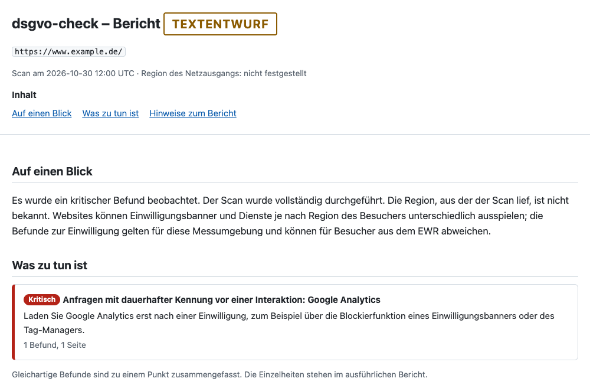
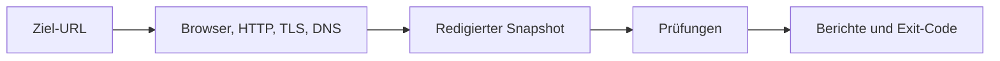
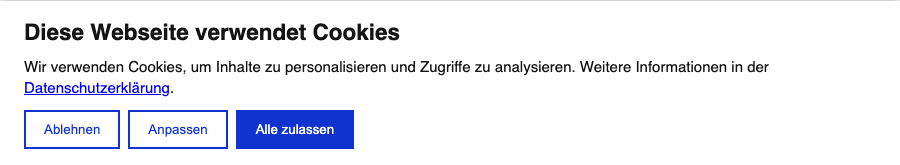
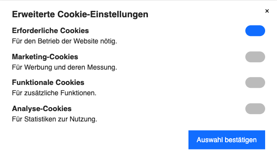

# dsgvo-check

English | [Deutsch](README.de.md)

[](https://github.com/seed-factory/dsgvo-check/actions/workflows/ci.yml)
[](LICENSE)

dsgvo-check observes what a website loads and stores, how its consent banner works, and how HTTP, TLS and email are configured. The exit code makes the results usable in CI. Reports document technical observations; legal assessment is the responsibility of site operators.

**Status** · Prototype 0.1.0 from source. Report texts are marked “Draft text”.

- [Quick start](#quick-start)
- [How a scan works](#how-a-scan-works)
- [Banner examples](#banner)
- [Checks and findings](#what-is-checked)
- [CI and Docker](#ci-integration)
- [Configuration and exit codes](#configuration)
- [Network and limitations](#what-the-scanner-sends)
- [Development](#development)

## Quick start

### Prerequisites

- Node.js 26 or later. CI tests with Node.js 26.
- Corepack for the pnpm version specified in [package.json](package.json). If needed, run `npm install --global corepack@0.36.0` once.
- Chromium (Chrome for Testing). The installation step below downloads the matching version.
- Docker as an alternative to local installation. [Start with Docker](#docker)

### Installation

```sh
git clone https://github.com/seed-factory/dsgvo-check.git
cd dsgvo-check
corepack pnpm install
node node_modules/playwright-core/cli.js install --no-shell chromium
corepack pnpm build
```

On Linux, `node dist/cli.js install --with-deps` installs missing system libraries with root privileges.

### First scan

```sh
node dist/cli.js https://www.example.de/ --format console,json,html --out ./dsgvo-check-report
```

Replace the example address with your website. A typical scan takes 1–3 minutes.

| Format    | Result                                            |
| --------- | ------------------------------------------------- |
| `console` | Summary in the terminal                           |
| `json`    | `report.json` with findings and complete evidence |
| `html`    | `report.html` as a standalone file                |
| `summary` | `summary.md` for CI                               |
| `pdf`     | `report.pdf` from the same HTML view              |

### Reading the report

Open `report.html` for an overview of findings, inconclusive results, recommended actions and observed services. Evidence for each check follows below. With `--detail brief`, HTML and PDF retain only the summary. Banner screenshots are suspended to protect visitor data. The scan still captures banner characteristics.



### Re-exporting a report

```sh
node dist/cli.js report ./dsgvo-check-report/report.json --format html,pdf --lang de --out ./report-export
```

`report` uses the existing JSON report. Without flags, the command writes HTML in German next to the JSON file. `DSGVO_CHECK_REPORT_FORMATS` and `DSGVO_CHECK_REPORT_LANG` change these defaults. If PDF printing fails, the JSON and scan exit code remain available. Invalid input JSON results in exit code 2.

### Saving and re-evaluating a snapshot

```sh
node dist/cli.js https://www.example.de/ --save-snapshot scan.snapshot.json
node dist/cli.js --from-snapshot scan.snapshot.json --checks HDR-01,TLS-02 --format console
```

A snapshot stores redacted observations for later evaluation without network access. The new report states the original capture time. `scan.evaluatedAt` gives the new evaluation time in JSON.

## How a scan works



Collectors capture technical facts and remove sensitive data before storage. Checks read the snapshot and return findings. `--fail-on` determines the severity at which a finding fails CI.

| Browser phase        | What happens                                                                                                 |
| -------------------- | ------------------------------------------------------------------------------------------------------------ |
| A · Before selection | Chromium observes the homepage, legal pages and selected subpages.                                           |
| B · Reject           | A matching adapter clicks reject and checks whether the decision persists after reload and on control pages. |
| C · Accept           | A fresh profile accepts and visits the control pages for comparison.                                         |

Each phase starts with its own browser profile. Content lower down a page becomes visible by enlarging the browser window. The scanner does not trigger scroll input.

[Page selection, aborts and certificate errors](docs/scan-reference.md#browserablauf) · [Architecture for development](docs/architecture.md)

### Banner

A consent management platform (CMP) displays the consent banner. dsgvo-check has adapters for Borlabs, Cookiebot, Complianz, Usercentrics, CCM19, Real Cookie Banner, CookieHub, Shopware 6, Wix and TYPO3 cookieman.

**Cookiebot** · The adapter can select “Reject” on the first layer.



**Wix** · The adapter can save in settings when only necessary categories are enabled.



The images show local test replicas. Further examples are the [first Wix layer](docs/images/banner-wix-first-layer.png) and a [blocking Usercentrics banner without direct rejection](docs/images/banner-usercentrics.png).

An unknown banner is left untouched. CONSENT-04 reports “Banner not recognized” as `info`. [Detection, click paths and confirmation](docs/scan-reference.md#banner)

## What is checked

The browser checks observe typical situations including these:

- A website loads a font or a YouTube thumbnail before the visitor interacts with the banner.
- A tracking service continues sending requests on a control page after confirmed rejection.
- A linked privacy policy is reachable but does not mention an observed service.

| ID         | Observation                                                                                           |
| ---------- | ----------------------------------------------------------------------------------------------------- |
| CONSENT-01 | Third-party requests and tracking hits before interaction with the banner                             |
| CONSENT-02 | Cookies and Web Storage before interaction (names, flags, lifetime; **no values**)                    |
| CONSENT-03 | Tracking without a recognizable consent banner                                                        |
| CONSENT-04 | First banner layer: is “Reject” on equal footing with “Accept”?                                       |
| CONSENT-05 | What continues to be sent or stored after confirmed “Reject”                                          |
| TRACK-01   | Service inventory at each point: before interaction, after rejection, after consent                   |
| EMBED-01   | Fonts from third-party servers (e.g. Google Fonts)                                                    |
| EMBED-02   | Maps (e.g. Google Maps) without a two-click solution                                                  |
| EMBED-03   | Videos and thumbnails (e.g. YouTube, Vimeo) without a two-click solution                              |
| LEGAL-01   | Legal notice and privacy policy: linked, reachable, not covered by the banner                         |
| LEGAL-02   | References to previous legislation in text (e.g. TMG, RStV, TTDSG, Privacy Shield)                    |
| PRIV-01    | Are observed services named in the privacy policy?                                                    |
| PRIV-02    | Privacy policy statements (e.g. “fonts local”) compared with requests                                 |
| HDR-01     | Security headers: HSTS, CSP, framing protection, `nosniff`, Referrer/Permissions Policy               |
| HDR-02     | Software versions in headers such as `Server` and `X-Powered-By`                                      |
| TLS-01     | Redirect from http to https; forms on http pages, including linked posts; links to own http addresses |
| TLS-02     | Certificate: valid, complete chain, remaining lifetime relative to total lifetime                     |
| MAIL-01    | DMARC record and policy, including for the target domain and email domains in the legal notice        |
| MAIL-02    | SPF record (statically evaluated), together with DMARC for the same domain                            |
| MAIL-03    | DKIM keys on the checked selectors and their RSA length, per email domain                             |

### Variants

Each check can report several variants; a finding's message ID is `<Prüfung>.<Variante>`.

- The table shows the default severity of each variant. It is generated from `test/data/ruleset`.
- Medium confidence limits a finding to `warning`, low confidence to `info`.
- **(locked)** means `locked`: the variant is not raised and does not count toward `--fail-on`; the check remains `inconclusive`.

<!-- registry:begin: generated from test/data/ruleset by `corepack pnpm registry`, do not edit -->
| ID           | `critical`                                                          | `warning`                                                                                                               | `info`                                                                                                                  |
| ------------ | ------------------------------------------------------------------- | ----------------------------------------------------------------------------------------------------------------------- | ----------------------------------------------------------------------------------------------------------------------- |
| `CONSENT-01` | `tracking-completed`                                                | `library-loaded`, `first-party-proxy`, `cookieless-ping`                                                                | `third-party-resource`, `unknown-host`, `request-not-completed`                                                         |
| `CONSENT-02` | `tracking-identifier-stored`                                        | `unknown-third-party-persistent`                                                                                        | `unknown-first-party-persistent`, `cmp-cookie-with-uid`, `storage-rejected-or-attempted`                                |
| `CONSENT-03` | `no-banner-strong-tracking`                                         | `no-banner-consent-services`                                                                                            | —                                                                                                                       |
| `CONSENT-04` | `blocking-no-reject`, `close-means-accept`, `nonblocking-no-reject` | `reject-not-actionable`, `reject-ineffective`, `consent-without-action`                                                 | `reject-as-link`, `no-choice-at-first-layer`, `pur-abo`, `banner-not-recognized` (locked), `cmp-not-supported` (locked) |
| `CONSENT-05` | `tracking-after-reject`                                             | `cookieless-ping-after-reject`                                                                                          | `connect-only-after-reject`                                                                                             |
| `TRACK-01`   | —                                                                   | —                                                                                                                       | `service-inventory`                                                                                                     |
| `EMBED-01`   | —                                                                   | `fonts-loaded`, `fonts-in-embed-frame`                                                                                  | `preconnect-only`                                                                                                       |
| `EMBED-02`   | —                                                                   | `maps-loaded`                                                                                                           | —                                                                                                                       |
| `EMBED-03`   | —                                                                   | `video-loaded`                                                                                                          | —                                                                                                                       |
| `LEGAL-01`   | `document-not-found`, `links-broken`                                | `provider-details-without-link`, `link-missing-on-some-pages`, `reachable-via-intermediate`, `footer-covered-by-banner` | `unresolved`                                                                                                            |
| `LEGAL-02`   | —                                                                   | —                                                                                                                       | `outdated-reference`                                                                                                    |
| `PRIV-01`    | —                                                                   | `not-named`                                                                                                             | `category-only`, `ambiguous-match`, `named-in-cmp-only`                                                                 |
| `PRIV-02`    | `contradiction-replicated`                                          | `contradiction-single`                                                                                                  | `wording-to-review`                                                                                                     |
| `MAIL-01`    | —                                                                   | `record-not-found`, `policy-none`, `record-invalid`                                                                     | `weak-option`, `legacy-pct`                                                                                             |
| `MAIL-02`    | —                                                                   | `record-not-found`, `permissive-qualifier`, `record-invalid`, `softfail-without-enforcement`                            | `softfail-with-enforcement`, `ptr-mechanism`                                                                            |
| `MAIL-03`    | —                                                                   | `key-too-short`, `given-selector-missing`                                                                               | `selectors-not-found`                                                                                                   |
| `HDR-01`     | —                                                                   | `hsts-missing`, `anti-framing-missing`, `referrer-policy-permissive`                                                    | `header-missing`                                                                                                        |
| `HDR-02`     | —                                                                   | —                                                                                                                       | `version-header`                                                                                                        |
| `TLS-01`     | `https-unavailable`, `form-on-http-page`                            | `no-redirect`, `client-side-redirect-only`, `internal-http-link`                                                        | `redirect-chain-detail`, `internal-http-link-upgraded`                                                                  |
| `TLS-02`     | `certificate-invalid`                                               | `chain-incomplete`, `certificate-expiring`                                                                              | `certificate-expiry-approaching`                                                                                        |
<!-- registry:end -->

### Planned checks

These checks are specified but not yet implemented. The table lists the planned variants.

| ID                   | Topic                                   | `critical`                      | `warning`                                                                    | `info`                                              | No finding (`reason`)    |
| -------------------- | --------------------------------------- | ------------------------------- | ---------------------------------------------------------------------------- | --------------------------------------------------- | ------------------------ |
| `EMBED-04`           | CAPTCHA                                 | —                               | `captcha-without-form`                                                       | `captcha-with-form`                                 | —                        |
| `EMBED-05`           | Widgets                                 | —                               | `widget-loaded`                                                              | —                                                   | —                        |
| `CONSENT-06`         | Consent Mode                            | `google-granted-despite-denied` | `default-granted`, `hit-before-default`                                      | —                                                   | `not-observable`         |
| `VULN-01`, `VULN-02` | CMS core; plugins, themes and libraries | `version-listed-kev-or-preauth` | `version-listed`, `eol-major`                                                | `version-unknown`                                   | `source-unavailable`     |
| `TLS-03`             | Mixed Content                           | —                               | `active-mixed-content-blocked`, `passive-upgrade-failed`, `form-action-http` | `passive-auto-upgraded`                             | —                        |
| `TLS-04`             | TLS 1.0/1.1                             | —                               | `legacy-protocol-accepted`                                                   | —                                                   | `handshake-inconclusive` |
| `DNS-01`             | CAA and DNSSEC                          | —                               | `dnssec-bogus`                                                               | `caa-not-found`, `dnssec-unsigned`                  | —                        |
| `HDR-02`             | Cookie attributes                       | —                               | `session-cookie-attributes`                                                  | `cookie-attributes`, `cookie-samesite-missing`      | —                        |
| `ADMIN-01`           | Public WordPress information            | —                               | `users-and-xmlrpc-exposed`                                                   | `partial-exposure`                                  | —                        |
| `FILE-01`            | Service files                           | `sensitive-signature`           | `exposed-file`                                                               | `minor-file`                                        | —                        |
| `SEC-01`             | `security.txt`                          | —                               | —                                                                            | `security-txt-not-found`, `security-txt-incomplete` | —                        |
| `BFSG-01`            | Automatic accessibility signals         | —                               | —                                                                            | `axe-rule-observed`                                 | —                        |
| `PERF-01`            | Lab performance                         | —                               | —                                                                            | `lab-metrics`                                       | —                        |

- **VULN-01, VULN-02:** Severities apply when the version is determined exactly; for a version range each variant is one level lower.
- **ADMIN-01, FILE-01:** only on explicit request (opt-in); the prototype does not send such requests.
- **BFSG-01, PERF-01:** do not count toward `--fail-on` (`gating: false`).

## CI integration

Run the scan in a separate job with read permissions and no secrets. The integrations use `ghcr.io/seed-factory/dsgvo-check:<Version>`. The examples require a published tag and image.

### GitHub Action

```yaml
jobs:
  dsgvo-check:
    runs-on: ubuntu-24.04
    permissions:
      contents: read
    steps:
      - uses: seed-factory/dsgvo-check@v0.1.0
        with:
          url: https://staging.example.de/
          fail-on: critical
```

The step provides `exit-code` and paths for JSON, HTML and PDF. The job summary and artifact upload are enabled by default. [All inputs and outputs](action.yml) · [Example with an intentionally failing job](examples/github-failing/README.md)

### GitLab CI

```yaml
include:
  - remote: https://raw.githubusercontent.com/seed-factory/dsgvo-check/v0.1.0/templates/gitlab/dsgvo-check.gitlab-ci.yml
    integrity: sha256-<base64-sha256-der-datei>

variables:
  DSGVO_CHECK_URL: https://staging.example.de/
```

The [template](templates/gitlab/dsgvo-check.gitlab-ci.yml) defines the `dsgvo-check` job (stage `test`, runs only when `DSGVO_CHECK_URL` is set). The release workflow summary provides the `integrity` value.

The template retains the report directory as an artifact for 14 days. [Template and variables](templates/gitlab/dsgvo-check.gitlab-ci.yml)

### Docker

```sh
docker build -t dsgvo-check:dev .
mkdir -p dsgvo-check-report
docker run --rm --user "$(id -u):$(id -g)" --env HOME=/tmp \
  --cap-drop=ALL --security-opt no-new-privileges \
  --read-only --tmpfs /tmp:rw,nosuid,nodev,size=1g \
  --memory=3g --memory-swap=3g --cpus=2 --pids-limit=1024 --shm-size=512m \
  -v "$PWD/dsgvo-check-report:/out" \
  dsgvo-check:dev https://www.example.de/ --out /out --format console,json,html
```

### Isolation

In the image, the container provides the sandbox (`--sandbox container`). The run above uses a read-only filesystem, restricted privileges and resource limits. `/out` must be writable by the UID used at startup. Without `--user`, the image runs as UID 10001. Locally, Chromium uses its own sandbox by default.

## Configuration

### Options

`node dist/cli.js --help` shows all options. The following cover the most common uses.

| Option        | Default                | Effect                                          |
| ------------- | ---------------------- | ----------------------------------------------- |
| `--fail-on`   | `critical`             | `critical`, `warning` or `none`                 |
| `--format`    | `console,json`         | Comma-separated output formats                  |
| `--out`       | `./dsgvo-check-report` | Output directory                                |
| `--max-pages` | `6`                    | Phase A page budget                             |
| `--timeout`   | `8m`                   | Global time limit, e.g. `90s`                   |
| `--checks`    | all                    | Comma-separated check IDs                       |
| `--lang`      | `de`                   | Report language `de` or `en`                    |
| `--detail`    | `full`                 | Detail level `full` or `brief` for HTML and PDF |

### Settings

The scanner runs with sensible defaults. A CLI flag takes precedence over the environment variable, followed by the local `.env` and the default value. With Docker, pass variables using `--env` or `--env-file`. [All variables with defaults and limits](.env.example)

### Exit codes

| Code | Meaning                                                                           |
| ---- | --------------------------------------------------------------------------------- |
| `0`  | No finding reaches the threshold.                                                 |
| `1`  | At least one finding reaches the threshold.                                       |
| `2`  | The scan or report output failed, a relevant check failed, or `--strict` applied. |

A scan that was not performed or a write error takes precedence over a finding. A finding takes precedence over a single check error and over `--strict`. `--fail-on none` disregards the threshold and check errors when evaluating the exit code. Other scan errors and `--strict` still apply.

[All exit reasons and their precedence](docs/scan-reference.md#exit-gründe)

## What the scanner sends

The scanner sends browser navigations and the following standard requests, nothing else. This is the complete list for site operators who want to know what reached their site.

**Browser:** navigations in phases A, B and C (see [pages in phase A](docs/scan-reference.md#seiten-in-phase-a)), one at a time with at least 1.5 s between them. If the target URL's certificate is rejected, they go to the target of its HTTP redirect, not additionally.

**HTTP**, at most 2 requests per second per host:

- `robots.txt` from the homepage origin;
- at most 2 sitemap requests (the sitemap or a sitemap index and a child sitemap), only if homepage links do not fill the page budget;
- the redirect chains from `http://` and `https://` for the target host and its `www.` and apex variants, plus the chain on a port explicitly specified in the target URL;
- one request each to the legal notice and privacy policy linked from the homepage (same website only, for security headers and version information);
- for TLS-01 after the browser, at most 3 requests (`DSGVO_CHECK_HTTP_FORM_TWIN_PAGES`):
  - first to the `http://` addresses of pages where phase A saw a form;
  - with the remaining budget to the `http://` addresses of posts and articles linked by visited pages as permalinks (`rel="bookmark"`) that the browser did not visit;
  - both only if `http://` on their host serves content without redirecting to https: one GET each, without following a redirect or submitting anything, no retry, and no further request to that host after 429 or 503.

**TLS:** one handshake per host variant (at most 3) to read the certificate. After a redirect to another domain, at most 3 more are added for the final host and its `www.` and apex variants.

**DNS:** MX, SPF, DMARC and DKIM queries to the scanning machine's resolver, not to the website.

- At most 60 queries for the scanned domain.
- After the browser, at most 30 more each for the domain the homepage redirects to and for up to 2 email domains from the legal notice.
- DKIM: at most 8 selectors per email domain (`<selector>._domainkey.<domain>`), after the other queries and within the same budget.

**Not sent:** requests for exposed files or admin interfaces, logins and forms. The scanner never bypasses bot protection, CAPTCHAs or geo-blocks: a blocked website is recorded as blocked and is not retried with tricks.

For the User-Agent and the IP address third parties see in phase C, see [Usage notes](#usage-notes). The User-Agent remains unchanged even if a consent banner therefore treats it as a crawler and does not open; the report states this (see [Banner](#banner)).

## Limitations

- A scan is a sample for one browser configuration, one location and the pages actually visited.
- Bot protection, geo signals and states that cannot be checked can make checks `inconclusive`.
- The snapshot contains neither cookie values nor Web Storage values or TC-Strings, even in hashed form. URL parameters and headers follow allowlists. [What is stored](docs/scan-reference.md#keine-werte)
- The network check filters private, loopback, link-local and metadata addresses during target validation and document navigation. Subresources, DNS rebinding and the target behind a proxy are outside this boundary. Use an isolated environment without access to sensitive internal services.
- An empty list of findings does not confirm legal compliance. [Limits of individual checks](docs/scan-reference.md#einzelne-prüfungen)

## Usage notes

dsgvo-check is intended for checking your own websites or websites you manage on behalf of others; reports about
third-party websites are not intended for publication. HTTP requests of the scanner carry the User-Agent
“dsgvo-check/<version> (passive DSGVO/security check; https://github.com/seed-factory/dsgvo-check)”; the browser
identifies as Chrome with the same token. TLS handshakes and DNS queries carry no User-Agent. Phase C discloses
the scanning machine's IP address to the third parties whose resources the website loads after acceptance
in the banner. With `--proxy`, DNS queries go directly to the resolver, not through the proxy.

The same text appears in `dsgvo-check --help` (source: `test/data/texts/en/core.yaml`, key `usageNotes`).

## Development

```sh
corepack pnpm typecheck
corepack pnpm lint
corepack pnpm test:unit
corepack pnpm test:integration
corepack pnpm build
corepack pnpm test:e2e
```

### Tests

Unit tests need neither a browser nor network access. Integration and E2E tests use local servers. `corepack pnpm test:changed` selects tests based on the diff to `main`. [Test levels, CI and local test environment](docs/development.md#tests)

### Canary

Canary measures scanner coverage and reliability against a private sample. `corepack pnpm canary --dry-run` shows the plan without scanning. A live run requires `--confirm`. [Preparation, evaluation and rules](docs/development.md#canary)

### Contributing

[Architecture and modules](docs/architecture.md) · [Development commands and release](docs/development.md) · [Project rules and new checks](AGENTS.md)

## License

Apache-2.0. [LICENSE](LICENSE) · [NOTICE](NOTICE)
