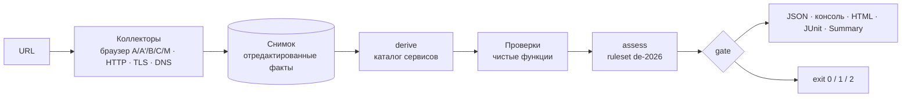

# dsgvo-check — бриф

Статус на 2026-10-30: проектирование закончено; прототип этапа 1 — отдельный срез по манифесту [docs/prototype/BRIEF.md](prototype/BRIEF.md), не релиз 1.0 и не его ворота.

Этот документ на одной странице отвечает на три вопроса: что строим, по каким правилам и что нужно от заказчика, чтобы начать. Обоснования и детали — в документах из раздела «Карта документов».


---

## 1. Что строим

**dsgvo-check** — open-source CLI-сканер (TypeScript + Playwright, Apache-2.0). Он открывает сайт в настоящем браузере и пассивно фиксирует, что происходит до согласия на cookies, после отказа и после принятия. Дополнительно проверяет HTTP-заголовки, TLS и почтовые DNS-записи. Результат — проверяемые технические факты с доказательствами, отчёт (JSON, консоль, HTML) и код возврата для CI.

Позиционирование: **пассивный CI-гейт для немецких сайтов.** Сканер показывает, какие запросы и записи на устройство появляются до клика и после «Ablehnen», и сверяет это с Datenschutzerklärung и Impressum. Плюс базовая гигиена безопасности. Ни один из разобранных аналогов не закрывает P0-каталог целиком ([prior-art](01-research/prior-art.md)).



## 2. Для кого и зачем

| Кто | Что получает | Как пользуется |
|---|---|---|
| Аудиторы заказчика (seed-factory) | Воспроизводимые доказательства для аудита: URL, запрос, cookie, заголовок, DNS-запись, `crmCode` для CRM | Локальный запуск или CI с DE/EWR-egress, JSON в CRM |
| Команды сайтов и агентства | Красная сборка при регрессии: трекер до согласия, сломанный отказ, пропавший Impressum | GitHub Action, GitLab-шаблон, Docker-образ |
| Владельцы сайтов | Понятный немецкий отчёт без юридических выводов | HTML-отчёт |

**Критерии успеха релиза 1.0:**

- Все обязательные пункты ТЗ выполнены; качество проверяется по [стратегии тестирования](04-quality-and-delivery.md).
- 0 известных ложных `critical` на CMP-лаборатории и на 10 сайтах заказчика; все размеченные `mustFind` найдены.
- Для каждой проверки есть пары фикстур «нарушение / чисто / inconclusive», CI проекта зелёный.
- Доля `inconclusive` по каждой проверке видна в отчёте канарейки, а не спрятана.
- Все немецкие тексты вычитаны заказчиком, черновиков в релизе нет.

## 3. Принципы

1. **Факт, а не правовая оценка.** «Vor der Interaktion mit dem Banner beobachtet», «in der Datenschutzerklärung nicht gefunden» — да. «Verstößt gegen DSGVO» — никогда. `critical` означает «уверенно установленный технический факт класса, приоритетного по утверждённому ruleset», а не «нарушение». Стоп-слова проверяет lint. Подробно — в [Formulierungsleitfaden](legal/wording-guide.md).
2. **Лучше `inconclusive`, чем ложный `critical`.** Нераспознанный баннер, бот- или гео-режим CMP, неполный документ дают `inconclusive` с диагностикой и не роняют CI.
3. **Только пассивно.** Браузерные навигации, DNS, два TLS-handshake, фиксированные служебные URL. Перебора, инъекций, логинов и форм нет; граница для generic-селекторов DKIM — вопрос 16. FILE-01 и ADMIN-01 — отдельный opt-in класс вне релиза.
4. **Честное измерение.** Отчёт показывает, откуда и как мерили: UA, egress, sandbox, страницы «geplant / beobachtet / auswertbar», известные пробелы захвата.
5. **Минимизация данных.** Значения cookies и Web Storage не сохраняются ни открыто, ни хешем; `mailto:` маскируется; HAR выключен; скриншот — обрезка снимка первого экрана по области баннера, только при однозначном контейнере ≤ 50 % viewport.
6. **Уровни — это данные.** Severity, gating и `crmCode` лежат в ruleset `de-2026` по `(checkId, variant)`, заказчик их подписывает. Правовая база меняется: версия ruleset и «Rechtsstand» видны в отчёте.
7. **Новая проверка не трогает ядро.** Папка, строка в реестре, тексты, ruleset, фикстуры — и тест полноты.
8. **Чистые лицензии.** Никаких NC-, SA- и GPL-данных в поставке; каталог сервисов собственный (Apache-2.0); лицензии и атрибуции зависимостей и данных — в `THIRD_PARTY_NOTICES`.

## 4. Объём

| Что | Когда |
|---|---|
| Все 15 P0 + **CONSENT-05** (работает ли «Ablehnen»; перенос из P1 требует подтверждения) | Релиз 1.0 |
| JSON-контракт, консоль, HTML без JS, JUnit, GitHub Job Summary; фазы A, A′, B, C, M; семь CMP-адаптеров | Релиз 1.0 |
| GitHub Action, GitLab-шаблон, Docker-образ, npm-пакет; пример репозитория с красной сборкой | Релиз 1.0 (этап 2) |
| PDF (печать того же HTML) | По явному `--format pdf` или `--format html,pdf`; по умолчанию выключен. Сбой печати даёт одну строку предупреждения, без PDF-файла и без изменения кода выхода и JSON |
| Остальные P1: EMBED-03/04/05, CONSENT-06, MAIL-03, TLS-03/04, VULN-01/02 (VULN — последними) | Этап 3б, по каталогу |
| P2: DNS-01, HDR-02, SEC-01, LEGAL-02, BFSG-01, PERF-01; FILE-01 и ADMIN-01 только opt-in | После релиза |
| Пакетное сканирование, рейтинги сайтов, генератор претензий, автоуведомления, тексты под конкретный сайт (в т. ч. LLM) | Никогда (non-features) |

## 5. Как работает скан

- **Фазы браузера.** Четыре свежих профиля: A (A′ — в конце того же), B, C, M.
  - **A** — до 6 страниц без взаимодействия.
  - **A′** — движение мыши и прокрутка без кликов.
  - **B** — наблюдение до клика, снимок первого экрана, «Ablehnen», проверка отказа, reload и контрольные страницы.
  - **C** — «Alle akzeptieren».
  - **M** — мобильный первый уровень.
- **Выбор страниц** детерминирован: старт, Impressum, Datenschutzerklärung, Kontakt и ещё 2 страницы. Выборку можно закрепить в конфиге.
- **CMP.** Семь собственных адаптеров в порядке каталога: Borlabs, Cookiebot, Complianz, Usercentrics, CCM19, Real Cookie Banner, CookieHub. Адаптер только извлекает факты и кликает (`extract / act / verify`); что считать отказом и куда кликать, решает чистая функция в ядре. Вердикт CONSENT-04 выше `info` — только при распознавании `high`. Иначе — `info` «Banner nicht erkannt», и этот уровень нельзя поднять конфигом.
- **Бот и гео.** Детектор бот-режима обязателен: прямой бот-сигнал CMP (RCB для ботов «принимает всё») переводит затронутые проверки в `inconclusive`. По регуляркам из исходников буквальный UA ловят только `isbot` и RCB; Borlabs, Cookiebot и Complianz — нет; в рантайме это проверит спайк С1. Гео-сигналы CMP тоже дают `inconclusive`. CONSENT-03 получает `critical` только при заявленном EWR-egress (`--assume-region`, в тексте находки — «Region laut Nutzerangabe»).
- **Передача в третьи страны (за пределы EWR)** — не отдельная проверка, а атрибут находки: `provider`, `parent`, `dpfEntity` из каталога и статический `adequacy.json`. Страна на уровень не влияет; стоп-лист задан фразами о получателе и передаче (см. [Formulierungsleitfaden §2 №4](legal/wording-guide.md#2-запрещённые-слова-и-конструкции-de-и-en)); исключения — только через allowlist с причиной.
- **Вежливость.** Навигации по одной с паузой ≥ 1,5 с, HTTP-пробы ≤ 2 запр./с, честный User-Agent со ссылкой на репозиторий, скан укладывается в 8 минут. При 429/503 — пауза по `Retry-After`, один повтор, затем новых навигаций к хосту нет (`SCAN-THROTTLED`).

Детали — в [архитектуре](02-architecture.md) и [спецификации проверок](03-checks.md).

## 6. Контракт для CI

```bash
dsgvo-check https://example.de --fail-on critical
```

| Код | Когда |
|---|---|
| `0` | Учитываемых находок нет, релевантные проверки не упали |
| `1` | Есть учитываемая (не подавленная и не покрытая baseline) находка не ниже `--fail-on`: по умолчанию `critical`, `warning` включает `critical`, при `none` кода `1` нет |
| `2` | Скан не состоялся: цель недоступна, WAF, таймаут до сбора стартовой страницы, нет браузера или sandbox, неверные аргументы, внутренний сбой, отчёт не записан. Либо упала релевантная проверка, а находок для `1` нет |

Приоритет: `2 (fatal)` > `1` > `2 (ошибка релевантной проверки или --strict)` > `0`. Нераспознанный баннер, бот, гео и `--sandbox off` на код не влияют; `--strict` переводит их в `2`, если нет `1`. Все причины пишутся в `summary.exitReasons[]`. Синтаксис `--format` и `--out` пока не закреплён (ОВ-17/18 [архитектуры](02-architecture.md)). Полная таблица пограничных случаев — в [архитектуре, раздел 12](02-architecture.md).

## 7. Ключевые решения

Архитектура и контракты — в [02-architecture.md](02-architecture.md), поведение проверок — в [03-checks.md](03-checks.md). Ниже главное.

| Тема | Решение |
|---|---|
| Стек | Node ≥ 24, TypeScript 7, `playwright-core` 1.64.x с точным пином и полный Chrome for Testing (new headless), pnpm 12.16.1 (фолбэк 11.28.9), Vitest 5, Biome, zod 4 → JSON Schema 2020-12. Один npm-пакет без workspace |
| Конвейер | Коллекторы → отредактированный снимок → `derive` → чистые проверки → assess по ruleset → `gate` → репортеры. Снимок можно сохранить и пересчитать без сети |
| Модель результата | Три оси: `status` проверки (без `pass/fail`), `severity`, `confidence`; `confidence` ограничивает уровень. Диагностики `SCAN-*` идут отдельно и не гейтят |
| Дедупликация | Одно наблюдение — одна гейтящая находка (`routing.yaml`). TRACK-01 — инвентарь `info` (нужно подтверждение) |
| CONSENT-04 | Таблица вариантов по фактам первого экрана: блокирующий баннер с кнопкой согласия, но без отказа, или «× = принять» → `critical`; отказ неактивен или не работает, согласие без клика → `warning`; ссылка вместо кнопки, неблокирующий, Pur-Abo, «только настройки» → `info`; «Banner nicht erkannt» — `info`, конфигом не переопределяется |
| PRIV-01 | DSE извлекается в фазе A без кликов и независимо от отказа, дополняется в B; manifest полноты; совпадение `named > company > domain > category`; не выше `warning`; PDF → `inconclusive` |
| TLS-02 | Невалидный сертификат → `critical`. Срок — относительно срока действия L: остаток < min(14 д, 25 % L) → `warning`, < min(30 д, 50 % L) → `info`; при L ≤ 10 д находки о сроке нет (6-дневные сертификаты Let's Encrypt). Для IP-цели — `checkIP` |
| Данные | Свой каталог сервисов (~100 записей из аудитов заказчика) + third-party-web (MIT), Open Cookie Database (Apache-2.0), AdGuard cname-trackers (MIT). Для VULN: WPVulnerability (CC0), retire.js, OSV/GHSA, CISA KEV |
| Fingerprint | `sha256(JCS{v, checkId, variantGroup, subject})` без хоста цели — baseline переживает preview-деплои |
| Изоляция | `--sandbox require` по умолчанию (`chromiumSandbox: true`, без `auto`); единый `EgressPolicy` для прокси, undici и TLS с проверкой IP при соединении; `--proxy` только HTTP CONNECT; HTML без JS с полной CSP (`default-src 'none'; img-src data:`; хеш стиля); поведение sandbox на трёх входах ТЗ — вопрос 8 |
| Доставка | GitHub — composite Action → `docker run` по тегу версии из `package.json` (docker-action требует root и убивает sandbox); GitLab — `include:remote` с `integrity`; образ `node:24-bookworm-slim` + CfT |

## 8. Где мы отходим от ТЗ и идеи

Каждое отступление — вопрос заказчику. До ответа действует буква ТЗ.

| Тема | ТЗ / идея | Предложение |
|---|---|---|
| CONSENT-05 | P1 | В релиз: «срабатывает ли Ablehnen» — ядро идеи |
| Отчёты | ТЗ: консоль и JSON, «HTML — если успеешь»; PDF — только в идее | HTML строится из шаблона; PDF печатает тот же HTML только по явному флагу. JUnit и Job Summary остаются в релизном объёме |
| Код `2` | «Сканер сам упал» | Плюс недоступная цель, WAF, таймаут и ошибка релевантной проверки |
| «Код возврата опционально» (идея) | В ТЗ обязателен | Обязателен; `--fail-on none` — режим «только отчёт» |
| FILE-01 (`.git`, `.env`, бэкапы) | В идее — в ядре, в каталоге — P2 | Opt-in `--exposure-probes` после правовой оценки (§§ 202a/202c StGB); 0 находок в 80 аудитах |
| Передача за пределы ЕС | В идее есть, проверки нет | Атрибут находки, не отдельная проверка; GeoIP — после релиза, opt-in |
| TRACK-01 | P0 с T1-кодом | `info`-инвентарь, уровень несёт CONSENT-находка |
| `--sandbox require` по умолчанию | «Одна команда без конфига»; «остальные CI — через Docker-образ» | На хосте Ubuntu ≥ 23.10 (AppArmor ⚠) и при голом `docker run` с дефолтным seccomp команда даёт `2` с инструкцией, а не отчёт; образ выдаёт seccomp-профиль и точную строку запуска — вопрос 8 |
| MAIL-03: generic-селекторы DKIM | Запрет «перебора» | После заданного и документированных селекторов — короткий generic-список: ≤ 25 TXT к DNS, не к сайту; результат только `info` (каталог сам описывает MAIL-03 как поиск «на распространённых селекторах») — вопрос 16 |
| Каталог | — | Ошибки примеров и кодов: Next.js 15.2.8 (CVE-2025-29927 исправлена в 15.2.3), у EMBED-03 crmCode карт, у P2 нет `crmCode`, «T0» у FILE-01 — нужно подтверждение |

## 9. Роли

| Зона | Заказчик (DSGVO, безопасность, документация) | Разработка (браузер, тесты, CI) |
|---|---|---|
| Право | Подпись ruleset `de-2026`, немецкие тексты, `legalNote`, дисклеймер, оценка RDG, CRA и FILE-01 | Стоп-листы и lint, механика текстов и версий |
| Данные | Экспорт своих аудитов (домены → сервисы → `crmCode` → фрагменты политик), утверждение алиасов | Каталог сервисов, лицензии, `datasets.lock.json` |
| Проверка качества | 10 сайтов с согласием владельцев, разметка `mustFind` / `mustNotFind`, лицензии CMP-лаборатории | Фикстуры, CMP-лаборатория, канарейка, критерии приёмки |
| Поставка | Организация, домен, имя, страница проекта | Action, GitLab, образ, npm, релизы, подписи |

## 10. Что нужно от заказчика до этапа 1

Открытые вопросы по контрактам перечислены в [архитектуре](02-architecture.md), [проверках](03-checks.md) и [качестве и доставке](04-quality-and-delivery.md). Самое срочное:

| # | Вопрос | Рекомендация |
|---|---|---|
| 1 | Что означает `critical` | Уверенно установленный технический факт класса, приоритетного по ruleset, а не доказанное нарушение |
| 2 | Семантика кодов `0/1/2` | Как в разделе 6 |
| 3 | User-Agent браузера | Буква ТЗ (ссылка на репозиторий). По регуляркам из исходников буквальный UA ловят только `isbot` и RCB (1 из 25 CMP-находок каталога); Borlabs, Cookiebot и Complianz — нет. Перейти на токен без URL, только если спайк С1 всё же покажет бот-режим хотя бы у одного из них |
| 4 | Release manifest | 15 P0 + CONSENT-05, HTML, JUnit, Summary, фаза M; PDF по явному флагу. При сокращении объёма: JUnit → Job Summary → HTML; JSON и консоль — контракт ТЗ; фаза M не вылетает |
| 5 | Корпус и данные | Экспорт аудитов — на этапе 0, 10 сайтов с согласием владельцев — к концу этапа 1; разовый приватный замер прототипа требует подтверждения заказчика; его корпус хранится вне репозитория и не ограничен обязательным числом сайтов (не приёмка) |
| 6 | Дедупликация и `crmCode` | TRACK-01 — инвентарь; `crmCode` только в JSON, `null` допустим |
| 7 | Организация, домен, имя | `dsgvo-check`, если clearance пройден (npm свободен); в `<org>/<repo>` нет `bot`, `crawler`, `spider`, `robot` |
| 8 | Sandbox на трёх входах ТЗ (`npx`, `docker run`, CI) | `require` везде плюс явный `off` с диагностикой; образ выдаёт seccomp-профиль и точную строку `docker run`. Для `npx` вне CI пересмотреть, если С3 покажет отказ на массовых хостах. Решение — до этапа 1, шаблоны — до этапа 2 |

## 11. Главные риски

| Риск | Мера |
|---|---|
| Бот-режим CMP при буквальном UA (по статике — сайты с RCB и `isbot`) или гео-режим вне EWR → ложные CONSENT-01/02/03 или `inconclusive` | Детектор прямых бот- и гео-сигналов → `inconclusive`; DE/EWR-egress для аудитов; спайк С1 |
| Шум PRIV-01 (третья по частоте P0: 48 из 80; HDR-01 — 64, MAIL-01 — 54) подрывает доверие | Manifest полноты, `category-only` → `info`, не выше `warning`, размеченный корпус |
| Поздние входные данные заказчика | Запрос на этапе 0; CMP-лаборатория как временный корпус; черновые тексты |
| Дрейф вёрсток CMP ломает адаптеры | Ночная лаборатория и канарейка; версия CMP в evidence; fail-safe в `info` |
| Отчёты используют для Abmahnungen; § 824 BGB | Только факты, стоп-листы, Messumgebung, дисклеймер, non-features |
| Недоверенный JS в CI с секретами | Sandbox `require` (`chromiumSandbox: true`), `EgressPolicy` с проверкой IP при соединении, non-root, read-only, job без secrets |

## 12. Этапы и оценка

| Этап | Результат | Оценка, чд |
|---|---|---|
| 0 · Разведка | Таблица аналогов (готова), стек, источники CVE (выбраны), спайки С1–С7 (UA/бот, профиль, sandbox на трёх входах, TLS 1.0/1.1, `EgressPolicy`, адаптеры, захват), smoke тулчейна | 5–6 |
| 1 · Каркас = прототип | CLI, JSON-контракт, коды, Docker-образ. Срез по [BRIEF](prototype/BRIEF.md): 14 из 15 P0 (без PRIV-02) и CONSENT-05, фазы A, B, C, семь адаптеров — с упрощениями, не релизные ворота | 18–21 |
| 2 · CI | `EgressPolicy` и egress-прокси, GitHub Action, GitLab-шаблон, пример репозитория с красной сборкой | 5–7 |
| 3а · Релизные проверки | PRIV-02, доведение проверок прототипа до спецификации, фазы A′ и M, HTML, JUnit/Summary, PDF по явному флагу, тексты, калибровка | 45–52 (без PDF 44–50) |
| 3б · P1 | По каталогу, VULN последними | ≈ 20 сверх релиза |
| 4 · Релиз | Тексты вычитаны, ruleset подписан, релиз и подписи | 6–8 |

Итого 79–94 чд без буфера, **91–108 чд с буфером 15 %**, коридор риска — до 135 чд. После спайков этапа 0 оценку пересчитываем; работа прототипа сверх этапа 1 засчитывается в 3а, а не дважды. Критерии качества и поставки — в [04-quality-and-delivery.md](04-quality-and-delivery.md).

## Карта документов

| Документ | Что внутри |
|---|---|
| [specs/](../specs/) | Идея, ТЗ, каталог проверок — входные документы |
| [01-research/](01-research/) | Ресёрч: правовая карта, регуляторика 2026, аналоги, данные и лицензии, браузер, HTTP/DNS/TLS/почта |
| [02-architecture.md](02-architecture.md) | Архитектура и контракты |
| [03-checks.md](03-checks.md) | Спецификация каждой проверки: детект, evidence, уровни, фикстуры, правовой якорь, черновик текста |
| [04-quality-and-delivery.md](04-quality-and-delivery.md) | Тестирование, CI, Docker, Action, GitLab, релизы, безопасность сканера |
| [legal/wording-guide.md](legal/wording-guide.md) | Formulierungsleitfaden, черновики немецких текстов и дисклеймера |
| [prototype/](prototype/) | Манифест прототипа этапа 1 ([BRIEF.md](prototype/BRIEF.md)); не релиз 1.0 и не его ворота |
