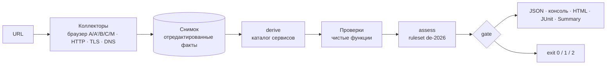

# dsgvo-check — бриф

Статус на 2026-11-03: архитектура и спецификация проверок готовы, прототип этапа 1 реализован ([prototype/BRIEF.md](prototype/BRIEF.md)). Прототип — отдельный срез, не релиз 1.0 и не его ворота. Из релиза пока нет `EgressPolicy` и прокси, PRIV-02, фаз A′ и M, JUnit и вычитанных текстов.

Документ на одной странице: что строим, по каким правилам и что нужно от заказчика.

## 1. Что строим

**dsgvo-check** — open-source CLI-сканер (TypeScript + Playwright, Apache-2.0). Он открывает сайт в настоящем браузере и пассивно фиксирует, что происходит до согласия на cookies, после отказа и после принятия; проверяет HTTP-заголовки, TLS и почтовые DNS-записи. Результат — технические факты с доказательствами, отчёт (JSON, консоль, HTML) и код возврата для CI.

Позиция: **пассивный CI-гейт для немецких сайтов.** Запросы и записи на устройство до клика и после «Ablehnen» сверяются с Datenschutzerklärung и Impressum, сверху — базовая гигиена безопасности. Ни один из разобранных аналогов не закрывает P0-каталог целиком ([prior-art](01-research/prior-art.md)).



Снимок можно сохранить и пересчитать без сети. Фазы браузера, CMP-адаптеры, модель результата, данные и изоляция — в [архитектуре](02-architecture.md); поведение проверок — в [спецификации проверок](03-checks.md).

## 2. Для кого

- **Аудиторы заказчика (seed-factory):** воспроизводимые доказательства (URL, запрос, cookie, заголовок, DNS-запись, `crmCode` для CRM); локальный запуск или CI с DE/EWR-egress, JSON уходит в CRM.
- **Команды сайтов и агентства:** красная сборка при регрессии (трекер до согласия, сломанный отказ, пропавший Impressum) через GitHub Action, GitLab-шаблон или Docker-образ.
- **Владельцы сайтов:** понятный немецкий HTML-отчёт без юридических выводов.

**Критерии успеха релиза 1.0:**

- Выполнены все обязательные пункты ТЗ; способ проверки каждого — в Definition of Done ([04-quality-and-delivery.md](04-quality-and-delivery.md)).
- 0 известных ложных `critical` на CMP-лаборатории и 10 сайтах заказчика; все размеченные `mustFind` найдены.
- Для каждой проверки есть фикстуры «нарушение / чисто / inconclusive»; CI зелёный.
- Доля `inconclusive` по каждой проверке видна в отчёте канарейки.
- Немецкие тексты вычитаны заказчиком, черновиков нет.

## 3. Принципы

1. **Факт, а не правовая оценка.** «Vor der Interaktion mit dem Banner beobachtet» — да, «Verstößt gegen DSGVO» — никогда. `critical` — уверенно установленный технический факт класса, приоритетного по ruleset, а не «нарушение». Стоп-слова проверяет тест; правила — в [Formulierungsleitfaden](legal/wording-guide.md).
2. **Лучше `inconclusive`, чем ложный `critical`.** Нераспознанный баннер, бот- или гео-режим CMP, неполный документ дают `inconclusive` с диагностикой и не роняют CI. CONSENT-04 выше `info` — только при распознавании `high`; CONSENT-03 получает `critical` только при заявленном EWR-egress (`--assume-region`).
3. **Только пассивно.** Навигации браузера, DNS, два TLS-handshake, фиксированные служебные URL; без перебора, инъекций, логинов и форм (граница для generic-селекторов DKIM — вопрос 16). Паузы между навигациями ≥ 1,5 с, ≤ 2 запр./с на хост, честный User-Agent, скан до 8 минут. FILE-01 и ADMIN-01 — только opt-in, вне релиза.
4. **Честное измерение.** Отчёт показывает, откуда и как мерили: UA, egress, sandbox, страницы «geplant / beobachtet / auswertbar», известные пробелы захвата.
5. **Минимизация данных.** Значения cookies и Web Storage не сохраняются ни открыто, ни хешем; `mailto:` маскируется; HAR выключен. Скриншот — обрезка первого экрана по баннеру при однозначном контейнере ≤ 50 % viewport.
6. **Уровни — данные.** Severity, gating и `crmCode` лежат в ruleset `de-2026`, его подписывает заказчик; версия ruleset и «Rechtsstand» видны в отчёте.
7. **Новая проверка не трогает ядро:** папка, строка в реестре, тексты, ruleset, фикстуры, тест полноты.
8. **Чистые лицензии.** Без NC-, SA- и GPL-данных в поставке; каталог сервисов собственный (Apache-2.0); атрибуции — в `THIRD_PARTY_NOTICES`.

## 4. Объём

| Когда | Что |
|---|---|
| Релиз 1.0 | Все 15 P0 + **CONSENT-05** (работает ли «Ablehnen»; перенос из P1 требует подтверждения). JSON-контракт, консоль, HTML без JS, JUnit, GitHub Job Summary; фазы A, A′, B, C, M; семь CMP-адаптеров |
| Релиз 1.0, этап 2 | GitHub Action, GitLab-шаблон, Docker-образ, npm-пакет; пример репозитория с красной сборкой. Action — composite с `docker run`, а не docker-action: тот требует root и убивает sandbox |
| Релиз 1.0, по явному `--format pdf` | PDF — печать того же HTML; по умолчанию выключен; сбой печати — одна строка предупреждения, код выхода и JSON не меняются |
| Этап 3б | Остальные P1: EMBED-03/04/05, CONSENT-06, MAIL-03, TLS-03/04, VULN-01/02 (VULN — последними) |
| После релиза | P2: DNS-01, HDR-02, SEC-01, LEGAL-02, BFSG-01, PERF-01; FILE-01 и ADMIN-01 только opt-in |
| Никогда | Пакетное сканирование, рейтинги сайтов, генератор претензий, автоуведомления, тексты под конкретный сайт (в т. ч. LLM) |

При нехватке бюджета форматы сокращаются в порядке JUnit → Job Summary → HTML.

## 5. Контракт для CI

```bash
dsgvo-check https://example.de --fail-on critical
```

| Код | Когда |
|---|---|
| `0` | Учитываемых находок нет, релевантные проверки не упали |
| `1` | Есть учитываемая (не подавленная и не покрытая baseline) находка не ниже `--fail-on`: по умолчанию `critical`, `warning` включает `critical`, при `none` кода `1` нет |
| `2` | Скан не состоялся (цель недоступна, WAF, таймаут до сбора стартовой, нет браузера или sandbox, неверные аргументы, внутренний сбой, отчёт не записан) либо упала релевантная проверка, а находок для `1` нет |

Приоритет: `2 (fatal)` > `1` > `2 (ошибка релевантной проверки или --strict)` > `0`. Нераспознанный баннер, бот, гео и `--sandbox off` на код не влияют; `--strict` переводит их в `2`, если нет `1`. Причины пишутся в `summary.exitReasons[]`; пограничные случаи — в [архитектуре, раздел 12](02-architecture.md). Умолчания `--format` и `--out` для 1.0 не закреплены (ОВ-17/18 архитектуры); прототип использует `console,json` и `./dsgvo-check-report`.

## 6. Где мы отходим от ТЗ и идеи

Каждое отступление — вопрос заказчику. До ответа действует буква ТЗ.

| Тема | ТЗ / идея | Предложение |
|---|---|---|
| CONSENT-05 | P1 | В релиз: «срабатывает ли Ablehnen» — ядро идеи |
| Отчёты | ТЗ: консоль и JSON, «HTML — если успеешь»; PDF — только в идее | Также HTML, JUnit и Job Summary; PDF — печать того же HTML по явному флагу |
| Код `2` | «Сканер сам упал» | Плюс недоступная цель, WAF, таймаут и ошибка релевантной проверки |
| Код возврата | В идее «опционально», в ТЗ обязателен | Обязателен; `--fail-on none` — режим «только отчёт» |
| FILE-01 (`.git`, `.env`, бэкапы) | В идее — в ядре, в каталоге — P2 | Opt-in `--exposure-probes` после правовой оценки (§§ 202a/202c StGB); 0 находок в 80 аудитах |
| Передача за пределы ЕС | В идее есть, проверки нет | Атрибут находки (`provider`, `parent`, `dpfEntity`, статический `adequacy.json`), на уровень не влияет; стоп-лист — [Formulierungsleitfaden §2 №4](legal/wording-guide.md#2-запрещённые-слова-и-конструкции-de-и-en); GeoIP — после релиза, opt-in |
| TRACK-01 | P0 с T1-кодом | `info`-инвентарь, уровень несёт CONSENT-находка |
| `--sandbox require` по умолчанию | «Одна команда без конфига»; «остальные CI — через Docker-образ» | На хосте Ubuntu ≥ 23.10 (AppArmor ⚠) и при голом `docker run` с дефолтным seccomp команда даёт `2` с инструкцией, а не отчёт; образ выдаёт seccomp-профиль и точную строку запуска (вопрос 8) |
| MAIL-03: generic-селекторы DKIM | Запрет «перебора» | После заданного и документированных селекторов — короткий generic-список: ≤ 25 TXT к DNS, не к сайту; результат только `info` (каталог сам описывает MAIL-03 как поиск «на распространённых селекторах») — **вопрос 16** |
| Каталог | — | Ошибки примеров и кодов: Next.js 15.2.8 (CVE-2025-29927 исправлена в 15.2.3), у EMBED-03 `crmCode` карт, у P2 нет `crmCode`, «T0» у FILE-01 |

## 7. Роли

| Зона | Заказчик | Разработка |
|---|---|---|
| Право | Подпись ruleset `de-2026`, немецкие тексты, `legalNote`, дисклеймер, оценка RDG, CRA и FILE-01 | Стоп-листы и lint, механика текстов и версий |
| Данные | Экспорт своих аудитов (домены → сервисы → `crmCode` → фрагменты политик), утверждение алиасов | Каталог сервисов, лицензии, `datasets.lock.json` |
| Качество | 10 сайтов с согласием владельцев, разметка `mustFind` / `mustNotFind`, лицензии CMP-лаборатории | Фикстуры, CMP-лаборатория, канарейка, критерии приёмки |
| Поставка | Организация, домен, имя, страница проекта | Action, GitLab, образ, npm, релизы, подписи |

## 8. Вопросы заказчику до этапа 1

Остальные открытые вопросы — в [архитектуре](02-architecture.md), [проверках](03-checks.md) и [качестве и доставке](04-quality-and-delivery.md). Самые срочные:

| # | Вопрос | Рекомендация |
|---|---|---|
| 1 | Что означает `critical` | Уверенно установленный технический факт класса, приоритетного по ruleset, а не доказанное нарушение |
| 2 | Семантика кодов `0/1/2` | Как в разделе 5 |
| 3 | User-Agent браузера | Буква ТЗ (ссылка на репозиторий). По регуляркам из исходников буквальный UA ловят только `isbot` и RCB (1 из 25 CMP-находок каталога); Borlabs, Cookiebot и Complianz — нет. Перейти на токен без URL, только если спайк С1 покажет бот-режим хотя бы у одного из них |
| 4 | Release manifest | Состав релиза из раздела 4. При сокращении — порядок из раздела 4; JSON и консоль (контракт ТЗ) и фаза M не вылетают |
| 5 | Корпус и данные | Экспорт аудитов — на этапе 0; 10 сайтов с согласием владельцев — к концу этапа 1. Отдельно — согласие на разовый приватный замер прототипа по 100 публичным сайтам (не приёмка); корпус хранится вне репозитория |
| 6 | Дедупликация и `crmCode` | TRACK-01 — инвентарь; `crmCode` только в JSON, `null` допустим |
| 7 | Организация, домен, имя | `dsgvo-check`, если clearance пройден (npm свободен); в `<org>/<repo>` нет `bot`, `crawler`, `spider`, `robot` |
| 8 | Sandbox на трёх входах ТЗ (`npx`, `docker run`, CI) | `require` везде плюс явный `off` с диагностикой. Для `npx` вне CI пересмотреть, если спайк С3 покажет отказ на массовых хостах. Решение — до этапа 1, шаблоны — до этапа 2 |

Вопрос 16 (generic-селекторы DKIM, MAIL-03) описан в разделе 6; на него ссылается [03-checks](03-checks.md).

## 9. Главные риски

| Риск | Мера |
|---|---|
| Бот-режим CMP при буквальном UA или гео-режим вне EWR → ложные CONSENT-01/02/03 или `inconclusive` | Детектор прямых бот- и гео-сигналов; DE/EWR-egress для аудитов; спайк С1 |
| Шум PRIV-01 (третья по частоте P0: 48 из 80; HDR-01 — 64, MAIL-01 — 54) подрывает доверие | Manifest полноты, `category-only` → `info`, не выше `warning`, размеченный корпус |
| Поздние входные данные заказчика | Запрос на этапе 0; CMP-лаборатория как временный корпус; черновые тексты |
| Дрейф вёрсток CMP ломает адаптеры | Ночная лаборатория и канарейка; версия CMP в evidence; fail-safe в `info` |
| Отчёты используют для Abmahnungen; § 824 BGB | Только факты, стоп-листы, Messumgebung, дисклеймер, non-features |
| Недоверенный JS в CI с секретами | Sandbox `require`, `EgressPolicy`, non-root, read-only, job без secrets |

## 10. Этапы и оценка

| Этап | Результат | Оценка, чд |
|---|---|---|
| 0 · Разведка | Таблица аналогов (готова), стек, источники CVE (выбраны), спайки С1–С7 (UA/бот, профиль, sandbox на трёх входах, TLS 1.0/1.1, `EgressPolicy`, адаптеры, захват), smoke тулчейна | 5–6 |
| 1 · Каркас = прототип | CLI, JSON-контракт, коды, Docker-образ. Срез по [BRIEF](prototype/BRIEF.md): 14 из 15 P0 (без PRIV-02) и CONSENT-05, фазы A, B, C, семь адаптеров — с упрощениями | 18–21 |
| 2 · CI | `EgressPolicy` и egress-прокси, GitHub Action, GitLab-шаблон, пример репозитория с красной сборкой | 5–7 |
| 3а · Релизные проверки | PRIV-02, доведение проверок прототипа до спецификации, фазы A′ и M, HTML, JUnit/Summary, PDF по явному флагу, тексты, калибровка | 45–52 (без PDF 44–50) |
| 3б · P1 | По каталогу, VULN последними | ≈ 20 сверх релиза |
| 4 · Релиз | Тексты вычитаны, ruleset подписан, релиз и подписи | 6–8 |

Итого 79–94 чд без буфера, **91–108 чд с буфером 15 %**, коридор риска — до 135 чд. После спайков этапа 0 оценку пересчитываем; работа прототипа сверх этапа 1 засчитывается в 3а, а не дважды.

## Карта документов

- [specs/](../specs/) — идея, ТЗ, каталог проверок (входные документы).
- [01-research/](01-research/) — правовая карта, регуляторика 2026, аналоги, данные и лицензии, браузер, HTTP/DNS/TLS/почта.
- [02-architecture.md](02-architecture.md) — архитектура и контракты.
- [03-checks.md](03-checks.md) — спецификация каждой проверки: детект, evidence, уровни, фикстуры, правовой якорь, черновик текста.
- [04-quality-and-delivery.md](04-quality-and-delivery.md) — тестирование, CI, Docker, Action, GitLab, релизы, безопасность сканера.
- [legal/wording-guide.md](legal/wording-guide.md) — Formulierungsleitfaden, черновики немецких текстов и дисклеймера.
- [prototype/BRIEF.md](prototype/BRIEF.md) — манифест прототипа этапа 1.
