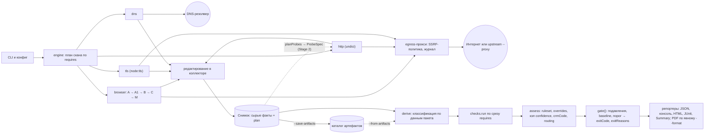

# Архитектура и контракты `dsgvo-check`

**Зачем этот документ и кому он нужен.** Документ описывает устройство сканера: слои, данные между ними и контракты, которые меняются только вместе с версией. Он нужен разработчикам коллекторов, проверок, оценки и репортеров, а также тем, кто ревьюит их PR. Приоритет источников: решение заказчика → [ТЗ](../specs/dsgvo-check_TZ.md) → [каталог проверок](../specs/dsgvo-check_katalog-proverok.md) → этот документ и [спецификация проверок](03-checks.md) → остальные документы. Здесь описана целевая 1.0; срез прототипа и исключения — в [BRIEF](prototype/BRIEF.md). Несогласованные предложения помечены номером ОВ-n и собраны в разделе [«Открытые вопросы»](#открытые-вопросы).

Связанные документы: [ТЗ](../specs/dsgvo-check_TZ.md), [каталог проверок](../specs/dsgvo-check_katalog-proverok.md), [спецификация проверок](03-checks.md), [качество и поставка](04-quality-and-delivery.md), [Formulierungsleitfaden](legal/wording-guide.md).

**Обозначения.**

| Знак | Значение |
|---|---|
| A | Фаза до любого действия с баннером |
| A′ | Нейтральное взаимодействие без клика; в данных и JSON — `A1` (ОВ-1) |
| B | После «Ablehnen»; на стартовой включает окно до клика |
| C | После «Alle akzeptieren» |
| M | Мобильный первый уровень, без кликов |
| O / T / E | Классы действий сканера: наблюдение / ограниченные технические пробы / пробы экспозиции |
| ⚠ | Факт не подтверждён первоисточником |

---


## 1. Обзор и поток данных

### 1.1 Принципы

1. **Наблюдение отделено от оценки.** Коллекторы собирают сырые факты. Проверки сопоставляют их с данными и выдают наблюдения без уровня. Уровень назначает assess по ruleset-данным, код возврата считает одна чистая функция `gate()`. Решение суда меняет YAML, а не код проверки.
2. **Проверки не делают I/O.** Им недоступны Playwright, undici и модули `node:*` с вводом-выводом; это проверяет тест графа импортов (L0). Дополнительный запрос проверка может только описать — через `ProbeSpec`.
3. **Снимок хранит сырые факты и решения сбора.** Классификация (`derive`) в снимок не запекается и пересчитывается при каждой оценке, в том числе по сохранённым артефактам.
4. **Одна сетевая точка выхода.** Трафик браузера, HTTP- и TLS-клиентов идёт через собственный egress-прокси: SSRF-политика, журнал соединений, upstream `--proxy`.
5. **Неизвестное — не «чисто».** У проверки есть статус покрытия; `inconclusive` и `error` не равны `completed`. Статусов `pass` и `fail` нет.

### 1.2 Поток данных



### 1.3 Этапы конвейера

| # | Этап | Вход → выход | Чистый | Где |
|---|---|---|---|---|
| 1 | Разбор CLI и конфига | argv, `.dsgvo-check.yaml` → `ScanOptions` (zod) | нет: чтение файла; валидация чистая | `src/cli` |
| 2 | Preflight | URL → валидный `http(s)`-URL без userinfo; разрешение цели по SSRF-политике | нет | `src/engine`, `src/net` |
| 3 | Stage 1: сбор | план → разделы снимка (DNS, TLS, HTTP, браузерные фазы) | нет | `src/collectors/*` |
| 4 | Stage 2: пробы | `planProbes(view)` всех включённых проверок → валидатор `ProbeSpec` → HTTP-коллектор | нет | `src/engine`, `src/collectors/http` |
| 5 | Финализация снимка | разделы → `Snapshot`, sha256; опционально запись в `--save-artifacts` | нет: запись; сборка и хеш чистые | `src/engine` |
| 6 | `derive` | снимок + данные пакета → классификации (мемоизировано) | да | `src/core/derive` |
| 7 | Проверки | срез `SnapshotSlice<K>` + `CheckContext` → `CheckOutput` | да | `src/checks/*` |
| 8 | assess | наблюдения + ruleset + overrides → находки с `severity`, `crmCode`, `fingerprint` | да | `src/core/assess` |
| 9 | gate | находки, `CheckResult[]`, диагностика, опции → `{exitCode, exitReasons[]}` | да | `src/core/gate` |
| 10 | Репортеры | `Report` → файлы и консоль; запись в `finally` верхнего уровня, резерв 30 с | нет | `src/reporters/*` |

Предварительный код вычисляется до сериализации. Репортеры читают `Report`; ошибки записи возвращаются движку, который повторно вызывает `gate()` и атомарно обновляет JSON окончательным кодом (раздел 14).

Stage 2 зависит от отпечатков компонентов, поэтому `derive` вызывается и посреди сбора. Результат, использованный для планирования (например, обнаруженные slug плагинов), записывается в `plan` как факт. Проверки всё равно вызывают `derive` заново.

### 1.4 Пять контрактов

Это критический путь этапа 1. Всё остальное — реализация, её можно переписать без смены контрактов.

| Контракт | Файл | Что фиксирует | Как версионируется |
|---|---|---|---|
| `Snapshot` | `src/core/api/snapshot.ts` | Разделы сырых фактов и `plan` | Внутренний `snapshotFormat`; снимок — артефакт отладки и фикстур, не публичный контракт |
| `CheckDefinition` | `src/core/api/check.ts` | `id`, `requires`, `variants`, `planProbes?`, `run` | Версия пакета (semver) |
| `Ruleset` | `data/ruleset/de-2026.yaml` + zod-схема | `(checkId, variant)` → `severity`; `gating` по проверке | `ruleset.version` (CalVer) и `rechtsstand` |
| `gate()` | `src/core/gate/gate.ts` | Приоритет кодов, `exitReasons[]` | Смена семантики кодов — major `schemaVersion` |
| `Report` | zod → `schema/report.schema.json` | Публичная JSON-схема | `schemaVersion` (semver, независим от CLI) |

### 1.5 Правила зависимостей

Проверяются тестом графа импортов на L0.

| Слой | Может импортировать | Не может импортировать |
|---|---|---|
| `src/checks/**` | `src/core/api` | `playwright-core`, `undici`, `node:fs`, `node:net`, `node:tls`, `node:dns`, `node:http(s)`, `node:child_process`, коллекторы, assess, gate |
| `src/core/**` | `src/core/**`, данные пакета | `src/checks`, `src/collectors`, `src/engine`, `src/reporters`, любой I/O |
| `src/collectors/**` | `src/core/api`, `src/core/consent`, `src/net`, `src/redact` | `src/checks`, `src/core/assess`, `src/core/gate` |
| `src/reporters/**` | `src/core/api` (тип `Report`), тексты | движок, коллекторы, проверки |
| Любой слой | — | Пользовательские строки вне `data/` (lint) |

Реестр проверок передаётся в движок снаружи (из `src/cli`), поэтому ядро о конкретных проверках не знает.

---

## 2. Структура репозитория

Один публикуемый npm-пакет, один `package.json`, **без pnpm-workspace**. `test/fixture-server` и `test/utils` — обычные каталоги. Workspace не нужен: приватные тестовые пакеты не публикуются, а выгоды без публикации нет.

```text
dsgvo-check/
├─ package.json                 # единственный; bin "dsgvo-check"; "engines": { "node": ">=24" }
├─ pnpm-lock.yaml               # pnpm 12.16.1 через packageManager, lockfile обязателен
├─ tsconfig.json  biome.json  .oxlintrc.json  vitest.config.ts
├─ action.yml                   # composite Action → docker run образа по тегу версии
├─ docker/seccomp-chromium.json # профиль seccomp для Chromium sandbox
├─ templates/gitlab/dsgvo-check.gitlab-ci.yml # шаблон для include:remote + integrity
├─ Dockerfile                   # node:24-bookworm-slim + полный Chrome for Testing, tini, non-root
├─ schema/                      # генерируются из zod, коммитятся; CI ловит расхождение
│  ├─ report.schema.json        # JSON Schema 2020-12, $id на домене проекта
│  ├─ config.schema.json  suppressions.schema.json  baseline.schema.json
├─ src/
│  ├─ cli/                      # аргументы, конфиг, подкоманды, запись отчётов в finally
│  ├─ engine/                   # план, оркестрация коллекторов, бюджеты, отмена, Stage 2
│  ├─ net/                      # EgressPolicy, egress-proxy, resolver, user-agent
│  ├─ redact/                   # очистка URL, маскирование, санитайзер логов и исключений
│  ├─ core/
│  │  ├─ api/                   # Snapshot, CheckDefinition, Observation, ProbeSpec, Evidence
│  │  ├─ derive/                # классификация хостов, cookies, компонентов; нормализация документов
│  │  ├─ consent/               # classifyFirstLayer(facts, lexicon), лексикон кнопок
│  │  ├─ assess/                # ruleset, overrides, кэп, crmCode, routing, связывание
│  │  ├─ fingerprint/           # JCS + sha256
│  │  ├─ gate/                  # подавления, baseline, gate()
│  │  └─ report-model/          # zod-схема Report — источник schema/report.schema.json
│  ├─ collectors/
│  │  ├─ browser/               # фазы A, A1, B, C, M; сеть, storage, DOM, документы, скриншоты
│  │  │  └─ cmp/                # 7 адаптеров (TS), реестр адаптеров, эвристика, мост к autoconsent
│  │  ├─ http/  tls/  dns/
│  ├─ checks/
│  │  ├─ index.ts               # явный реестр: одна строка на проверку
│  │  └─ consent-04/            # index.ts (defineCheck), fixtures/, *.test.ts
│  └─ reporters/                # json, console, html, pdf, junit, summary
├─ data/                        # см. раздел 13
├─ test/
│  ├─ fixture-server/           # мульти-хост HTTP(S) по Host и SNI, тестовый CA, dns2
│  └─ utils/                    # нормализация снимков, фабрики фактов
└─ docs/
```

Раскладка `src/` (отдельные `engine`, `net`, `redact`; лексикон в `src/core/consent`) — **предложение автора, не согласовано (ОВ-2)**. Зафиксированы только слои и правила импорта.

### 2.1 Что публикуется

| Артефакт | Где | Содержимое | Основание |
|---|---|---|---|
| npm-пакет `dsgvo-check` | npm; способ публикации — ОВ-25 | `dist/` (ESM), скомпилированные данные, `schema/`, `LICENSE`, `NOTICE`, `THIRD_PARTY_NOTICES`, атрибуции наборов данных | Состав поставки (§2.1) |
| Docker-образ | GHCR, `ghcr.io/seed-factory/dsgvo-check:<версия package.json>` | `node:24-bookworm-slim`, полный Chrome for Testing (new headless), CLI, tini, non-root, seccomp-профиль, `THIRD_PARTY_NOTICES`; amd64 сразу, arm64 после нативного smoke | — |
| GitHub Action | `action.yml` в корне этого репозитория | composite → `docker run` по тегу версии; outputs `exit-code` и пути | — |
| GitLab-шаблон | `templates/gitlab/dsgvo-check.gitlab-ci.yml` | `include:remote` + `integrity`, `artifacts: when: always`, `allow_failure: false` | — |
| JSON Schema | в npm-пакете и по `$id` на домене проекта | `report`, `config`, `suppressions`, `baseline` | — |

Порядок релиза: версия из `package.json` → образ с этим тегом → тег релиза. Отдельные репозитории: `example` (красная и зелёная сборки, коды `0/1/2`) и приватная приёмочная канарейка; корпус прототипа хранится локально вне репозитория. GitLab Catalog-компонент — после релиза. Детали поставки — в [качестве и поставке](04-quality-and-delivery.md).


### 2.2 Где данные и тексты

Все пользовательские строки и все решения, которые может менять заказчик, лежат в `data/`: каталог сервисов, routing, ruleset, маппинг `crmCode`, тексты `de` и `en`, правовой контекст, `adequacy.json`, вендоренные снапшоты и `datasets.lock.json`. Данные CMP — TS-модули адаптеров в `src/collectors/browser/cmp/`. Подробно — раздел 13.

---

## 3. Тулчейн и версии

Сочетание версий подтверждается install- и build-smoke на этапе 0.

| Компонент | Версия и режим | Роль | Пометка |
|---|---|---|---|
| Node.js | `engines: >=24`; CI на 24 и 26 | runtime | — |
| TypeScript | 7.0.x, `tsc` для typecheck и emit; 6.0 — запасной вариант | язык | declaration emit TS 7.0 — ⚠ проверить (install/build-smoke) |
| pnpm | 12.16.1 через `packageManager`, lockfile обязателен; фолбэк 11.28.9 при провале smoke | менеджер пакетов | — |
| Vitest | 5 | тесты L0–L3 | — |
| Biome | 2.6 | форматтер и линтер, ограничения импортов | работа одной установкой с TS 7.0 — ⚠ проверить |
| oxlint-tsgolint | — | type-aware правила: `no-floating-promises` | ⚠ проверить вместе с TS 7.0 |
| zod | 4 | схемы конфига, отчёта, данных → JSON Schema 2020-12 | — |
| Ajv | — | валидация отчётов в контрактных тестах | — |
| `playwright-core` | точный пин 1.64.x (Chrome for Testing 156) | браузерный коллектор | работа одной установкой с остальным тулчейном — ⚠ проверить |
| undici | 8 | HTTP-коллектор | — |
| `@duckduckgo/autoconsent` | точный пин 17.1.0, без модификаций | детект неподдерживаемых CMP, второе мнение о кнопках | MPL-2.0 |
| third-party-web | 0.30.0, вендорится | fallback-классификация хостов | MIT |
| Бандлер | нет | — | — |
| Лицензии зависимостей | allowlist в CI | — | — |

**Дополнительные runtime-зависимости** — **предложение автора, не согласовано (ОВ-3)**, предлагались для задач CLI, классификации доменов и рендеринга; версии установленных библиотек закреплены в [package.json](../package.json): `commander` 15 (CLI), `tldts` (eTLD+1 по PSL), `intl-messageformat` (ICU MF1), реализация JCS (RFC 8785) для fingerprint; для тестов — `dns2` и генератор тестового CA. Ориентир — не больше 8 прямых runtime-зависимостей, без install-скриптов (политика install-скриптов проверяется install-smoke закреплённого pnpm).

**Поставка и релизы.** Actions используют теги (`actions/checkout@v7`, `actions/setup-node@v7`). Renovate с отдельной группой Playwright (пакет, `ARG` в Dockerfile, браузер), release-please, npm trusted publishing/provenance, `actions/attest` и SBOM — **предложение автора, не согласовано (ОВ-25)**. Образ: `node:24-bookworm-slim` и полный Chrome for Testing в new headless — не headless shell: shell выдаёт `HeadlessChrome` в `Sec-CH-UA`.

---

## 4. Сборщики

### 4.1 Сводка

Движок поднимает только те коллекторы и те части сбора, которые нужны разделам `requires` включённых проверок. Ключи `requires` гранулярны (`http.securityTxt`, `dns.dkim` и т. п.), поэтому, например, `security.txt` не запрашивается, пока SEC-01 не зарегистрирована. Это и параллельный запуск DNS, TLS и HTTP одновременно с браузерными фазами — **предложение автора, не согласовано (ОВ-4)**.

| Коллектор | Класс | Разделы снимка | Через egress-прокси | Лимиты |
|---|---|---|---|---|
| browser | O | `pages`, `network`, `storage`, `dom`, `cmpFacts`, `consentSignals`, `documents`, `screenshots`, части `componentsRaw` | да, через `EgressPolicy` | 6 уникальных страниц; навигации по одной, пауза ≥ 1,5 с; потолок 2 000 браузерных запросов |
| http | O, T, E | `http.*`, части `componentsRaw`, `documents` (связанные страницы DSE) | да | ≤ 2 запр./с на хост; Stage 2 ≤ 20; класс E — только `--exposure-probes` |
| tls | T | `tls.*` | да | handshake для хоста и пары www/apex; 2 handshake TLS 1.0/1.1 для TLS-04 |
| dns | T | `dns.*` | нет, напрямую к резолверу (§6.4) | ≤ 60 запросов, из них DKIM ≤ 25 TXT |

Каждый коллектор пишет факты только через `src/redact` (раздел 5.3) и счётчики собственных запросов в `environment.requestsIssued {navigations, probes, dns, tls}`.

### 4.2 Браузерный коллектор

**Запуск.** Четыре свежих профиля через `launchPersistentContext(tmpdir)`: A (A′ в конце), B, C, M. Почему persistent, а не `newContext()`: по предварительному эксперименту `newContext()` ведёт себя как Incognito как минимум по preconnect — ⚠ проверить спайком С2. Настройки:

| Параметр | Значение | Основание |
|---|---|---|
| Движок | Chrome for Testing, new headless; `playwright-core` с точным пином | — |
| Sandbox | `require` ⇒ `chromiumSandbox: true`, запуск без `--no-sandbox`; не поднялся → `failed`, `2`, без fallback. `npx` печатает причину и варианты: образ, настройка userns/AppArmor пользователем, явный `off`. Образ выдаёт профиль командой `docker run --rm <image> seccomp-profile > dsgvo-check-seccomp.json` и строку запуска с `--security-opt seccomp=…`, `--cap-drop=ALL`, non-root. Action передаёт профиль сам; в GitLab `off` только явной переменной | Открыт вопрос заказчику: конфликт с запуском одной командой; все три входа — ⚠ С3 |
| Загрузки | `acceptDownloads: false` | — |
| Локаль и время | `de-DE`, `Europe/Berlin` | Контракт снимка (§5) |
| User-Agent | раздел 7.6 | — |
| Заголовки | без кастомных заголовков, без `DNT` и `Sec-GPC`; `From:` только по `--contact` в HTTP-пробах | — |
| Прокси | локальный egress-прокси; QUIC выключен; non-proxied UDP у WebRTC выключен | — |
| Viewport desktop | 1440×900 | **предложение автора, не согласовано (ОВ-5)** |
| Viewport M | 390×844, `isMobile` | — |
| Навигация | `waitUntil: 'domcontentloaded'`, таймаут 30 с; ожидание `load` ≤ 15 с не фатально (`loadIncomplete`) | **предложение автора, не согласовано (ОВ-5)** |
| Service workers | `serviceWorkers: 'allow'`: блокировка ломает сайт | **предложение автора, не согласовано (ОВ-5)** |

**Захват.** Подписка `context.on('request' | 'response' | 'requestfinished' | 'requestfailed')` до первой навигации; CDP для `initiator`, `Network.responseReceivedExtraInfo` (Set-Cookie и `blockedCookies`), позже `Audits.issueAdded` для TLS-03. `page.route`/`context.route` для наблюдения не используются: route отключает HTTP-кэш. Граница «до/после действия» — **время начала** запроса, а не ответа. Init-скрипты до скриптов страницы: хук сеттеров `document.cookie` и CookieStore (имя, домен, путь, срок, длина — значение из страницы не выходит), хук `dataLayer.push` и команд consent; наблюдение local/sessionStorage и IndexedDB. Сеттер фиксирует попытку, а не принятие: `accepted` требует подтверждения API/CDP или снимком storage. Транзиентная запись без подтверждения остаётся `attempted`. Времена CDP, страницы и Node нормализуются к одному монотонному началу скана; порядок получения callback не подменяет время события. Захват `pagehide`/`keepalive`-beacons и SW-запросов через CDP auto-attach на Chromium 156 — ⚠ проверить спайком С7; до результата пробел записывается в `environment` как известное ограничение.

**Что кладёт в снимок, по фазам.**

| Фаза | Профиль и действия | Разделы снимка | Для каких проверок |
|---|---|---|---|
| A | Свежий профиль; 6 страниц по одной, без взаимодействия; после окна тишины каждой страницы — `extract(page, viewport)` (только чтение); решение — `classifyFirstLayer`; после окна — инжекция autoconsent | `network`, `storage` (снимок после каждой страницы и события записи), `dom`, `cmpFacts`, `consentSignals`, `pages`, `documents`, `componentsRaw` (generator, `?ver=`, URL и sha256 скриптов, строки версий) | CONSENT-01/02/03, TRACK-01, EMBED-*, LEGAL-01, HDR-01, VULN |
| A′ (`A1`) | Профиль A; стартовая и Kontakt: `mouse.move`, `wheel`, `Shift`, без кликов | те же; у фактов `trigger: interaction-without-consent` | те же; уровень как в A |
| B | Свежий профиль; стартовая: ≥ 4 с наблюдения до клика, снимок первого экрана (геометрия, hit-testing, видимость — до любого действия), клик «Ablehnen», verify, reload, 2 контрольные страницы; дополнение DSE после подтверждённого отказа при закрытом баннере | `network`, `storage`, `cmpFacts`, `consentSignals`, `plan.click`, `documents`, `screenshots` | CONSENT-04, CONSENT-05, PRIV-01/02, LEGAL-01, репликация A на стартовой |
| C | Свежий профиль; «Alle akzeptieren» на стартовой и те же 2 страницы | `network`, `storage`, `cmpFacts`, `consentSignals`, `plan.click` | инвентарь сервисов PRIV-01/02, положительный контроль |
| M | Свежий профиль, 390×844, `isMobile`; только стартовая, без кликов | `cmpFacts` (первый уровень, блокировка), `screenshots` | CONSENT-04 |

**Документы (`documents`).** Поиск и извлечение Impressum и Datenschutzerklärung — функция коллектора, а не проверки. DSE собирается в A без кликов: rendered- и скрытый DOM-текст по разделам, same- и cross-origin фреймы, ≤ 3 связанные страницы того же префикса. В B после подтверждённого отказа и закрытия баннера сбор дополняется раскрытием аккордеонов и табов. Если B невозможна, нераскрытые части отмечаются в manifest, limitation `banner-open`; полный manifest позволяет PRIV-01 работать (`completed`/`partial`), без автоматического `inconclusive`. Согласие ради документа не нажимается. Фрагмент хранит происхождение (`visible / expandable / frame / linked / hidden-irrelevant`), документ — manifest (`complete`, `errors[]`). PDF в 1.0 не разбирается: PRIV-* → `inconclusive` «als PDF – nicht ausgewertet»; LEGAL-01 может считать документ найденным.

**Скриншоты.** В B до клика и в M: `page.screenshot({fullPage: false, scale: 'css'})` текущего viewport до любых действий и только при допустимом контейнере, затем crop сохранённого изображения по `box` контейнера. Сохраняется только crop (JPEG ≤ 200 КБ), полный кадр остаётся в памяти. Контейнер адаптера или эвристики должен быть однозначным, его площадь ≤ 50 % viewport; иначе limitation `screenshot-skipped` с причиной. Геометрия — в CSS-пикселях главного viewport; фреймы учитываются при переводе координат. `locator.screenshot()` не используется: автопрокрутка меняет первый экран. `--no-screenshots` выключает сбор. Это снижает, но не исключает попадание чужого контента; применимость UrhG § 51 — ⚠ вопрос заказчику. API: [page.screenshot](https://playwright.dev/docs/api/class-page#page-screenshot), [геометрия Locator](https://playwright.dev/docs/api/class-locator#locator-bounding-box).

### 4.3 HTTP-коллектор

undici 8 через egress-прокси и `EgressPolicy` (инжектируемые `connect`/`lookup`); редиректы вручную, без HSTS-кэша. Ответы читаются потоково с лимитом декодированных байтов и отменой запроса: один `Range` не ограничивает ответ сервера.

| Запрос | Класс | Раздел | Ограничения |
|---|---|---|---|
| `http://` для хоста, apex и www | T | `http.redirects` | ручные редиректы ≤ 5; цепочка — evidence TLS-01 |
| `robots.txt`, sitemap (`Sitemap:` из robots) | O | `http.robots` | для выбора дополнительных страниц |
| Цели ссылок Impressum и Datenschutz; переход через «Kontakt», «Rechtliches», «Über uns»; фолбэк `/impressum`, `/datenschutz` | O | `http.linkTargets` | переход ≤ 3 GET, затем фолбэк |
| `/.well-known/security.txt`, затем `/security.txt` | T | `http.securityTxt` | только если SEC-01 зарегистрирована (после релиза) |
| Stage 2: `readme.txt`, `style.css` обнаруженных плагинов и тем | T | `http.probes`, `componentsRaw` | ≤ 20; только slug из `plan` |
| Класс E: FILE-01 ≤ 15 путей, ADMIN-01 3 GET | E | `http.probes` | только `--exposure-probes`, вне релиза; `Range: bytes=0-4095`, обрыв, тело не хранится |

Заголовки главных документов (старт, Impressum, DSE) для HDR-01 берутся из ответов навигаций фазы A; HSTS учитывается только на https. Общие правила: ≤ 2 запр./с на хост (token bucket в коллекторе, не в прокси), перегрузка — единая политика §6.3. Один повтор при сетевой ошибке и лимиты тела (HTML 2 MiB, `readme.txt`/`style.css` 64 KiB) — **предложение автора, не согласовано (ОВ-6)**.

### 4.4 TLS-коллектор

| Что | Как | Раздел |
|---|---|---|
| TLS-02: цепочка, имя, срок | `node:tls` через `EgressPolicy`; DNS-имя: SNI и собственный `X509Certificate.checkHost(name, {subject: 'never'})` (DNS SAN, без CN-fallback); IP-цель: `X509Certificate.checkIP`, без SNI. Mozilla-store Node, `--use-system-ca` опционально; хост и пара www/apex | `tls.certificates`: `host` или `ipTarget`, `ip`, `family`, `lifetimeDays`, `protocol`, `issuer`, `san`, `notBefore`, `notAfter`, `chainComplete`, `authorizationError`, `trustStore` |
| TLS-04: TLS 1.0 и 1.1 | 2 пробы через `EgressPolicy`, SNI только для DNS-имени. План А — сырой ClientHello через `net.Socket`; план Б — `ciphers: 'DEFAULT@SECLEVEL=0'` с `minVersion = maxVersion` проверяемого протокола. ServerHello с этой версией — свидетельство согласования версии; Alert `protocol_version` — отказ, прочие сбои неоднозначны | `tls.legacyProtocols` с результатом self-test клиента |

Для TLS-02 диагностический handshake может использовать `rejectUnauthorized: false` только для чтения сертификата и `authorizationError`: браузер и HTTP-коллектор TLS-ошибку не обходят. Проверка имени выполняется отдельно даже при ошибке цепочки; отсутствие root в серверном наборе не означает неполную цепочку, `chainComplete` описывает построение пути к выбранному trust store. API: [Node TLS](https://nodejs.org/api/tls.html#tlscheckserveridentityhostname-cert), [X509Certificate](https://nodejs.org/api/crypto.html#x509checkipip). Срок действия `L = notAfter − notBefore`: `warning` при остатке < min(14 д, 25 % L), `info` при < min(30 д, 50 % L); при L ≤ 10 д предупреждений о приближающемся истечении нет, но уже истёкший сертификат остаётся `critical`. В evidence — `lifetimeDays`.

Работоспособность пробы TLS 1.0/1.1 с OpenSSL образа — ⚠ проверить спайком С4. Если клиент сам не способен согласовать версию, это `error` сканера, а не вывод о сервере. При невалидном сертификате https браузерные проверки получают `skipped (tls-blocked)`.

### 4.5 DNS-коллектор

`node:dns/promises.Resolver`, инжектируемый (в тестах — `dns2`). Нормализуются успешный ответ и ошибки Node (`ENOTFOUND`, `ENODATA`, `ESERVFAIL`, `ETIMEOUT`) в `NOERROR`, `NXDOMAIN`, `NODATA`, `SERVFAIL`, `TIMEOUT`; `NODATA` и `TIMEOUT` здесь результаты коллектора, не DNS RCODE; SERVFAIL и timeout после одного повтора дают `error` проверки, а не «записи нет».

| Запросы | Раздел | Лимит |
|---|---|---|
| MX и Null MX; TXT `v=spf1` с `include`/`redirect` | `dns.mail` | SPF ≤ 10 lookups и ≤ 2 void |
| `_dmarc`: Tree Walk по RFC 9989 с PSD, без стопа на eTLD+1 | `dns.mail` | ≤ 8 запросов |
| DKIM `<sel>._domainkey`: `--dkim-selector`, затем документированные селекторы провайдера по MX, затем короткий generic-список | `dns.dkim` | ≤ 25 TXT |
| CAA по дереву, DS у родителя (DNS-01, после релиза) | `dns.caa`, `dns.dnssec` | в общем лимите |

Всего ≤ 60 DNS-запросов на скан. `mailto:` в `rua`/`ruf` маскируется до домена до записи. С `--proxy` DNS-запросы идут к резолверу напрямую: через HTTP-CONNECT они не туннелируются; путь каждого коллектора пишется в `scan.environment.egress.collectors` и Messumgebung (ОВ-7 закрыт).

### 4.6 Пробы и классы действий

| Класс | Действия | По умолчанию | Кто заказывает |
|---|---|---|---|
| O — наблюдение | Навигации браузера по выбранным страницам, CMP-клик только по однозначным «Ablehnen»/«Akzeptieren», дополнение документов по §4.2, `robots.txt`, sitemap, GET целей правовых ссылок, переход и фолбэк LEGAL-01 | вкл. | движок |
| T — технические пробы | DNS ≤ 60, TLS-handshake, `http://`-цепочки, `security.txt`, Stage 2 ≤ 20 | вкл. | движок и `planProbes` проверок |
| E — экспозиция | FILE-01 ≤ 15 путей по списку заказчика, ADMIN-01 3 GET; 4 KiB неотключаемо, тело не хранится | выкл., `--exposure-probes`, вне релиза | `planProbes` FILE-01, ADMIN-01 |

Флаг пользователя не создаёт разрешения владельца сайта; README говорит это прямо. Сканер сам не инициирует перебор, POST, отправку форм, попытки входа, вызовы XML-RPC, решение CAPTCHA, обход WAF и бот-защиты, stealth независимо от флагов. Собственные запросы сайта, включая POST/beacon при обычном визите или клике CMP, наблюдаются без сохранения тел. Действия над документом после отказа ограничены §4.2; generic-DKIM ≤ 25 TXT остаётся вопросом заказчику из-за запрета перебора в ТЗ. Контракт `ProbeSpec` и его валидатор — раздел 9.2.

---

## 5. Снимок артефактов

### 5.1 Три класса данных

| Класс | Примеры | Где живёт | Пересчитывается при `--from-artifacts` |
|---|---|---|---|
| Сырой факт | URL, тайминги, initiator, имена cookies, кнопки (роль, accessible name, геометрия), тексты документов, DNS-ответы, извлечённые строки версий | снимок | нет |
| Решение сбора | Выбранные страницы и причины, контрольные страницы B/C, нажатая кнопка (`plan.click`), заказанные пробы, усечения бюджета | снимок, раздел `plan` | нет: это тоже факт |
| Производное | Хост → сервис и категория; cookie → категория; компонент → advisories; нормализованный текст DSE; совпадения алиасов; классы кнопок | `derive` при оценке | да |

Так обновление каталога или ruleset пересчитывается на старых снимках только в пределах сохранённых безопасных признаков; а L1-фикстуры не переписываются при обновлении каталога.

### 5.2 Разделы

| Раздел | Пишет | Содержимое |
|---|---|---|
| `environment` | engine | Версии пакета, данных и браузера; UA; headless-режим; sandbox; тип профиля; viewports; `de-DE`, `Europe/Berlin`; `egress {mode, region, source, collectors}`; фичи Chromium, отключённые Playwright (`ThirdPartyStoragePartitioning`, `HttpsUpgrades`, `OptimizationHints`, `NetworkTimeServiceQuerying`); QUIC выключен; известные пробелы наблюдения; `requestsIssued` |
| `plan` | engine, коллекторы | Кандидаты страниц, выбор и причины; источник выборки (`auto` или `pages:`); контрольные страницы B/C; `click` по фазам; заказанные `ProbeSpec`; решения `robots.txt`; срабатывание потолков |
| `pages` | browser | Для каждой страницы и фазы: URL, порядок в профиле, статус, `loadIncomplete`, `quietNotReached`, длительность окна, челлендж, «geplant / beobachtet / auswertbar» |
| `network` | browser, egress-прокси | Запросы: очищенный `url`, `method`, `resourceType`, `initiator`, `phase`, `page`, монотонный `tMs`, `navigationId`, `actionId?`, `frameId`, `parentRequestId?`, независимые `delivery`, `result`, `provenance`, безопасные `features` (§11.5); журнал CONNECT прокси: хост, порт, `connectedIp {value, origin}`, CNAME-цепочка, время |
| `storage` | browser | Cookies: `name`, `domain` или `first-party`, `path`, `partitionKey`, флаги, `lifetime`, `length`, `setter`, `setterHost`, `state` (`attempted / accepted / rejected / sent`); ключи local/sessionStorage, имена IndexedDB; события записи с `tMs` |
| `dom` | browser | Ссылки (accessible name, href, зона: шапка, меню, подвал, баннер), формы (схема `action`, видимость), iframes, `link rel`, Zwei-Klick-плейсхолдеры, перекрытие подвала баннером |
| `cmpFacts` | browser (адаптеры) | `CmpFacts` на каждую пару (фаза, страница, viewport) — раздел 8.3 |
| `consentSignals` | browser | Команды `dataLayer` consent default/update с порядком и временем; параметры `gcs`/`gcd` хитов; `__tcfapi('ping', 2, callback)` |
| `documents` | browser, http | Impressum, DSE: `url`, `kind`, `lang`, `parts[]` с происхождением, `complete`, `errors[]`, `sha256` |
| `http.*` | http | `redirects`, `documentHeaders`, `linkTargets`, `robots`, `securityTxt`, `probes` |
| `tls.*` | tls | `certificates`, `legacyProtocols` |
| `dns.*` | dns | Каждый запрос: `qname`, `type`, `rcode`, записи, резолвер, время, путь Tree Walk |
| `componentsRaw` | browser, http | Meta generator, `?ver=`, `Stable tag`, `Version:`, URL, sha256 и длина тел скриптов, runtime-маркеры. Сами тела скриптов — только в памяти, ≤ 512 KiB на скрипт |
| `screenshots` | browser | Путь к файлу в артефактах и `sha256` |

Новые экстракторы версий (например, после обновления retire.js) требуют нового скана: в снимке лежат уже извлечённые строки, а не тела.

### 5.3 Редактирование до записи

Выполняется в коллекторе **до** снимка, логов, исключений и артефактов. Коллектор сначала извлекает безопасные признаки (`identifier {kind, matchesStoredIdentifier}`, `eventType`, `consentSignal`, `consentState`, `parserVersion`, `observationSource`), затем удаляет значения.

| Данные | Правило |
|---|---|
| Значения cookies, Web Storage, TC-String | Не сохраняются ни открыто, ни хешем; только имя, домен или `first-party`, путь, `partitionKey`, флаги, длина |
| Корреляция идентификаторов (например, `cid` хита ↔ cookie) | Только в памяти скана: HMAC с одноразовым ключом, без экспорта |
| Query | Значения идентификаторов всегда удаляются; allowlist допускает только проверенные несекретные значения по сигнатуре, не любой `id`. Остальные значения → `[redacted]`; состав allowlist (`tid`, `id`, `v`, `en`, `ev`, `t`, `gcs`, `gcd`, `dma`, `npa`) — **предложение автора, не согласовано (ОВ-12)** |
| Тела | Нет POST-тел, тел ответов, тел FILE-01 |
| HAR, trace, NetLog | Выключены |
| `mailto:` | В DMARC `rua/ruf` и в `security.txt` маскируется до домена |
| Impressum, DSE | Блок контактов маскируется; правило «e-mail и телефоны в `documents` заменяются маской» — **предложение автора, не согласовано (ОВ-12)** |
| ADMIN-01 | Только счётчики |
| `--contact`, учётные данные `--proxy` | В снимок, отчёт и логи не попадают |
| Сообщения исключений и логи | Проходят тот же санитайзер URL; L0-тест ищет тестовые значения cookies и `mailto:` в фикстурах вывода |

### 5.4 Формат и хеш

- `snapshot.json` — UTF-8 JSON с полем `snapshotFormat: 1`. Формат внутренний: `--from-artifacts` с несовместимым `snapshotFormat` завершает работу с `2` и `invalid-input`.
- Хеш: `sha256(JCS(snapshot))`. Поле отчёта `scan.snapshotSha256` (необязательное, minor схемы) — **предложение автора, не согласовано (ОВ-11)**. Хеш подтверждает совпадение канонического представления, но без подписи не доказывает автора и момент создания.
- Снимок подчиняется тем же правилам минимизации, что и отчёт, но полнее его: полный журнал запросов есть только в артефактах, а в отчёте — evidence находок.

### 5.5 `--save-artifacts` и `--from-artifacts`

```text
<dir>/                      # --save-artifacts <dir>
├─ snapshot.json            # раздел 5.2, уже отредактирован
├─ screenshots/*.jpg        # область баннера, desktop B и M
└─ manifest.json            # версии пакета, данных, браузера; snapshotFormat; sha256 файлов
```

| Режим | Что делает | Сеть |
|---|---|---|
| `--save-artifacts <dir>` | Обычный скан плюс запись каталога. Источник L1-фикстур (срез по `requires`) | да |
| `--from-artifacts <dir>` | Вместо `<url>`: загрузить снимок → `derive` по текущим данным пакета → проверки → assess → gate → репортеры. `scan.target`, `startedAt`, `environment` берутся из снимка; время оценки = `scan.startedAt` | нет |

В этой спецификации используется пара `--save-artifacts`/`--from-artifacts` (ОВ-23). В `--from-artifacts` онлайн-источники VULN не опрашиваются: VULN-проверки дают `inconclusive` с причиной `offline-reevaluation`, а `scan.reevaluatedAt` фиксирует время повторной оценки и передаётся гейту для проверки срока подавлений — **предложение автора, не согласовано (ОВ-11)**. Если словарь кнопок изменился после скана и классификация CONSENT-04 расходится с `plan.click`, проверка получает limitation `lexicon-changed-since-scan`.

---

## 6. Egress-прокси

### 6.1 Роль

In-process HTTP/CONNECT-прокси в процессе CLI. Общий модуль `EgressPolicy` выполняет resolve → проверку всех A/AAAA → соединение с проверенным IP без повторного DNS. Его используют прокси браузера, undici (`connect`/`lookup`), `node:tls` и `net.Socket`, включая прямые пробы и тестовые подмены. Через него идут браузер (Chromium `--proxy-server`) и undici; TLS-коллектор открывает туннель через тот же прокси. Задачи:

1. SSRF-политика: проверка IP при фактическом соединении.
2. Журнал соединений: хост, порт, проверенный IP и его происхождение, CNAME-цепочка (отдельно собирается резолвером), время. Даёт видимость preconnect и части beacon-соединений и данные для детекта CNAME-cloaking.
3. Цепочка на upstream `--proxy` только `http://` (HTTP CONNECT); SOCKS5 — бэклог.
4. Точка подмены резолвера в тестах.

Реализация решается спайком С5: `proxy-chain` (Apache-2.0) со своим `lookup` — ⚠ проверить наличие хука в исходниках; иначе собственный HTTP/CONNECT-прокси поверх `EgressPolicy` (CONNECT для HTTPS/TLS, HTTP forwarding для открытого HTTP); оценка размера заранее не гарантируется.

### 6.2 SSRF-политика

Порядок для каждого соединения:
1. `EgressPolicy`: разрешить имя собственным резолвером (все A и AAAA); IP-литерал нормализовать и проверить без DNS.
2. Проверить **каждый** адрес по таблице ниже, IPv4-mapped IPv6 — по встроенному IPv4.
3. Соединиться только с проверенным адресом; повторного разрешения имени нет, поэтому DNS-rebinding не проходит.
4. Каждый новый адрес назначения проверяется, включая редиректы (HTTP forwarding или CONNECT); повторное использование туннеля не означает новый DNS. Редиректы undici — вручную; все кандидаты повторного соединения также проверяются.
5. Блокировка → соединение не открывается, диагностика `SCAN-PRIVATE-REQUEST-BLOCKED` с evidence (хост, причина, фаза).

| Диапазон | Решение | Основание |
|---|---|---|
| Loopback (`127.0.0.0/8`, `::1`) | запрет | — |
| Private (`10.0.0.0/8`, `172.16.0.0/12`, `192.168.0.0/16`, IPv6 ULA `fc00::/7`) | запрет | — |
| Link-local (`169.254.0.0/16`, `fe80::/10`) | запрет | — |
| Metadata-адреса облаков (`169.254.169.254` и IPv6-аналоги) | запрет | — |
| Публичный IPv6 | разрешён: IPv6-only сайты сканируются | — |
| Прочие специальные (`0.0.0.0/8`, CGNAT `100.64.0.0/10`, multicast, зарезервированные и документационные диапазоны) | запрет | SSRF-политика; точный перечень — ОВ-8 |
| Смешанный ответ (публичные и запрещённые адреса для одного имени) | запрет целиком | **предложение автора, не согласовано (ОВ-8)** |

Если запрещённым оказывается адрес самой цели, скан не состоялся: `failed`, `SCAN-PRIVATE-REQUEST-BLOCKED`, причина `invalid-input`, код `2` — **предложение автора, не согласовано (ОВ-10)**. Флага `--allow-private` нет (ОВ-9).

### 6.3 Rate limit

Прокси **не троттлит** браузерный трафик: без MITM туннель не раскрывает HTTP-запросы (HTTP/2 multiplexing), а лимит исказил бы измеряемое поведение (таймерные теги, lazy-load).

| Что | Где ограничивается | Значение |
|---|---|---|
| Навигации браузера | движок | по одной, пауза ≥ 1,5 с |
| Подзагрузки браузера | не ограничиваются | общий счётчик по `context.on('request')`, потолок 2 000 |
| HTTP-пробы | HTTP-коллектор, token bucket | ≤ 2 запр./с на хост |
| DNS | DNS-коллектор | ≤ 60 запросов |

**Перегрузка — общая политика браузера и проб.** 429/503 на навигации либо ≥ 3 таких ответа целевого хоста за фазу (для проб — три подряд) → пауза по `Retry-After` ≤ 30 с в пределах общего бюджета, один повтор. При повторной перегрузке новые навигации и пробы к этому хосту не начинаются: `SCAN-THROTTLED`, затронутые проверки `partial`, coverage неполная. Сам прокси HTTP-статусы внутри CONNECT не видит; события агрегирует движок из браузерного и HTTP-коллекторов.

При достижении потолка 2 000 текущее окно наблюдения дорабатывает, новые навигации не начинаются, оставшиеся страницы получают в coverage «geplant, nicht beobachtet» с причиной `request-budget`.

### 6.4 Upstream `--proxy`

- `--proxy <url>` в 1.0 — только `http://` (HTTP CONNECT) для браузера, undici и TLS; SOCKS5 — бэклог. DNS идёт напрямую к резолверу. Учётные данные не попадают в отчёт и логи; `environment.egress.collectors` фиксирует пути коллекторов.
- Прокси регион не доказывает: `region: unknown` до `--assume-region eea|de`; затем `asserted` «laut Nutzerangabe».
- `EgressPolicy` разрешает и проверяет цель локально; upstream получает `CONNECT <проверенный IP>:<port>` (IPv6 — в `[]`), исходные SNI и `Host` идут внутри туннеля. IP-цель не несёт SNI. Отказ upstream принимать IP-литерал → ошибка конфигурации без fallback на имя (⚠ С5).
- Локально проверенный адрес назначения не выдаётся за подтверждённый peer upstream: `connectedIp.origin: resolvedLocally / upstream / unknown` фиксирует источник. Сеть, ACL и NAT upstream вне нашей SSRF-границы. CDN-узел выбирает локальный резолвер — limitation в Messumgebung; гео-логика CMP по клиентскому IP сохраняется.
- Внешний сервис «what is my IP» не вызывается. DNS идёт напрямую; ОВ-7 закрыт.

### 6.5 Настройки Chromium вокруг прокси

| Настройка | Зачем | Пометка |
|---|---|---|
| `--proxy-server=http://127.0.0.1:<port>` | весь трафик через прокси | — |
| Отключение неявного обхода прокси для loopback (`--proxy-bypass-list=<-loopback>`) | обращения к `localhost` тоже проходят SSRF-политику | ⚠ проверить в С5 |
| QUIC выключен | HTTP/3 обошёл бы CONNECT-прокси | пишется в Messumgebung |
| `--force-webrtc-ip-handling-policy=disable_non_proxied_udp` | WebRTC не открывает UDP мимо прокси | ⚠ проверить в С5 |
| HTTP/2 через CONNECT; preconnect виден как CONNECT | полнота журнала | ⚠ проверить в С5 |

### 6.6 Карта хостов в тестах

Детали — в [качестве и поставке, раздел 3](04-quality-and-delivery.md#3-офлайн-инфраструктура).

- Одна таблица `host → адрес фикстуры` на тест. Из неё генерируются `lookup` общего резолвера `EgressPolicy` (прокси, undici, `node:tls`, `net.Socket`) и `--host-resolver-rules` для Chromium там, где он работает без прокси. L2 по умолчанию идёт через прокси: тестируется то, что поставляется. Разрешение хостов от прокси не зависит, поэтому провал С5 не заставит переделывать тесты.
- Fixture-server слушает 80 и 443 в своём netns, различает `Host` и SNI, сертификаты подписаны тестовым CA. Запрос к хосту вне карты роняет тест.
- SSRF-защиту в тестах нельзя отключать глобально. В L2 адреса фикстур разрешаются адресно через инжектируемую политику; в L3 упакованный CLI работает в изолированном netns, где фикстуры получают адреса, которые политика считает публичными, поэтому политика не ослабляется ни флагом, ни переменной окружения — **предложение автора, не согласовано (ОВ-9)**.

### 6.7 Модель угроз

Прокси внутри процесса — политика для **неуязвлённого** браузера: рендерер в sandbox сокетов не открывает, а скомпрометированный браузерный процесс может прокси обойти. Принудительная сетевая граница (сканер в `--internal`-сети и отдельный контейнер-прокси) в одном контейнере невыполнима и стоит в бэклоге после релиза; README описывает модель угроз честно.

---

## 7. Фазы согласия и обход

### 7.1 Последовательность скана

| Шаг | Что происходит | Навигации |
|---|---|---|
| 0 | Preflight: URL, разрешение цели по SSRF-политике, старт прокси, `robots.txt` | — |
| 1 | DNS, TLS, HTTP-база (параллельно браузеру, ОВ-4) | — |
| 2 | A: 6 страниц | 6 |
| 3 | A′: стартовая и Kontakt в профиле A | 2 |
| 4 | Выбор контрольных страниц B/C по сигналам A | — |
| 5 | B: стартовая (≥ 4 с до клика), отказ, verify, reload, 2 контрольные страницы | 4 |
| 6 | C: стартовая, принятие, 2 контрольные страницы | 3 |
| 7 | M: стартовая, 390×844 | 1 |
| 8 | Stage 2: `ProbeSpec` | ≤ 20 HTTP-проб |
| 9 | Финализация снимка, оценка, gate, отчёты | — |

Итого до 16 основных навигаций без повторов, редиректов и дополнений документов; дополнительные действия и запросы учитываются отдельно в `plan` и бюджетах. Фазы идут последовательно: в каждый момент жив один браузерный профиль.

### 7.2 Выбор страниц

6 уникальных страниц:

1. Стартовая после редиректов (цепочка — evidence TLS-01).
2. Impressum.
3. Datenschutzerklärung.
4. Kontakt или Anfahrt.
5–6. До 2 страниц по ключевым словам навигации, DOM-сигналам стартовой или sitemap, из разных шаблонов.

Правила:
- Выбор детерминирован: стабильная сортировка кандидатов, причина выбора каждой страницы пишется в `plan`.
- Ключ `pages:` в конфиге закрепляет выборку.
- Scope — финальный хост плюс пара www/apex. Другие поддомены того же eTLD+1 не обходятся.
- `robots.txt` соблюдается для дополнительных страниц; стартовая и правовые страницы проверяются всегда.
- «Первый визит» утверждается только для стартовой; остальные страницы A — «Folgeseite in derselben Sitzung», порядок и состояние профиля пишутся в evidence.

Конкретика — **предложение автора, не согласовано (ОВ-13)**:
- Ключевые слова для страниц 5–6: `video`, `über uns`, `team`, `karriere`, `blog`, `referenzen`, `bewertungen`, `termin`, `shop`, `newsletter`; DOM-сигналы: iframes, ссылки на `youtube`, `maps`.
- Sitemap: `Sitemap:` из `robots.txt`, `/sitemap.xml`, `/wp-sitemap.xml`; «разные шаблоны» — разные первые сегменты пути.
- Исключаются `mailto:`, `tel:`, `javascript:`, файлы, `wp-admin`, `wp-login.php`, корзина, checkout, поиск, logout.
- `pages:` полностью заменяет автоматический выбор: стартовая включается всегда, не больше 6 записей, адреса вне scope → `invalid-input`.

### 7.3 Контрольные страницы B и C

B и C идут по одной контрольной выборке: стартовая и 2 страницы. Страницы выбираются **до** фазы B по сетевым и DOM-сигналам A: Zwei-Klick-плейсхолдеры, iframes, шаблоны. Так B и C сопоставимы, а бюджет вырастает примерно на одну навигацию. Ранжирование — **предложение автора, не согласовано (ОВ-13)**: (1) число разных `serviceId` категорий, требующих согласия, наблюдённых на странице в A; (2) DOM-сигналы встраиваний; (3) отличие шаблона от уже выбранной; при равенстве — порядок из `plan`.

### 7.4 Ожидание «тишины»

`networkidle` не используется (Playwright помечает его как discouraged).

```text
goto(url, waitUntil='domcontentloaded')                     # таймауты навигации — ОВ-5
t0 = now
loop:
  inflight = started − finished − failed                    # без websocket, eventsource, media-range
  quiet    = (now − lastRequestStart ≥ 2 s) and inflight ≤ 1
  if now − t0 ≥ MIN_DWELL and quiet: break
  if now − t0 ≥ HARD_CAP: page.quietNotReached = true; break
```

| Фаза | MIN_DWELL | HARD_CAP |
|---|---|---|
| A | 6 с | 20 с |
| A′ | 3 с | 10 с |
| B, C | 4 с | 12 с |
| M | 3 с | 8 с |

Окно тишины: 2 с и inflight ≤ 1. Параметры калибруются на CMP-лаборатории и корпусе; `quietNotReached` — не ошибка, а факт в `pages`. Репликация: на стартовой в B до клика ≥ 4 с наблюдения — второе независимое окно «до согласия». Хит из A, не воспроизведённый в B, получает `replicated: false`; уровень не понижается, понижается только утверждение о регулярности. Для остальных страниц `replicated` не заполняется.

### 7.5 Бюджеты

| Бюджет | Значение | Основание |
|---|---|---|
| Страниц | 6 уникальных | — |
| Навигации | до 16 основных, по одной, пауза ≥ 1,5 с | — |
| Браузерные запросы | ≤ 2 000 на скан, усечение в coverage | — |
| HTTP-пробы | ≤ 2 запр./с на хост; Stage 2 ≤ 20; переход LEGAL-01 ≤ 3 GET | — |
| DNS | ≤ 60, DKIM ≤ 25 | — |
| TLS | handshake хоста и пары www/apex; 2 для TLS-04 | — |
| Класс E | ≤ 15 путей FILE-01 и 3 GET ADMIN-01, только `--exposure-probes` | — |
| Общее время | `--timeout 8m` плюс 30 с резерва на запись отчётов | — |
| Evidence | ≤ 20 `evidenceIds` на находку, остальное — счётчик `evidenceTruncated` | Контракт снимка (§5) |

### 7.6 User-Agent и анти-бот

По умолчанию — буквально по ТЗ:

| Канал | UA |
|---|---|
| HTTP-пробы (undici) | `dsgvo-check/<ver> (+https://github.com/<org>/<repo>; passive DSGVO/security check)` |
| Браузер | `navigator.userAgent` запущенного CfT с `HeadlessChrome/` → `Chrome/` (или шаблон Chrome с major из `browser.version()`) плюс тот же токен; M — мобильный шаблон и согласованные `userAgentMetadata` |

TLS-handshake не несёт HTTP-заголовков и UA. UA/Client Hints задаются до первой навигации каждого профиля; в M CDP `Network.setUserAgentOverride` согласует UA, платформу и `userAgentMetadata` (включая mobile). Поддержка точного пина — runtime-проверка С1.

Статическая таблица ресёрча [browser-automation §3.2](01-research/browser-automation.md):

| Детектор | Буквальный UA ТЗ по извлечённым регуляркам |
|---|---|
| `isbot`, Real Cookie Banner | совпадает (`http`, `\.com\b`, `check\b`) |
| Borlabs 3.5 `isBot`, Cookiebot `isSpider`, Complianz `cmplz_is_bot` | не совпадает, пока в `<org>/<repo>` нет `bot`, `crawler`, `spider`, `robot` |
| Usercentrics | паттерны `HeadlessChrome`, `Playwright/` в нашем UA отсутствуют; эффект не изучен |
| CCM19, CookieHub | не проверены |

С1 — runtime-подтверждение этой таблицы (буквальный UA, токен без URL, чистый Chrome), отдельно Usercentrics/CCM19/CookieHub и ленивые чанки. Отступление от UA ТЗ — только после решения заказчика об отклонении от UA ТЗ. Заголовок `X-…` отклонён: может вызвать CORS-preflight, без MITM в HTTPS через CONNECT его не добавить, он раскрывался бы третьим лицам.

**Детектор бот-режима обязателен.** Прямой сигнал CMP (Cookiebot `isSpider()`, ветка RCB `accept-all-for-bots` и аналоги) → затронутые проверки `inconclusive`, диагностика `SCAN-BOTMODE`. Consent-cookie без клика сама по себе бот-режим не доказывает: это может быть default-state CMP или настоящий дефект сайта.

**Анти-бот сайта.** WAF, челлендж или 403 на стартовой → `scan.status: failed`, `SCAN-BLOCKED`, код `2`. Челлендж на подстранице → страница в coverage «nicht auswertbar» и остаётся в знаменателе LEGAL-01. Никаких обходов.

### 7.7 Гео-диагностика

Гео-сигналы CMP читаются всегда:

| Источник | Сигнал |
|---|---|
| Cookiebot | `isOutOfRegion`, `CookieConsent=-1` |
| Usercentrics | `__ucCmp.isConsentRequired()` |
| Complianz | `complianz.region` |
| Borlabs | гео-диалог |
| Любая TCF-CMP | `__tcfapi('ping', 2, callback)` → `PingReturn.gdprApplies` в callback |

Только явное значение out-of-region, не наличие метода/поля, → затронутые проверки `inconclusive`, диагностика `SCAN-GEO`. `PingReturn.gdprApplies: false` — такой сигнал; `true` не подтверждает местоположение. `ping` не содержит категорий или факта ответа пользователя: TCF-состояние читается через `addEventListener` v2 с ограниченным ожиданием, без сохранения TC-String. API: [IAB CMP API v2](https://github.com/InteractiveAdvertisingBureau/GDPR-Transparency-and-Consent-Framework/blob/master/TCFv2/IAB%20Tech%20Lab%20-%20CMP%20API%20v2.md). Гео-сигналом **не** считаются отсутствие CMP-скрипта и список `region` в Consent Mode. В отчёте: `scan.environment.egress = {mode: direct | proxy, region: unknown | asserted, source, collectors}`; термин — EWR, не «EU». CONSENT-03 даёт `critical` только при `region: asserted` (EWR). С `--strict` неподтверждённый регион при включённых CONSENT-проверках даёт `strict:egress-unverified` (раздел 12). Регион GitHub-hosted runners не документирован — ⚠ проверить гео-сигналами из job (этап 2).

---

## 8. Подсистема CMP

### 8.1 Разделение «факты — решение»

Адаптер в коллекторе только **извлекает факты** и **кликает**. Решение «что из кнопок — отказ, блокирует ли баннер, какой вариант CONSENT-04» принимают чистые функции в core, поэтому самая рискованная логика покрыта L1 и пересчитывается по снимку:

- `adapter.extract(page, viewport)` → `CmpFacts` в снимок; `act(page, target)` выполняет выбор core, `verify(page)` читает состояние.
- `classifyFirstLayer(facts, lexicon)` — чистая функция в `src/core/consent`. Её вызывает коллектор (куда кликнуть) и CONSENT-04 (вердикт). Выбранная коллектором кнопка записывается в `plan.click`.
- CONSENT-04 при повторе сверяет свою классификацию с `plan.click`; расхождение → limitation `lexicon-changed-since-scan`.

Лексикон кнопок (de/en: `reject`, `accept`, `settings`, `save`, `close-ambiguous`, `pur-abo`) — типизированная TS-константа с версией в `src/core/consent/lexicon.ts` — **предложение автора, не согласовано (ОВ-2)**.

### 8.2 Интерфейс адаптера

Контракт адаптера: `extract(page, viewport) → CmpFacts`, `act(page, target: ButtonRef) → ClickFact`, `verify(page) → ConsentState`.

```ts
// src/collectors/browser/cmp/types.ts — иллюстрация контракта
import type { Page } from 'playwright-core';
// CmpId, CmpFacts, ViewportSpec, ButtonRef, ClickFact, ConsentState — из core/api.
export interface CmpAdapter {
  readonly id: CmpId;
  readonly knownVersions: string; // вне диапазона → recognition medium
  /** Только факты: распознавание, кнопки, блокировка, состояние, гео/бот-сигналы. */
  extract(page: Page, viewport: ViewportSpec): Promise<CmpFacts>;
  /** locator.click() без force по элементу, выбранному core. */
  act(page: Page, target: ButtonRef): Promise<ClickFact>;
  /** Чтение сразу после действия и после reload. */
  verify(page: Page): Promise<ConsentState>;
}
```

`reject` и `accept` — классы в результате `classifyFirstLayer`, не методы адаптера. JS-API CMP только читается, никаких `withdraw()` и `denyAll()`. Core выбирает только однозначный элемент reject/accept; уверенность в функции кнопки отделена от распознавания CMP. Перекрытие — evidence, не повод кликать скриптом. `ButtonRef` — сериализуемая ссылка на элемент и фрейм в рамках навигации, не `Locator`; адаптер заново находит элемент и проверяет однозначность. `ClickFact` фиксирует target, `navigationId`, `actionId`, монотонный `tMs`, исход/ошибку и `uiClosed`; событие клика отмечается до обработчиков сайта (capture-listener с переводом времени в общую шкалу), не после завершения `click()`, которое может ждать навигацию. Неизвестное время действия — limitation, не выдуманная граница B. Точная форма этих вспомогательных типов — **предложение автора, не согласовано (ОВ-16)**.

### 8.3 `CmpFacts`

```ts
// src/core/api/cmp.ts — сырые факты; классы кнопок здесь не хранятся, их даёт derive
export type CmpId =
  | 'borlabs' | 'cookiebot' | 'complianz' | 'usercentrics'
  | 'ccm19' | 'real-cookie-banner' | 'cookiehub';
export type Box = { x: number; y: number; width: number; height: number };
export type ViewportSpec = { width: number; height: number; isMobile: boolean };

export interface CmpFacts {
  phase: Phase;
  page: string;
  viewport: ViewportSpec;
  recognition: {
    cmpId: CmpId | null;
    version?: string;
    signals: readonly string[];          // независимые признаки: 'global', 'script', 'dom', 'cookie'
    autoconsentCmp?: string;             // имя от autoconsent, если адаптера нет
    heuristicCandidate?: boolean;        // эвристика нашла кандидата баннера
  };
  container?: { frame: string; shadow: 'none' | 'open'; box: Box };
  buttons: readonly ButtonFact[];
  blocking: { overlay: boolean; scrollLock: boolean; inert: boolean; coveredRatio: number; method: string };
  closeSemantics?: 'accept' | 'reject' | 'dismiss' | 'unknown';   // только из прочитанного конфига CMP
  state?: ConsentState;                 // без наблюдаемого источника отсутствует, не default-denied
  geoSignals: readonly Signal[];
  botSignals: readonly Signal[];
  hiddenOnPage?: boolean;                // например, Borlabs dialogHideDialogOnPages
  screenshot?: EvidenceId;
}

export interface ButtonFact {
  ref: ButtonRef;
  role: string;
  name: string;                           // accessible name
  vendorRole?: string;                    // сырая роль из разметки/конфига CMP, не класс core
  element: 'button' | 'link' | 'other';
  box: Box;
  visibleAtFirstScreen: boolean;          // снимается до любого действия: locator.click() прокручивает
  actionableAtFirstScreen: boolean;       // hit-testing elementFromPoint с учётом потомков
  contrast?: number;
}

export interface ConsentState {
  source: 'api' | 'cookie' | 'tcf';
  ready: 'stub' | 'loading' | 'ready';    // false из API-стаба — не отказ
  categories: 'denied' | 'granted' | 'partial' | 'unknown';
  origin: 'default' | 'stored' | 'action' | 'special-branch';
  decision: { responded: boolean | 'unknown'; method: 'explicit' | 'implied' | 'unknown' };
  scope?: string;                          // на какие страницы распространяется решение
}
```

Признаки блокировки: overlay, scroll-lock на документе (на внутреннем контейнере не считается), `inert`, `coveredRatio`. `aria-modal` сам по себе блокировку не доказывает. `elementFromPoint` может вернуть потомка ссылки — hit-testing это учитывает.

### 8.4 Семь адаптеров

Порядок реализации — по каталогу. Borlabs, Cookiebot и Complianz дают 20 из 25 CMP-находок каталога и идут первыми.

| # | CMP | Гео-сигнал | Бот-сигнал | Особенности для сбора |
|---|---|---|---|---|
| 1 | Borlabs | гео-диалог | `cookiesForBots` ⚠ С1 | `dialogHideDialogOnPages`: на странице баннера нет — страница пропускается для CONSENT-03 |
| 2 | Cookiebot | `isOutOfRegion`, `CookieConsent=-1` | `isSpider()` | — |
| 3 | Complianz | `complianz.region` | ⚠ С1 | — |
| 4 | Usercentrics | `__ucCmp.isConsentRequired()` | регулярка с `HeadlessChrome` и `Playwright/` ⚠ С1 | — |
| 5 | CCM19 | ⚠ | ⚠ С1 | — |
| 6 | Real Cookie Banner | — | ветка `accept-all-for-bots` | буквальный UA ТЗ включает бот-режим |
| 7 | CookieHub | ⚠ | ⚠ С1 | — |

Селекторы пишем сами по документации вендоров и лаборатории; файлы правил autoconsent не копируются. Версия CMP пишется в evidence; версия вне известного диапазона → распознавание `medium`. Спайк С6 — адаптеры Borlabs и Cookiebot на этапе 0.

### 8.5 `@duckduckgo/autoconsent`

Закреплённая немодифицированная зависимость 17.1.0 (MPL-2.0) в двух ролях:
1. «CMP X erkannt, nicht unterstützt» — распознавание CMP вне семёрки.
2. Второе мнение классификатора кнопок.

Инжектируется после окна наблюдения фазы A, чтобы не влиять на трафик до согласия. Правила не копируются в наш каталог и не модифицируются; детект read-only работает на собственных правилах autoconsent. `optOut`, `optIn`, cosmetic и любые мутирующие действия выключены; точный конфиг 17.1.0 — ⚠ проверить. Распространение требует `THIRD_PARTY_NOTICES` (§13.5), даже без модификаций.

### 8.6 Эвристика и «Banner nicht erkannt»

Эвристика ищет кандидата баннера в main frame, open shadow DOM и фреймах по семантике диалога (`role=dialog|alertdialog`, `<dialog open>`), фиксированному позиционированию и словарю согласия. Стартовые пороги (перекрытие ≥ 15 % вьюпорта или полоса у края, ≥ 2 разных consent-слова) — **предложение автора, не согласовано (ОВ-15)**, калибруются на корпусе.

Правило распознавания баннера:

- CONSENT-04 уровня `warning` или `critical` выдают только собственные адаптеры при распознавании `high` и однозначной классификации кнопок первого экрана.
- Эвристика, autoconsent, `medium` или версия вне диапазона дают только вариант `banner-not-recognized` (или `cmp-not-supported` с именем CMP): `info`, текст «Banner nicht erkannt», статус проверки `inconclusive`, `crmCode: null`; оба варианта `locked: true`, `gating: false`, override → `invalid-input`.
- В evidence — измеренные факты для ручной проверки: кнопки, тексты, блокировка, скриншот области.
- Зависимые CONSENT-05 и выводы PRIV-02 о фазе B → `inconclusive`; PRIV-01 и LEGAL-01 читают документы A независимо от отказа. Код возврата не меняется, кроме `--strict`.
- Вердикт по эвристике в 1.0 не включается; возможен позже, после precision ≥ 0,95 на размеченном корпусе.

### 8.7 Вердикт CONSENT-04

Чистая таблица по `CmpFacts` первого экрана desktop (B до клика) и M. Уровни — данные ruleset (раздел 10).

| Условие | Вариант | Уровень по умолчанию |
|---|---|---|
| CMP `high`; блокировка измерена; `acceptAvailableAtFirstLayer: true` (actionable accept); на первом уровне нет actionable-кнопки класса reject («Einstellungen», «Später», «Verbergen», «×» отказом не считаются) | `blocking-no-reject` | `critical` |
| Блокирующий первый уровень без accept и reject, только настройки | `no-choice-at-first-layer` | `info`, ручная оценка |
| «×» = принять по прочитанному конфигу CMP | `close-means-accept` | `critical` |
| Reject есть, но не actionable (перекрыт, вне вьюпорта, disabled) | `reject-not-actionable` | `warning` |
| Клик выполнен, отказ не подтверждён по состоянию | `reject-ineffective` | `warning` |
| CMP `ready`, `granted`, `origin: default/stored`, без клика и бот-сигнала | `consent-without-action` | `warning` |
| Reject оформлен ссылкой | `reject-as-link` | `info`, ручная оценка |
| Reject нет, баннер не блокирует ни на одном viewport | `nonblocking-no-reject` | `info`, ручная оценка |
| Pay-or-Okay на первом уровне; флаг, другие варианты не отключает | `pur-abo` | `info`, ручная оценка |
| Нет адаптера, `medium`, версия вне диапазона | `banner-not-recognized` / `cmp-not-supported` | `info`, `locked: true`, `gating: false`, статус `inconclusive` |
| Гео- или бот-сигнал | — | статус `inconclusive`, `SCAN-GEO` / `SCAN-BOTMODE` |

Метрики равноценности (площади, контраст, тип элемента) — только evidence, без вывода.

### 8.8 Проверка, что отказ сработал

Отказ подтверждается **по состоянию**, независимо от сети и от закрытия UI:

1. До клика: `extract(page, viewport)` на desktop, `classifyFirstLayer` → однозначная reject-кнопка или отсутствие клика с причиной в `plan.click`.
2. `act(page, target)`; момент клика — нулевая точка «после» для фазы B (по времени **начала** запроса).
3. `verify(page)` до конца окна B (MIN_DWELL/HARD_CAP 4/12 с): CMP `ready`, все необязательные категории `denied` (по API или consent-cookie), `origin: action`, `decision.responded: true`.
4. Reload → `verify(page)` снова: `denied`, `origin: stored`, `decision.responded: true`. Default-denied без ответа отказом не считается: CONSENT-05 → `inconclusive` «Ablehnung nicht bestätigt».
5. Закрытие UI пишется отдельным фактом (`uiClosed`), условием не является.

| Исход | CONSENT-04 | CONSENT-05 |
|---|---|---|
| Отказ подтверждён и сохранился | вердикт по первому экрану | оценивает хиты, начатые после клика, и записи storage, принятые после клика (Set-Cookie, принятый после клика, — запись, даже если запрос начат до него) |
| Клик выполнен, отказ не подтверждён по полному контракту | `reject-ineffective` | `inconclusive` |
| Однозначной reject-кнопки нет | вердикт по первому экрану (`blocking-no-reject` и т. п.) | `inconclusive` |
| CMP не распознан | `banner-not-recognized` / `cmp-not-supported` | `inconclusive` |
| Захват `pagehide` недоступен (до результата С7) | вердикт по первому экрану | `inconclusive` |

В 1.0 переход через «Einstellungen» ради отказа не выполняется: разрешены только однозначные reject/accept. При отсутствии такого target CONSENT-05 → `inconclusive`. Прежнее предложение второго уровня (ОВ-14) противоречило этому ограничению; расширение возможно только отдельным решением заказчика, без включения в текущий контракт.

---

## 9. Контракт проверки

Проверка получает только нужные ей факты и возвращает наблюдения; I/O остаётся в коллекторах.

### 9.1 Типы

```ts
// src/core/api/check.ts — иллюстрация контракта слоя checks, не финальный код
export type Severity = 'critical' | 'warning' | 'info';     // закрытый enum: новое значение = major схемы
export type Confidence = 'high' | 'medium' | 'low';         // уверенность сопоставления, не вероятность нарушения
export type Phase = 'A' | 'A1' | 'B' | 'C' | 'M';           // A1 = A′ (ОВ-1)
export type CheckId = string;                                // ID каталога: публичный контракт, не переиспользуется

/** Статусы, которые ставит сама проверка. `skipped` и `error` ставит движок. */
export type CheckOwnStatus = 'completed' | 'partial' | 'inconclusive' | 'not_applicable';

export type SnapshotKey =
  | 'environment' | 'plan' | 'pages' | 'network' | 'storage' | 'dom' | 'cmpFacts'
  | 'consentSignals' | 'documents' | 'screenshots' | 'componentsRaw'
  | 'http.redirects' | 'http.documentHeaders' | 'http.linkTargets' | 'http.robots'
  | 'http.securityTxt' | 'http.probes'
  | 'tls.certificates' | 'tls.legacyProtocols'
  | 'dns.mail' | 'dns.dkim' | 'dns.caa' | 'dns.dnssec';

export interface VariantSpec {
  /** Группа для fingerprint: смена варианта внутри группы не рождает «новую» находку. */
  readonly group: string;
}

export interface CheckDefinition<K extends SnapshotKey = SnapshotKey, V extends string = string> {
  readonly id: CheckId;
  readonly requires: readonly K[];                        // срез снимка; движок поднимет нужный сбор
  readonly variants: { readonly [P in V]: VariantSpec };  // статический список: maxSeverity, полнота, типы
  planProbes?(view: PlanningView): readonly ProbeSpec[];  // Stage 2, только декларативно
  run(slice: SnapshotSlice<K>, ctx: CheckContext): CheckOutput<V>; // чистая и синхронная
}

export const defineCheck = <K extends SnapshotKey, const V extends string>(
  d: CheckDefinition<K, V>,
): CheckDefinition<K, V> => d;

export interface CheckOutput<V extends string = string> {
  status: CheckOwnStatus;
  reason?: string;                       // 'banner-not-recognized' | 'pdf-not-evaluated' | 'document-incomplete' | …
  limitations?: readonly string[];       // 'lexicon-changed-since-scan' | 'pagehide-capture-unavailable' | …
  coverage?: CheckCoverage;              // страницы, документы, селекторы, реально оценённые
  observations: readonly Observation<V>[];
}

export interface Observation<V extends string = string> {
  variant: V;
  subject: string;                       // основа fingerprint, раздел 11.8
  confidence: Confidence;
  serviceId?: string;                    // группировка в отчёте, подавление по сервису
  phases: readonly Phase[];
  pages: readonly string[];              // очищенные URL
  trigger?: 'interaction-without-consent';
  replicated?: boolean;                  // только стартовая страница
  evidenceIds: readonly EvidenceId[];    // ссылки на evidence снимка, без копий
  params: Readonly<Record<string, string | number | boolean>>;   // плейсхолдеры ICU
  classification?: { source: string; datasetVersion: string };
}

export interface CheckContext {
  readonly evaluationTime: Date;         // = scan.startedAt, также при --from-artifacts
  readonly derive: Derive;               // мемоизированные чистые функции над снимком и данными пакета
  readonly routing: { ownerOf(category: string): CheckId };   // data/routing.yaml
  readonly isThirdParty: (host: string) => boolean;          // eTLD+1 хоста ≠ eTLD+1 цели
}

export interface Derive {
  service(host: string, url?: string): ServiceMatch | undefined;   // каталог → third-party-web → unknown
  cookieClass(cookie: CookieFact): CookieClass;                     // каталог → Open Cookie Database → сеттер
  document(kind: 'impressum' | 'privacy'): NormalizedDocument | undefined;  // NFKC, регистр, ä/ae, дефисы
  firstLayer(facts: CmpFacts): FirstLayerClassification;            // classifyFirstLayer(facts, lexicon)
  components(): readonly ComponentMatch[];                          // версия exact / range / unknown
}
```

`SnapshotSlice<K>` — только перечисленные в `requires` разделы: L1-фикстура проверки — это срез, поэтому добавление поля в другой раздел её не ломает. Сериализация составных частей `subject` в строку без изменения таблицы §11.8 и состав `SnapshotKey` — **предложение автора, не согласовано (ОВ-16, ОВ-4)**.

### 9.2 `ProbeSpec` и валидатор

```ts
// src/core/api/probe.ts
export interface ProbeSpec {
  readonly class: 'T' | 'E';            // O — навигации движка; проверка их не заказывает
  readonly purpose: string;             // 'VULN-02.plugin-readme' — для plan и отчёта
  readonly method: 'GET';
  readonly path: string;                // путь на финальном хосте цели
  readonly maxBytes: number;            // для E ≤ 4096, не отключается
  readonly followRedirects: 0 | 5;
  readonly keep: 'headers' | 'version-strings' | 'signature-match';  // тело целиком не хранится никогда
  readonly signatureId?: string;        // FILE-01: наружу только факт совпадения
}

export interface PlanningView {
  readonly plan: Snapshot['plan'];
  readonly pages: Snapshot['pages'];
  readonly componentsRaw: Snapshot['componentsRaw'];
  readonly components: () => readonly ComponentMatch[];   // derive, результат пишется в plan
}
```

Валидатор движка отклоняет `ProbeSpec`, если:

| Условие | Почему |
|---|---|
| `method` не `GET` | никаких POST, форм, XML-RPC-вызовов |
| `path` не из данных проверки и не из обнаруженного slug в `plan` | нет словарей и перебора |
| хост отличается от финального хоста цели и пары www/apex | Область цели (§7.1) |
| `class: 'E'` без `--exposure-probes` | класс E — opt-in вне релиза |
| `class: 'E'` и `maxBytes` > 4096 | лимит неотключаем |
| превышен лимит класса (Stage 2 ≤ 20, E ≤ 15 + 3) | — |
| заданы заголовки авторизации или cookies | пробы без учётных данных |

Отклонённая проба пишется в `plan` с причиной; проверка получает `limitations`. Набор полей `ProbeSpec` (`purpose`, `keep`) — **предложение автора, не согласовано (ОВ-16)**.

### 9.3 Регистрация

```ts
// src/checks/index.ts — слой checks, не ядро; явный список виден в PR и типобезопасен
import consent01 from './consent-01/index.js';
import consent04 from './consent-04/index.js';
// …
export const registry = [consent01, consent04 /* … */] as const;
```

Автообнаружение по файловой системе и build-time manifest не используются: тест полноты даёт ту же гарантию без шага сборки. Автозагрузки плагинов из `node_modules` нет.

### 9.4 Тест полноты (L0)

Падает, если у зарегистрированной проверки нет хотя бы одного из пунктов:

| Что | Где |
|---|---|
| Уникальный `id` из каталога или из списка внекаталожных | `src/checks/index.ts` |
| Запись ruleset на **каждый** вариант; `gating` | `data/ruleset/de-2026.yaml` |
| `crmCode` или явный `null` с причиной на каждый вариант | `data/crm/mapping.yaml` |
| Тексты `de` на каждый `checkId.variant`; `en` — если `en` выпускается | `data/texts/{de,en}.yaml` |
| `legalNote` по `checkId` со статусом источника, `reviewedAt`, `reviewBy` | `data/texts/{de,en}.yaml`, раздел `legalNotes` (§13.4) |
| L1-фикстура на каждый вариант; `clean`; `inconclusive` или `error`; контрпример «соседняя ложная находка» | `src/checks/<id>/fixtures/` |
| Импорты проверки — только `src/core/api` | граф импортов |

---

## 10. Ruleset и оценка

### 10.1 Уровни как данные

```yaml
# data/ruleset/de-2026.yaml — иллюстрация; полный перечень вариантов — в 03-checks.md
ruleset:
  version: 2026.11.0                # CalVer
  rechtsstand: 2026-10-30
  profile: de-2026
  status: draft                      # до подписи заказчика; draft блокирует релиз, не разработку
  checks:
    CONSENT-04:
      gating: true
      variants:
        blocking-no-reject: { severity: critical, when: { acceptAvailableAtFirstLayer: true } }
        close-means-accept: critical
        reject-not-actionable: warning
        reject-ineffective: warning
        consent-without-action: warning
        reject-as-link: info
        nonblocking-no-reject: info
        no-choice-at-first-layer: info
        pur-abo: info
        banner-not-recognized: { severity: info, gating: false, locked: true }
        cmp-not-supported: { severity: info, gating: false, locked: true }
    EMBED-01:
      gating: true
      variants:
        fonts-loaded: warning
        preconnect-only: info
    BFSG-01:
      gating: false                  # info, никогда не гейтит (после релиза)
```

Строковая запись варианта — сокращение `{severity: …}`; загрузчик нормализует её до объекта. `when` в примере обозначает обязательное условие классификации первого экрана, а не произвольный исполняемый предикат: `classifyFirstLayer` проверяет его до выбора варианта. `locked`/`gating: false` неизвестных CMP — инвариант core, его нельзя отменить заменой YAML.

`crmCode` в ruleset не хранится: он берётся из `data/crm/mapping.yaml` по `(checkId, variant)` — у VULN два кода. `messageId` = `checkId.variant`, `legalNoteId` = `checkId`.

### 10.2 Порядок оценки

Для каждого наблюдения:

1. **Базовый уровень** — `ruleset.checks[checkId].variants[variant].severity` после нормализации.
2. **Пользовательский override** из `rules:` конфига: на вариант (`EMBED-01.fonts-loaded`) или на всю проверку. Override всей проверки не поднимает её `info`-варианты. `banner-not-recognized` и `cmp-not-supported` непереопределяемы (`locked: true`): адресный override — `invalid-input`, код `2`; override всей CONSENT-04 их не меняет. Инвариант проверяют assess, схема конфига и L0. Все overrides видны в `scan.options.overrides[]`.
3. **Кэп по confidence**: `medium` → не выше `warning`, `low` → не выше `info`. Кэп применяется последним: override его не обходит. После кэпа фильтра по confidence нет.
4. **`crmCode`** из маппинга (`string` или `null`).
5. **Атрибуты сервиса** из каталога: `provider`, `parent`, `dpfEntity`, `processingLocation: "nicht feststellbar"`. На уровень не влияют.
6. **`fingerprint`** (раздел 11.8).
7. **Связывание**: `related[]` по `serviceId` и общим `evidenceIds` (`evidence[].id`).

После assess — подавления и baseline (в `gate`), затем порог.

### 10.3 `maxSeverity` и релевантность

`maxSeverity(check)` — максимум по статическим `variants` после ruleset и overrides, без кэпа уверенности: у упавшей проверки confidence нет; кэп применяется только к находке. Проверка **релевантна порогу**, если она включена, `gating: true` и `maxSeverity ≥ failOn`. При `--fail-on none` релевантных нет. Пример: MAIL-03 (максимум `warning`) при `--fail-on critical` нерелевантна, её `error` код не меняет. `maxSeverity` вычисляется, а не хранится.

### 10.4 Маршрутизация категорий и дедупликация

Одно наблюдение даёт одну гейтящую находку. Владелец категории задан данными:

```yaml
# data/routing.yaml
version: 1
owners:
  analytics: CONSENT-01
  ads: CONSENT-01
  session-recording: CONSENT-01
  tag-manager: CONSENT-01
  cdn: CONSENT-01
  payment: CONSENT-01
  consent-provider: CONSENT-01
  unknown: CONSENT-01
  fonts: EMBED-01
  maps: EMBED-02
  video: EMBED-03
  captcha: EMBED-04
  widget: EMBED-05
  social: EMBED-05
  reviews: EMBED-05
  chat: EMBED-05
```

| Роль | Кто | Как реализовано |
|---|---|---|
| Гейтящая (primary) | Владелец категории по `routing.yaml` | Сетевая проверка выдаёт наблюдение, только если `ctx.routing.ownerOf(category) === this.id` |
| Связанная (linked) | TRACK-01 — `info`-инвентарь со стадиями `loaded → initialised → event-sent` и таймингом | Общие `evidenceIds` со ссылками на `evidence[].id`; уровень несёт CONSENT-находка (связь инвентаря с consent-находкой) |
| Независимые оси | CONSENT-02 (хранилище), CONSENT-06 (Consent Mode), CONSENT-03 (нет баннера), CONSENT-05 (после отказа) | Свои гейтящие находки; это не дубли |

В отчёте связанные находки группируются по `serviceId` («Google Analytics 4: CONSENT-01, CONSENT-02, TRACK-01»); подавить группу можно одним правилом по `serviceId`. Смена владельца категории — minor-релиз с разделом «Baseline changes» в CHANGELOG. Пока владелец не зарегистрирован (EMBED-03/04/05 до этапа 3б), его категории уходят CONSENT-01 — **предложение автора, не согласовано (ОВ-24)**.

### 10.5 Lint ruleset (L0)

- Каждый вариант каждой зарегистрированной проверки есть в ruleset; лишних вариантов нет.
- Коды тира T3 в маппинге — у вариантов не выше `warning`. Это lint, а не автоматическая выводимость уровня из CRM-тира.
- `gating: false` у BFSG-01 и PERF-01.
- `status: draft` или неутверждённый `de` блокирует релиз.
- Таблица ruleset сверяется отдельным табличным тестом с утверждённой заказчиком таблицей; L1-тесты проверяют `variant`, а не уровень, поэтому правка уровней не ломает фикстуры.

---

## 11. Модель результата и JSON-контракт

Схема: zod 4 → JSON Schema 2020-12, валидация Ajv. Публикуемая схема не закрывает `additionalProperties`.

### 11.1 Отчёт верхнего уровня

| Поле | Содержимое |
|---|---|
| `schemaVersion` | semver схемы, независим от CLI |
| `tool` | `{name, version}` |
| `ruleset` | `{version (CalVer), rechtsstand, profile: "de-2026"}` |
| `datasets[]` | внешние снапшоты: имя, дата, sha256, лицензия, `attribution`, время онлайн-запроса |
| `scan` | раздел 11.2 |
| `checks[]` | раздел 11.3 |
| `findings[]` | раздел 11.4 |
| `diagnostics[]` | раздел 11.6 |
| `evidence[]` | раздел 11.5, общий массив; находки ссылаются через `evidenceIds` |
| `legalContext` | статус DPF (C-703/25 P pending) и прочее из `data/legal/context.yaml` |
| `summary` | `{counts, exitCode, exitReasons[]}` |
| `disclaimer` | условные абзацы, отключить нельзя |

### 11.2 `scan`

`status` (`complete / partial / failed`), `target`, `finalUrl`, `startedAt` (UTC), `durationMs`, `failure {code, message}` при `failed`, `options {failOn, strict, sandbox, timeout, lang, checks, pages, baseline, suppressionsFile, overrides[], proxy {mode}, assumeRegion}` (без секретов), `environment`, `coverage`.

- `environment`: UA, движок и версия, headless-режим, sandbox, тип профиля, viewport, `de-DE`, `Europe/Berlin`, `egress {mode, region, source, collectors}`, отключённые фичи Chromium, QUIC выключен, известные пробелы наблюдения, `requestsIssued {navigations, probes, dns, tls}`. В HTML выводится разделом «Messumgebung»; здесь же явно сказано, что фаза C раскрывает IP сканирующей машины третьим лицам (также в Nutzungshinweise).
- `coverage`: страницы с `planned / observed / evaluated` и причинами пропуска; формулировки LEGAL-01 — «auf n von m geprüften Seiten».

### 11.3 `checks[]`

`id`, `status`, `reason`, `limitations[]`, `coverage`, `durationMs`.

| Статус | Кто ставит | Когда |
|---|---|---|
| `completed` | проверка | выполнена |
| `partial` | проверка | выполнена на части данных |
| `inconclusive` | проверка | данных недостаточно: нераспознанный баннер, бот/гео, неполный документ |
| `not_applicable` | проверка | неприменима (нет ни одного поддерживаемого компонента для VULN-02; отсутствие WP отключает только WP-ветку) |
| `skipped` | движок | выключена или пропущена по зависимости (`tls-blocked`) |
| `error` | движок | исключение в `run`, коллектор не дал артефакт, DNS SERVFAIL/timeout после повтора, `timeout` |

### 11.4 `findings[]`

`checkId`, `variant`, `variantGroup`, `severity`, `confidence`, `crmCode` (`string` или `null`), `fingerprint`, `subject`, `serviceId?`, `phases[]`, `pages[]`, `trigger?`, `replicated?`, `evidenceIds[]` (≤ 20) и `evidenceTruncated`, `messageId`, `params`, `legalNoteId`, `related[]`, `classification {source, datasetVersion}`, `provider?`, `parent?`, `dpfEntity?`, `processingLocation?`, `suppression?`, `baselineStatus?`.

- `severity`: `info` никогда не гейтит. `critical` — уверенно установленный технический факт класса, приоритетного по утверждённому ruleset; это не констатация нарушения.
- `crmCode` — только в JSON; в описании схемы: «interne Taxonomie des Auftraggebers, keine rechtliche Einordnung». В консоли, HTML, PDF, JUnit и Summary строк `T[0-9]_` нет (L0-тест).
- `baselineStatus`: `new | known | raised` — **предложение автора, не согласовано (ОВ-16)**.
- Отрендеренные тексты (`title`, `description`, `hint`, §13.4) в `findings[]` не входят в контракт; машины используют `messageId` и `params`.

### 11.5 Типы evidence

`evidence.type` — открытый enum: потребитель игнорирует неизвестные типы. Общие поля: `id`, монотонный `tMs` от начала скана (`scan.startedAt` — UTC-якорь), `navigationId` для навигационных фактов и `actionId?`. Время «после навигации/клика» вычисляется по этой единой шкале. Требование ТЗ «URL, запрос, cookie, заголовок, DNS-запись» закрывают `request`, `cookie`, `header`, `dns`.

| `type` | Поля |
|---|---|
| `request` | `url` (очищенный), `method`, `resourceType`, `initiator`, `phase`, `page`, `tMs`, `navigationId`, `actionId?`, `frameId?` (для SW может отсутствовать), `parentRequestId?` (ссылка на `evidence[].id`); `delivery: attempted / blocked-by-browser / sent`, `result: response {status} / failed {errorText} / aborted / none`, `provenance: network / service-worker / http-cache / memory-cache`; `features {identifier {kind, param?, matchesStoredIdentifier}, eventType, consentSignal, parserVersion, observationSource}`; `thirdPartyETLD1`, `serviceId?`, `connectedIp {value, origin: resolvedLocally / upstream / unknown}` |
| `cookie`, `storage` | `name`, `domain` или `first-party`, `path`, `partitionKey`; `secure`, `httpOnly`, `sameSite`, `lifetime`, `length`; `setter` (`http-response` / `script`), `setterHost`; `state` (`attempted / accepted / rejected / sent`), `phase`, `tMs`. Значений и хешей нет |
| `header` | `url`, `name`, `present`; значение — только для заголовков безопасности |
| `dns` | `qname`, `type`, `rcode` (`NOERROR / NXDOMAIN / NODATA / SERVFAIL / TIMEOUT`), записи с замаскированным `mailto:`, резолвер, время, путь Tree Walk |
| `tls` | `host` или `ipTarget`, `ip`, `family`, `lifetimeDays`, `protocol`, `issuer`, `san`, `notBefore`, `notAfter`, `chainComplete`, `authorizationError`, `trustStore` |
| `cmp` | `cmpId`, `version`, `recognitionConfidence`; `buttons[{role, name, vendorRole?, kind, kindConfidence, box, visibleAtFirstScreen, actionableAtFirstScreen, contrast}]`; `blocking {overlay, scrollLock, inert, coveredRatio, method}`; `viewport`, `plan.click`, производное `acceptAvailableAtFirstLayer`; `kind`/`kindConfidence` с версией лексикона — результат core |
| `consent-state` | `source`, `ready`, `categories`, `origin`, `scope`, `decision {responded: true / false / unknown, method: explicit / implied / unknown}` |
| `document` | `url`, `kind`, `lang`, `parts[]` с происхождением, `complete`, `errors[]`, `sha256` |
| `text-match` | `documentId`, `section`, `quote` (≤ 200 знаков), `matchLevel`, `negation` |
| `component` | `product`, `version`, `versionConfidence` (`exact / range / unknown`), `source` |
| `mixed-content` | `sourceUrl`, `selected`, `resolution` (`upgraded / blocked / loaded`), `transferred` |
| `screenshot` | путь к файлу артефакта, `sha256`, `crop {box, viewport}`; данных изображения в JSON нет; отсутствие — limitation `screenshot-skipped` с причиной |

`identifier.kind`: `stored-match / persistent-param / user-supplied / per-load / none`; `critical` требует устойчивого идентификатора (`stored-match`, подтверждённый сигнатурой `persistent-param` или `user-supplied`), а `per-load`/`none` дают не выше `warning`. `matchesStoredIdentifier` — результат сравнения с tracking-storage через одноразовый HMAC только в памяти. `consentSignal` хранит декодированные признаки `gcs/gcd`; `observationSource: playwright / cdp / proxy-log`. Обслуженный SW запрос страницы и upstream-запрос SW — разные evidence со связью `parentRequestId`; у SW без клиентского фрейма `frameId` отсутствует (`request.frame()` может бросить исключение), причина фиксируется. Начало/ответ/завершение запроса различаются событиями на общей шкале; `requestfinished` и CONNECT сами по себе не доказывают передачу идентификатора.

### 11.6 `diagnostics[]`

`code`, `affects[]` (checkId), `evidenceIds[]`; без severity. Сами не гейтят и не идут в CRM; `gate()` реагирует на связанное fatal-состояние или strict-причину, а не на произвольный код диагностики. Коды: `SCAN-GEO`, `SCAN-BOTMODE`, `SCAN-BLOCKED`, `SCAN-UNREACHABLE`, `SCAN-THROTTLED`, `SCAN-TIMEOUT`, `SCAN-SANDBOX-OFF`, `SCAN-PRIVATE-REQUEST-BLOCKED`. Список открыт: новый код — minor.

### 11.7 Версии и semver схемы

Ровно пять осей: версия пакета (semver; включает каталог, ruleset, тексты); `schemaVersion` (semver); `ruleset.version` (CalVer) плюс `rechtsstand`; `datasets[]`; `fingerprintVersion`. `logicVersion` по проверкам нет.

| Изменение | Версия схемы |
|---|---|
| Новое необязательное поле; новый `checkId`, `variant`, `evidence.type`, код диагностики | minor |
| Удаление или переименование; смена типа; новое значение закрытого enum (`severity`, `status`); смена семантики кодов возврата | major |
| Смена маппинга `crmCode` | minor пакета, запись в CHANGELOG |

`$id` схемы строится на домене проекта и фиксируется до этапа 1 вместе с именем и организацией.

### 11.8 Fingerprint

```text
fingerprint = "sha256:" + hex(sha256(JCS({ v: 1, checkId, variantGroup, subject })))
```

JCS — каноническая сериализация RFC 8785. В ключ **не входят** хост цели, страницы, фаза, время, query, значения, текст сообщения, severity. Хост цели исключён ради preview-деплоев: каждый PR на `*.vercel.app` или `*.netlify.app` — свой eTLD+1 (private suffix PSL), и baseline не совпал бы ни разу.

| Проверки | `subject` |
|---|---|
| CONSENT-01, CONSENT-05, CONSENT-06, TRACK-01, EMBED-*, PRIV-01 | `serviceId`; неизвестные хосты — `unknown:<eTLD+1 третьего лица>` |
| CONSENT-02, HDR-02 | `name` + (`first-party` или eTLD+1 третьего лица) + `path` + partitioned |
| HDR-01 | имя заголовка |
| MAIL-*, DNS-01 | вид записи |
| LEGAL-01 | тип документа |
| PRIV-02 | `claimId` + `serviceId` |
| CONSENT-03, CONSENT-04 | `consent-ui` |
| VULN-* | `product` + CVE |
| FILE-01 | путь |
| TLS-01 | `http-entry:` + роль хоста (`final` / `pair`) |
| TLS-02 | `certificate:` + роль хоста |
| TLS-03 | `resourceType` + (`first-party` или eTLD+1 третьего лица) |
| TLS-04 | версия протокола + роль хоста |
| SEC-01 | `security.txt` |
| LEGAL-02 | id устаревшего термина |
| ADMIN-01 | endpoint |
| BFSG-01 | id правила axe |
| PERF-01 | метрика |

Ограничение: агрегация скрывает новую затронутую страницу. Страницы лежат в evidence, baseline возвращает находку при росте severity или смене `variantGroup`, выборку можно закрепить через `pages:`.

### 11.9 Подавления

Файл `.dsgvo-check/suppressions.yaml`:

```yaml
version: 1
suppressions:
  - serviceId: google-fonts                  # рекомендуемый матчер: переживает смену владельца категории
    reason: "Schriften werden lokal eingebunden, Ticket WEB-412"
    expires: 2026-12-31                      # обязательно
    owner: web-team                          # необязательно
  - checkId: "EMBED-01.fonts-loaded"         # glob, в том числе CHECK.variant
    reason: "Übergang bis Relaunch"
    expires: 2027-01-31
  - fingerprint: "sha256:9b…"
    reason: "Bestätigt durch Datenschutzbeauftragte"
    expires: 2027-03-31
```

- Обязательны `reason` и `expires`.
- Подавленная находка остаётся в отчёте с `suppression`; просроченное правило снова учитывается, консоль предупреждает.
- Подавить нельзя `error`, `inconclusive`, диагностику и неполное покрытие.
- Срок проверяется по времени текущего запуска, переданному гейту явно (при офлайн-повторе — `scan.reevaluatedAt`, ОВ-11); часы внутри чистой функции не читаются.

### 11.10 Baseline

- `dsgvo-check baseline create report.json` → файл с `version: 1`, `fingerprintVersion` и записями `{fingerprint, severity}`.
- С `--baseline <file>` гейтят новые отпечатки и отпечатки с выросшим уровнем.
- В 1.0 `fingerprintVersion: 1`; чужая версия baseline → `invalid-input`, код `2` с понятным сообщением. `baseline migrate` — бэклог до версии 2.
- Канарейка baseline сама не обновляет.
- Сохранять в baseline выборку страниц и по умолчанию повторять её при `--baseline` — **предложение автора, не согласовано (ОВ-13)**.

### 11.11 Пример одной находки

Сокращённая иллюстрация, не валидный полный отчёт: многоточия и условные id не являются данными. Общие `tMs`/`navigationId` опущены; имена `variantGroup` закрепляются в определении проверки.

```jsonc
{
  "findings": [
    {
      "checkId": "CONSENT-04",
      "variant": "blocking-no-reject",
      "variantGroup": "first-layer-reject",
      "severity": "critical",
      "confidence": "high",
      "crmCode": "T1_CONSENT_BANNER_BROKEN",
      "fingerprint": "sha256:5b0e…",
      "subject": "consent-ui",
      "phases": ["B", "M"],
      "pages": ["https://www.example.de/"],
      "evidenceIds": ["ev-0041", "ev-0042", "ev-0043", "ev-0044"],
      "evidenceTruncated": 0,
      "messageId": "CONSENT-04.blocking-no-reject",
      "params": { "cmp": "Borlabs Cookie", "acceptLabel": "Alle akzeptieren", "otherLabels": "Einstellungen" },
      "legalNoteId": "CONSENT-04",
      "related": [],
      "classification": { "source": "cmp-adapter:borlabs", "datasetVersion": "1.0.0" },
      "baselineStatus": "new"
    }
  ],
  "evidence": [
    {
      "id": "ev-0041", "type": "cmp", "phase": "B", "page": "https://www.example.de/",
      "cmpId": "borlabs", "version": "…", "recognitionConfidence": "high",
      "buttons": [
        { "role": "button", "name": "Alle akzeptieren", "kind": "accept", "kindConfidence": "high",
          "box": {"x": 520, "y": 610, "width": 400, "height": 48}, "visibleAtFirstScreen": true, "actionableAtFirstScreen": true, "contrast": 7.4 },
        { "role": "button", "name": "Einstellungen", "kind": "settings", "kindConfidence": "high",
          "box": {"x": 520, "y": 670, "width": 400, "height": 40}, "visibleAtFirstScreen": true, "actionableAtFirstScreen": true, "contrast": 4.6 }
      ],
      "acceptAvailableAtFirstLayer": true, "lexiconVersion": "1",
      "blocking": { "overlay": true, "scrollLock": true, "inert": false, "coveredRatio": 0.86, "method": "hit-test-grid" },
      "viewport": { "width": 1440, "height": 900, "isMobile": false },
      "plan": { "click": null, "reason": "no-unambiguous-reject" }
    },
    { "id": "ev-0042", "type": "cmp", "phase": "M", "viewport": { "width": 390, "height": 844, "isMobile": true }, "…": "…" },
    { "id": "ev-0043", "type": "consent-state", "phase": "B",
      "source": "api", "ready": "ready", "categories": "denied", "origin": "default", "decision": { "responded": false, "method": "unknown" } },
    { "id": "ev-0044", "type": "screenshot", "phase": "B", "path": "screenshots/b-start-desktop.jpg", "sha256": "…",
      "crop": {"box": {"x": 460, "y": 550, "width": 520, "height": 220}, "viewport": {"width": 1440, "height": 900}} }
  ]
}
```

Находка о стороннем сервисе дополнительно несёт атрибуты каталога, например для Google Analytics:

```jsonc
"serviceId": "google-analytics-4",
"provider": { "name": "Google Ireland Ltd.", "country": "IE" },
"parent": { "name": "Google LLC", "country": "US" },
"dpfEntity": { "name": "Google LLC", "listed": true, "checkedAt": "<Datum>", "source": "<DPF-Liste>" },
"processingLocation": "nicht feststellbar"
```

Слова «Empfänger» и «Übermittlung» в тексты не попадают.

### 11.12 Минимальный отчёт при `failed`

Обязательны только эти поля; отчёт пишется в `finally` верхнего уровня с собственным таймаутом. Каждый путь к `2` проверяется контрактным тестом на валидность по Ajv.

```json
{
  "schemaVersion": "1.0.0",
  "tool": { "name": "dsgvo-check", "version": "1.0.0" },
  "scan": {
    "status": "failed",
    "target": "https://www.example.de/",
    "startedAt": "2026-10-30T09:12:03Z",
    "failure": { "code": "SCAN-BLOCKED", "message": "Challenge-Seite auf der Startseite" }
  },
  "summary": { "exitCode": 2, "exitReasons": ["blocked"] },
  "disclaimer": { "messageId": "report.disclaimer", "text": "…" }
}
```

---

## 12. Gate и коды возврата

Политика кодов возврата требует подтверждения заказчика.

```ts
// src/core/gate/gate.ts — чистая функция, табличный тест без браузера
export function gate(input: {
  scanStatus: 'complete' | 'partial' | 'failed';
  fatal?: 'timeout' | 'unreachable' | 'blocked' | 'sandbox-unavailable' | 'invalid-input' | 'internal-error' | 'report-write-failed';
  findings: readonly AssessedFinding[];        // после подавлений, baseline и кэпа
  checks: readonly CheckResult[];
  diagnostics: readonly Diagnostic[];
  relevant: ReadonlySet<CheckId>;              // статический maxSeverity после overrides, без confidence cap
  evaluationTime: Date;                       // передан извне: срок подавлений; часы не читаются
  options: { failOn: 'critical' | 'warning' | 'none'; strict: boolean; egressRegion: 'unknown' | 'asserted' };
}): { exitCode: 0 | 1 | 2; exitReasons: readonly string[] };
```

**Учитываемая находка:** не подавлена действующим правилом, не покрыта baseline (или её уровень вырос), `rank(severity) ≥ rank(failOn)`. Порог «достигнут или превышен»: `warning` включает `critical`. У находки и варианта должно быть `gating: true`; `info` не гейтит; override всей проверки не поднимает её info-варианты.

**Приоритет:** `2 (fatal)` > `1 (порог)` > `2 (ошибка релевантной проверки или --strict)` > `0`. Политику задают `--fail-on` и `--strict`; входы гейта меняют также baseline, подавления, `rules:`, `--checks`, `--timeout` и `--sandbox off`.

| Ситуация | Статусы | Код |
|---|---|---|
| Учитываемых находок нет; релевантные проверки `completed`, `inconclusive` или `not_applicable` | `complete` | `0` |
| Есть учитываемая находка | `complete` или `partial` | `1`, даже если другие проверки упали |
| Нераспознанный баннер | CONSENT-04 `info` «Banner nicht erkannt», `inconclusive`; CONSENT-05 `inconclusive` | не влияет; `2` только при `--strict` и отсутствии `1` |
| Бот- или гео-сигнал | затронутые проверки `inconclusive`, диагностика | не влияет; `--strict` → `2` |
| Ошибка релевантной проверки (исключение в `run`, нет артефакта, SERVFAIL или timeout DNS после повтора) | `partial`, `check-error:<id>` | `2`, если нет `1`; при `1` GitHub — `::warning::` и Summary, GitLab — stderr и JUnit `<error>` |
| Ошибка нерелевантной проверки | `partial`, проверка `error` | не влияет |
| Цель недоступна: NXDOMAIN, отказ соединения на 80 и 443, timeout или 5xx навигации стартовой дважды | `failed`, `SCAN-UNREACHABLE` | `2` |
| WAF, челлендж или 403 на стартовой | `failed`, `SCAN-BLOCKED` | `2` |
| Челлендж на подстранице | страница «nicht auswertbar» в coverage | по прочим правилам |
| Сертификат https невалиден | TLS-02 `critical`; браузерные проверки `skipped (tls-blocked)` | `1` (при `--fail-on none` — `0`) |
| Пробы: 429/503 трижды подряд, после паузы и одного повтора (§6.3) | `SCAN-THROTTLED`, новые пробы/навигации к хосту не начинаются; затронутые `partial` | по прочим правилам |
| Браузер: 429/503 на навигации либо ≥ 3 за фазу, после `Retry-After` ≤ 30 с и одного повтора | `SCAN-THROTTLED`, coverage неполная; недоступная стартовая — `failed` | по прочим правилам; стартовая недоступна — `2` |
| Глобальный `--timeout` до завершения A на стартовой | `failed`, `SCAN-TIMEOUT` | `2` (`timeout`), fatal |
| Глобальный `--timeout` после частичного сбора | незавершённые проверки `error(timeout)`, `SCAN-TIMEOUT` | `1` при учитываемой находке; иначе `2`, если незавершённые релевантны; иначе `0` |
| `--sandbox require` (по умолчанию), sandbox не поднялся | `failed` | `2` |
| `--sandbox off` | `SCAN-SANDBOX-OFF` | не влияет; `--strict` → `2` |
| `--strict` и `egress.region: unknown` при включённых CONSENT-проверках | `strict:egress-unverified` | `2`, если нет `1` |
| Неверные аргументы или конфиг, URL не `http(s)`, credentials в URL, браузер не установлен или не стартовал | `failed` | `2`, сообщение в stderr |
| Адрес цели запрещён SSRF-политикой | `failed`, `SCAN-PRIVATE-REQUEST-BLOCKED`, `invalid-input` | `2` (ОВ-10) |
| Внутренний сбой, unhandled rejection, OOM, SIGINT/SIGTERM | `failed`; частичный JSON, если успели | `2` |
| Не записан JSON или запрошенный HTML/JUnit/Summary | уже созданные файлы сохраняются | `2` |
| Запрошенный PDF не напечатался (нет Chromium, sandbox или таймаут) | одна строка-предупреждение; `report.pdf` отсутствует, JSON сохраняется | код не меняется |
| `--fail-on none` | порог `1` и релевантность ошибок выключены; strict действует независимо | `0`; `2` при fatal или strict-причинах |
| Просроченное подавление | находка учитывается, предупреждение в консоли | по порогу |

**`exitReasons[]`** — пишутся все, не только победившая: `threshold`, `check-error:<id>`, `unreachable`, `blocked`, `timeout`, `sandbox-unavailable`, `invalid-input`, `internal-error`, `report-write-failed`, `strict:inconclusive:<id>`, `strict:sandbox-off`, `strict:egress-unverified`. `--strict` даёт `2` за `inconclusive` включённой проверки, когда нет `1`, независимо от `--fail-on none`; отдельные strict-причины — sandbox off и неизвестный регион при включённых CONSENT-проверках. Находки, собранные до сбоя, сохраняются при любом коде.

**Мягкий режим** GitLab (`allow_failure: exit_codes: [1]`) — только явная документированная опция, не значение шаблона по умолчанию. Если среди причин есть `check-error`, Summary содержит отдельное предупреждение; GitLab выводит все причины в stderr и `<error>` в JUnit, даже при коде `1`. GitHub Action формирует аннотацию только по коду выхода после возобновления workflow-команд; файлы из контейнера в stdout раннера не печатаются. При `allow_failure: exit_codes: [1]` наличие находки делает job мягким и при ошибке проверки; на GitHub мягкий режим — `continue-on-error`, он пропускает любой ненулевой код, включая fatal `2`. Это цена мягкого режима; шаг, роняющий job при `exit-code == '2'`, — предложение [качества и поставки, §9](04-quality-and-delivery.md#9-github-action), не согласовано.

---

## 13. Данные

### 13.1 Состав

| Набор | Путь | Лицензия | Происхождение | Обновление |
|---|---|---|---|---|
| Каталог сервисов | `data/services/*.yaml` | Apache-2.0 | ~100 записей из экспорта аудитов заказчика и документации вендоров; чек-лист § 87a UrhG в PR | PR, версия пакета |
| Fallback хостов | `data/vendor/third-party-web/` | MIT | third-party-web 0.30.0 | плановый PR, `datasets.lock.json` |
| Cookies | `data/vendor/open-cookie-database/`, `data/cookies/allowlist.yaml` | Apache-2.0 / своё | Open Cookie Database; allowlist (consent-cookie CMP, сессия, LB, CSRF, язык) | плановый PR / PR |
| CNAME-cloaking | `data/vendor/cname-trackers/` | MIT | AdGuard `cname-trackers` | плановый PR |
| Routing | `data/routing.yaml` | Apache-2.0 | своё | minor с «Baseline changes» |
| Ruleset | `data/ruleset/de-2026.yaml` | Apache-2.0 | своё, подпись заказчика | CalVer `ruleset.version` |
| Маппинг CRM | `data/crm/mapping.yaml` | Apache-2.0 | заказчик | minor с CHANGELOG |
| Данные CMP | `src/collectors/browser/cmp/*.ts` | Apache-2.0 | свои селекторы; autoconsent 17.1.0 — зависимость без модификаций | вместе с кодом |
| Адекватность | `data/legal/adequacy.json` | своё | решения ЕС, список DPF | PR с `verifiedAt` |
| Правовой контекст | `data/legal/context.yaml` | своё | DPF, Digital Omnibus и т. п. с `verifiedAt`, `reviewBy` | PR; CI предупреждает о просроченном `reviewBy` |
| Тексты | `data/texts/{de,en}.yaml` | нужно решение заказчика (рекомендация CC BY 4.0) | заказчик; черновики `draft: true` | PR, ревью заказчика |
| PRIV-02 утверждения | `data/privacy/claims.yaml` | Apache-2.0 | своё, ~6 в MVP | PR |
| VULN: WP | онлайн-запрос | CC0 | WPVulnerability | в момент скана; время в `datasets[]` |
| VULN: JS | `data/vendor/retire/` | Apache-2.0 | retire.js | плановый PR |
| VULN: npm, Packagist | онлайн-запрос | по источнику, GHSA — CC BY 4.0 | OSV/GHSA с фильтром NC-источников | в момент скана |
| KEV | `data/vendor/cisa-kev/` | CC0 | CISA KEV (catalogVersion 2026.10.29 на дату документа) | плановый PR |
| Манифест | `data/datasets.lock.json` | — | источник, версия или дата, sha256, лицензия и атрибуция каждого вендоренного набора | при каждом обновлении |

Не используются в MVP: EasyPrivacy/EasyList (CC BY-SA), NC- и GPL-данные, Wordfence и EUVD (условия не прочитаны, ⚠ проверить), GeoIP (после релиза, opt-in `--network-attribution`, DB-IP Lite CC BY). Неизвестный хост — `unknown`, а не трекер. Пути `data/vendor/*` и `data/privacy/*` — **предложение автора, не согласовано (ОВ-2)**.

### 13.2 Запись каталога сервисов

Поля записи каталога:

```yaml
# data/services/google-analytics-4.yaml — иллюстрация
serviceId: google-analytics-4
category: analytics                     # → routing.yaml → CONSENT-01
policyRelevance: required               # PRIV-01 ищет сервис в DSE
provider: { name: "Google Ireland Ltd.", country: IE }   # Vertragspartner für EWR-Kunden laut Katalog
parent: { name: "Google LLC", country: US }
dpfEntity: { name: "Google LLC", listed: true, checkedAt: "<Datum>", source: "<DPF-Liste>" }
domains: [google-analytics.com]
signatures:                             # URL, payload, initiator — по путям, а не только доменам
  - { kind: url, path: "/g/collect", params: [cid] }
  - { kind: url, host: googletagmanager.com, path: "/gtag/js", query: "id=G-" }   # gtm.js того же хоста — сервис GTM
aliasesDe: ["Google Analytics"]
aliasesEn: ["Google Analytics"]
categoryTerms: ["Webanalyse", "Reichweitenmessung"]
source: { origin: customer-audit-export, ref: "<Audit-ID>", check87a: true }
```

Формулировка в отчёте: «Anbieter laut Dienstekatalog v[X]: Google Ireland Ltd. (IE), Konzernmutter Google LLC (US); „Google LLC“ am [Datum] in der DPF-Liste geführt. Ort der Verarbeitung und Übermittlungsinstrument wurden nicht geprüft.» Сигнатуры GA4: `/g/collect` с `cid`, `gtag/js?id=G-`; поле `source` — **предложение автора, не согласовано (ОВ-2)**.

### 13.3 `adequacy.json`

Разделение `country-adequacy` и `organisation-list`: DPF — решение для сертифицированных организаций, а не страновой статус адекватности.

```jsonc
{
  "version": "2026.11.0",
  "verifiedAt": "2026-10-30",
  "eea": ["…"],                                        // государства EWR
  "countryAdequacy": [
    { "country": "GB", "validUntil": "2031-12-27" }    // UK adequacy продлена до 27.12.2031
  ],
  "organisationLists": [
    { "id": "eu-us-dpf", "basis": "Durchführungsbeschluss (EU) 2023/1795", "entitiesSource": "<DPF-Liste>", "checkedAt": "<Datum>" }
  ]
}
```

На 30.10.2026 срок UK подтверждён [решением (EU) 2025/2574](https://eur-lex.europa.eu/legal-content/EN/TXT/?uri=CELEX:32025D2574), статус [C-703/25 P — CURIA](https://juris.curia.europa.eu/juris/liste.jsf?language=en&num=C-703%2F25). Статус DPF (C-703/25 P pending) хранится только в `data/legal/context.yaml` и выводится в `legalContext`. На уровень находки атрибуты не влияют.

### 13.4 Каталог сообщений

- `data/texts/{de,en}.yaml`, ICU MessageFormat 1, ключ `checkId.variant`; `de` по умолчанию. Поля сообщения — `title`, `description`, `hint` (Hinweis zur manuellen Prüfung; поля «remediation» нет). Структура сообщения и формулировки — в [Formulierungsleitfaden](legal/wording-guide.md).
- `legalNote` — общий текст по `checkId` со статусом источника (`authority-consensus / court-first-instance / court-appellate / contested / technical`), `reviewedAt` и `reviewBy`. Лежит в тех же файлах (раздел `legalNotes`), а не в `data/legal/`: одна пара `de`/`en` для паритета ключей и теста полноты; в `data/legal/` — только `context.yaml` и `adequacy.json`. Имена полей и место `legalNotes` — **предложение автора, не согласовано (ОВ-2)**.
- Черновики: `draft: true`, в отчёте штамп «Textentwurf». Неутверждённый `de` блокирует релиз. `en` выходит только вычитанным, иначе `--lang en` в 1.0 недоступен.
- L0: паритет ключей и плейсхолдеров, парсинг ICU, стоп-слова для `de` **и** `en`, «ни одной пользовательской строки вне `data/`».
- Дисклеймер с условными абзацами (например, абзац про скриншоты — только когда они включены), без флага отключения.

### 13.5 Сборка и обновление

- Собственные YAML-данные валидируются zod на сборке и компилируются в JSON в `dist/`; runtime-парсер нужен для пользовательских YAML-конфига и подавлений, с валидацией и без произвольных тегов — **предложение автора, не согласовано (ОВ-2)**.
- `THIRD_PARTY_NOTICES` включается в npm и OCI: лицензии всех распространяемых зависимостей/данных; MPL-2.0 autoconsent — текст лицензии и ссылка на исходник точной версии; GHSA — CC BY 4.0 attribution; NOTICE Apache-зависимостей. `datasets[].attribution` обязателен; HTML-футер «Datensätze und Attribution» выводит CC BY-атрибуции использованных источников. L0 сверяет notices с деревом зависимостей и `datasets.lock.json`.
- Вендоренные наборы обновляются плановым PR: новый снапшот, `datasets.lock.json`, лицензионная проверка, тесты классификации, ревью изменений результатов на корпусе.
- Онлайн-источники VULN опрашиваются во время скана; недоступный источник → `inconclusive`, а не «CVE nicht gefunden». Наружу уходят только продукт и версия, URL сайта — нет — **предложение автора, не согласовано (ОВ-21)**.
- «Data-релизов без кода» нет: свои данные едут в пакете, их обновление — обычный patch или minor пакета.
- Владельцы данных через `CODEOWNERS`: `texts/de.yaml`, `legal/*`, `ruleset/*`, `crm/*` ревьюит заказчик; `services`, адаптеры CMP, fingerprints — разработка — **предложение автора, не согласовано (ОВ-22)**.

---

## 14. Репортеры


Все репортеры читают один `Report` после `gate()`. JSON пишется первым как страховка; после остальных репортёров — атомарная перезапись (временный файл + rename) с окончательными `exitCode` и `exitReasons[]`. Ошибка запрошенного репортёра, кроме PDF, → `report-write-failed`, код `2`; уже созданные файлы сохраняются. Сбой печати PDF оставляет код выхода и `report.json` прежними, удаляет незавершённый `report.pdf` и печатает одну строку-предупреждение из `data/texts`. Если сама перезапись не удалась, расхождение JSON с кодом процесса объясняется в stderr. Всё — в `finally` с резервом 30 с.

| Формат | В релизе 1.0 | Файл | Содержание и ограничения |
|---|---|---|---|
| JSON | да, контракт | `report.json` | Полная схема раздела 11; при `failed` — минимальная. Единственное место `crmCode` |
| Консоль | да | stdout/stderr | Шапка (цель, `finalUrl`, ruleset и `rechtsstand`, egress, sandbox); находки по уровню, сгруппированные по `serviceId`; coverage «geplant / beobachtet / auswertbar»; диагностика; строка с `exitCode` и `exitReasons`. Строки с сайтов очищены от ANSI, bidi и workflow-команд CI |
| HTML | да | `report.html` | Один файл без JS, CSP `default-src 'none'; img-src data:; style-src 'sha256-…'; base-uri 'none'; form-action 'none'`, контекстное экранирование, URL текстом, скриншоты баннера как `data:`; раздел «Messumgebung»; штамп «Textentwurf» у черновых текстов |
| JUnit | да | `junit.xml` | XML-построитель с вычисткой недопустимых символов; маппинг ниже |
| GitHub Job Summary | да | `summary.md` | Счётчики, главные находки, coverage, `exitReasons`, предупреждение о `check-error`; экранирование Markdown и HTML, без картинок; лимит 1 MiB на шаг — ⚠ подтвердить контрактным тестом интеграции, при превышении обрезка со ссылкой на артефакт |
| PDF | да, только по явному `--format pdf` или `--format html,pdf` | `report.pdf` | Печать того же HTML в A4 через Chromium: JS выключен, контекст offline, сеть заблокирована; сбой печати даёт предупреждение без изменения кода выхода и JSON |
| SARIF, GitLab Code Quality | после релиза | — | У потребителей нет естественного места для веб-находки |

В HTML один блок `<style>` с SHA-256 его точного содержимого в CSP; атрибутов `style=` нет, JS и сеть запрещены. L2 проверяет ноль сети и отображение стилей/скриншотов.

HTML строится из `data/report/report.html`: один файл с разметкой и одним `<style>`. Подписи берутся через `{{t "report.…"}}` из `data/texts/{de,en}/report.yaml`; естественного языка в шаблоне нет. Запрещены `<script>`, обработчики `on*=`, атрибуты `style=`, внешние URL, `url()` и `@import`. Print-CSS задаёт A4 и раскрывает `<details>`, чтобы доказательства печатались целиком.

`src/reporters/template.ts` — свой минимальный движок без зависимостей: `{{ путь }}`, `if`/`else`, `each` и `t`. Вывода без экранирования нет: все подстановки проходят `sanitizeExternal` и `escapeHtml` с разрывом `T<цифра>_`; неизвестные пути и ключи дают ошибку. `src/reporters/report-view.ts` отбирает и ограничивает поля для вывода, не включает `crmCode` и предоставляет общие сортировки для HTML и Summary. `src/reporters/html.ts` загружает шаблон, строит view, проверяет скриншоты и рендерит результат; хеш CSP вычисляется по фактическому тексту стиля.

`src/reporters/pdf.ts` получает готовый HTML, запускает Chromium через `playwright-core` с той же политикой sandbox, что и сканер, и создаёт контекст с `javaScriptEnabled: false`, `offline: true`. Обработчик `route('**/*')` прерывает всё, кроме `data:` и `about:`. После `setContent(html)` вызывается `page.pdf({ format: 'A4', printBackground: true })`; колонтитул с дисклеймером и номерами страниц берёт тексты из `data/texts`. При `--format pdf` без `html` HTML рендерится в памяти.


**JUnit — согласовано:** testsuite на модуль, testcase на проверку; `<failure>` — учитываемые находки, `<error>` — `check-error`, `<skipped>` — `inconclusive`/`not_applicable`/`skipped`. Подавленные, baseline-known и `info` — в `<system-out>`; `<properties>` — `exitCode`, `exitReasons`, `failOn`. Полный `Report` остаётся источником деталей, включая одновременные находки и ошибки.

PDF по умолчанию не включён. Явно запрошенный PDF попадает в каталог отчёта и CI-артефакты; `pdf-path` Action пуст, если файла нет.

**Предложение автора, не согласовано (ОВ-17):**
- Форматы по умолчанию: `json,html`; Action и шаблон передают `--format json,html,junit,summary`.
- Разделы HTML: Kopf, Zusammenfassung, Befunde, Abdeckung, Messumgebung, Diagnosen, Rechtlicher Kontext, Datensätze und Attribution, Hinweis.

---

## 15. CLI

### 15.1 Команды

| Команда | Что делает |
|---|---|
| `dsgvo-check <url> [флаги]` | Скан. Без конфига, с умолчаниями (ТЗ) |
| `dsgvo-check --from-artifacts <dir> [флаги]` | Повторная оценка сохранённого снимка без сети (раздел 5.5) |
| `dsgvo-check report <report.json> --format html,pdf [--lang <lang>] [--out <dir>]` | Перевыпуск HTML/PDF из JSON после проверки схемы; языки `de`, `en`; битый или чужой JSON даёт `2`, сбой PDF — предупреждение |
| `dsgvo-check baseline create <report.json>` | Baseline-файл (раздел 11.10) |
| `dsgvo-check install` | Явная установка браузера; postinstall нет |

Подкоманды `explain` и `update` в 1.0 не нужны. Коды подкоманд: `0` — успех, `2` — ошибка — **предложение автора, не согласовано (ОВ-18)**.

### 15.2 Флаги скана

| Флаг | По умолчанию | Значения | Основание |
|---|---|---|---|
| `<url>` | — | `http://` или `https://`, без userinfo | ТЗ |
| `--fail-on` | `critical` | `critical`, `warning`, `none` | — |
| `--strict` | выкл. | — | — |
| `--checks <ID,...>` | все доступные проверки | список зарегистрированных ID | Реестр проверок |
| `--baseline <file>` | — | baseline-файл `version: 1` | — |
| `--sandbox` | `require` | `require`, `off` | — |
| `--timeout <dur>` | `8m` | длительность; плюс 30 с резерва на отчёты | — |
| `--proxy <url>` | — | только `http://…`; SOCKS5 — бэклог | Политика egress (§6) |
| `--assume-region` | — | `eea`, `de` → `region: asserted` «laut Nutzerangabe» | — |
| `--contact <email>` | — | заголовок `From:`; в отчёт не попадает | — |
| `--lang` | `de` | `de`; `en` — только после вычитки | — |
| `--no-screenshots` | скриншоты области баннера включены | — | — |
| `--dkim-selector <sel>` | — | повторяемый | — |
| `--use-system-ca` | Mozilla-store Node | — | TLS-02 |
| `--save-artifacts <dir>` | — | каталог артефактов | — |
| `--from-artifacts <dir>` | — | вместо `<url>` | ОВ-23 |
| `--exposure-probes` | выкл. | вне релиза 1.0 (FILE-01, ADMIN-01) | — |
| `--network-attribution` | — | после релиза | — |
| `--out <dir>` | `./dsgvo-check-report` | каталог отчётов | ОВ-18 |
| `--format <list>` | `json,html` | `console`, `json`, `html`, `pdf`, `junit`, `summary`; список через запятую, PDF только явно | Форматы отчёта (§14) |
| `--config <file>` | `./.dsgvo-check.yaml`, если есть | — | ОВ-18 |
| `--suppressions <file>` | `./.dsgvo-check/suppressions.yaml`, если есть | — | ОВ-18 |

Политику гейта задают `--fail-on` и `--strict`; входы меняют baseline, подавления, `rules:`, `--checks`, `--timeout`, `--sandbox off`, а ошибки запуска и записи отчётов, кроме сбоя печати PDF, дают fatal `2` (§12). Приоритет «флаг > конфиг > умолчание» — **предложение автора, не согласовано (ОВ-18)**.

### 15.3 Конфиг `.dsgvo-check.yaml`

```yaml
version: 1                       # обязательно; миграции при смене
pages:                           # закрепляет выборку
  - /
  - /impressum
  - /datenschutz
  - /kontakt
  - /ueber-uns
  - /leistungen
rules:                           # overrides уровня (раздел 10.2)
  EMBED-01.fonts-loaded: { severity: critical }   # на вариант
  HDR-01: { severity: critical }                   # вся проверка; info-варианты не поднимаются
```

Ключи конфига — `version`, `pages`, `rules`. В 1.0 остальные параметры задаются только флагами, неизвестный ключ — `invalid-input` с подсказкой — **предложение автора, не согласовано (ОВ-18)**. `suppressions.yaml` и baseline — отдельные файлы с `version: 1`.

### 15.4 Переменные окружения

**Предложение автора, не согласовано (ОВ-19):**

| Переменная | Смысл |
|---|---|
| `DSGVO_CHECK_PROXY` | Альтернатива `--proxy`, чтобы учётные данные не попадали в argv и список процессов |
| `NO_COLOR` | Без ANSI в консоли; в не-TTY ANSI выключен всегда |
| `CI`, `GITHUB_ACTIONS` | Санитизация workflow-команд в выводе, без интерактивных подсказок |
| `PLAYWRIGHT_BROWSERS_PATH` | Где искать браузер; в образе `/ms-playwright` |

В контейнер Action передаются только `HOME=/tmp` и `NO_COLOR=1`; перечень переменных CLI не расширяет окружение контейнера.

`HTTP_PROXY` и `HTTPS_PROXY` неявно не читаются: скрытая смена egress исказила бы `environment.egress`.

---

## 16. Расширяемость

### 16.1 Новая проверка над существующими разделами снимка

Ни один из пяти контрактов не меняется (ТЗ: «новая проверка добавляется без правок ядра»).

1. **ID.** Есть в каталоге или в списке внекаталожных; не переиспользуется.
2. **Папка** `src/checks/<id>/index.ts`: `defineCheck({ id, requires, variants, planProbes?, run })`. `requires` — только существующие ключи `SnapshotKey`. Классификации — через `ctx.derive`, не своим кодом поверх данных.
3. **Доп. запросы** — только `planProbes` → `ProbeSpec` класса T (или E с opt-in); валидатор движка проверяет их.
4. **Одна строка** в `src/checks/index.ts`.
5. **Данные:** варианты в `data/ruleset/de-2026.yaml`; `crmCode` или `null` с причиной в `data/crm/mapping.yaml`; черновые тексты `de` (и `en`, если выпускается) по `checkId.variant` с `draft: true`; `legalNote` по `checkId`; при владении категорией — строка в `data/routing.yaml`.
6. **Фикстуры:** L1 на каждый вариант, `clean`, `inconclusive` или `error`, контрпример; для браузерных и сетевых проверок — сценарии L2 ([качество, раздел 2](04-quality-and-delivery.md#2-фикстуры-и-полнота-реестра)).
7. **Прогон L0:** тест полноты, граф импортов, стоп-слова, lint ruleset.
8. **Версии:** новый `checkId` и варианты — minor схемы; если проверка забирает категорию у CONSENT-01 — раздел «Baseline changes» в CHANGELOG.
9. **Спецификация:** раздел в [03-checks.md](03-checks.md).

### 16.2 Новый адаптер CMP

1. `src/collectors/browser/cmp/<id>.ts`, реализующий `CmpAdapter` (раздел 8.2): только чтение в `extract` и `verify`, `act` исполняет выбранный core target, клики только `locator.click()` без `force`.
2. Строка в реестре адаптеров; `CmpId` расширяется.
3. Симулятор в `test/fixture-server` (признаки и конечный автомат, без кода вендора) и сценарии L2.
4. Снимки `CmpFacts` из лаборатории как L1-фикстуры для `classifyFirstLayer`.

### 16.3 Новый вид фактов

Если существующих разделов не хватает, меняется коллектор и контракт `Snapshot` — это уже не «без правок ядра», а minor пакета. Для BFSG-01 (axe-core) и PERF-01 (Lighthouse) рассматривается `PageProbe {phase, pages, scriptRef, maxResultBytes}` по аналогии с `ProbeSpec` — **предложение автора, не согласовано (ОВ-26)**. Фаза и контракт определяются до P2, в 1.0 точки расширения нет. Внешние плагины из npm в 1.0 не подключаются.

---

## 17. Нефункциональные требования

### 17.1 Время скана

| Часть | Расчёт по параметрам фаз и окон наблюдения |
|---|---|
| Окна наблюдения | A 6 × (6…20 с), A′ 2 × (3…10 с), B 5 × (4…12 с) — до клика, после клика, после reload, 2 страницы; C 3 × (4…12 с) плюс ожидание баннера до клика; M 1 × (3…8 с) = **77…244 с** |
| Паузы между 16 основными навигациями | 15 × 1,5 с ≈ 23 с; повторы и документы — дополнительно |
| Stage 2 | при полном бюджете 20 проб и 2 запр./с — около 10 с плюс ответы; при меньшем числе проб быстрее |
| DNS, TLS, HTTP-база | параллельно браузеру (ОВ-4), не на критическом пути |
| Загрузка страниц и запуск 4 профилей | ⚠ замерить (С2, лаборатория) |
| Жёсткий потолок | `--timeout 8m` + 30 с на запись отчётов |

Типичная WP-страница даёт 100–250 запросов, p95 времени фаз неизвестен — ⚠ проверить замером на лаборатории (этап 1), калибровка в 3а. `timeout-minutes: 15` в CI-шаблонах — **предложение автора, не согласовано (ОВ-20)**.

### 17.2 Память и ресурсы

- В каждый момент жив один браузерный профиль: фазы последовательны.
- Потолки: 2 000 браузерных запросов, ≤ 20 evidence на находку, тела скриптов ≤ 512 KiB на скрипт (обрабатываются последовательно), на диск не пишутся.
- Лимиты контейнера в Action: `--memory=3g`, `--shm-size=1g`, `--pids-limit=1024`, `tmpfs` для профилей при read-only корне — **предложение автора, не согласовано (ОВ-20)**; наличие лимитов обязательно, их значения требуют замеров.

### 17.3 Вежливость к сайту

| Правило | Значение |
|---|---|
| Страниц | 6 уникальных; `robots.txt` для дополнительных |
| Навигации | по одной, пауза ≥ 1,5 с; до 16 основных, дополнительные — в `plan` |
| HTTP-пробы | ≤ 2 запр./с на хост; общая политика 429/503, `Retry-After` ≤ 30 с, один повтор, затем стоп хоста (§6.3) |
| Подзагрузки браузера | не троттлятся (обычный визит), потолок 2 000 |
| Класс E | выкл., вне релиза |
| Повторы | без автоматического повторного скана; первая попытка остаётся в отчёте |
| Прозрачность | UA со ссылкой на репозиторий; `requestsIssued` в отчёте; `From:` по `--contact` |

### 17.4 Детерминизм отчёта

- Выборка страниц: стабильная сортировка, причины в `plan`, закрепление через `pages:`.
- Fingerprint без хоста, страниц и фазы; JCS-сериализация.
- При одинаковых снимке, данных и входах `derive`, проверки и assess воспроизводимы, время технической оценки = `scan.startedAt`. `durationMs` замеряется движком. Полное совпадение `summary`/`exitCode` офлайн-повтора не обещается: гейт учитывает текущие сроки подавлений, а онлайн-VULN без сохранённых данных → `inconclusive` (ОВ-11).
- Источники недетерминизма записываются, а не прячутся: онлайн-запросы VULN — время в `datasets[]` и строка «VULN: Online-Abfrage am …»; `quietNotReached`; `replicated`; усечения бюджета в coverage.
- Порядок массивов в JSON: находки — по рангу `severity`, затем `checkId`, затем `fingerprint`; evidence — по `id` — **предложение автора, не согласовано (ОВ-16)**.

### 17.5 Платформы и приватность

- Linux amd64 — основная платформа; arm64 — после нативного smoke; npm на Windows и macOS — best effort.
- Содержимое сайтов не отправляется отдельному сервису анализа; обычный визит и фаза C обращаются к третьим лицам сайта. Телеметрии сканера нет — **предложение автора, не согласовано (ОВ-21)**.
- Retention артефактов в шаблонах — 14 дней.

---

## Открытые вопросы

Предложения автора, ожидающие решения. До решения разработка следует им, если они не противоречат ТЗ и утверждённым контрактам.

| № | Предложение автора, не согласовано | Зачем | Решает · когда |
|---|---|---|---|
| ОВ-1 | Идентификатор фазы A′ в данных и JSON — `A1` | Нужен ASCII-идентификатор для `phase` и `phases[]` | Разработка · до alpha-схемы (этап 1) |
| ОВ-2 | Раскладка `src/` (`engine`, `net`, `redact`); лексикон кнопок — TS-константа в `src/core/consent`; `data/vendor/*`, `data/privacy/*`; свои YAML-данные → JSON на сборке, runtime-парсер только для пользовательских YAML; поле `source` в записи каталога; поля сообщения `title`/`description`/`hint` и `legalNotes` в `data/texts/{de,en}.yaml` | Зафиксированы слои, но не пути и формат сборки данных; место `legalNote` не задано | Разработка · этап 1 |
| ОВ-3 | Runtime-зависимости `commander` 15, `tldts`, `intl-messageformat`, реализация JCS; ≤ 8 прямых; HTML-шаблонизатор без новых зависимостей | Нужно выбрать библиотеки CLI, PSL и ICU; установленные версии — в `package.json` | Разработка · install-smoke этапа 0 |
| ОВ-4 | Гранулярные ключи `SnapshotKey` (`http.securityTxt`, `dns.dkim`…); сбор только под `requires` включённых проверок; DNS/TLS/HTTP параллельно браузеру | Не делать запросов, которые никто не оценивает; время скана | Разработка · контракт `Snapshot`, этап 1 |
| ОВ-5 | Desktop viewport 1440×900; навигация `domcontentloaded` с таймаутом 30 с, `load` ≤ 15 с не фатально; `serviceWorkers: 'allow'` | Воспроизводимость Messumgebung | Разработка · калибровка этапа 3а |
| ОВ-6 | Один повтор при сетевой ошибке, лимиты тела HTML 2 MiB и `readme.txt`/`style.css` 64 KiB | Вежливость и память | Разработка · этап 1 |
| ОВ-7 | Закрыт: DNS напрямую к резолверу, путь коллекторов в `environment.egress.collectors` и Messumgebung | Политика egress (§6) | Решено |
| ОВ-8 | Точный перечень специальных диапазонов для `EgressPolicy`; смешанный DNS-ответ блокируется целиком | SSRF-политика требует запрет специальных диапазонов; остаётся детализация | Разработка · спайк С5 |
| ОВ-9 | Нет флага `--allow-private`; в L2 адреса фикстур разрешаются адресно через инжектируемую политику, в L3 — изолированный netns с «публичными» адресами | SSRF-защиту в тестах нельзя отключать глобально. Разрешение частной цели в том же job требует отдельного решения; цель примера — публичная ([04, §9](04-quality-and-delivery.md#9-github-action)) | Разработка · одно решение на этапе 1 |
| ОВ-10 | Цель с запрещённым адресом → `failed`, `SCAN-PRIVATE-REQUEST-BLOCKED`, `invalid-input`, код `2` | Нужно утвердить код запрета частной цели | Заказчик · до этапа 1 |
| ОВ-11 | Поле `scan.snapshotSha256` (minor); `manifest.json` в артефактах; `scan.reevaluatedAt` как время проверки подавлений; VULN при `--from-artifacts` → `inconclusive` (`offline-reevaluation`) | Связь отчёта со снимком; честный офлайн-повтор | Разработка · alpha-схема, этап 1 |
| ОВ-12 | Allowlist query (`tid`, `id`, `v`, `en`, `ev`, `t`, `gcs`, `gcd`, `dma`, `npa`); маскирование e-mail и телефонов в `documents` | Конкретизация минимизации URL и контактных данных | Заказчик · до этапа 3а |
| ОВ-13 | Ключевые слова, исключения и sitemap-фолбэк выбора страниц; ранжирование контрольных страниц B/C; `pages:` заменяет автовыбор целиком (стартовая всегда, ≤ 6, вне scope → ошибка); baseline хранит выборку и повторяет её при `--baseline` | Детерминизм и стабильность baseline | Разработка · этап 1, калибровка 3а |
| ОВ-14 | Текущий контракт: только reject/accept; автоматического перехода через настройки нет. Расширение на второй уровень — вопрос заказчику, вне текущей 1.0 | Не расширять разрешённые действия без решения | Заказчик · отдельный вопрос, после 1.0 |
| ОВ-15 | Стартовые пороги эвристики: перекрытие ≥ 15 % вьюпорта или полоса у края, ≥ 2 consent-слова | Эвристика даёт только `info`, но нужны исходные значения | Разработка · калибровка 3а |
| ОВ-16 | сериализация составного `subject` по §11.8; `baselineStatus: new / known / raised`; форма `ButtonRef`/`ClickFact`, поля `ProbeSpec` `purpose` и `keep`; порядок массивов в JSON | Контракт задаёт смысл, но не форму полей | Разработка · alpha-схема, этап 1 |
| ОВ-17 | Форматы по умолчанию `json,html`; разделы HTML | Маппинг JUnit уже определён в §14 | Разработка · этап 3а |
| ОВ-18 | Флаги `--out`, `--format`, `--config`, `--suppressions` и их умолчания; коды подкоманд `0/2`; «флаг > конфиг > умолчание»; конфиг 1.0 — только `version`, `pages`, `rules`, неизвестный ключ — ошибка | CLI без этих флагов не пишет отчёты в заданное место | Разработка · этап 1 |
| ОВ-19 | Переменные `DSGVO_CHECK_PROXY`, `NO_COLOR`, `CI`/`GITHUB_ACTIONS`, `PLAYWRIGHT_BROWSERS_PATH`; `HTTP(S)_PROXY` не читаются | Секреты вне argv; честный `egress` | Разработка · этап 2 |
| ОВ-20 | Лимиты контейнера `--memory=3g`, `--shm-size=1g`, `--pids-limit=1024`; `timeout-minutes: 15` в шаблонах | Наличие лимитов обязательно; их значения требуют замеров | Разработка · этап 2, по замерам |
| ОВ-21 | Телеметрии нет; онлайн-запросы VULN передают только продукт и версию, без URL сайта | Минимизация передачи третьим лицам | Заказчик · до этапа 3б |
| ОВ-22 | `CODEOWNERS`: заказчик — `texts/de.yaml`, `legal/*`, `ruleset/*`, `crm/*`; разработка — каталог, адаптеры, fingerprints | Процесс подписи ruleset и текстов | Заказчик · этап 1 |
| ОВ-23 | Имя режима повтора — `--from-artifacts` в паре с `--save-artifacts` | Одно имя в CLI, README и тестах | Разработка · этап 1 |
| ОВ-24 | Пока владелец категории не зарегистрирован (EMBED-03/04/05 до этапа 3б), его категории уходят CONSENT-01 | Иначе видео, капчи и виджеты до этапа 3б не дают ни одной находки | Заказчик · до этапа 1 |
| ОВ-25 | Actions по тегам — решение заказчика; Renovate с группой Playwright, release-please, npm trusted publishing/provenance, `actions/attest`, SBOM — предложения | Автоматизация релиза требует отдельного решения | Разработка · этап 4 |
| ОВ-26 | `PageProbe` для BFSG-01/PERF-01: фаза, страницы, scriptRef, лимит результата | Точка расширения для P2, вне 1.0 | Разработка · до P2 |
