# dsgvo-check — план реализации по этапам 0–4

**Зачем этот документ и кому он нужен.** План раскладывает этапы [ТЗ](../specs/dsgvo-check_TZ.md) на пакеты работ (WP) с оценками, зависимостями, вехами и критериями go/no-go. Заказчику он показывает, какие решения и входные данные нужны и к какой неделе, разработке — порядок работ, критический путь и Definition of Done релиза 1.0. Решения и оценки взяты из [консенсуса](consensus/README.md) (D01–D27); всё, чего там нет, помечено «предложение автора, не согласовано» и вынесено в [раздел 14](#14-открытые-вопросы).

Связанные документы: [архитектура](02-architecture.md), [спецификация проверок](03-checks.md), [качество и поставка](04-quality-and-delivery.md), [ADR](adr/README.md), [Formulierungsleitfaden](legal/wording-guide.md), [каталог проверок](../specs/dsgvo-check_katalog-proverok.md).

---

## 1. Основа плана

**Объём релиза 1.0** (release manifest, D01, ADR-002):
- все 15 P0 и CONSENT-05 — перенос из P1, нужно подтверждение заказчика (вопрос 4);
- фаза M (мобильный первый уровень);
- отчёты: JSON (контракт), консоль, HTML (один файл, без JS), JUnit, GitHub Job Summary (D02);
- PDF — stretch в оценке 3а; порядок сокращения форматов: PDF → JUnit → GitHub Job Summary → HTML; фаза M сохраняется (вопрос 4);
- остальные P1 — этап 3б в порядке каталога; VULN-01/02 идут последними и первыми уходят за релиз;
- P2 — после релиза; FILE-01 и ADMIN-01 — только opt-in класса E.

**Единицы и оценки.** Оценки — в человеко-днях (чд) разработки с тестами и документацией, по D26. Время заказчика на ответы, тексты и ревью в чд не входит. После спайков этапа 0 оценка пересчитывается (D26), это часть вехи G0. «Вопрос N» — вопрос заказчику из раздела 8 консенсуса, «факт N» — непроверенный факт из его раздела 7.

**Команда.** Недели в разделах 1, 8, 9 и 11 рассчитаны на двух разработчиков — **предложение автора, не согласовано** (открытый вопрос 1):
- **дорожка A** — ядро и контракты, CLI, `EgressPolicy` и egress-прокси (S2-06, этап 2 целиком идёт на дорожке A — раздел 4 и Гант), CI-интеграции, каталог сервисов, документный конвейер и PRIV, отчёты, тексты;
- **дорожка B** — офлайн-контур тестов, спайк С5 по egress-прокси (S0-08, этап 0), коллекторы, браузер, CMP и проверки согласия, LEGAL-01, MAIL-02, TLS-01.

### Сводка по этапам

| Этап | Цель | чд (D26) | Недели при 2 разработчиках | Веха |
|---|---|---|---|---|
| 0 · Разведка | Снять неопределённости, от которых зависят контракты; получить решения 1–7; сдать таблицу аналогов, стек и источник CVE | 5–6 | W1–W2 | G0 |
| 1 · Прототип | Срез по BRIEF: CLI, JSON, коды `0/1/2`, проверки, Docker-образ | 18–21 (сумма WP 16–19) | W2–W3 | G1 |
| 2 · CI | EgressPolicy и прокси, GitHub Action, GitLab-шаблон, пример | 5–7 (сумма WP 7–9) | W4–W5 | G2 |
| 3а · Проверки (manifest) | Остальные P0, CONSENT-05, фаза M, HTML, JUnit и Summary, тексты, калибровка | 45–52 | W4–W9 | G3а |
| 4 · Релиз | Схема 1.0.0, README, публикация с provenance, приёмка | 6–8 | W9–W10 | — |
| Буфер 15 % | Резерв на риски из раздела 10 | 12–14 | W10–W11 | G4 |
| **Итого до 1.0** | | **79–94 без буфера, 91–108 с буфером**; коридор риска до 135 | **≈ 11 недель** | |
| 3б · P1 сверх manifest | EMBED-03/04/05, CONSENT-06, MAIL-03, TLS-03/04, VULN-01/02 | ≈ 20 | +2 недели | G3б |
| PDF (stretch) | `dsgvo-check report report.json --format pdf` | 1–2, включены в 45–52 | в конце 3а; уходит первой (D02) | — |

Этап 1 — отдельный прототип по [BRIEF](prototype/BRIEF.md) и §2а консенсуса: 14 P0 без PRIV-02, CONSENT-05, фазы A/B/C и семь адаптеров с упрощениями. Это не релиз и не релизные ворота; этап 3а доводит проверки до полной спецификации. Без PDF оценка 3а по D26 — 44–50 чд. Сумма строк S3-01…S3-16 сейчас составляет 45–52 чд ещё до PDF; это несостыковка детализации с D26, которую нужно устранить при переоценке на G0, а не добавлять PDF поверх D26. По D26 работа прототипа сверх этапа 1 засчитывается в 3а при пересчёте после спайков; 1,5 чд прежнего S1-12 оценивали четыре проверки, а не весь BRIEF. Суммы WP этапов 1 и 2 (16–19 и 7–9) отличаются от D26 (18–21 и 5–7) только переносом S2-06 (2–2,5 чд) на этап 2 по §2а; итог 79–94 тот же, это не новая оценка (открытый вопрос 7). Нельзя обещать 91–108 чд и W11 до декомпозиции и пересчёта на G0. Повторно используемую работу этапа 1 надо вычесть из 3а, а не считать дважды.

---

## 2. Этап 0 · Разведка

### Цель

Сдать результат этапа по ТЗ (таблица аналогов, выбранный стек, источник базы CVE). Прогнать спайки С1–С7: их результаты определяют UA, профиль браузера, sandbox, egress-прокси и захват событий, а менять это после этапа 1 дорого. Получить ответы на вопросы 1–7 и пересчитать оценку.

### Что уже готово и что осталось

| Результат | Что уже есть | Что осталось | WP |
|---|---|---|---|
| Таблица аналогов | [prior-art.md](01-research/prior-art.md): паспорт 20 инструментов, матрица покрытия каталога, build vs reuse | Внести исправления: `@duckduckgo/autoconsent` только для детекта, без `optOut` (D12); 913 правил autoconsent и 204 правила Consent-O-Matic; Wordfence в MVP нет (D17); TLS-04 — своя проба, а не testssl.sh (раздел 4 консенсуса). Оформить к сдаче | S0-01 |
| Данные и лицензии | [data-sources-and-licenses.md](01-research/data-sources-and-licenses.md) | Синхронизировать с D14 и D16: EasyPrivacy/EasyList, NC- и GPL-данные в MVP не используются, GeoIP — после релиза. `datasets.lock.json` — в S3-08 | S0-01 |
| Выбранный стек | Решение D07; версии — в [engineering-ci-distribution.md](01-research/engineering-ci-distribution.md) §0 | Install- и build-smoke сочетания версий (⚠ проверить, факт 6). В сдаче — стек по D07, а не черновик ресёрча (там `engines >=22.12`, pnpm-workspace и headless shell: заменены D06, D07, D24) | S0-02 |
| Источник базы CVE | Решение D17: WPVulnerability (CC0), retire.js (Apache-2.0), OSV/GHSA с фильтром NC-источников, CISA KEV (CC0) | Поле `impact` в WPVulnerability (⚠ проверить) — к 3б, в S3-23. Условия Wordfence Intelligence и EUVD (⚠ проверить) — после релиза | — |
| Архитектура, проверки, качество, ADR, Formulierungsleitfaden | [02](02-architecture.md), [03](03-checks.md), [04](04-quality-and-delivery.md), [adr/](adr/README.md), [legal/](legal/wording-guide.md) | Принять на воркшопе | S0-11 |
| Спайки С1–С7 | — | Всё | S0-03…S0-10 |
| Решения заказчика 1–7 | Рекомендации в разделе 8 консенсуса | Ответы | S0-11 |

### Пакеты работ

| ID | Что делаем | Результат | Готово, когда | чд | Зависит от |
|---|---|---|---|---|---|
| S0-01 | Сдаточный документ разведки: таблица аналогов с исправлениями, стек (D07), источники CVE (D17), лицензии данных (D14) | Документ для заказчика | Каждое отличие от ресёрча сослано на решение D; заказчик принял документ на воркшопе | 0,5 | — |
| S0-02 | Install- и build-smoke: Node 24 и 26, TypeScript 7.0.x (emit и declarations), pnpm 12.16.1 (`packageManager`, fallback 11.28.9 при неудачном smoke; установка без Corepack, факт 32), Vitest 5, Biome 2.6, oxlint-tsgolint, `playwright-core` 1.64.x с Chrome for Testing 156, undici 8, zod 4 → JSON Schema 2020-12 → Ajv | Протокол и lockfile | Чистая установка и сборка `.d.ts` проходят на обоих Node; иначе зафиксирован переход на TS 6.0 (D07) | 0,25 | — |
| S0-03 | CMP-лаборатория v0: WordPress-установки с CMP в порядке каталога, минимум Borlabs, Cookiebot, Complianz; чтение ToS для автоматических сканов (⚠ проверить, факт 20) | Стенд и реестр установок с версиями CMP и условиями использования | Borlabs, Cookiebot и Complianz работают на стенде; по остальным четырём — установлены или записана причина | 0,5–0,75 | Бюджет и лицензии от заказчика (вопрос 5) |
| S0-04 | **С1** UA и бот-режим: три профиля UA (буквальный по ТЗ, токен без URL, чистый Chrome UA) × CMP лаборатории; рантайм-подтверждение статической таблицы ресёрча (буквальный UA ловят только `isbot` и RCB), включая ленивые чанки | Таблица «CMP × профиль → поведение» | Есть результаты по Borlabs, Cookiebot, Complianz, Usercentrics, CCM19, CookieHub и RCB либо причина отсутствия; сравнение со статической таблицей записано для вопроса 3 | 0,5–0,75 | S0-03 |
| S0-05 | **С2** профиль: `launchPersistentContext` против `newContext`, CfT new headless против headless shell на сайтах вендоров CMP (preconnect, `Sec-CH-UA`) | Замер | ADR-010 и ADR-011 подтверждены или пересмотрены (⚠ проверить, факт 3) | 0,25 | — |
| S0-06 | **С3** sandbox: sandbox на Ubuntu 24.04 (`npx`), GitHub `ubuntu-24.04` вне Action и в composite Action, GitLab.com `saas-linux-*`; голый `docker run` и профиль образа на amd64; AppArmor `docker-default` (⚠) | Протокол по типам runner | Для каждого входа записаны результат `require`, диагностика и профиль; данные переданы в вопрос 8 (⚠ факт 2) | 0,5 | S0-02 |
| S0-07 | **С4** TLS 1.0/1.1: план А — сырой ClientHello через `net.Socket`, план Б — `DEFAULT@SECLEVEL=0` с OpenSSL образа | Выбранный план для TLS-04 | Проба различает ServerHello и Alert `protocol_version` на тестовом сервере | 0,25 | — |
| S0-08 | **С5** egress-прокси: `proxy-chain` или свой CONNECT, единый `EgressPolicy` для прокси, undici, `node:tls` и `net`, проверка IP при соединении и приём upstream CONNECT на IP-литерал, HTTP/2 через CONNECT, preconnect как CONNECT, QUIC выключен, non-proxied UDP у WebRTC заблокирован (⚠ проверить, факт 4) | Прототип и выбор реализации | На каждом пути loopback, private, link-local, metadata и DNS-rebinding блокируются; публичный IPv6 проходит; приём CONNECT на IP-литерал upstream проверен | 0,75–1 | — |
| S0-09 | **С6** адаптеры Borlabs и Cookiebot: прототип `extract(page, viewport) → CmpFacts` и чистая `classifyFirstLayer` | Прототип и замер трудоёмкости адаптера | Оценка «7 адаптеров с симуляторами — 8–9 чд» подтверждена или пересчитана | 0,75–1 | S0-03 |
| S0-10 | **С7** захват `pagehide`/`keepalive`-beacons и SW-запросов через CDP auto-attach на Chromium 156 (⚠ проверить, факт 5) | Протокол с журналом принимающего сервера | Каждый путь захватывается, либо записано ограничение для раздела «Messumgebung» | 0,5 | — |
| S0-11 | Воркшоп G0: результаты спайков, вопросы 1–7, запрос входных данных, пересчёт оценки | Протокол решений и обновлённая оценка | Решения 1–7 записаны: ответ или явное принятие рекомендации из раздела 8 консенсуса | 0,25 | S0-01…S0-10 |
| | **Итого** | | | **5–6** | |

### Что даёт заказчик

| Что | К событию | Для чего |
|---|---|---|
| Репозиторий и доступы: GitHub-организация, GHCR, npm, группа на GitLab.com | До старта (ТЗ) | S0-06, S1-01 |
| Бюджет и лицензии CMP-лаборатории, минимум Borlabs (около 40 €, ⚠ проверить), Cookiebot, Complianz (вопрос 5) | Старт этапа 0 | S0-03 → С1 и С6 |
| Экспорт собственных аудитов: домены → сервисы → `crmCode` → фрагменты политик, только свои данные (§ 87a UrhG, вопрос 5) | Во время этапа 0, не позже G1 | S3-08 |
| Организация, репозиторий и домен проекта: URL для UA, `$id` схемы, GHCR и `action.yml`; clearance имени — DPMA, EUIPO, домен, npm, GitHub (D27, вопрос 7) | G0 | S1-02, S1-10, S1-11 |
| Ответы на вопросы 1–7: смысл `critical`, коды `0/1/2`, UA, release manifest, корпус, политика `null` для `crmCode`, организация | G0 | Контракты S1-02, S1-03 |

### Что можно делать параллельно

- Дорожка A: S0-01, S0-02, S0-03, S0-06, S0-07. Дорожка B: S0-08, S0-05, S0-10, затем S0-04 и S0-09 по готовности лаборатории.
- S1-01 (каркас репозитория) и S1-08 (офлайн-контур L2) от решений 1–7 не зависят. Они начинаются сразу после спайков, до G0 — **предложение автора, не согласовано** (открытый вопрос 3).

---

## 3. Этап 1 · Каркас

### Цель

Сквозной проход «URL → снимок → проверка → assess → gate → JSON и консоль → код возврата» в Docker-образе. Alpha-версии пяти контрактов и коллекторов, фазы A/B/C и проверки согласно [BRIEF](prototype/BRIEF.md) с поправками §2а консенсуса. SSRF-граница прототипа: проверка IP в инжектируемом `lookup` и при навигации; полной защиты не заявляем, CI с секретами исключён. Прокси и EgressPolicy — этап 2. Baseline, подавления, PDF, JUnit, autoconsent и приёмочная канарейка не являются воротами прототипа.

### Пакеты работ

| ID | Что делаем | Результат | Готово, когда | чд | Зависит от |
|---|---|---|---|---|---|
| S1-01 | Каркас: один публикуемый пакет без workspace (D06), ESM, Node ≥ 24, pnpm 12.16.1 с lockfile (`packageManager`, fallback 11.28.9 при неудачном smoke), TS 7 и `tsc`, Biome, oxlint-tsgolint, Vitest 5. CI L0 на Node 24 и 26, лицензионный allowlist зависимостей, actions по SHA, Renovate с группой Playwright (ADR-033 предлагается на этапе 4) | Репозиторий с зелёным CI | `pnpm test` и lint зелёные в CI; зависимость с запрещённой лицензией роняет L0 | 1 | S0-02 |
| S1-02 | Контракты: `Snapshot` (сырые отредактированные факты и раздел `plan`), `CheckDefinition {id, requires, variants, planProbes?, run}`, `ProbeSpec` с валидатором классов O/T/E, формат ruleset, схема `Report` на zod 4 → JSON Schema 2020-12 и Ajv, дискриминатор `scan.status: complete/partial/failed` | Типы и alpha-схема отчёта | Схема экспортируется и коммитится, drift-проверка в CI; минимальный отчёт `failed` валиден по Ajv | 1,5–2 | S1-01; G0 (вопросы 1, 2, 6) |
| S1-03 | `gate()`: чистая функция с приоритетом `2 (fatal)` > `1` > `2 (check-error / strict)` > `0`; `exitReasons[]`; `--fail-on critical\|warning\|none`; `--strict` | Модуль и табличный тест | Каждая строка таблицы §5.2 консенсуса — строка теста; релевантность по статическому максимуму вариантов после ruleset и overrides без кэпа confidence | 0,5–0,75 | S1-02 |
| S1-04 | Реестр и L0-тесты: явный реестр слоя checks; тест полноты (тексты de (en обязателен только после объявления релизным), ruleset, `crmCode` или явный `null`, фикстуры на каждый `variant`); граф импортов (проверке недоступны Playwright и `node:*` I/O); стоп-слова de и en; «ни одной пользовательской строки вне `data/`»; нет `T[0-9]_` в человекочитаемых отчётах; нет значений cookies и `mailto:` в выводе | Набор L0-тестов | Каждый тест падает на подготовленном нарушении | 0,5–0,75 | S1-02 |
| S1-05 | Assess и данные правил: `ruleset/de-2026.yaml` в статусе draft, кэп по confidence, lint «T3 не выше `warning`», `data/crm/mapping.yaml` по `(checkId, variant)`, `data/routing.yaml`, `derive` (чистая классификация, пересчитывается при повторной оценке по снимку: `--from-snapshot` в D05 и BRIEF, `--from-artifacts` в архитектуре; одно имя выбирается на этапе 1 — [ОВ-23 архитектуры](02-architecture.md#открытые-вопросы)) с минимальным каталогом для категории fonts | Конвейер assess | L1-тесты кэпа и lint зелёные; повтор по снимку с изменённым каталогом даёт новый результат | 1 | S1-02 |
| S1-06 | После прототипа, до релиза: fingerprint `sha256(JCS{v:1, checkId, variantGroup, subject})`; `.dsgvo-check/suppressions.yaml` с обязательными `reason` и `expires`; `baseline create` (не ворота прототипа; `baseline migrate` — бэклог); конфиг `.dsgvo-check.yaml` (`pages:`, `rules:`); у всех файлов `version: 1` | Модули и тесты | Таблица `subject` из раздела 5.4 консенсуса покрыта тестами; просроченное подавление снова учитывается; рост severity возвращает находку в гейт | 1–1,5 | S1-02, S1-03 |
| S1-07 | CLI: `dsgvo-check <url>` без конфига; команды `report`, `install` (baseline добавляется после прототипа в S1-06); флаги `--fail-on`, `--strict`, `--timeout 8m`, `--sandbox require\|off`, `--proxy` (только `http://`), `--assume-region`, `--contact`, `--no-screenshots`, `--lang`, `--use-system-ca`, режим сохранения и повтора снимка (`--from-snapshot` в D05, `--save-snapshot`/`--from-snapshot` в BRIEF, `--save-artifacts`/`--from-artifacts` в архитектуре; одно имя для CLI, README и тестов выбирается на этапе 1 — [ОВ-23 архитектуры](02-architecture.md#открытые-вопросы)). Запись JSON в `finally` верхнего уровня со своим таймаутом. Консольная сводка с очисткой ANSI, bidi и workflow-команд. Черновые тексты `data/texts/de.yaml` с `draft: true` | Исполняемый CLI | Неверный аргумент, URL не `http(s)`, credentials в URL → `2` и сообщение в stderr; при SIGINT пишется частичный JSON | 1,5–1,75 | S1-03 (интеграция baseline после S1-06) |
| S1-08 | Офлайн-контур L2: fixture-server в своём netns на 80/443, тест-CA и сертификаты (истёкший, чужое имя, неполная цепочка, 6-дневный — clean, IP-SAN для `checkIP`), dns2 с NXDOMAIN/NODATA/SERVFAIL/timeout, `--host-resolver-rules`, положительный контроль TLS-клиента | Тестовая сеть без интернета | L2-тест проходит в закрытой сети | 1,5–1,75 | S1-01 |
| S1-10 | Коллекторы HTTP (undici, ручные редиректы ≤ 5), TLS (`node:tls` с SNI, Mozilla-store), DNS с повтором. Вежливость: HTTP-пробы ≤ 2 запр./с на хост, UA `dsgvo-check/<ver> (+https://github.com/<org>/<repo>; passive DSGVO/security check)`, `From:` только по `--contact`. Редактирование в коллекторе до снимка | Три коллектора | L2-пары на каждый коллектор; SERVFAIL или timeout DNS после повтора даёт `error`, а не «записи нет» | 2 | S1-02, S1-08 |
| S1-11 | Браузерный коллектор фазы A: CfT new headless, `launchPersistentContext(tmpdir)`, `de-DE`, `Europe/Berlin`, UA по ответу на вопрос 3; подписка `context.on` до навигации, CDP initiator, init-хук `document.cookie`/CookieStore без значений, Web Storage; выбор 6 страниц (детерминированно, `pages:`, `robots.txt` для дополнительных); тишина (окно 2 с, inflight ≤ 1, A 6/20 с); пауза навигаций ≥ 1,5 с; потолок 2 000 браузерных запросов; `plan`, `environment` и `coverage` в снимке | Коллектор фазы A | L2-фикстуры фазы A зелёные; на лаборатории замерены запросы на WP-страницу и p95 фазы A (факт 7, ⚠ проверить) | 3–3,5 | S0-05, S1-02 |
| S1-12 | Проверки прототипа по BRIEF и §2а: 14 P0 без PRIV-02 и CONSENT-05, включая EMBED-01, HDR-01, TLS-02, MAIL-01; семь адаптеров и A/B/C | Срез прототипа | Фикстуры и alpha JSON проходят критерии BRIEF с поправками §2а; JSON, консоль, HTML и Job Summary работают; упрощения записаны | переоценить на G0 (1,5 — прежние четыре ID) | S1-04, S1-05, S1-10, S1-11 |
| S1-13 | Docker-образ: `node:24-bookworm-slim` и полный CfT, non-root, tini, seccomp-профиль, `--sandbox require`, amd64; L3-смоук кодов `0/1/2` | Docker-образ | На amd64 запуск с профилем образа даёт JSON и консоль; голый Docker при недоступном sandbox даёт `2` и точную инструкцию; `chromiumSandbox: true` при `require` | 1 | S0-06, S1-07, S1-11 |
| | **Итого** | | | **16–19 (D26: 18–21; S2-06 на этапе 2), до переоценки S1-12** | |

### Что даёт заказчик

| Что | К событию | Для чего |
|---|---|---|
| Ответ на вопрос 8 (sandbox на CI) по данным С3 | G1 | S2-01, S2-02 |
| Impressum и Datenschutzerklärung для домена проекта и витрины примера (вопрос 7) | G1 | S2-03, правовые ворота G2 |
| 10 сайтов с письменным согласием владельцев (объём, частота, срок) и ответственный за разметку `mustFind`/`mustNotFind` (вопрос 5). Запрашиваются заранее к G1; срок ТЗ — к этапу 3 | G1 | S3-16 |
| Ответы на вопросы 11 (evidence и хранение), 12 (egress для аудитов), 13 (стандарт описания сервисов) — «до этапа 3а» | G1 | S3-06, S3-10, S3-13 |
| Ревью pull requests в течение пары дней (ТЗ) | По ходу | Все WP |

### Что можно делать параллельно

- Дорожка A: S1-01 → S1-02 → S1-03, S1-04, S1-05 → S1-07 → S1-12. S1-06 и интеграция baseline — после прототипа, до релиза.
- Дорожка B: S1-08 → S1-10 → S1-11 → S1-12 → S1-13; остальные работы прототипа — по BRIEF.
- S1-03, S1-04 и S1-05 независимы друг от друга после S1-02.

---

## 4. Этап 2 · CI

### Цель

EgressPolicy и прокси, затем готовые интеграции из ТЗ: GitHub Action, шаблон GitLab CI, отдельный репозиторий-пример, где Action роняет сборку; остальные CI — через Docker-образ. Пробный прогон релизного конвейера.

### Пакеты работ

| ID | Что делаем | Результат | Готово, когда | чд | Зависит от |
|---|---|---|---|---|---|
| S2-06 | `EgressPolicy` для прокси, undici, `node:tls` и `net`; in-process CONNECT браузера, все A/AAAA и проверка IP при соединении; QUIC и non-proxied UDP WebRTC выключены. `--proxy` только HTTP CONNECT на проверенный IP, DNS напрямую; отказ upstream от IP-литерала — ошибка без fallback | Политика и прокси | L2/L3 для каждого пути, включая TLS и upstream: private, metadata и rebinding блокируются, публичный IPv6 проходит; граница upstream и DNS записаны в Messumgebung | 2–2,5 | S0-08, S1-08, G1 |
| S2-01 | Composite Action (D24): `action.yml` → `docker run` образа по digest; non-root, seccomp, cap-drop, read-only, tmpfs, лимиты, без secrets и `docker.sock`, конфиг read-only, отдельный каталог вывода; outputs `exit-code` и пути отчётов; upload через `if: always()`, retention 14 дней; в мягком режиме `continue-on-error`, `::warning::` и Summary с причинами, включая `check-error` | Action | Self-test `uses: ./` в CI проекта различает `0/1/2` по `exit-code`; отчёт загружается при `1` и `2`; лимит Job Summary около 1 MiB на шаг проверен (⚠ проверить, факт 8) | 1,5–2 | S1-13, S2-06 |
| S2-02 | GitLab-шаблон: версионированный `include:remote` с `integrity` (GitLab ≥ 17.9, ⚠ проверить; для старых self-managed — копия шаблона по commit SHA), `artifacts: when: always`, `allow_failure: false`, retention 14 дней, `--sandbox require`. Мягкий режим `allow_failure: exit_codes: [1]` — только документированная опция; все причины в stderr; JUnit `<error>` для ошибок подключается в шаблон в S3-14 | Шаблон | Пайплайн на GitLab.com `saas-linux-*` даёт `1` на красной ветке и `0` на зелёной; для сред без user namespaces описан явный `--sandbox off` с `SCAN-SANDBOX-OFF` | 1–1,5 | S1-13; вопрос 8 |
| S2-03 | Репозиторий `example` (D06): красная и зелёная сборка, все коды `0/1/2` (`2` — недоступная цель). Витрина без реальных третьих сторон: имитатор-поддомен; реальные третьи стороны — только в CI-job. На домене проекта — Impressum и Datenschutzerklärung | Публичный пример | PR «fix» переводит сборку из красной в зелёную на GitHub и на GitLab.com; прогон сканера по витрине не находит запросов к реальным третьим сторонам | 1–1,5 | S2-01, S2-02; тексты Impressum и DSE от заказчика |
| S2-04 | Пробный прогон релизного конвейера: release-please, сборка образа и push в GHCR, порядок «образ → digest → коммит в `action.yml` → тег» (D24), `actions/attest` и SBOM, `npm publish --dry-run` и установка из `npm pack` | Конвейер | Пробный релиз проходит без ручных шагов; аттестация образа проверяется `gh attestation verify` | 1 | S2-01 |
| S2-05 | L3-набор: упакованный CLI, образ и Action — коды `0/1/2`, отчёты при `1` и `2`, sandbox на трёх входах ТЗ (`npx`, `docker run`, CI) и отсутствие `--no-sandbox`, SSRF по всем путям `EgressPolicy` (D23). Замер гео-сигналов CMP из GitHub-hosted job на лаборатории (регион runner не документирован, ⚠ проверить, факт 9) | L3 в CI проекта | L3 зелёный; гео-сигналы из job записаны в протокол | 0,5–1 | S2-01, S2-02 |
| | **Итого** | | | **7–9** (D26: 5–7, без S2-06) | |

Прототип (S1-12, G1) и Action этапа 2 (S2-01) используют упрощённый GitHub Job Summary из [BRIEF](prototype/BRIEF.md) (раздел «Отчёты», Markdown); JUnit в прототипе нет (BRIEF, «Упрощения»). На этапе 2 Action отдаёт `exit-code`, пути отчётов, артефакты и этот упрощённый Summary с причинами. Релизные репортеры — этап 3а (D26): S3-14 добавляет JUnit по маппингу §5.2 консенсуса, доводит Summary до релизного вида (обрезка под лимит, без `T[0-9]_`) и подключает оба в Action и GitLab-шаблон.

### Что даёт заказчик

| Что | К событию | Для чего |
|---|---|---|
| Impressum и Datenschutzerklärung домена проекта (переданы к G1) | G2 | Правовые ворота этапа 2 (D26) |
| Доступ к группе на GitLab.com для проверки шаблона | Старт этапа 2 | S2-02 |
| Ревью PR | По ходу | — |

### Что можно делать параллельно

Этап 2 идёт на дорожке A. Дорожка B может готовить доводку CMP и адаптеров (S3-02, S3-03); защищённые интеграционные прогоны — после S2-06. S2-06 предшествует интеграционному SSRF-тесту; S2-01 и S2-02 после него можно выполнять параллельно.

---

## 5. Этап 3 · Проверки

### Цель

**3а** — release manifest: остальные P0, CONSENT-05, фаза M, HTML, JUnit и Summary, финальные тексты, калибровка на лаборатории и 10 сайтах. **3б** — P1 сверх manifest в порядке каталога, VULN-01/02 последними. PDF — stretch.

### Пакеты работ 3а

| ID | Что делаем | Результат | Готово, когда | чд | Зависит от |
|---|---|---|---|---|---|
| S3-01 | Фазы A′, B, C, M (D08): четыре свежих профиля `launchPersistentContext(tmpdir)` для A (с A′), B, C и M; A′ в профиле A (`mouse.move`, `wheel`, `Shift` без кликов). B: ≥ 4 с наблюдения до клика, снимок первого экрана до любого действия, «Ablehnen», верификация по состоянию CMP, reload, 2 контрольные страницы. C: «Alle akzeptieren» на старте и те же 2 страницы. M: 390×844, `isMobile`, только старт. Контрольные страницы выбираются до B по сетевым и DOM-сигналам A. Тишина: A′ 3/10 с, B и C 4/12 с, M 3/8 с | Коллектор всех фаз | L2-фикстуры каждой фазы зелёные; на лаборатории скан укладывается в `--timeout 8m` плюс 30 с на запись отчётов | 3–3,5 | S1-11; для B и C — S3-03 |
| S3-02 | Каркас CMP (D12): контракт адаптера `extract / act / verify`; `CmpFacts`; чистая `classifyFirstLayer(facts, lexicon)` в core; `high` = ≥ 2 независимых признака. Детектор бот-режима и гео-сигналов → `SCAN-BOTMODE`, `SCAN-GEO`. `@duckduckgo/autoconsent@17.1.0` без модификаций, после окна фазы A, detect-only read-only со своими правилами, без копирования и модификации правил, мутирующие действия выключены; только для «CMP X erkannt, nicht unterstützt» и второго мнения. Эвристика → только `info` | Подсистема CMP | L1 по `CmpFacts`; неизвестный баннер даёт вариант `banner-not-recognized`, статус `inconclusive`, `crmCode: null` | 2,5–2,75 | S0-09, S1-11 |
| S3-03 | Адаптеры Borlabs, Cookiebot, Complianz с симуляторами | Три адаптера | Сценарии симуляторов (распознан, reject, accept, verify, гео, бот) зелёные на L2; на лаборатории распознавание `high` | 3,5–4 | S3-02, S0-03 |
| S3-04 | Адаптеры Usercentrics, CCM19, Real Cookie Banner, CookieHub с симуляторами | Четыре адаптера | Как S3-03 | 4,5–5 | S3-02 |
| S3-05 | CONSENT-01, CONSENT-02, TRACK-01, EMBED-02: `routing.yaml` (одна гейтящая находка на наблюдение), allowlist cookies («nicht bewertet (Allowlist vX)»), `delivery / result / provenance`, монотонный `tMs`, безопасные признаки и связь через `evidenceIds` и `serviceId`. EMBED-01 переходит на полный routing | Четыре проверки | На каждый `variant` — violation, clean, inconclusive и контрпример «соседняя ложная находка» (D23) | 3,5–4 | S3-01; S3-08 для классификации, до него — fallback third-party-web |
| S3-06 | CONSENT-03 и CONSENT-04: таблица D13 по `CmpFacts` первого экрана (desktop и M): `blocking-no-reject` требует `acceptAvailableAtFirstLayer`; `no-choice-at-first-layer` — `info`; `banner-not-recognized` и `cmp-not-supported` locked, override запрещён, вариант `consent-without-action`; CONSENT-03 даёт `critical` только при `egress.region: asserted` (EWR) | Две проверки | Варианты `blocking-no-reject`, `close-means-accept`, `reject-not-actionable`, `reject-ineffective`, `reject-as-link`, `nonblocking-no-reject`, `pur-abo`, `no-choice-at-first-layer`, `banner-not-recognized` и `cmp-not-supported` покрыты; попытка повысить locked-вариант даёт `invalid-input`; остальные варианты покрыты L1 и симуляторами | 1,5–1,75 | S3-01, S3-03 |
| S3-07 | CONSENT-05: отказ подтверждается `origin: action` → `stored` и `decision.responded`, сохраняется после reload; default-denied не является отказом; новые хиты — с началом после клика; Set-Cookie, принятый после клика, — запись; захват `pagehide` и SW по итогам С7 | Проверка | Фикстуры с журналом принимающего сервера; неподтверждённый отказ даёт `inconclusive` | 1–1,25 | S3-06, S0-10 |
| S3-08 | Каталог сервисов (D14): около 100 записей из экспорта аудитов и документации вендоров, поля `serviceId`, `category`, `policyRelevance`, `provider`, `parent`, `dpfEntity`, `domains`, `signatures`, `aliasesDe/En`, `categoryTerms`; чек-лист § 87a UrhG в PR. Fallback: third-party-web 0.30.0, Open Cookie Database, AdGuard `cname-trackers`. `datasets.lock.json`, `data/legal/adequacy.json` (D16) | Данные и derive | Схема каталога валидируется в L0; у каждой записи указан источник; лицензионный allowlist зелёный | 4–4,5 | Экспорт аудитов; S1-05 |
| S3-09 | Документный конвейер `documents` (D15): поиск Impressum и DSE; извлечение DSE в A без кликов, дополнение в B независимо от успеха отказа, по разделам, аккордеоны и табы, same- и cross-origin фреймы, ≤ 3 связанные страницы; происхождение фрагментов; manifest полноты и limitation `banner-open`; нормализация (NFKC, регистр, ä/ae, дефисы, soft-hyphen); PDF → `inconclusive` «als PDF – nicht ausgewertet» | Раздел снимка `documents` | L2-фикстуры на каждый тип происхождения (`visible/expandable/frame/linked/hidden-irrelevant`) | 3–3,5 | S1-11; интеграция в фазу B — S3-01 |
| S3-10 | PRIV-01 и PRIV-02: уровни совпадения `named > company > domain > category > none`; отрицание, привязанное к субъекту и предикату; каталог утверждений (около 6) | Две проверки | Violation, clean, inconclusive и контрпример на каждый вариант; алиасы и допустимые формулировки приняты заказчиком (вопрос 13) | 5–6 | S3-08, S3-09 |
| S3-11 | LEGAL-01: словарь меток, цели 2xx и soft-404, модалки `#` и `javascript:`, перекрытие подвала баннером, переход через Kontakt, Rechtliches или Über uns (≤ 3 GET), фолбэк `/impressum`, `/datenschutz`; «auf n von m geprüften Seiten» | Проверка | Варианты `critical`, `warning`, `unresolved` покрыты L1 и L2 | 1,5–1,75 | S3-01, S3-09 |
| S3-12 | MAIL-02 (одна запись `v=spf1`, ≤ 10 lookups, ≤ 2 void, матрица с DMARC) и TLS-01 (`http://`-цепочки host, www, apex; формы на http-странице) | Две проверки | L1 и L2 на каждый вариант, включая SERVFAIL → `error` | 2–2,25 | S1-10 |
| S3-13 | HTML-отчёт: один файл без JS, CSP `default-src 'none'; img-src data:; style-src 'sha256-…'; base-uri 'none'; form-action 'none'`, контекстное экранирование, URL текстом, раздел «Messumgebung», снимок viewport до действий с обрезкой области баннера (≤ 50 % viewport) (JPEG ≤ 200 КБ, `--no-screenshots`) | Репортер | Тест «ноль сети», отображение стилей и снимков и XSS-фикстуры зелёные | 2–2,25 | S1-07 |
| S3-14 | Репортеры JUnit и GitHub Job Summary; подключение в Action и GitLab-шаблон | Два репортера | JUnit соответствует маппингу §5.2 консенсуса; Summary обрезается под лимит; нет `T[0-9]_`; JSON атомарно перезаписывается с окончательным кодом после репортёров, код процесса совпадает с ним при ошибке репортёра | 1–1,25 | S2-01, S2-02, S1-07 |
| S3-15 | Тексты и правовые ворота 3а: черновики `de` по всем вариантам 3а с `draft: true` (к W5), финальные тексты заказчика (к W7), `legalNote` со статусом источника, дисклеймер с условными абзацами, стоп-листы de и en; `en` — только вычитанный (D22); лицензионный аудит данных и зависимостей | Финальные `data/texts`, отчёт лицензионного аудита | В `data/texts` нет `draft: true`; подписаны тексты, конкретные значения ruleset и маппинг `crmCode`; L0 зелёный; аудит без открытых пунктов | 2–2,25 | Тексты заказчика (вопрос 10) |
| S3-16 | Калибровка: CMP-лаборатория (7 CMP) и приватная канарейка на 10 сайтах (`mustFind`, `mustNotFind`, `allowedInconclusive`); окна тишины, бюджеты, лексикон кнопок | Протокол калибровки | 0 известных ложных `critical` на лаборатории и корпусе; все `mustFind` найдены и ни один `mustNotFind` не сработал; доля `inconclusive` по ID в отчёте канарейки (D23) | 5–6 | S3-01…S3-15; 10 сайтов |
| | **Итого 3а по D26, включая PDF** | | | **45–52; детализация требует пересчёта** | |
| S3-17 | PDF (stretch): `dsgvo-check report report.json --format pdf`, печать того же HTML в офлайн-контексте Chromium | Команда `report --format pdf` | PDF совпадает с HTML по содержанию; тест «ноль сети» | 1–2 (включены в 45–52; без PDF 44–50) | S3-13 |

### Пакеты работ 3б (сверх manifest)

Порядок — по каталогу, VULN последними (раздел 4 консенсуса). Каждая проверка проходит те же критерии, что в 3а: L1 по вариантам, L2, калибровка.

| ID | Что делаем | Готово, когда | чд | Зависит от |
|---|---|---|---|---|
| S3-18 | EMBED-03, EMBED-04, EMBED-05 (`youtube-nocookie.com` пишет localStorage — ⚠ проверить, факт 21) | Варианты покрыты; routing по категориям video, captcha, widget | 2–2,5 | S3-05 |
| S3-19 | CONSENT-06: init-хук `dataLayer.push`, команды gtag, версионированный декодер `gcd` (формат ⚠ проверить, факт 17) | Неизвестный формат `gcd` → unknown; GTM template API → `inconclusive` | 2–2,5 | S3-01 |
| S3-20 | MAIL-03: `--dkim-selector`, документированные селекторы по MX, generic, всего ≤ 25 TXT; «nicht gefunden» — только `info` | Нет текста «DKIM fehlt» (L0) | 1–1,5 | S1-10; вопрос 16 (generic-список до ответа) |
| S3-21 | TLS-03 (auto-upgrade при флагах Playwright и полнота `MixedContentIssue` — ⚠ проверить, факт 16) | Четыре факта (исходник → выбран → upgraded/blocked → передача) в evidence | 1,5–2 | S1-11 |
| S3-22 | TLS-04 по плану из С4 | `handshake_failure` → `inconclusive`; self-test клиента → `error` | 1–1,5 | S0-07, S1-10 |
| S3-23 | VULN-01 и VULN-02: снапшоты WPVulnerability, retire.js, OSV/GHSA с фильтром NC, KEV в `datasets[]`; правило `critical` D17; Stage-2 `readme.txt`/`style.css` ≤ 20 только для обнаруженных плагинов; поле `impact` (⚠ проверить, факт 18) | `unknown` → `info` без CVE; источник недоступен → `inconclusive` | 8–9 | Вопрос 14 |
| S3-24 | Калибровка P1 на лаборатории и канарейке | Критерии приёмки S3-16 для P1 | 1–1,5 | S3-18…S3-23 |
| | **Итого 3б** | | **16,5–20,5** (D26: около 20) | |

### Что даёт заказчик

| Что | К событию | Для чего |
|---|---|---|
| Экспорт аудитов (если не передан на этапе 0) | Старт S3-08 (W5) | S3-08 → PRIV-01 |
| Финальные DE-тексты по `checkId.variant`, `legalNote`, дисклеймер, стоп-листы de и en, словарь статусов источников, лицензия текстов (вопрос 10). ТЗ: «к этапу 3» заказчик передаёт тексты на вычитку и подготовку | Тексты заказчика на вычитку — к началу этапа 3 по ТЗ; черновики разработки — W5; финал — W7 | S3-15 |
| Проверка правовых фактов 10–14 из раздела 7 консенсуса: DSK OH Rn. 124–125, статус OLG Köln 6 U 80/23 и VG Hannover 10 A 5385/22, EDPB 05/2020 Rn. 86, EDPB Cookie Banner TF (Type C), UrhG § 51 для скриншотов (⚠ проверить) | До подписи ruleset | `legalNote`, уровни CONSENT-04, LEGAL-01, A′ |
| Подпись таблицы уровней `ruleset/de-2026` (вопрос 9) | G3а | Релиз заблокирован до подписи; разработку не блокирует |
| Конкретные коды `crmCode` по вариантам (вопрос 6) | G3а | `data/crm/mapping.yaml` |
| Решение по VULN (вопрос 14): правило KEV для клиентских библиотек, CVE в примере «Next.js 15.2.8» | До соответствующих работ 3б | S3-23 |
| Ответ на вопрос 16: объём DKIM-селекторов против требования ТЗ о запрете перебора | До S3-20 | MAIL-03 |
| 10 сайтов и разметка (переданы к G1) | Старт S3-16 | Канарейка |

### Что можно делать параллельно

- Дорожка A (после этапа 2): S3-08 → S3-09 → S3-10 → S3-13 → S3-14 → S3-15.
- Дорожка B: S3-02 → S3-03 → S3-01 → S3-05 → S3-06 → S3-07 → S3-04 → S3-12 → S3-11.
- S3-16 — обе дорожки вместе в конце 3а.
- Четыре адаптера S3-04 независимы друг от друга и от логического критического пути. Если дорожка B отстаёт, они переносятся на дорожку A.
- 3б: S3-18…S3-22 делятся между дорожками; S3-23 — одна дорожка, последней.

---

## 6. Этап 4 · Релиз

### Цель

Опубликовать 1.0.0 в npm и GHCR с provenance, с версионированными Action и GitLab-шаблоном; README, модель угроз и правовой статус проекта; приёмка опубликованных артефактов.

### Пакеты работ

| ID | Что делаем | Результат | Готово, когда | чд | Зависит от |
|---|---|---|---|---|---|
| S4-01 | Заморозка схемы `1.0.0`: примеры, публикация по `$id`, правила semver схемы, CHANGELOG | Опубликованная схема | Golden-отчёты всех вариантов валидны по опубликованной схеме | 0,5–1 | G3а |
| S4-02 | README и документы: запуск локально, в GitHub, GitLab и через Docker; список проверок генерируется из реестра; UA; Nutzungshinweise (в т. ч. запрет публикации отчётов о третьих лицах); ограничения («PDF-Datenschutzerklärungen werden in 1.0 nicht ausgewertet»); честная модель угроз (D25); отличие кода `2` от ZAP baseline; правовой статус проекта (вопрос 15); `SECURITY.md`, `THIRD_PARTY_NOTICES` (MPL-2.0 и атрибуция GHSA CC BY 4.0); ADR-033 — предложение этапа 4 | Документация релиза | L0-тест: таблица проверок в README совпадает с реестром; заказчик принял Nutzungshinweise и правовой раздел | 2–2,5 | G3а; вопрос 15 |
| S4-03 | Релиз 1.0.0: образ → digest → коммит в `action.yml` → тег (D24); npm trusted publishing и provenance (staged publishing для первой публикации — ⚠ проверить, факт 23); `actions/attest` и SBOM; версионированный GitLab-шаблон; `THIRD_PARTY_NOTICES` в npm и OCI с L0-проверкой. GitLab Catalog-компонент — после релиза | Опубликованные артефакты | Аттестации проверяются; тег Action указывает на образ по digest | 1,5–2 | S4-01, S2-04 |
| S4-04 | Приёмка опубликованного: установка из npm (`dsgvo-check install`), образ из GHCR, Action по тегу, GitLab `include:remote`; канарейка на релизном образе | Протокол приёмки | Все install-тесты зелёные; канарейка выполняет критерии S3-16; все обязательные проверки для выбранных форматов и все пункты DoD пройдены | 1–1,5 | S4-03 |
| S4-05 | Материалы для страницы проекта на seed-factory.com; регламент обновления данных (`datasets[]`, CMP-данные, Chromium) | Пакет материалов | Передан заказчику | 0,5 | S4-02 |
| S4-06 | Непроверенные факты этапа 4 (факты 25–27; факт 23 — в S4-03): проверка ссылок `legalNote` в CI (URL TDDDG), транспозиция PLD, Az. по Modern Solution. Факты 24 и 28 (EuGH C-526/24) закрыты в раунде 4б | Обновлённые `legalContext` и README | В README и `legalContext` нет непроверенных утверждений без пометки | 0,5 | — |
| | **Итого** | | | **6–8** | |

### Что даёт заказчик

| Что | К событию | Для чего |
|---|---|---|
| Оценка правового статуса проекта (вопрос 15): RDG для платных аудитов, CRA (Art. 24 с 11.12.2027) и PLD (⚠ проверить, факт 26) | Старт этапа 4 | S4-02 |
| Утверждение README, Nutzungshinweise и дисклеймера | До G4 | S4-02 |
| Страница проекта на seed-factory.com (ТЗ) | G4 | S4-05 |

### Что можно делать параллельно

S4-01 и S4-02 — на разных дорожках; S4-05 и S4-06 — параллельно S4-03. Если 3б выполняется до релиза, документация S4-02 начинается параллельно 3б.

---

## 7. Критический путь

По D26 критический путь проходит через решения и спайки, контракты, прокси и браузер, три главных адаптера, фазу B и калибровку:

1. **S0-03 → S0-04 (С1) → S0-11 (G0)** — вопрос 3 (UA) решается по данным С1. Вместе с ним на G0 должны быть готовы S0-05 (С2), S0-06 (С3), S0-08 (С5) и S0-10 (С7).
2. **S1-02 → S1-03, S1-05** — пять контрактов: `Snapshot`, `CheckDefinition` с `variants`, `Ruleset`, `gate()`, схема `Report`.
3. **Прототип (этап 1) → S2-06** — EgressPolicy и прокси на этапе 2; затем защищённые интеграции и L3.
4. **S3-02 → S3-03** — `CmpFacts` и адаптеры Borlabs, Cookiebot, Complianz (20 из 25 CMP-находок каталога).
5. **S3-01 → S3-06 → S3-07** — фазы B и C, верификация отказа, CONSENT-04 и CONSENT-05.
6. **S3-16** — калибровка.
7. **S4-03 → S4-04 → G4** — публикация и приёмка.

**Вторая цепочка:** экспорт аудитов заказчика → **S3-08 → S3-09 → S3-10** → S3-16. PRIV-01 — третья по частоте P0 (48 из 80 аудитов).

**Близко к критическому пути:** S3-04, S3-11 и S3-12 — в расписании они замыкают загруженную дорожку B перед калибровкой (раздел 9); S3-15 — зависит от сроков текстов заказчика; подпись ruleset (вопрос 9) на G3а.

---

## 8. Вехи и go/no-go

| Веха | Неделя | Go — что должно быть выполнено | No-go — что делаем | Решения заказчика на вехе |
|---|---|---|---|---|
| **G0** · конец разведки | W2 | S0-01…S0-11 закрыты; решения 1–7 записаны; имя, организация и домен зафиксированы (D27); оценка пересчитана. Правовые ворота: политика уровней — смысл `critical`, T0/T1 допускают `critical`, T3 не выше `warning`, и политика `null`; также коды, UA и manifest. Это изменение модератора к предложению Fable-К (D26) | Пересчёт > 108 чд → заказчик выбирает вариант manifest (вопрос 4: только P0 или сокращённое ядро со списком исключений). С1 показал бот-режим при буквальном UA хотя бы у одного из Borlabs, Cookiebot, Complianz (20 из 25 CMP-находок каталога) → рекомендация заказчику — вариант (б) вопроса 3; при его выборе имя проверяется заново (D27) до старта S1-10 и S1-11. Бот-режим у RCB и на сайтах с `isbot` — ожидаемый результат статической таблицы, а не триггер (б): такие сайты остаются `inconclusive` по детектору бот-режима (`SCAN-BOTMODE`) — вопрос 3 консенсуса, D10, [ADR-0010](adr/0010-user-agent-and-bot-mode.md), [бриф §10](00-brief.md#10-что-нужно-от-заказчика-до-этапа-1). С5 не даёт проверки IP при соединении ни в одном варианте → S2-06 не начинается, D25 пересматривается с заказчиком. Smoke не прошёл → TS 6.0 (D07) | Вопросы 1–7; приём сдачи этапа 0 |
| **G1** · прототип | конец W3 | Критерии прототипа BRIEF с поправками §2а, включая HTML и Job Summary; 100-сайтовый приватный замер — при подтверждении вопроса 5; запуск образа с профилем даёт JSON и консоль; коды `0/1/2` покрыты; проверка IP в lookup и при навигации; CI зелёный на Node 24 и 26 | Sandbox не поднимается на GitHub hosted → Action не строится на `require` до ответа на вопрос 8. 10 сайтов не переданы → калибровка идёт только на лаборатории, а G3а не проходит без канарейки (D23) — риск 3 | Вопросы 8, 11, 12, 13; 10 сайтов и разметчик; Impressum и DSE для домена проекта |
| **G2** · CI | W5 | Критерии S2-01…S2-06, включая SSRF на всех путях; в `example` видны все коды `0/1/2` на GitHub и GitLab.com. Правовые ворота: Impressum и Datenschutzerklärung домена проекта, витрина без реальных третьих сторон (D26) | Нет Impressum/DSE → витрина не публикуется; пример работает приватно, этап 3а продолжается | — |
| **G3а** · release manifest | W9 | 15 P0 и CONSENT-05 зарегистрированы с L1 на каждый `variant` и L2 для браузерных и сетевых; фаза M; HTML, JUnit, Summary; приёмка S3-16. Правовые ворота: подписанные конкретные значения ruleset, маппинг `crmCode` и тексты, стоп-листы и лицензионный аудит; изменение модератора к предложению Fable-К (D26) | Ложный `critical` на лаборатории или корпусе → исправление до релиза за счёт буфера. Нет подписи ruleset или финальных `de` → релиз заблокирован (D13, D22): этап 4 идёт без S4-03 и S4-04. `en` не вычитан → `--lang en` в 1.0 недоступен | Подпись ruleset (вопрос 9); коды `crmCode` (вопрос 6); PDF — да или нет; 3б до или после релиза (открытый вопрос 2) |
| **G3б** · P1 (если 3б до релиза) | W11 | Каждая включённая P1 выполняет критерии 3а | Не уложились → VULN-01/02 первыми уходят за релиз (D01), остальное — в 1.x | Вопросы 14 и 16 до соответствующих работ 3б |
| **G4** · релиз 1.0 | W11 (W13 с 3б) | Все пункты DoD раздела 12 закрыты | Пункт DoD не выполнен → релиз не публикуется; решение по переносу или сокращению manifest — за заказчиком | Вопрос 15; страница на seed-factory.com |

---

## 9. Диаграмма Ганта

Ось — недели от старта проекта: метка `Wnn` отмечает начало недели nn, проект начинается в W01. Бары — ориентировочные рабочие дни при двух разработчиках, до пересчёта на G0; `crit` — критический путь. Буфер показан единым блоком перед G4 — **предложение автора, не согласовано** (открытый вопрос 4). Бар 3б показан после 1.0; по решению на G3а он встаёт перед этапом 4 и сдвигает релиз на 2 недели (открытый вопрос 2).

```mermaid
gantt
    title dsgvo-check · план при двух разработчиках
    dateFormat X
    axisFormat W%W
    tickInterval 1week
    weekday monday
    excludes weekends

    section Этап 0 · Разведка
    Спайки С1–С7, лаборатория, документ разведки : crit, s0, 388800, 5d
    Воркшоп и ответы на вопросы 1–7 : crit, s0w, after s0, 3d

    section Дорожка A · ядро, CI, документы, отчёты
    Этап 1 · каркас, контракты, gate, CLI, первые проверки : crit, a1, after s0, 10d
    Этап 2 · EgressPolicy, прокси, Action, GitLab, example : a2, after a1 b1, 6d
    3а · каталог, документы, PRIV-01 и PRIV-02 : a3, after a2, 13d
    3а · HTML, JUnit и Summary, тексты : a4, after a3, 5d

    section Дорожка B · сбор, браузер, CMP
    Этап 1 · прототип, L2-контур, коллекторы, фазы A/B/C, образ : crit, b1, after s0, 10d
    3а · доводка CMP и адаптеров Borlabs, Cookiebot, Complianz : crit, b2, after a2, 6d
    3а · фазы A′, B, C, M и verify : crit, b3, after b2, 3d
    3а · CONSENT-01…04, TRACK-01, EMBED-02 : crit, b4, after b3, 6d
    3а · CONSENT-05 : crit, b5, after b4, 1d
    3а · адаптеры Usercentrics, CCM19, RCB, CookieHub : b6, after b5, 5d
    3а · LEGAL-01, MAIL-02, TLS-01 : b7, after b6, 4d

    section Обе дорожки
    3а · калибровка на лаборатории и 10 сайтах : crit, c1, after a4 b7, 3d
    Буфер 12–14 чд : crit, buf, after c1, 7d
    Этап 4 · релиз 1.0 : crit, r1, after buf, 4d
    3б · P1 после 1.0 или до этапа 4 по решению G3а : p1, after r1, 10d

    section Вехи
    G0 · решения 1–7 : milestone, g0, after s0w, 0d
    G1 · прототип : milestone, g1, after a1 b1, 0d
    G2 · CI : milestone, g2, after a2, 0d
    G3а · release manifest : milestone, g3, after c1, 0d
    G4 · релиз 1.0 : milestone, g4, after r1, 0d
```

График ориентировочный: после переноса прокси и расширения прототипа распределение WP и оценки по дорожкам уточняются на G0; зависимость 3а от готовности EgressPolicy показана консервативно. Калибровка 5–6 чд показана по 3 дня на дорожку, этап 4 (6–8 чд) — по 4 дня, буфер 12–14 чд — по 7 дней. График не является подтверждением W11. Ранний старт этапа 1 до G0 — предложение автора, не согласовано (открытый вопрос 3); зависимые от решений контракты уточняются после G0.

---

## 10. Буфер и реестр рисков

### Буфер

- **Размер:** 15 % от базы, 12–14 чд (D26). Плановая база с буфером — 91–108 чд, коридор риска — до 135 чд.
- **Учёт:** еженедельный burn-down по WP (риск 9 консенсуса). Прогноз сравнивается с 108 чд.
- **Если прогноз выходит за 108 чд,** объём сокращается в порядке D01 и D02:
  1. PDF (S3-17);
  2. 3б: сначала VULN-01/02 (S3-23), затем остальные P1 — в 1.x;
  3. JUnit → GitHub Job Summary → HTML, только после решения заказчика по manifest (вопрос 4); фаза M сохраняется. До 135 чд — коридор риска, выше — пересмотр плана.
- **Распределение резерва по рискам** — оценка автора плана, 13 чд (середина 12–14). Она показывает, на что рассчитан буфер, а не закрепляет за рисками дни.

### Реестр рисков

Риски 1–12 — из раздела 9 консенсуса; 13–14 — риски самого плана.

| # | Риск | Вер. | Влияние | Мера | Владелец | Где в плане | Резерв, чд |
|---|---|---|---|---|---|---|---|
| 1 | Бот- или гео-режим CMP: ложные CONSENT-01/02/03 или `inconclusive`. По статическому анализу при буквальном UA — прежде всего на сайтах с RCB и `isbot`; гео-режим — на всех CMP с гео-логикой | средняя | высокое | Детектор по прямым сигналам → `inconclusive` и диагностика; спайк С1 до этапа 1; DE-egress для аудитов; CONSENT-03 `critical` только с заявленным EWR | Разработка; решения по UA и egress — заказчик (вопросы 3, 12) | S0-04, S3-02, G0 | 2 |
| 2 | Шум PRIV-01 (48/80 аудитов) подрывает доверие к третьей по частоте P0 | высокая | высокое | Manifest полноты, происхождение фрагментов, `category-only` → `info`, `inconclusive` при неполноте, не выше `warning`, размеченный корпус | Разработка; алиасы и формулировки — заказчик (вопрос 13) | S3-09, S3-10, S3-16 | 2 |
| 3 | Поздние входные данные: решения 1–8, 10 сайтов, экспорт аудитов, тексты, подпись ruleset | средне-высокая | высокое | Запрос на этапе 0; CMP-лаборатория как временный корпус; черновики текстов с `draft: true`; тесты по `variant` выводят уровни из критического пути | Заказчик | G0, G1, S3-08, S3-15 | 2 |
| 4 | Дрейф семи CMP (селекторы, shadow DOM, версии) ломает адаптеры | высокая | среднее | Ночная лаборатория и канарейка; версия CMP в evidence; fail-safe в `info`; autoconsent как сигнал дрейфа | Разработка | S3-03, S3-04, S3-16 | 1 |
| 5 | Правовой риск вывода: § 824 BGB, Abmahn-злоупотребление, ложные факты о получателях, § 186 StGB для Einzelunternehmer | средняя | высокое | Только факты; стоп-листы de и en; `crmCode` только в JSON; модель `provider/parent/dpfEntity`; «Messumgebung»; дисклеймер; non-features (batch, рейтинги, генератор претензий, автоуведомления); приватная канарейка | Заказчик (тексты, юрист) и разработка | S1-04, S3-15, S4-02 | 0,5 |
| 6 | Компрометация CI недоверенным JS или SSRF к metadata раннера | средняя | высокое | Sandbox `require`; EgressPolicy для прокси, undici, TLS и net с проверкой IP при соединении; non-root, read-only; job без secrets, OIDC и `docker.sock`; быстрые апдейты Chromium | Разработка | S0-08, S2-06, S1-13, S2-01 | 1 |
| 7 | Флейки измерений (таймерные теги, A/B-тесты) дают мигающий CI | высокая | среднее | Детерминированная выборка и `pages:`; окно тишины; `2` только за релевантные ошибки; baseline без хоста и страниц; `exitReasons` | Разработка | S1-03, S1-06, S1-11, S3-16 | 1 |
| 8 | Пропуски захвата (SW, pagehide-beacons, sGTM, транзиентные cookies, OOPIF) дают ложное «чисто» | высокая | среднее | CDP auto-attach, граф SW, хук cookies, фикстуры на каждый путь, ограничения в «Messumgebung», спайк С7 | Разработка | S0-10, S1-11, S3-07 | 1,5 |
| 9 | Перерасход оценки и расползание объёма | высокая | среднее | Release manifest; PDF как stretch; VULN первыми за борт; новые ID — в бэклог; еженедельный burn-down; буфер 15 % | Заказчик и разработка | Весь план, порядок сокращений выше | — |
| 10 | Персональные данные и секреты в evidence и артефактах (mailto, Impressum, имена авторов, скриншоты) | средняя | высокое | Редактирование в коллекторе до снимка и логов; маски; скриншот только области баннера; retention 14 дней; L0-тест редактирования | Разработка; срок хранения — заказчик (вопрос 11) | S1-04, S1-10, S1-11, S3-13 | 0,5 |
| 11 | Sandbox недоступен на входах ТЗ: `npx` на хосте, голый `docker run`, CI (вопрос 8) | средняя | среднее | Спайк С3 на трёх входах; профиль образа и точная команда; явный `--sandbox off` с диагностикой; решение заказчика по конфликту с ТЗ | Разработка | S0-06, S2-02 | 0,5 |
| 12 | Лицензионное загрязнение данных (NC, CC BY-SA, модифицированный MPL, § 87a UrhG при сборке каталога) | низко-средняя | высокое | Allowlist лицензий в CI; `datasets.lock.json`; autoconsent без модификаций и без копирования правил; чек-лист § 87a; только собственные аудиты | Разработка; права на экспорт — заказчик | S1-01, S3-08, S3-15 | 0,5 |
| 13 | CMP-лабораторию нельзя поднять к G0: нет лицензий или ToS запрещают автоматические сканы (⚠ проверить, факт 20) | средняя | высокое | Бюджет запрашивается до старта; первыми — Borlabs, Cookiebot, Complianz; замер С1 по CMP, которые не удалось поднять к G0, переносится на начало S3-04 и фиксируется как ограничение на G0 — **предложение автора, не согласовано** (открытый вопрос 5) | Заказчик (бюджет, лицензии) и разработка | S0-03, S0-04, S3-04 | 0,5 |
| 14 | Команда меньше двух разработчиков | средняя | высокое | При одном разработчике календарь растёт примерно вдвое; оценка в чд не меняется, буфер этого не покрывает | Заказчик | Раздел 9 | — |
| | | | | | | **Итого резерва** | **13** |

---

## 11. Сводка обязательств заказчика по неделям

| Неделя | Что нужно от заказчика |
|---|---|
| До старта | Репозиторий и доступы; бюджет и лицензии CMP-лаборатории |
| W1–W2 | Экспорт аудитов (можно до G1); clearance имени; организация, репозиторий и домен проекта; ответы 1–7 к G0 |
| W3 | Ответы 8, 11, 12, 13; 10 сайтов с согласием и разметчик; Impressum и DSE домена проекта |
| W5–W7 | Финальные DE-тексты к W7; алиасы и формулировки для PRIV-01; проверка правовых фактов 10–14 |
| W9 | Подпись ruleset; коды `crmCode`; решения по PDF и 3б |
| W9–W10 | Оценка правового статуса (вопрос 15); утверждение README и дисклеймера |
| W11 | Страница проекта на seed-factory.com |
| Всё время | Ревью PR в течение пары дней |

---

## 12. Definition of Done релиза 1.0

### Раздел «Обязательно» ТЗ

| Требование ТЗ | Как проверяется | WP |
|---|---|---|
| **Запуск одной командой:** `<tool> https://example.de` без конфига, с разумными умолчаниями | L3 на опубликованных артефактах: `npx` на Ubuntu 24.04 и GitHub runner, голый Docker и Docker с профилем, CI: результат и диагностика по §3 D25. Голый Docker с дефолтным seccomp ожидаемо даёт `2` и точную команду с профилем; конфликт с одной командой без конфига требует решения вопроса 8. На поддержанном входе получены код возврата, JSON и консоль; умолчания в `scan.options`: `--fail-on critical`, `--sandbox require`, `--lang de`, `--timeout 8m` | S1-07, S1-13, S4-04 |
| **Встраивание в CI:** готовый GitHub Action и шаблон GitLab CI, остальные CI — через Docker-образ | Репозиторий `example`: красная и зелёная сборка на GitHub (Action по релизному тегу) и на GitLab.com (`include:remote` с `integrity`). README описывает `docker run` для прочих CI, и L3 прогоняет именно эту команду | S2-01…S2-03, S4-04 |
| **Код возврата:** `0` — порог не превышен, `1` — превышен, `2` — сканер упал; `--fail-on critical\|warning` | Табличный тест `gate()`: каждая строка таблицы 5.2 консенсуса. L3 на упакованных CLI, образе и Action: каждый код, отчёт пишется при `1` и `2`. В `example` видны все три кода. Уточнения ТЗ (недоступная цель, WAF, таймаут → `2`) подтверждены заказчиком (вопрос 2) | S1-03, S2-05, S4-04 |
| **JSON-отчёт:** стабильная схема — ID проверки, уровень, доказательство (URL, запрос, cookie, заголовок, DNS-запись), `crmCode` | Схема `1.0.0` опубликована по `$id`; golden-отчёты всех вариантов валидны по Ajv; в golden-наборе есть evidence типов `request`, `cookie`, `header`, `dns`; `crmCode` берётся из `data/crm/mapping.yaml` (строка или `null`); минимальный отчёт `failed` валиден для каждого пути к `2`; L0: нет строк `T[0-9]_` вне JSON | S1-02, S3-14, S4-01 |
| **Человеческий отчёт:** сводка в консоли; HTML — если успеешь | Golden-тесты консоли с очисткой ANSI, bidi и workflow-команд. HTML входит в manifest (D02): один файл без JS, полная CSP §5.8 консенсуса, тест «ноль сети» и отображение стилей и снимков, XSS-фикстуры | S1-07, S3-13 |
| **Расширяемость:** новая проверка добавляется без правок ядра | Явный реестр слоя checks, тест полноты и тест графа импортов в L0. PR каждой проверки этапа 3а меняет только папку проверки, строку реестра и `data/`, без `src/core/` — проверяется по списку файлов на ревью. Пошаговая инструкция — в [архитектуре](02-architecture.md) | S1-04, S3-05…S3-12 |
| **Тесты:** для каждой проверки фикстура с нарушением и чистая; CI проекта зелёный | Тест полноты падает, если у `variant` нет violation и clean, а также inconclusive/error и контрпримера (D23). CI зелёный на релизном коммите на Node 24 и 26; L2 и L3 зелёные | S1-04, S3-16, S4-04 |
| **README:** как запустить локально и в CI, какие проверки есть | Таблица проверок генерируется из реестра, L0 сверяет её с реестром. Прогон по README на чистой машине: npm, Docker, GitHub Action, GitLab-шаблон | S4-02, S4-04 |

### Ограничения ТЗ и ворота релиза

| Условие | Как проверяется | WP |
|---|---|---|
| Только пассивные проверки | Валидатор `ProbeSpec` (классы O/T/E); класс E выключен и вне релиза; L0-тест: проверка не может описать запрос вне `ProbeSpec` | S1-02, S1-04 |
| Не долбить сайт: ограничение частоты, честный UA со ссылкой на репозиторий | L2-тест: HTTP-пробы ≤ 2 запр./с на хост, пауза навигаций ≥ 1,5 с, потолок 2 000 запросов; UA HTTP-проб и браузера — по D10 или по ответу на вопрос 3 | S1-10, S1-11 |
| Нет юридических выводов, дисклеймер в отчёте | Стоп-листы de и en в L0; дисклеймер с условными абзацами во всех человекочитаемых форматах; в `data/texts` нет `draft: true` | S3-15 |
| Нет ложного CONSENT-04 на неизвестном баннере | L1 и симуляторы: эвристика, autoconsent и `medium` дают только `info` «Banner nicht erkannt», `inconclusive`, `crmCode: null` | S3-02, S3-06 |
| Ruleset `de-2026` подписан заказчиком | Статус ruleset не draft; без подписи релизный job останавливается | S3-15, G3а |
| Калибровка | 0 известных ложных `critical` на лаборатории и корпусе; все `mustFind` найдены и ни один `mustNotFind` не сработал; доля `inconclusive` по ID опубликована в протоколе. Precision 99 % на 10 сайтах не заявляется (D23) | S3-16, S4-04 |
| Лицензии | Отчёт лицензионного аудита; `datasets.lock.json`; `THIRD_PARTY_NOTICES` в npm и OCI | S3-15, S4-02 |
| Поставка | Порядок «образ → digest → `action.yml` → тег»; provenance npm; аттестация и SBOM образа | S4-03 |
| Правовой статус проекта | Раздел README по итогам вопроса 15 | S4-02 |

---

## 13. Следующий шаг: детальные планы этапов

Перед каждым этапом пишется отдельный детальный план в формате TDD — **предложение автора, не согласовано** (открытый вопрос 6): задачи по 2–5 минут, у каждой — файлы, падающий тест, минимальная реализация, прогон и коммит в формате conventional commits (их читает release-please). План этапа 1 пишется сразу после G0, когда ответы на вопросы 1–7 зафиксированы.

Первые 15 задач этапа 1 в порядке выполнения на дорожке A. Дорожка B параллельно начинает свой детальный план с S1-08: fixture-server с тест-CA и запросом к стороннему имени через `--host-resolver-rules`.

| # | Задача | WP | Файлы | Первый красный тест или проверка |
|---|---|---|---|---|
| 1 | Пакет и тулчейн | S1-01 | `package.json`, `pnpm-lock.yaml`, `tsconfig.json`, `biome.json` | `test/smoke/version.test.ts`: версия CLI совпадает с `package.json` |
| 2 | CI L0 на Node 24 и 26 | S1-01 | `.github/workflows/ci.yml` | Намеренное нарушение Biome роняет job |
| 3 | Лицензионный allowlist зависимостей | S1-01 | `scripts/check-licenses.ts`, `test/l0/licenses.test.ts` | Фикстура с GPL-3.0 отклоняется |
| 4 | Уровень, уверенность и кэп | S1-02 | `src/core/model/severity.ts` | `capByConfidence('critical', 'medium')` возвращает `warning`, при `low` — `info` |
| 5 | Статус проверки без `pass/fail` | S1-02 | `src/core/model/check-result.ts` | Схема отклоняет `status: 'pass'` |
| 6 | `CheckDefinition` и `maxSeverity()` | S1-02 | `src/core/check/definition.ts` | Переопределение всей проверки в `rules:` не поднимает её `info`-варианты |
| 7 | `gate()`: нет учитываемых находок → `0` | S1-03 | `src/core/gate/gate.ts`, `test/core/gate.table.test.ts` | Первая строка таблицы 5.2 консенсуса |
| 8 | `gate()`: порог `--fail-on` → `1`; `info` не гейтит; `none` → `0` при отсутствии fatal и strict-причин | S1-03 | те же | `--fail-on warning` включает `critical` |
| 9 | `gate()`: подавления и baseline | S1-03 | те же | Просроченное подавление учитывается; рост уровня относительно baseline учитывается |
| 10 | `gate()`: ошибка релевантной проверки → `2`, если нет `1` | S1-03 | те же | Ошибка проверки с `maxSeverity: critical` даёт `2` и `check-error:<id>`; с `maxSeverity: info` при `--fail-on critical` код не меняется |
| 11 | `gate()`: fatal `2` выше `1`, порядок `exitReasons[]` | S1-03 | те же | `unreachable` при учитываемой находке → `2` |
| 12 | `gate()`: `--strict` | S1-03 | те же | `strict:inconclusive:<id>`, `strict:sandbox-off`, `strict:egress-unverified` → `2` при отсутствии `1` |
| 13 | Реестр проверок и тест полноты | S1-04 | `src/checks/index.ts`, `test/l0/completeness.test.ts` | Проверка без `de`-текста для варианта роняет тест |
| 14 | Схема отчёта и минимальный `failed` | S1-02 | `src/core/report/schema.ts`, `schema/report.schema.json`, `test/core/schema.test.ts` | Минимальный отчёт `failed` валиден по Ajv; экспорт схемы совпадает с закоммиченным файлом |
| 15 | Fingerprint по JCS | S1-06 | `src/core/fingerprint/fingerprint.ts`, `test/core/fingerprint.test.ts` | Одна и та же находка на двух хостах цели (preview-деплои) даёт одинаковый `fingerprint` |

---

## 14. Открытые вопросы

Предложения автора плана, которых нет в консенсусе. До решения заказчика план исполняется по ним.

1. **Состав команды** — два разработчика с дорожками A и B (разделы 1, 9). Предложение автора, не согласовано. При одном разработчике оценка в чд та же, календарь — около 18–22 недель до 1.0.
2. **Место этапа 3б.** По умолчанию P1 сверх manifest идут после 1.0 (в 1.x). Перед этапом 4 — только по решению на G3а: релиз сдвигается примерно на 2 недели, а план — до 111–128 чд с буфером. Предложение автора, не согласовано. Связано с вопросом 4 консенсуса.
3. **Ранний старт этапа 1 до G0:** S1-01 и S1-08 не зависят от решений; S1-02 первые два дня идёт по рекомендациям раздела 8 консенсуса и правится после ответов. Предложение автора, не согласовано.
4. **Буфер** — единый проектный блок перед G4 и распределение 13 чд по рискам (раздел 10). Предложение автора, не согласовано.
5. **Неполная лаборатория к G0:** замер С1 по CMP, которые не удалось поднять к G0, переносится на начало S3-04 и записывается как ограничение (риск 13); для изменения критерия G0 нужно решение заказчика. Предложение автора, не согласовано.
6. **Формат детальных планов:** TDD-задачи по 2–5 минут и conventional commits (раздел 13). Предложение автора, не согласовано; размер задачи проверяется на практике.
7. **Оценки этапов 1 и 2 по WP:** S2-06 (`EgressPolicy` и прокси, 2–2,5 чд) учтён на этапе 2 по §2а, поэтому суммы WP — 16–19 и 7–9 вместо 18–21 и 5–7 D26; итог не меняется, пересчёт на G0. Предложение автора, не согласовано.

Вопросы заказчику из консенсуса, от которых зависят вехи плана: 1–7 — к G0; 8, 11, 12, 13 — к G1; 9 и конкретные коды по 6 — к G3а; 10 — финальные тексты к W7; 14 и 16 — до соответствующих работ 3б; 15 — до этапа 4. Вопрос 5: отдельное подтверждение разового приватного замера прототипа на 100 публичных сайтах; он не заменяет приёмочную канарейку. Формулировки, варианты и рекомендации — в разделе 8 [консенсуса](consensus/README.md).
