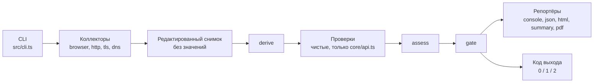
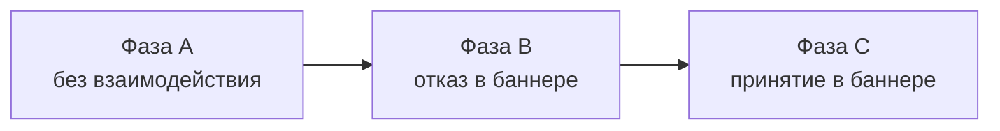

# Архитектура одним взглядом

`dsgvo-check` — пассивный CLI-сканер сайтов на TypeScript и Playwright: ищет признаки нарушений DSGVO/TDDDG/DDG и базовые проблемы безопасности, а по найденному роняет CI. Весь ввод-вывод делают коллекторы и редактируют данные до записи в снимок, всё остальное — чистые функции, а уровни находок задают данные в `test/data`, не код проверок.

Код выхода: `0` — причин для отказа нет; `1` — достигнут порог `--fail-on` (по умолчанию `critical`); `2` — сбой скана или записи отчёта (приоритетнее `1`), ошибка значимой проверки либо сработал `--strict`.

Правила для агентов — в [AGENTS.md](../AGENTS.md), документация для пользователей — в [README.md](../README.md).

## Схема



- Коллекторы — единственное место с I/O: значений cookies, Web Storage и TC-String нет ни в снимке, ни в отчёте, ни в логах (правило 2 [AGENTS.md](../AGENTS.md)).
- `derive`, проверки, `assess` и `gate` — чистые функции; проверки импортируют только [api.ts](../src/core/api.ts), это проверяет [import-graph.test.ts](../test/unit/core/import-graph.test.ts).
- Уровни, `gating` и `crmCode` — данные в `test/data/ruleset`.

Браузерный коллектор проходит три фазы, каждую в свежем профиле Chromium: cookies и хранилище предыдущей фазы не переносятся.



## Дерево

Только каталоги и ключевые файлы, список сверен с `git ls-files`. `schema/` и `dist/` создаёт `corepack pnpm build`, в git их нет. `test/data/` входит в npm-пакет и в образ: там ruleset, тексты, словари, каталог сервисов и шаблон отчёта.

```text
dsgvo-check/
├── .github/
│   ├── scripts/               # TS-логика шагов CI: версия, релиз, проверки
│   └── workflows/             # ci.yml и release.yml
├── canary/
│   └── sites.example.yaml     # пример корпуса; настоящий sites.yaml локальный
├── docker/
│   ├── entrypoint.sh          # точка входа образа: seccomp, CLI под tini
│   └── seccomp-chromium.json  # профиль seccomp для песочницы Chromium
├── docs/
│   └── architecture.md        # этот файл
├── examples/github-failing/   # пример «красной» сборки GitHub
├── scripts/
│   ├── canary/                # раннер канарейки: прогон, агрегация, сводка
│   ├── emit-env-example.ts    # .env.example из схемы настроек
│   ├── emit-registry.ts       # таблица вариантов в README.md из ruleset
│   └── emit-schema.ts         # schema/report.schema.json из zod-схемы
├── specs/                     # требования заказчика: идея, ТЗ, каталог проверок
├── src/
│   ├── cli.ts                 # CLI на commander: скан, report, install
│   ├── index.ts               # программный API: scan, gate, схема
│   ├── scan.ts                # оркестратор: сбор, derive, проверки, assess, gate
│   ├── scan-collect.ts        # сбор: коллекторы под общим дедлайном
│   ├── scan-options.ts        # опции скана: умолчания и проверка
│   ├── checks/                # проверки: чистые функции над срезом снимка
│   │   ├── browser/           # CONSENT, EMBED, LEGAL, PRIV, TRACK
│   │   ├── dns/               # MAIL-01, MAIL-02; lib/ — разбор SPF и DMARC
│   │   ├── http/              # HDR-01, TLS-01, TLS-02
│   │   └── index.ts           # явный реестр всех проверок
│   ├── cmp/                   # распознавание баннера CMP и клик по выбору
│   │   ├── adapters/          # адаптеры: Borlabs, Cookiebot, Usercentrics и др.
│   │   ├── page/              # код внутри страницы: замер баннера
│   │   ├── classify.ts        # первый слой: отказ, согласие, цель клика
│   │   └── lexicon.ts         # лексикон кнопок
│   ├── collectors/            # весь I/O; редактируют данные до записи
│   │   ├── browser/           # Chromium: фазы A, B, C
│   │   │   ├── in-page/       # код внутри страницы: DOM, хранилище, нажатия
│   │   │   ├── launch/        # запуск Chromium, SSRF-граница сети
│   │   │   ├── legal/         # Impressum и Datenschutzerklärung
│   │   │   ├── pages/         # выбор страниц, robots.txt, навигации, WAF
│   │   │   ├── phases/        # phase-a.ts, consent-phase.ts (B и C)
│   │   │   ├── recording/     # запросы, cookies и Web Storage без значений
│   │   │   └── collector.ts   # сбор по фазам
│   │   ├── dns/               # MX, DMARC (Tree Walk), SPF
│   │   ├── http/              # HTTP-пробы класса T: редиректы, заголовки
│   │   └── tls/               # рукопожатия; HTTP CONNECT для --proxy
│   ├── core/                  # контракты и чистая логика, проверок не знает
│   │   ├── api.ts             # единственный модуль ядра для проверок
│   │   ├── config/            # настройки: схема, env, .env, пороги
│   │   ├── data/              # загрузка test/data, тексты, дисклеймер
│   │   ├── evaluation/        # контракт проверки, assess, gate
│   │   ├── redaction/         # редактирование заголовков и текста
│   │   ├── report/            # схема отчёта, сборка, контракт репортёра
│   │   ├── runtime/           # ошибки, логгер, User-Agent, версия
│   │   ├── snapshot/          # снимок и контракт коллектора
│   │   └── url/               # цель, санитизация URL, e-mail, адреса
│   ├── derive/                # сторонний ли хост, какой сервис, стадия
│   └── reporters/             # console, json, html, summary, pdf, write.ts
├── templates/gitlab/          # шаблон GitLab CI на том же образе
├── test/
│   ├── data/                  # данные пакета: идут в npm и образ
│   │   ├── browser/, cmp/     # словари и сигнатуры браузерного коллектора
│   │   ├── http/, legal/      # слова HTTP-коллектора, юридические ссылки
│   │   ├── report/report.html # шаблон HTML-отчёта
│   │   ├── ruleset/de-2026/   # варианты, уровни, gating, коды CRM
│   │   ├── services/          # каталог сервисов (Apache-2.0)
│   │   ├── texts/{de,en}/     # все пользовательские строки
│   │   └── routing.yaml       # какая проверка владеет категорией сервиса
│   ├── unit/                  # L0–L1: без браузера и сети
│   ├── integration/           # L2: Chromium, undici, node:tls, DNS на loopback
│   ├── e2e/                   # L3: собранный CLI, образ, Action
│   ├── live/                  # живые сайты; в pnpm test не входит
│   ├── fixture-server/        # сервер виртуальных хостов с настоящим TLS
│   ├── fixtures/              # снимки HTTP-проверок, образец отчёта
│   └── utils/                 # общие помощники тестов
├── Dockerfile                 # образ: Node 26, Chrome for Testing, non-root
├── action.yml                 # composite Action: docker run образа
├── AGENTS.md                  # правила для агентов и людей, команды
├── README.md                  # документация для пользователей (Deutsch)
└── …                          # LICENSE, NOTICE, .env.example, package.json, vitest.config.ts
```

## Куда смотреть, если нужно …

| Нужно | Куда смотреть |
|---|---|
| Добавить проверку | `src/checks/<module>/<id>.ts` и строка в `index.ts` модуля; варианты, уровни и `crm` — `test/data/ruleset/de-2026/<module>.yaml`; тексты — `test/data/texts/{de,en}/<module>.yaml`; фикстуры — `test/unit/checks/browser/scenarios/`, [fixtures.ts](../test/unit/checks/dns/fixtures.ts) для DNS или `test/fixtures/snapshots/http/<ID>/`; затем `corepack pnpm registry`. Образец — [contract-example.test.ts](../test/unit/core/evaluation/contract-example.test.ts), шаги — в [AGENTS.md](../AGENTS.md); имена вариантов запланированной проверки — в таблице «Geplante Prüfungen» [README.md](../README.md) |
| Поменять уровень, `gating`, `crmCode` или имя варианта | [browser.yaml](../test/data/ruleset/de-2026/browser.yaml), [http.yaml](../test/data/ruleset/de-2026/http.yaml), [dns.yaml](../test/data/ruleset/de-2026/dns.yaml) в `test/data/ruleset/de-2026/`; затем `corepack pnpm registry` обновит таблицу вариантов в [README.md](../README.md), раздел «Was geprüft wird» |
| Поменять текст находки | [browser.yaml](../test/data/texts/de/browser.yaml), [http.yaml](../test/data/texts/de/http.yaml), [dns.yaml](../test/data/texts/de/dns.yaml) в `test/data/texts/de/` и их зеркало в `en/`; правила формулировок — правило 3 в [AGENTS.md](../AGENTS.md), их проверяют [stopwords.test.ts](../test/unit/core/data/stopwords.test.ts) и [wording.test.ts](../test/unit/checks/browser/wording.test.ts) |
| Поменять шаблон отчёта | разметка и стили — [report.html](../test/data/report/report.html); подписи — [report.yaml](../test/data/texts/de/report.yaml) (и в `en/`); какие данные попадают в шаблон — [report-view.ts](../src/reporters/report-view.ts); язык шаблона — [template.ts](../src/reporters/template.ts); PDF печатает тот же HTML ([pdf.ts](../src/reporters/pdf.ts)). Консоль и Job Summary — [console.ts](../src/reporters/console.ts) и [summary.ts](../src/reporters/summary.ts) |
| Добавить сервис в каталог или сменить его категорию | `test/data/services/*.yaml` (формат записи — [_catalog.yaml](../test/data/services/_catalog.yaml)); какая проверка владеет категорией — [routing.yaml](../test/data/routing.yaml) |
| Поддержать новый CMP или подпись кнопки | id в `KNOWN_CMP_IDS` ([types.ts](../src/cmp/types.ts)), адаптер в `src/cmp/adapters/` (чтение API) и регистрация в [src/cmp/index.ts](../src/cmp/index.ts); признаки, версии и селекторы — [adapters.yaml](../test/data/cmp/adapters.yaml); подписи кнопок — [lexicon.yaml](../test/data/cmp/lexicon.yaml); ручной стенд — `test/fixture-server/sites/cmp/<имя>/` и [sites.ts](../test/fixture-server/sites.ts); тесты — `test/integration/cmp/` |
| Добавить или поменять слово, имя параметра или cookie, сигнатуру бот-защиты, ключевое слово страницы | YAML из таблицы «Словари и сопоставления» ниже: [browser/](../test/data/browser), [cmp/](../test/data/cmp), [http/](../test/data/http), [legal/links.yaml](../test/data/legal/links.yaml); новый ключ верхнего уровня — со схемой (`dataSection`) и строкой в [sections.test.ts](../test/unit/core/data/sections.test.ts) |
| Добавить или изменить порог, таймаут, лимит | поле в схеме [schema.ts](../src/core/config/schema.ts) (умолчание, границы, описание); имя переменной выводится из пути; затем `corepack pnpm env:example`. Коллекторы читают значение из `ctx.config`, проверки — из `ctx.thresholds`; протокольные константы и защитные пределы остаются в коде |
| Понять или изменить код выхода и порог | [gate.ts](../src/core/evaluation/gate.ts) (чистая функция) и [gate.test.ts](../test/unit/core/evaluation/gate.test.ts) |
| Проверить, что в снимок не попали значения | [redact.ts](../src/core/redaction/redact.ts), [email.ts](../src/core/url/email.ts), [url.ts](../src/core/url/url.ts), [headers.ts](../src/core/redaction/headers.ts); редактирует коллектор до записи |
| CI проекта и релиз | [ci.yml](../.github/workflows/ci.yml), [release.yml](../.github/workflows/release.yml); логика шагов — в TypeScript, `.github/scripts/` |
| GitHub Action и GitLab | [action.yml](../action.yml), [шаблон GitLab](../templates/gitlab/dsgvo-check.gitlab-ci.yml), [пример](../examples/github-failing/README.md); контракты поставки проверяет [delivery-config.e2e.test.ts](../test/e2e/delivery-config.e2e.test.ts) |
| Docker | [Dockerfile](../Dockerfile), [entrypoint.sh](../docker/entrypoint.sh), [seccomp-chromium.json](../docker/seccomp-chromium.json); описание для пользователей — [README.md](../README.md), раздел «Docker»; e2e образа — [docker.e2e.test.ts](../test/e2e/docker.e2e.test.ts), запускается только при `DSGVO_E2E_IMAGE` |
| Канарейка | [README.md](../README.md), раздел «Canary» (правила, этика, запуск); [sites.example.yaml](../canary/sites.example.yaml), раннер [main.ts](../scripts/canary/main.ts) и соседние файлы в [scripts/canary/](../scripts/canary/); настоящий `canary/sites.yaml` и `canary/results/` лежат только локально, в `.gitignore` |
| Запустить тесты, добавить сайт в стенд | [README.md](../README.md), раздел «Entwicklung» → «Tests»: уровни, параллельность (`DSGVO_TEST_WORKERS`), сеть в L2; сайт в стенд — [sites.ts](../test/fixture-server/sites.ts) и `test/fixture-server/sites/<модуль>/` |

## Словари и сопоставления

Всё, что меняется вместе с внешним миром, лежит в YAML рядом с остальными данными, а не в константах кода: слова и фразы, имена параметров и cookies, сигнатуры бот-защиты, селекторы и признаки CMP, пути и расширения страниц.

| Каталог `test/data/` | Что внутри | Кто читает |
|---|---|---|
| `cmp/lexicon.yaml` | подписи кнопок первого слоя, слова баннера, Pur-Abo | коллектор (`loadLexicon`), CONSENT-04 |
| `cmp/adapters.yaml` | признаки, версии, селекторы баннера и кнопок, шаблон бота каждого адаптера | адаптеры (`adapterData`), CONSENT-04 (список известных CMP) |
| `cmp/categories.yaml` | имена необходимых категорий согласия | CONSENT-04 |
| `cmp/probe.yaml` | атрибуты для селектора кнопки | замер баннера (в страницу — аргументом) |
| `legal/links.yaml` | подписи, ключи и пути юридических ссылок, пробные пути | коллектор, LEGAL-01 |
| `browser/identifiers.yaml` | имена параметров и cookies с идентификаторами, параметры Consent Mode | рекордер запросов |
| `browser/challenges.yaml` | сигнатуры WAF и бот-защиты | `detectChallenge` |
| `browser/dom.yaml` | словарь разметки для кода внутри страницы | `domFactsInPage`, `documentInPage`, `bannerBoxInPage` — аргументом `evaluate` |
| `browser/pages.yaml` | ключевые слова дополнительных страниц, исключённые пути, расширения файлов | `selectPages` |
| `http/html.yaml` | слова поиска и юридических ссылок в префиксе HTML | `detectForm`, `findLegalLinks` |
| `services/_catalog.yaml` | параметры, заданные при визите; буквы `gcd` | derive |

- У каждого файла свой ключ верхнего уровня со zod-схемой (`dataSection` в [parse.ts](../src/core/data/parse.ts)); [sections.test.ts](../test/unit/core/data/sections.test.ts) проверяет, что схема есть у каждого файла и ключа и каждая загружается.
- Коллектор читает секцию через `loadSection`, проверка — из `ctx.data.<каталог>` (`data: ['<каталог>']` в `defineCheck`), код страницы получает значения аргументом `evaluate`: он ничего не может импортировать.
- Ошибка в файле — `DataError` с каталогом и путём ключа, например `test/data/browser: challenges.titles.0.pattern: invalid regular expression`.
- В коде остаются таблицы логики (сопоставления внутренних типов, коды ошибок Node и Chromium, словарь протоколов HTTP, TLS и DNS, стандартная разметка) и всё, что защищает приватность: allowlist query в [url.ts](../src/core/url/url.ts), allowlist заголовков в [headers.ts](../src/core/redaction/headers.ts), скрытые поля в [report-view.ts](../src/reporters/report-view.ts). Правка словаря не должна ослабить правило 2.

## Настройки

- Все пороги, таймауты, паузы и лимиты описывает одна схема — [schema.ts](../src/core/config/schema.ts): у настройки есть умолчание, границы и описание, имя переменной — `DSGVO_CHECK_<РАЗДЕЛ>_<ИМЯ>` с единицей в конце (`_MS`, `_BYTES`, `_DAYS`). Константы протоколов (SPF, DMARC) и защитные пределы (редактирование, размеры разбора чужого содержимого) остаются в коде.
- Приоритет: флаг CLI → переменная окружения → `.env` в текущем каталоге → умолчание. `.env` необязателен; его читает `util.parseEnv` и ничего не пишет в `process.env`, поэтому чужие переменные не доходят до Chromium.
- Неверное значение — код 2 (`invalid-config`): причина — id с параметрами ([problems.ts](../src/core/config/problems.ts)), текст `config.problem.<id>` лежит в `test/data/texts/{de,en}`.
- Паузы правила 1 (`DSGVO_CHECK_BROWSER_NAVIGATION_PAUSE_MS` ≥ 1500, `DSGVO_CHECK_BROWSER_RETRY_DELAY_MS` ≥ 3000, `DSGVO_CHECK_HTTP_MIN_INTERVAL_MS` ≥ 500) можно только ужесточать: нижняя граница равна умолчанию.
- Коллекторы берут значения из `ctx.config`, проверки — из `ctx.thresholds` и не импортируют конфиг; отличия от умолчаний попадают в отчёт (`scan.options.settings`, без секретов).
- [.env.example](../.env.example) генерирует `corepack pnpm env:example` (`env:example:check` ловит расхождение). В его конце блок `tests` с `DSGVO_TEST_WORKERS` — число параллельных файлов тестов, его читает только [vitest.config.ts](../vitest.config.ts), сканер нет.
