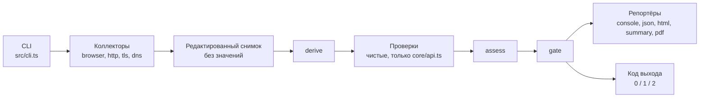
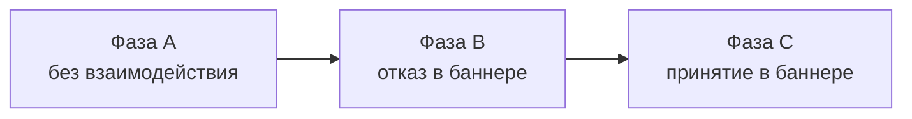
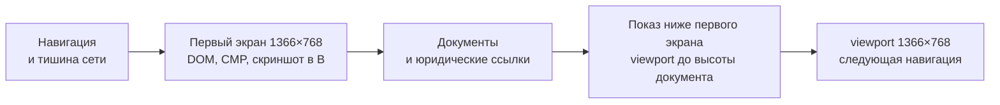

# Архитектура одним взглядом

`dsgvo-check` — пассивный CLI-сканер сайтов на TypeScript и Playwright: ищет признаки нарушений DSGVO/TDDDG/DDG и базовые проблемы безопасности, а по найденному роняет CI. Весь ввод-вывод делают коллекторы и редактируют данные до записи в снимок, всё остальное — чистые функции, а уровни находок задают данные в `test/data`, не код проверок.

Код выхода: `0` — причин для отказа нет; `1` — достигнут порог `--fail-on` (по умолчанию `critical`); `2` — сбой скана или записи отчёта (приоритетнее `1`), ошибка значимой проверки либо сработал `--strict`.

Правила для агентов — в [AGENTS.md](../AGENTS.md), документация для пользователей — в [README.md](../README.md).

## Схема



- Коллекторы — единственное место с I/O: значений cookies, Web Storage и TC-String нет ни в снимке, ни в отчёте, ни в логах (правило 2 [AGENTS.md](../AGENTS.md)).
- Заголовки ответов HTTP-коллектор и браузер записывают через один нормализатор [headers.ts](../src/core/redaction/headers.ts): значение остаётся только у заголовков безопасности и технических (`VALUE_HEADERS`), URL санитизируются, остальное — `[redacted]`. Относительные URL, URL других схем и URL с query (`report=/r/…`, `//host/r?u=…`, `wss://…?token=…`) разрешаются по адресу ответа и санитизируются; `@`, который санитайзер не прочёл как адрес (домен без точки, ничего после `@`), делает такой URL целиком `[redacted]`. Адреса и `mailto:` в значениях — до домена, слово с `@`, в том числе percent-encoded, — `[redacted]`; у `Link` так же редактируется и текст вне `<…>`. Текст, приклеенный к URL с query или фрагментом (`?ids=1,2`, `?q=O(x)`, `?u=a'b`), до пробела, `;` или запятой перед пробелом входит в его query; URL в кавычках кончается закрывающей кавычкой. Ссылка из одного фрагмента (`anchor="#…"`) не хранится. Токен CSP с `http(s)://`, в котором есть кавычка или угловая скобка, сокращается до источника. Из `Set-Cookie` остаётся только имя по одному правилу с браузером (`setCookieName`): пара без `=` — безымянная cookie, её текст — значение, имени у неё нет. У заголовков продукта (`PRODUCT_HEADERS`: `Server`, `X-Powered-By`, `X-Generator`, `X-Redirect-By`, `X-AspNet-Version`, `X-AspNetMvc-Version`) значение тоже `[redacted]`, а рядом лежит `productVersions` — до четырёх пар `product/version` по грамматике токенов RFC 9110. Комментарии в скобках, строки в кавычках и текст, приклеенный к ним без пробела, имена продуктов с точкой или вида идентификатора (больше четырёх цифр, слово длиннее 20 символов, hex от восьми знаков), версии вида хоста, с hex-хешем в суффиксе или из четырёх чисел (IPv4, в том числе восьмеричная запись) и всё, что не проходит строгую форму, не сохраняются. Имя продукта из одного слова не отличить от имени хоста без точки. Пустой массив — значение разобрано и версии нет; поля нет — снимок старше, и HDR-02 даёт `inconclusive` (`values-not-stored`). У `<meta http-equiv>` с именем заголовка продукта `productVersions` не хранится: это текст страницы, а не заголовок ответа.
- Сертификаты в снимке ([probe.ts](../src/collectors/tls/probe.ts)): значение атрибута subject и issuer или имя `DNS:` с `@` (в том числе с экранированием RFC 4514, в кавычках или percent-encoded) хранится как `[redacted]@домен` последнего адреса в нём, а без прочитанного адреса — `[redacted]`. В остальных значениях `mailto:` — до домена, query любого URL (в том числе относительного и других схем) — `?[redacted]`, фрагмент не хранится. Из SAN хранятся только `DNS:` вида имени хоста (иначе `[redacted]`) и `IP Address:` — их читает TLS-02; сверку имени хоста коллектор делает по сырому сертификату.
- `derive`, проверки, `assess` и `gate` — чистые функции; проверки импортируют только [api.ts](../src/core/api.ts), это проверяет [import-graph.test.ts](../test/unit/core/import-graph.test.ts).
- Уровни, `gating` и `crmCode` — данные в `test/data/ruleset`.
- Проверка получает секции из `requires` (нет секции — `skipped` или `error`) и, если они есть в снимке, секции из `optional`. Коллекторы выбираются только по `requires` ([scan-collect.ts](../src/scan-collect.ts), `requiredCollectors`): TLS-01 читает ссылки фазы A из `browser`, но `--checks TLS-01` браузер не запускает. `slice.unavailable` называет опциональные секции, которые скан собирался получить и не получил (коллектор пропущен, упал или срезан таймаутом); секция коллектора со статусом `not-run` просто отсутствует.

Браузерный коллектор проходит три фазы, каждую в свежем профиле Chromium: cookies и хранилище предыдущей фазы не переносятся.

DNS собирается в два этапа. Первый идёт параллельно с http и tls и опрашивает только сканируемый домен (`dns.queryBudget`). Второй ([collectDnsFollowUp](../src/collectors/dns/index.ts)) идёт после браузера и после подстановки конечного URL из HTTP, поэтому знает и конечный хост, когда браузер пропущен как `tls-blocked` или `tls-fallback-failed`; если браузер начал с цели http-редиректа (`plan.browserEntry`), Impressum и конечный хост берутся с неё. Он берёт цели из [mail-targets.ts](../src/collectors/dns/mail-targets.ts): регистрируемый домен конечного хоста, если редирект ведёт на другой домен (`final`), и точные домены адресов из Impressum (`contact`: текст документа без частей `hidden-irrelevant` и `mailto:` в содержимом страниц с ролью `impressum`, сначала адреса текста, потом получатели `mailto:`; не больше `dns.maxMailDomains`, без фримейла). У каждой цели свой бюджет `dns.mailDomainQueryBudget`; кэш, номера запросов, счётчик таймаутов и остановка по `--timeout` общие с первым этапом. Запросы дописываются в `dns.queries`, цели и их статус — в `dns.mailDomains`, сам этап — в `dns.mailDomainStage`. MAIL-01 и MAIL-02 оценивают каждую цель отдельно: у сканируемого домена subject прежний (`dmarc`, `spf`), у остальных — `dmarc@final`, `dmarc@contact:<домен>`, поэтому `assess` не сливает находки разных доменов, а отпечатки старых находок не меняются. Сбой ответа у сканируемого домена — ошибка проверки, у другой цели — ограничение `mail-domain-unresolved:<домен>`.

Формы на страницах по plain http видит HTTP-коллектор и шаг после браузера. Коллектор читает формы по всему прочитанному телу (`DOCUMENT_READ_BYTES`, 512 KiB сырых байт), а не по префиксу 64 KiB: у http-хопа 2xx с HTML есть `hasForm`, `forms` (до пяти форм, которые принимают данные кроме поиска по сайту: санитизированный `action`, его схема и `method`; имена и значения полей не хранятся) и `formInspection` (`complete`, `truncated` — тело обрезано, `unavailable` — `Content-Encoding` без декодера, битый или незавершённый сжатый поток; без `Content-Type` такие байты тоже считаются страницей). Теги читаются сканером, который держит значение атрибута в кавычках внутри тега: `<form` или `>` в значении поля — текст, поэтому значение поля не становится формой или её `action`. Относительный `action` разрешается по первому `<base href>`, пустой — по адресу страницы. У Impressum и Datenschutzerklärung, чья цепочка закончилась на http, те же поля лежат в `DocumentResponse`. Браузер пишет у формы `FormFact.takesInput` по тем же правилам, что и разбор разметки (слова поиска из `html.yaml` и типы полей без ввода передаются аргументом `evaluate`). После DNS-шага [form-twins.ts](../src/collectors/http/form-twins.ts) берёт страницы фазы A с такой формой на хостах, чья цепочка `http://<host>/` (корень, стандартный порт; цепочка цели с путём не в счёт) закончилась страницей по http, и делает один GET `http://`-адреса каждой: без перехода по редиректу и без отправки формы, не больше `http.formTwinPages`, через `HttpClient` с той же паузой на хост. Остаток того же бюджета идёт на пермалинки: ссылки страниц фазы A, у которых `rel` содержит тип ссылки HTML `bookmark` (браузер пишет у ссылки `LinkFact.permalink`; это стандартная разметка, поэтому правило в коде, а не в словаре; в старых снимках поля нет, и пермалинков нет), — так WordPress ссылается на пост его датой, а бюджет страниц фазы A до постов с формой комментариев обычно не доходит. Сначала ссылки стартовой страницы, затем остальных страниц в порядке посещения, внутри страницы — в порядке документа; на тех же хостах, без query и порта, без адресов, которые фаза A посетила (запрошенный и конечный адрес страницы), и без уже запрошенных; каждый адрес один раз. После ответа 429 или 503 хост в этом шаге больше не запрашивается (до повтора клиента дело не доходит), оставшиеся страницы получают исход `throttled` без запроса; хосты из `throttledHosts` не берутся вовсе. Адреса с query, портом или отредактированной частью и уже запрошенные коллектором (корни, юридические документы) не берутся; формы с e-mail или паролем идут первыми. Ответы пишутся в `http.twins` (страница — у пермалинка адрес ссылки, адрес, `source`: `input-form` или `permalink`, у пермалинка `linkedFrom` — страница фазы A со ссылкой, хоп с фактами форм, исход, `challenge`; без `source` в старых снимках — `input-form`), сам шаг — в `http.formTwinStage` (бюджет, число страниц с формой `candidates` и пермалинков `permalinkCandidates`, ошибка); запросы прибавляются к `http.requestsIssued`, пробы — к `plan.probes` с назначением `form-twin` или `permalink-twin`. Как и второй этап DNS, шаг не отдельный коллектор в `collection`: при сбое секция остаётся, а TLS-01 получает ограничение `http-form-twins-not-collected`. TLS-01 собирает формы входов, документов и близнецов в одну находку `form-on-http-page` на роль хоста (subject `http-entry:<роль>`; у входа роль хоста входа, у остальных — хоста страницы), страницы перечисляются, `action` первой формы — в параметрах и в улике `page` (`formAction`). Страница пермалинка считается как остальные; её улика `page` имеет роль `http-form-permalink`, число таких страниц — параметр `permalinks`, и текст говорит, что адрес запрошен как http-адрес поста или статьи, на который ссылаются посещённые страницы, а браузер его не посещал. Обрезанное или нечитаемое тело без найденной формы и юридический документ, на месте которого по http пришёл challenge бот-защиты, дают `http-form-not-inspected:<url>`, близнец без пригодного ответа (сбой, challenge, редирект на другой http-адрес, 429, 5xx) — `http-form-twin-undecided:<страница>`, страниц с формой больше бюджета — `http-form-twins-capped` (пермалинки сверх бюджета ограничения не дают: есть ли у них форма, неизвестно, как и у страниц, которые фаза A не посетила); редирект близнеца на https — чисто. Форма https-страницы с `action` на http — не TLS-01.

DKIM (MAIL-03) опрашивается в конце обработки каждой цели, после дерева SPF и из её же бюджета, поэтому не отнимает запросы у MAIL-01 и MAIL-02. План селекторов строит чистая [dkim.ts](../src/checks/dns/lib/dkim.ts) по уже полученным MX и SPF: сначала `dns.dkimSelectors` (`selector` для всех доменов или `domain/selector`), затем селекторы провайдера из [dkim.yaml](../test/data/dns/dkim.yaml), если совпали и суффикс MX, и include в дереве SPF, затем общие имена; без повторов, не больше `dns.dkimMaxSelectors` запросов; заданный селектор сверх предела остаётся в плане с `capped` и не опрашивается. Домен с Null MX или без MX и без SPF не опрашивается. План с причиной (`operator`, `provider:<id>`, `common`) и признаком `given` (селектор задал оператор или провайдер всегда им подписывает) пишется в `dns.dkimPlan` и сохраняется, даже если бюджет кончился, поэтому проверка отличает неопрошенный селектор от отсутствующего. По именам SPF и селекторов сохраняются записи SPF и записи ключей DKIM (тег версии DKIM или `p=`), потому что один ответ служит обоим разборам; остальной TXT отбрасывается с подсчётом в `filteredAnswers`. Таймауты запросов DKIM не считаются в предохранителе `resolver-unresponsive`: сервер, роняющий запросы к `_domainkey`, не должен лишать следующий домен ответов MX, DMARC и SPF. CNAME разрешает резолвер (c-ares отдаёт TXT цели, висячий CNAME — NXDOMAIN). Проверка читает теги по RFC 6376 §3.2 и длину модуля RSA из DER (SubjectPublicKeyInfo или PKCS#1), Ed25519 — ровно 32 байта, пустой `p=` — отозванный ключ; разбор никогда не бросает исключение. `key-too-short` — RSA короче `ctx.thresholds.dns.dkimMinRsaBits`; `given-selector-missing` — ни на одном опрошенном селекторе нет записи ключа, а заданные или фиксированные провайдером есть в плане; иначе `selectors-not-found` (info). Сбой ответа без найденного ключа — ошибка, неопрошенный из-за бюджета селектор — `inconclusive` `dns-budget-exhausted`, нечитаемый ключ (в том числе другой версии DKIM) — `inconclusive` `key-unparsable`, отозванный — `key-revoked`, заданный селектор сверх предела — `dkim-selectors-capped`, снимок без `dkimPlan` — `inconclusive` `dkim-not-collected`. Subject — `dkim` (наличие ключа) и `dkim:<селектор>` (длина), у других целей с суффиксом `@final` и `@contact:<домен>`.



На каждой странице сначала снимается первый экран, затем показывается остальное. В B и C стартовая страница доходит до показа только после клика (в B — после перезагрузки), контрольные страницы — после своих фактов.



- Показ — [reveal.ts](../src/collectors/browser/pages/reveal.ts): `page.setViewportSize` до высоты документа, не выше `browser.revealMaxHeightPx`, затем `waitForQuiet` не дольше `browser.revealDwellMs` и жёсткого предела фазы, затем прежний viewport. Событий прокрутки, колеса и ввода нет: баннер, считающий прокрутку согласием, не срабатывает. Не меняется страница, которая помещается в окно, не прокручивается (`overflow: hidden` у корня, как под блокирующим баннером) или сама прокрутилась вниз: смена размера может вернуть её наверх, а это событие прокрутки. Если браузер не подтвердил возврат 1366×768 (`viewportSize()` Playwright сообщает запрошенный размер ещё до подтверждения) или вызов размера не завершился вовремя (он ещё может сработать после возврата), фаза дальше не навигирует: `partial`, причина `viewport-not-restored`. Ошибки шага — только своими словами, без текста исключений страницы.
- Запросы после показа рекордер помечает `afterReveal: true` до следующей навигации; классификация по моменту (`timing`) не меняется, улика запроса несёт тот же флаг. Cookies и хранилище, появившиеся за время показа, снимаются ещё раз для той же страницы; ответы 429/503 целевого хоста считаются для троттлинга, как запросы самой страницы.
- `PageVisit.reveal` — исход (`revealed`, `fits-viewport`, `scroll-locked`, `scrolled`, `failed`), высота документа и окна, `capped`. EMBED-01, EMBED-02 и EMBED-03 дают ограничение `reveal-height-capped`, если в фазах A или B страница была выше предела; при `browser.revealDwellMs = 0` коллектор пишет пробел наблюдения `below-fold-not-revealed`.
- `affects` у `SCAN-BLOCKED` и `SCAN-THROTTLED` ([navigate.ts](../src/collectors/browser/pages/navigate.ts)) — проверки, которым не хватает фактов браузера. Заблокированная страница: проверки, читающие страницу её роли (`blockedAffects`), в фазе A ещё TLS-01 (читает ссылки каждой страницы фазы A) и для Impressum — MAIL-01, MAIL-02 и MAIL-03 (их домены из Impressum, `dns.mailDomains`). Сверх роли учитываются виды юридических документов, ради которых фаза A читает страницу (`PageQueue.legalKindsOf` → `VisitSpec.legalKinds`): все виды страницы в очереди (общая страница политики и Impressum сохраняет роль первого вида, второй — в `alsoKinds`), а на контактной и промежуточной страницах — ещё не найденные и не поставленные в очередь документы, чьи ссылки там ищут и чьим Impressum страница может стать сама. Impressum добавляет LEGAL-01, LEGAL-02 и MAIL-01–03, политика — LEGAL-01, LEGAL-02, PRIV-01 и PRIV-02. Дополнительное уведомление о данных политикой не считается. Троттлинг (`throttledAffects`): браузерные проверки, в фазе A ещё TLS-01 и MAIL-01–03. Ожидание теста выводится из `requires`/`optional` проверок и из того, чей результат зависит от `dns.mailDomainStage`.

Диалог, который CMP не открыла сканеру: адаптер CCM19 отмечает `firstLayer.dialogNotOpened`, если на первом экране фазы B или C после ожидания баннера виджет всё ещё скрыт, все его кнопки отключены и ответа нет (`markDialog` в [src/cmp/index.ts](../src/cmp/index.ts) оставляет флаг только после истёкшего ожидания). Если у адаптера есть собственный тест производителя на краулеров (`dialogBotUserAgent` в [adapters.yaml](../test/data/cmp/adapters.yaml): шаблон и флаги из скрипта производителя и подпись для отчёта, сейчас только `isBotBrowser` CCM19), `withDialogBotSignal` в [bot-user-agent.ts](../src/cmp/bot-user-agent.ts) читает `navigator.userAgent` самой страницы и при совпадении добавляет в `botSignals` сигнал `bot-user-agent` с подписью теста в `detail`. User-Agent в факты не попадает; у адаптеров без теста он не читается. Тест CCM19 ловит ` (+http` токенов поисковых роботов, поэтому в честном User-Agent сканера ссылка на репозиторий стоит после описания и без `+` ([user-agent.ts](../src/core/runtime/user-agent.ts)): виджет открывается сканеру, как посетителю. Что User-Agent сканера не совпадает с тестами краулеров из данных CMP, кроме теста Real Cookie Banner (он берёт любые `http` и `check`, а без имени и ссылки User-Agent не честный), проверяет [bot-user-agent.test.ts](../test/unit/cmp/bot-user-agent.test.ts). Проверки, читающие бот-сигналы (`signalOutcome` в [signals.ts](../src/checks/browser/signals.ts)), дают `inconclusive` с причиной `cmp-bot-user-agent` и `SCAN-BOTMODE` с `cause: user-agent` и `test`; первая страница — состояние баннера `dialogNotOpenedBot`. Без совпадения остаётся `cmp-dialog-not-opened`.

Отказ в фазе B нажимается на первом слое. Если первый слой распознанного с уверенностью `high` баннера отказа не содержит (`nonblocking-no-reject`, `blocking-no-reject`, `no-choice-at-first-layer`), а данные адаптера описывают слой настроек (`settingsLayer` в [adapters.yaml](../test/data/cmp/adapters.yaml), сейчас только Wix), фаза B отказывает через него ([consent-phase.ts](../src/collectors/browser/phases/consent-phase.ts), `rejectViaSettings`).

- Решают чистые функции [settings-layer.ts](../src/cmp/settings-layer.ts): `chooseSettingsOpener` — ровно одна доступная кнопка первого слоя с ролью производителя `settings` и подписью настроек; `chooseSettingsSave` — слой открылся в одном контейнере, каждый переключатель, который посетитель может менять, читается и выключен, и есть ровно одна доступная кнопка с ролью производителя `reject` (иначе `save`), чья подпись — отказ или сохранение, не согласие. Переключатели не трогаются никогда: при уже включённой группе ничего не нажимается (`preselected-groups`). Заблокированный переключатель сам не говорит о назначении группы, поэтому включённых заблокированных может быть не больше, чем необходимых групп производителя (`settingsLayer.essentialGroups`, у Wix 1); лишний считается предвключённой группой, нечитаемый переключатель — `settings-groups-unreadable`.
- Адаптер (`openSettings` в [base.ts](../src/cmp/adapters/base.ts)) нажимает выбранную кнопку настроек, ждёт слой не дольше `cmp.waitMs` (в пределах `browser.cmpCallTimeoutMs`) и измеряет его как первый слой, но по контейнерам `settingsLayer`: первый слой Wix остаётся открытым за слоем и в измерение не попадает. Переключатели читает тот же зонд в том же контейнере, что и кнопки (`switches` в [probe.ts](../src/cmp/page/probe.ts)), поэтому скрытая копия слоя не подменяет видимый; визуально скрытый checkbox внутри видимого переключателя (так у Wix) читается со своим состоянием `checked` и `disabled`. Кнопка сохранения нажимается обычным `act`: состояние перед этим кликом, а не перед открытием настроек, сравнивает `verify`, затем перезагрузка и контрольные страницы, как при отказе первого слоя.
- Селекторы Wix сверены с очищенной разметкой баннера производителя (cookie-consent-banner-for-uou 1.871.0, [settings-layer.html](../test/fixtures/cmp/wix/settings-layer.html)): [wix-captured-markup.test.ts](../test/integration/cmp/adapters/wix-captured-markup.test.ts) проверяет, что каждый селектор `adapters.yaml` находит там ровно тот элемент, который найден по роли и подписи, что каждый `data-hook` из данных Wix есть в этой разметке и что симулятор рисует слой с теми же hook, ролями, подписями и состояниями переключателей.
- Момент клика — сохранение: `markClickAt`, `actionId` и `afterClick` относятся к нему, поэтому запросы, пока настройки открыты, — до взаимодействия, а не после отказа.
- В снимке: `plan.click.B.target` и `reason` остаются решением первого слоя, `plan.click.B.settings` — кнопки настроек и сохранения или причина без нажатия (`settings-control-not-found`, `settings-not-opened`, `settings-layer-ambiguous`, `settings-groups-unreadable`, `preselected-groups`, `settings-save-not-found`); `cmp.phases[B].settings` — измеренный слой (имена кнопок редактирует мост, как у первого слоя); `cmp.phases[B].click.path: settings` — нажато сохранение настроек; в отчёте — `scan.coverage.consentActions[].path`.
- CONSENT-04 по-прежнему оценивает только первый слой и не судит о сохранении настроек (`reject-ineffective`, `reject-unverified` — только для отказа первого слоя). CONSENT-05 и EMBED-01/02/03 дают параметр `rejectPath` (`first-layer` или `settings`; у EMBED — `null` без загрузки после отказа), тексты говорят «über die Einstellungen». Причина без нажатия становится ограничением CONSENT-05 при `no-reject-click`; если выбранная кнопка сохранения не нажалась (`click.path: settings`, `clicked: false`), ограничение — `settings-save-failed`.

Браузер стартует с цели, кроме одного случая: TLS-коллектор не принял сертификат цели ([scan-collect.ts](../src/scan-collect.ts), `tlsBlocked`).

- Тогда чистая `tlsFallbackEntry` смотрит только наблюдённую цепочку `http://` цели на стандартном порту. Вход есть, если цепочка закончилась на https другого DNS-хоста, у каждого https-хопа `tlsAuthorized === true`, запись рукопожатия этого хоста (если есть) принята, а ответ — 2xx или challenge (403, 429). Редирект, полученный по отвергнутому https-соединению, не считается; IP и явный порт — тоже.
- Сырой URL конца цепочки HTTP-коллектор передаёт только в памяти (`CollectorResult.handover.chainUrls`); в снимке — редактированный `plan.browserEntry`. Браузер получает `ctx.entry` и открывает его с обычной проверкой сертификатов; область сканирования, как при любом редиректе, задаёт хост стартовой страницы.
- Нет входа → `plan.tlsFallback` (`none`, `same-host`, `invalid`, `off`), браузер `skipped/tls-blocked`, `SCAN-TLS-BLOCKED` с параметром `fallback`.
- Вход не дал оцениваемой стартовой страницы (challenge, 5xx, 429 или другой 4xx, недоступность, ошибка сертификата, адрес не публичный, общий таймаут) или браузер до неё не дошёл (не запустился, исключение фазы A) → браузер `skipped/tls-fallback-failed` с кодом причины в `collection.browser.error`, `fallback: blocked`. Это не фатально: исход скана не хуже, чем без попытки.
- Стартовая страница там — страница блокировки или challenge (`start-page-blocked`): параметры фатала остаются в `collection.browser.error.params` (`signals` — подписи сигналов бот-защиты или WAF из `browser/challenges.yaml`), а `SCAN-TLS-BLOCKED` получает `fallback: bot-protection` и `signals` (не больше 10). Заголовок и текст диагностики, предложение «Auf einen Blick» о невыполненных проверках (`overview.open`, `protection: signal`), консоль и summary называют защиту и её сигналы. Снимки без `params`, страница, где из сигналов есть только статус (`status:403`), и другие причины дают прежний текст (`fallback: blocked`).
- Вход сработал → `SCAN-TLS-FALLBACK`, `scan.entry` в отчёте, на первой странице `overview.tlsFallback` вместо `overview.redirect`. TLS-02 по-прежнему оценивает сертификат цели. Выключатель — `DSGVO_CHECK_SCAN_TLS_FALLBACK=off`.

## Дерево

Только каталоги и ключевые файлы, список сверен с `git ls-files`. `schema/` и `dist/` создаёт `corepack pnpm build`, в git их нет. `test/data/` входит в npm-пакет и в образ: там ruleset, тексты, словари, каталог сервисов и шаблон отчёта.

```text
dsgvo-check/
├── .github/
│   ├── scripts/               # TS-логика шагов CI: версия, релиз, проверки
│   └── workflows/             # ci.yml и release.yml
├── canary/
│   └── sites.example.yaml     # пример корпуса; настоящий sites.yaml локальный
├── docs/
│   └── architecture.md        # этот файл
├── examples/github-failing/   # пример «красной» сборки GitHub
├── scripts/
│   ├── canary/                # раннер канарейки: прогон, агрегация, сводка
│   ├── emit-env-example.ts    # .env.example из схемы настроек
│   ├── emit-registry.ts       # таблица вариантов в README.md из ruleset
│   └── emit-schema.ts         # schema/report.schema.json из zod-схемы
├── specs/                     # требования заказчика: идея, ТЗ, каталог проверок
├── src/
│   ├── cli.ts                 # CLI на commander: скан, report, install
│   ├── index.ts               # программный API: scan, gate, схема
│   ├── scan.ts                # оркестратор: сбор, derive, проверки, assess, gate
│   ├── scan-collect.ts        # сбор: коллекторы под общим дедлайном
│   ├── scan-options.ts        # опции скана: умолчания и проверка
│   ├── checks/                # проверки: чистые функции над срезом снимка
│   │   ├── browser/           # CONSENT, EMBED, LEGAL, PRIV, TRACK
│   │   ├── dns/               # MAIL-01–03; lib/ — разбор SPF, DMARC и DKIM, цели-домены
│   │   ├── http/              # HDR-01, TLS-01, TLS-02
│   │   └── index.ts           # явный реестр всех проверок
│   ├── cmp/                   # распознавание баннера CMP и клик по выбору
│   │   ├── adapters/          # адаптеры: Borlabs, Cookiebot, Usercentrics, Shopware, Wix, cookieman и др.
│   │   ├── page/              # код внутри страницы: замер баннера
│   │   ├── classify.ts        # первый слой: отказ, согласие, цель клика
│   │   └── lexicon.ts         # лексикон кнопок
│   ├── collectors/            # весь I/O; редактируют данные до записи
│   │   ├── browser/           # Chromium: фазы A, B, C
│   │   │   ├── in-page/       # код внутри страницы: DOM, хранилище, нажатия
│   │   │   ├── launch/        # запуск Chromium, SSRF-граница сети
│   │   │   ├── legal/         # Impressum и Datenschutzerklärung
│   │   │   ├── pages/         # выбор страниц, robots.txt, навигации, WAF, показ ниже первого экрана
│   │   │   ├── phases/        # phase-a.ts, consent-phase.ts (B и C)
│   │   │   ├── recording/     # запросы, cookies и Web Storage без значений
│   │   │   └── collector.ts   # сбор по фазам
│   │   ├── dns/               # MX, DMARC (Tree Walk), SPF, селекторы DKIM; второй этап — домены после браузера
│   │   ├── http/              # HTTP-пробы класса T: редиректы, заголовки, формы; http-адреса страниц с формой после браузера
│   │   └── tls/               # рукопожатия; HTTP CONNECT для --proxy
│   ├── core/                  # контракты и чистая логика, проверок не знает
│   │   ├── api.ts             # единственный модуль ядра для проверок
│   │   ├── config/            # настройки: схема, env, .env, пороги
│   │   ├── data/              # загрузка test/data, тексты, дисклеймер
│   │   ├── evaluation/        # контракт проверки, assess, gate
│   │   ├── redaction/         # редактирование заголовков и текста, имена со страницы
│   │   ├── report/            # схема отчёта, сборка, контракт репортёра
│   │   ├── runtime/           # ошибки, логгер, User-Agent, версия
│   │   ├── snapshot/          # снимок и контракт коллектора
│   │   ├── text/              # поиск имён по границам слов: общий для коллектора и проверок
│   │   └── url/               # цель, санитизация URL, e-mail, адреса
│   ├── derive/                # сторонний ли хост, какой сервис, стадия
│   └── reporters/             # console, json, html, summary, pdf, write.ts
├── templates/gitlab/          # шаблон GitLab CI на том же образе
├── test/
│   ├── data/                  # данные пакета: идут в npm и образ
│   │   ├── browser/, cmp/     # словари и сигнатуры браузерного коллектора
│   │   ├── http/, legal/      # слова HTTP-коллектора, юридические ссылки, данные Impressum
│   │   ├── dns/               # фримейл-домены второго этапа DNS, провайдеры и селекторы DKIM
│   │   ├── report/report.html # шаблон HTML-отчёта
│   │   ├── ruleset/de-2026/   # варианты, уровни, gating, коды CRM
│   │   ├── services/          # каталог сервисов (Apache-2.0)
│   │   ├── texts/{de,en}/     # все пользовательские строки
│   │   └── routing.yaml       # какая проверка владеет категорией сервиса
│   ├── unit/                  # L0–L1: без браузера и сети
│   ├── integration/           # L2: Chromium, undici, node:tls, DNS на loopback
│   ├── e2e/                   # L3: собранный CLI, образ, Action
│   ├── live/                  # живые сайты; в pnpm test не входит
│   ├── fixture-server/        # сервер виртуальных хостов с настоящим TLS
│   ├── fixtures/              # снимки HTTP-проверок, образец отчёта, разметка баннеров производителей
│   └── utils/                 # общие помощники тестов
├── Dockerfile                 # образ: Node 26, Chrome for Testing, non-root
├── action.yml                 # composite Action: docker run образа
├── AGENTS.md                  # правила для агентов и людей, команды
├── README.md                  # документация для пользователей (Deutsch)
└── …                          # LICENSE, NOTICE, .env.example, package.json, vitest.config.ts
```

## Куда смотреть, если нужно …

| Нужно | Куда смотреть |
|---|---|
| Добавить проверку | `src/checks/<module>/<id>.ts` и строка в `index.ts` модуля; варианты, уровни и `crm` — `test/data/ruleset/de-2026/<module>.yaml`; тексты — `test/data/texts/{de,en}/<module>.yaml`; фикстуры — `test/unit/checks/browser/scenarios/`, [fixtures.ts](../test/unit/checks/dns/fixtures.ts) для DNS или `test/fixtures/snapshots/http/<ID>/`; затем `corepack pnpm registry`. Образец — [contract-example.test.ts](../test/unit/core/evaluation/contract-example.test.ts), шаги — в [AGENTS.md](../AGENTS.md); имена вариантов запланированной проверки — в таблице «Geplante Prüfungen» [README.md](../README.md) |
| Поменять уровень, `gating`, `crmCode` или имя варианта | [browser.yaml](../test/data/ruleset/de-2026/browser.yaml), [http.yaml](../test/data/ruleset/de-2026/http.yaml), [dns.yaml](../test/data/ruleset/de-2026/dns.yaml) в `test/data/ruleset/de-2026/`; затем `corepack pnpm registry` обновит таблицу вариантов в [README.md](../README.md), раздел «Was geprüft wird» |
| Поменять текст находки | [browser.yaml](../test/data/texts/de/browser.yaml), [http.yaml](../test/data/texts/de/http.yaml), [dns.yaml](../test/data/texts/de/dns.yaml) в `test/data/texts/de/` и их зеркало в `en/`; правила формулировок — правило 3 в [AGENTS.md](../AGENTS.md), их проверяют [stopwords.test.ts](../test/unit/core/data/stopwords.test.ts) и [wording.test.ts](../test/unit/checks/browser/wording.test.ts) |
| Поменять шаблон отчёта | разметка и стили — [report.html](../test/data/report/report.html); подписи — [report.yaml](../test/data/texts/de/report.yaml) (и в `en/`); какие данные попадают в шаблон — [report-view.ts](../src/reporters/report-view.ts), подача улик — [evidence-view.ts](../src/reporters/evidence-view.ts); язык шаблона — [template.ts](../src/reporters/template.ts); PDF печатает тот же HTML ([pdf.ts](../src/reporters/pdf.ts)). Консоль и Job Summary — [console.ts](../src/reporters/console.ts) и [summary.ts](../src/reporters/summary.ts) |
| Добавить сервис в каталог или сменить его категорию | `test/data/services/*.yaml` (формат записи — [_catalog.yaml](../test/data/services/_catalog.yaml)); какая проверка владеет категорией — [routing.yaml](../test/data/routing.yaml) |
| Поддержать новый CMP или подпись кнопки | id в `KNOWN_CMP_IDS` ([types.ts](../src/cmp/types.ts)), адаптер в `src/cmp/adapters/` (чтение API) и регистрация в [src/cmp/index.ts](../src/cmp/index.ts); признаки, версии и селекторы — [adapters.yaml](../test/data/cmp/adapters.yaml); подписи кнопок — [lexicon.yaml](../test/data/cmp/lexicon.yaml); ручной стенд — `test/fixture-server/sites/cmp/<имя>/` и [sites.ts](../test/fixture-server/sites.ts); тесты — `test/integration/cmp/`, сквозной скан с отказом, согласием и обзором отчёта — [consent-flow.test.ts](../test/integration/pipeline/consent-flow.test.ts) |
| Добавить или поменять слово, имя параметра или cookie, сигнатуру бот-защиты, ключевое слово страницы | YAML из таблицы «Словари и сопоставления» ниже: [browser/](../test/data/browser), [cmp/](../test/data/cmp), [http/](../test/data/http), [legal/](../test/data/legal); новый ключ верхнего уровня — со схемой (`dataSection`) и строкой в [sections.test.ts](../test/unit/core/data/sections.test.ts) |
| Добавить или изменить порог, таймаут, лимит | поле в схеме [schema.ts](../src/core/config/schema.ts) (умолчание, границы, описание); имя переменной выводится из пути; затем `corepack pnpm env:example`. Коллекторы читают значение из `ctx.config`, проверки — из `ctx.thresholds`; протокольные константы и защитные пределы остаются в коде |
| Понять или изменить код выхода и порог | [gate.ts](../src/core/evaluation/gate.ts) (чистая функция) и [gate.test.ts](../test/unit/core/evaluation/gate.test.ts) |
| Проверить, что в снимок не попали значения | [redact.ts](../src/core/redaction/redact.ts), [email.ts](../src/core/url/email.ts), [url.ts](../src/core/url/url.ts), [headers.ts](../src/core/redaction/headers.ts) (allowlist значений, `productVersions` заголовков продукта), [page-names.ts](../src/core/redaction/page-names.ts) (одно правило имён, ID-подобных участков и языковых тегов для всех коротких значений страницы) и [page-values.ts](../src/collectors/browser/page-values.ts) (атрибуты, методы, параметры, пути cookies, ответы кода страницы — только как токены закрытых наборов, имена или языковые теги), [probe-result.ts](../src/cmp/page/probe-result.ts) (что из страницы попадает в факты CMP и в план клика, см. «Значения страницы в фактах CMP»), [dialog-mentions.ts](../src/collectors/browser/dialog-mentions.ts) (из текста диалога CMP остаются только найденные сервисы каталога, см. «Сервисы диалога CMP в снимке»); редактирует коллектор до записи |
| CI проекта и релиз | [ci.yml](../.github/workflows/ci.yml), [release.yml](../.github/workflows/release.yml); логика шагов — в TypeScript, `.github/scripts/` |
| GitHub Action и GitLab | [action.yml](../action.yml), [шаблон GitLab](../templates/gitlab/dsgvo-check.gitlab-ci.yml), [пример](../examples/github-failing/README.md); контракты поставки проверяет [delivery-config.e2e.test.ts](../test/e2e/delivery-config.e2e.test.ts) |
| Docker | [Dockerfile](../Dockerfile): в образе песочница — сам контейнер (режим `--sandbox container`, только при `DSGVO_CHECK_CONTAINER=1`), своего профиля seccomp нет; описание для пользователей — [README.md](../README.md), раздел «Docker»; e2e образа — [docker.e2e.test.ts](../test/e2e/docker.e2e.test.ts), запускается только при `DSGVO_E2E_IMAGE` |
| Канарейка | [README.md](../README.md), раздел «Canary» (правила, этика, запуск); [sites.example.yaml](../canary/sites.example.yaml), раннер [main.ts](../scripts/canary/main.ts) и соседние файлы в [scripts/canary/](../scripts/canary/); настоящий `canary/sites.yaml` и `canary/results/` лежат только локально, в `.gitignore` |
| Запустить тесты, добавить сайт в стенд | [README.md](../README.md), раздел «Entwicklung» → «Tests»: уровни, параллельность (`DSGVO_TEST_WORKERS`), сеть в L2; сайт в стенд — [sites.ts](../test/fixture-server/sites.ts) и `test/fixture-server/sites/<модуль>/` |

## Общие помощники браузерных проверок

Что нужно нескольким проверкам, живёт в одном модуле `src/checks/browser/`, а не копируется: так одно и то же наблюдение везде даёт одинаковый вывод и одинаковые улики.

| Модуль | Что даёт | Кто пользуется |
|---|---|---|
| [signals.ts](../src/checks/browser/signals.ts) | `confirmedReject` — состояния CMP, доказывающие отказ: создано нашим кликом и прочитано после перезагрузки; `stateEvidence` — улика `consent-state` фазы B; `decisionInEffect` — действует ли решение клика на странице: нет, если последний факт после клика показывает баннер снова или состояние CMP без ответа (cookie согласия привязан к другому хосту); `pagesWithoutDecision` — контрольные страницы фазы B или C, где решение клика не действует (стартовая страница и её перезагрузка в список не входят), и `withoutDecision` — признак «запись сделана на такой странице» для запросов, cookies и хранилища и ограничения `reject-not-in-effect`/`accept-not-in-effect`; `dialogNotOpenedOutcome` — `inconclusive` с причиной `cmp-dialog-not-opened`, когда первый экран фазы B после ожидания баннера отмечен `dialogNotOpened` и ничего не нажато; `signalOutcome` — бот- или гео-сигнал CMP делает проверку `inconclusive` (`bot-mode`, `geo`), а сигнал `bot-user-agent` теста производителя на краулеров — с причиной `cmp-bot-user-agent` | CONSENT-03, CONSENT-04, CONSENT-05, TRACK-01, EMBED-01, EMBED-02, EMBED-03, PRIV-02 |
| [documents.ts](../src/checks/browser/documents.ts) | `usableDocument`; `policyDocuments` — HTML-документы Datenschutzerklärung (сначала политика, затем читаемые дополнительные уведомления) или причина, почему её нельзя прочитать; `isSupplement`; `policyText` — текст частей, видимое и скрытое отдельно; `policyEvidence` — улика `document`; `normalizeText` для поиска слов | LEGAL-01, LEGAL-02, PRIV-01, PRIV-02 |
| [impressum-details.ts](../src/checks/browser/impressum-details.ts) | блоки документа — раздел с подразделами внутри одного места (`content` или `chrome`) и одного фрейма, без скрытого текста; сколько видов данных Impressum в каждом | LEGAL-01 |
| [policy-claims.ts](../src/checks/browser/policy-claims.ts) | схема и разбор `legal/claims.yaml`; разбиение текста на предложения (сокращения, порядковые числа и точки в URL не конец предложения); поиск фраз (`*` в конце слова — продолжение); привязка предложения к сервису: имя в предложении, затем сервис в последнем заголовке раздела, затем в предыдущем предложении; слово категории («Schriften») или компания («Servern von Google») ограничивают унаследованный сервис, квантор («alle Schriftarten») делает утверждение о всей категории; отрицание рядом со словами утверждения или описания соединения отменяет их (кроме «nicht nur» и отрицания до «sondern»); описание соединения засчитывается только с внешним источником (компания вне названия продукта или слово `external`), а предложение, где есть и утверждение, и внешний источник, неоднозначно; элемент шаблона может быть списком фраз, из которых достаточно одной; `limits` (часть сервисов или страниц, другое время) делают утверждение неоднозначным, но не отменяют описание соединения в том же предложении | PRIV-02; `splitSentences` — LEGAL-02 |
| [evidence.ts](../src/checks/browser/evidence.ts) | `requestEvidence` и `distinctRequestEvidence` (каждый запрос один раз; повтор после показа ниже первого экрана — тот же запрос); `requestEvidenceByMoment` — без повторов внутри момента (до взаимодействия, после отказа, после согласия) и с местами для запросов после отказа, чтобы те же URL фазы A их не вытеснили; `requestEvidencePerContext` — по одному запросу на пару (фаза, страница) | все браузерные проверки |
| [reject-moment.ts](../src/checks/browser/reject-moment.ts) | `loadMoment` — когда загружено: до взаимодействия, после отказа или в оба момента (`moment`), подтверждён ли отказ состоянием CMP на странице с загрузкой после него (`rejectConfirmed`), на скольких страницах отказ действовал (`afterRejectPageCount`), где нажат отказ (`rejectPath`); `rejectPath` — первый слой или сохранение слоя настроек; `rejectProof` и `momentEvidence` — запросы по моментам и две улики `consent-state`, как у CONSENT-05 | CONSENT-05, EMBED-01, EMBED-02, EMBED-03; `rejectFacts` — PRIV-02 |
| [embed-frame.ts](../src/checks/browser/embed-frame.ts) | что загрузил кадр встроенного сервиса помимо самой вставки: `frameFont` — запрос кадра, загрузивший шрифт сервиса шрифтов каталога (по `resourceKind` и тем же видам запроса, что `fonts-loaded` сайта, `fontLoadKind` из `fonts.ts`; счётчик Adobe Fonts `p.typekit.net` — не загрузка); `FRAME_FONT_EMBEDS` — категории вставок (карты, видео), чьи находки называют шрифты кадра; `frameParams` — шрифты с их сервисами (`frameFontServices`, `frameFontRequestCount`) и хосты-помощники; `embedEvidence` — улики по моментам, в которых всегда есть один запрос шрифта кадра | EMBED-02, EMBED-03; `frameFont`, `FRAME_FONT_EMBEDS` и `resourceName` — EMBED-01 |

`derive` добавляет для проверок три факта каталога, чтобы им не читать `derive/catalog.ts` с его загрузчиком файлов (правило 4):

- `ClassifiedRequest.resourceServiceId`, `resourceCategory` и `resourceKind` — у запроса из кадра встроенного сервиса (`source: embed-frame`) сервис каталога самого ресурса и вид запроса для этого сервиса (вид сигнатуры, иначе вид по типу ресурса — как `kind` того же запроса сайта): шрифт кадра карты остаётся запросом карты (`serviceId: google-maps`, `kind` — для карты), но известно, что это Google Fonts и что это таблица стилей или файл шрифта, а не `hit`. У хоста без сервиса этих полей нет; EMBED-02 и EMBED-03 по ним называют шрифты кадра карты или плеера (`frameFontServices`, `frameFontRequestCount`), хосты-помощники — запросы кадра без `resourceServiceId`. EMBED-01 даёт по тем же запросам (`frameFont`, только доставленные, до согласия) отдельную находку `fonts-in-embed-frame` на пару «сервис шрифтов — вставка» для кадров карт и видео (`FRAME_FONT_EMBEDS`): их находки EMBED-02 и EMBED-03 называют те же шрифты, а проверки CAPTCHA и виджетов (EMBED-04, EMBED-05) в прототип не входят, поэтому шрифты их кадров отдельной находки не дают — ни ссылки на вставку, ни подходящего совета для них нет. Subject `google-fonts@google-maps` (`subjects.embedResource`), поэтому отпечаток не совпадает с `fonts-loaded` того же сервиса, загруженного самой страницей; `serviceId` — сервис шрифтов, в параметрах `service` и `embedService`, момент как у `fonts-loaded` (страница запроса — страница документа кадра, `pageIndex`, как у EMBED-03 и PRIV-02; EMBED-02 считает позднюю загрузку кадра на странице, с которой она записана, поэтому `pages` и момент пары могут расходиться), `related` — находка проверки, которой маршрутизирована категория вставки (`embedded-in`). `preconnect-only` того же сервиса шрифтов получает `embedFrameFonts`, `embedServices` и `embedCount` по кадрам любой категории, загрузившим его шрифты: «ein abgeschlossener Abruf … wurde nicht festgestellt» тогда относится только к запросам вне кадров вставок, а сами вставки названы в тексте. Сервис ресурса попадает и в `DerivedSection.catalog`, чтобы находка назвала поставщика; в `DerivedSection.services` шрифты кадра по-прежнему не входят.
- `DerivedSection.serviceNames` — имя, псевдонимы, компании и категория каждого сервиса каталога с `policyRelevance` `required` или `optional`, замеченного или нет: по ним проверка понимает, о каком сервисе предложение политики.
- `DerivedSection.frames` — iframe каждой посещённой страницы по его `src` с сервисом и категорией каталога: EMBED-03 по ним видит видеокадр в DOM, который за визит ничего не загрузил (ленивый кадр ниже первого экрана), и пишет ограничение `video-embed-not-loaded` вместо молчаливого «чисто».

EMBED-03 относит запрос к вставке по `frameServiceId`, когда кадр принадлежит видеосервису: хосты YouTube внутри плеера youtube-nocookie.com дают одну находку youtube-nocookie, а превью на самой странице остаётся YouTube. Страница запроса из кадра — страница документа этого кадра (`pageIndex` в [snapshot.ts](../src/checks/browser/snapshot.ts)): поздний beacon плеера записан уже со следующей страницей. По ней же PRIV-02 считает пары (фаза, страница) и страницы находки, а EMBED-01 — страницы и момент шрифтов кадра.

PRIV-02 держит утверждение `no-connection` о карте или видео до согласия (`until-consent`): такая вставка без соединения ничего не показывает, и «Vorher wird keine Verbindung hergestellt» двухкликового текста загрузкой после «Alle akzeptieren» не опровергается. `afterReject` и улики отказа (`rejectFacts` из reject-moment.ts) — только для запросов после подтверждённого отказа на страницах, где он действует (`decisionInEffect`); на контрольной странице, где баннер показан снова, решения нет, и запрос там по-прежнему противоречит утверждению «erst nach Einwilligung», но без слов о подтверждённом отказе.

## Юридические документы в снимке

Раздел `documents` пишет фаза A браузерного коллектора ([queue.ts](../src/collectors/browser/legal/queue.ts), [documents.ts](../src/collectors/browser/legal/documents.ts)).

- `documents` — страницы, прочитанные как Impressum или Datenschutzerklärung, `attempts` — каждая попытка их найти (ссылка, промежуточная страница, пробный путь) с исходом.
- `DocumentRecord.role` — `supplement` у дополнительного уведомления о данных того же сайта («Datenschutz Kurse»): после найденной политики фаза A читает до `browser.maxSupplementaryPolicies` таких страниц из ссылок той же страницы, откуда найдена политика, в порядке ранга `findLegalLink` (`privacySupplements` в [pages.ts](../src/collectors/browser/pages/pages.ts)). Берётся только ссылка с меткой не хуже «начинается с ключа» вне содержимого и боковой колонки; языковые версии определяет тот же `isLanguageAlternate` с данными `browser/pages.yaml`, что и у выбора страниц. Попытки таких страниц помечены `supplement: true`; языковая версия записывается попыткой с исходом `other-language` без навигации. Уведомления — юридические страницы: `--max-pages` они не расходуют, паузу, резерв времени и лимит запросов соблюдают. Страница, уже стоящая в очереди как контактная, промежуточная или дополнительная, сохраняет свою роль и читается ещё и как уведомление. Без `role` документ — политика, как в старых снимках.
- PRIV-01 ищет в политике и в читаемых уведомлениях (`policyDocuments` в [documents.ts](../src/checks/browser/documents.ts)), а сервис, которого нет ни в одном из них, — ещё и среди сервисов, которые называет диалог CMP (раздел «Сервисы диалога CMP в снимке»); уведомление в PDF, на другом языке, обрезанное, не загруженное или только записанная языковая версия дают ограничение `supplement-not-evaluated`. Попытки сопоставляются с документами той же роли: уведомление с тем же отредактированным URL (`?page=[redacted]`) не дисквалифицирует политику. LEGAL-01 попытки и документы уведомлений не учитывает: неудачное уведомление — не битая ссылка на политику, данные Impressum в уведомлении не заменяют Impressum. PRIV-02 читает только политику: находка называет её страницей с утверждением, а описание загрузки в уведомлении не относится к утверждению политики. LEGAL-02 читает HTML-документы обоих видов на немецком или английском и уведомления в HTML (уведомление не в HTML или на другом языке, обрезанное, не загруженное или только записанная языковая версия — `supplement-not-evaluated`), без частей `hidden-irrelevant`; Impressum и политика с одним URL и одним текстом — одна страница (`documentKind: combined`); документы, чьи URL совпали только после редактирования query (`index.php?page=[redacted]`), — разные страницы. Кандидаты LEGAL-02 не читает. Упоминание засчитывается по предложениям (`splitSentences` из policy-claims.ts со словарём сокращений LEGAL-02 и `legalStarts`: предложение начинается и с «§» или цифры), если в том же предложении нет признака прошлого и преемника; обозначение, чья дата позже даты скана (`ctx.now`), не ищется.
- Текст частей, заголовки и `sha256` не содержат значений cookies и Web Storage посетителя: перед чтением документа коллектор берёт их в память (`secretValues` в [jar.ts](../src/collectors/browser/recording/jar.ts)), [scrub.ts](../src/collectors/browser/legal/scrub.ts) заменяет в тексте значение, его раскодированные формы и поля, похожие на идентификатор (от восьми знаков, с цифрой), на `[redacted]`, и значения отбрасываются. Политика может показать ID согласия в декларации cookies, а скрипт — вписать `document.cookie` в Impressum; редактирование свободного текста такой ID от слова не отличает. Текст вычищается дважды (`storedText` в [documents.ts](../src/collectors/browser/legal/documents.ts)): до редактирования свободного текста — вне адресов и начал ссылок, где значение стоит так, как его написала страница, и после него — везде, без учёта регистра ASCII и с `%XX` как границей слова, потому что редактирование переписывает ссылку в форму парсера URL (хост в нижнем регистре, `%7B`, punycode), а маске адреса нужен адрес целиком. Адреса сайта в значениях (хост в `domainPath` у Borlabs, `landingPath` у OneTrust): метки регистрируемого домена сайта — домена документа и домена скана — идентификатором не считаются, иначе адрес и ссылка сайта в Impressum разрезались бы по хосту; метки поддоменов и сегменты пути считаются, только если в них ID-подобная последовательность (`hasIdLikeRun` из [page-names.ts](../src/core/redaction/page-names.ts)). Хост другого сайта идёт по меткам, как любое значение. Все куски ищутся за один проход (Aho–Corasick), время растёт с длиной текста, а не с произведением текста на число кусков.
- `DocumentPart.place` — `content` или `chrome` по тому же правилу, что и места заголовков (`outsideText` в [document.ts](../src/collectors/browser/in-page/document.ts)); где место меняется, начинается новая часть, поэтому текст подвала без своего заголовка не сливается с разделом содержимого перед ним. В старых снимках поля нет.
- `candidates` — страницы, прочитанные на данные Impressum, пока Impressum не найден: контактная и промежуточные страницы и стартовая без ссылки на Impressum. Страницы уже открыты, лишних навигаций нет; текст редактируется как у документов. Промежуточная страница, которую заголовки содержимого подтверждают как Impressum, становится документом `foundVia: hop`. Кандидаты — не документы: PRIV-01 и попытки их не читают, а когда Impressum найден, коллектор их убирает. Их читает только LEGAL-01 для варианта `provider-details-without-link`; подразделы складываются только под заголовком Impressum, иначе заголовок страницы над её разделами сложил бы данные несвязанных разделов.

## Сервисы диалога CMP в снимке

`cmp.dialogMentions` — сервисы каталога, которые называет диалог согласия вместе со свёрнутыми и скрытыми подробностями (у Borlabs Cookie — «Cookie-Details»: сервис, провайдер, назначение). Сам текст диалога не хранится нигде: рядом с сервисами диалог печатает consent ID, UID или TC-String посетителя, а редактирование свободного текста не отличает их от слов. Схема zod (`z.strictObject`) и защитный предел — [cmp-dialog.ts](../src/core/snapshot/cmp-dialog.ts). В записи только `cmpId`, имя CMP из данных адаптера, версия, фаза, `pageUrl`, `takenAt`, список `services` из `{ serviceId, term }` и `truncated`.

- Читается один раз за скан, в фазе A, на первом экране первой страницы, где собственный адаптер распознал CMP с уверенностью `high` и его контейнер есть в странице (`readDialogMentions` в [collector.ts](../src/collectors/browser/collector.ts)). Эвристика баннера не читается никогда. Неудачное чтение (исключение, таймаут, запись не прошла схему) на следующих страницах не повторяется — каждая ждала бы тот же таймаут: исключение и таймаут оставляют в фазе ошибку `cmp-dialog-mentions-failed`, любой из трёх случаев — в секции `cmp.dialogMentionsFailed: true`. Контейнера нет — это не неудача, секция ничего не помечает. Условия чтения проверяет [dialog-mentions-read.test.ts](../test/unit/collectors/browser/dialog-mentions-read.test.ts). Без клика и без прокрутки: тот же зонд, что измеряет первый слой, в том же контейнере `banner.containers` из [adapters.yaml](../test/data/cmp/adapters.yaml) возвращает текст всех текстовых узлов (`fullTextMaxChars` в [probe.ts](../src/cmp/page/probe.ts)), включая `display: none`, закрытые `<details>` и открытые shadow root, без `script` и `style`. Значения полей ввода и атрибуты, кроме `alt`, не читаются.
- Текст остаётся в памяти моста (`dialogMentions` в [cmp-bridge.ts](../src/collectors/browser/cmp-bridge.ts)): `dialogMentionsOf` из [dialog-mentions.ts](../src/collectors/browser/dialog-mentions.ts) один раз сворачивает его в форму поиска и ищет в нём по границам слов имя и псевдонимы (`aliasesDe`, `aliasesEn`) каждого сервиса каталога, которого политика должна называть (`policyRelevance` не `none`). Каталог коллектор загружает через `loadSection` (`servicesSection` в [catalog.ts](../src/derive/catalog.ts), та же схема сервиса, что у всего каталога). Для каждого найденного сервиса записывается `term` — строка самого каталога, которая совпала, а не кусок страницы. Поиск тот же, что у PRIV-01 в политике: `normalizeText`, `containsTerm`, `firstTermIn` и `serviceNameTerms` лежат в [search.ts](../src/core/text/search.ts), коллектор импортирует их напрямую, проверки — через [api.ts](../src/core/api.ts). Поэтому `Google-Tag-Manager` и `Uebersetzer` находятся, а `Google Ads` в начале `Google AdSense` — нет; что запись совпадает с уровнем `named` у `matchLevel` для каждого сервиса каталога, проверяет [dialog-mentions.test.ts](../test/unit/collectors/browser/dialog-mentions.test.ts), там же — что идентификаторы любой формы (после `:`, `–`, `|`, `#`, в скобках, склеенные с меткой, только из букв, UUID, TC-String) в запись не попадают.
- Предел — `CMP_DIALOG_TEXT_MAX_CHARS` (100 000 символов, константа в коде). Обрезанный текст теряет последний токен: обрезанное имя могло бы совпасть с более коротким (`Google Ads` из `Google AdSense`); запись помечается `truncated`.
- Снимок из `--from-snapshot` проверяется той же схемой (`parseCmpDialogMentions` в `loadSnapshot` из [scan.ts](../src/scan.ts)), неподходящая запись удаляется; в секции `cmp` остаются только `phases`, `dialogMentions` и `dialogMentionsFailed`, другие ключи файла отбрасываются.
- PRIV-01 читает записи как необязательную секцию `cmp`. Сервис, которого нет ни в одном документе на уровнях, считающихся названием (`named`, `company`, `domain`), но который есть в `dialogMentions` с одним из своих имён каталога, даёт `named-in-cmp-only` (`info`, группа `policy-mention`, как у `not-named`, уверенность не выше `medium`) вместо `not-named` или `category-only`; запись с `term`, которого у сервиса нет (отредактированный файл), не в счёт. Компания, домен и категория в диалоге не в счёт: диалог называет провайдера у каждого своего сервиса. `ambiguous-match` (имя только в скрытой части политики) остаётся. Параметры — `cmp` (имя CMP из данных адаптера), `cmpTerm` (совпавшее имя каталога) и `categoryOnly`; улики — `cmp` и `text-match` с `documentId: cmp-dialog`, `matchLevel: named` и именем каталога в `quote`. Обрезанный текст при сервисе, оставшемся `not-named` или `category-only`, — ограничение `cmp-dialog-truncated`, неудачное чтение (`dialogMentionsFailed`) при таком сервисе — `cmp-dialog-unread`. Без записи и без отметки о неудаче поведение прежнее.

## Значения страницы в фактах CMP

Зонд баннера ([probe.ts](../src/cmp/page/probe.ts)), зонд распознавания ([detect.ts](../src/cmp/page/detect.ts)) и функции чтения адаптеров выполняются в основном мире страницы. Страница может подменить встроенные объекты (`Array.prototype`, `String.prototype`, `RegExp.prototype`, `Math`, `Promise`, `CSS.escape`) и вернуть через них что угодно, поэтому всё, что они вернули, Node-сторона проверяет заново, а проверки внутри страницы остаются только первым проходом.

- Результат зонда разбирает схема zod в [probe-result.ts](../src/cmp/page/probe-result.ts): числа — только конечные, флаги — только булевы, роль производителя — одна из ролей аргументов зонда, способы блокировки, сигналы эвристики, причина и элементы управления отброшенного кандидата, `coveredBy` — только из своих словарей. Лишние поля отбрасываются.
- Короткие значения, которые сканер берёт из страницы, проверяет одно правило — [page-names.ts](../src/core/redaction/page-names.ts): id, классы и значения атрибутов селектора, теги, ключи категорий, а в браузерном коллекторе ещё схемы ссылок, типы скриптов, имена событий, сегменты путей cookies и куски значений, которые вычищаются из текста документов. Зонд получает правило данными (`NAME_RULES`) и применяет его теми же шагами. Значение проверяется как записано и в NFKC (полноширинные `＠`, `？`, `＝` и цифры становятся ASCII). Имя состоит только из букв, цифр, `_`, `.`, `:`, `/` и `-`: значение с `?`, `=`, `&`, `@`, `%`, кавычками, скобками, пробелом, управляющим или невидимым знаком (пробел нулевой ширины, знаки направления текста, мягкий перенос, заполнители хангыля), комбинируемым знаком, знаком частного использования или неназначенным кодом — не имя. Не имя и URL: `//`, схема адреса, документа или кода в начале (`mailto:`, `tel:`, `javascript:`), хост с путём (`host.test/u/…`); другое слово перед двоеточием остаётся именем (`md:w-1/2`). На Node-стороне значение проходит ещё и поиск адресов из редактирования свободного текста. Не имя и значение с участком вида идентификатора, цифры любой письменности считаются цифрами: 6 цифр подряд, 8 цифр всего (телефон, номер карты или счёта, IP-адрес), hex от 8 знаков с цифрой и буквой, base64 от 16 знаков с двумя цифрами и буквой, UUID; hex от 16 знаков с цифрой — ещё и после удаления всех знаков, кроме букв и цифр (hash с точкой или невидимым знаком внутри); base64 от 20 знаков с цифрой вместе с `-` и `_`, если его части между `-` и `_` не слова. Слово — от трёх букв, каждое следующее с заглавной; часть из одной-двух строчных букв (`uc`, `cc`) тоже годится; только одна часть может быть короткой группой до 4 букв или цифр или кончаться ею (`CybotCookiebotBannerCloseButtonE2E`, `ch2-open-settings-btn`, `cookie-consent-banner-v2` остаются именами, токен, разрезанный на короткие части, `x9Kq-Lm3P-zR7t-…`, — нет). Не распознаются base64, разрезанный точками на короткие куски, и буквы других письменностей, похожие на латинские (кириллическая `с` в hex-хеше). Цена строгости: имя производителя или сайта с таким участком (`post-123456`, `ConsentBanner2024`, `decade2024`) тоже не имя, и селектор строится по следующему признаку или по структурному пути; среди селекторов `adapters.yaml`, `probe.yaml` и сайтов-фикстур таких нет. Селектор клика строится из id, атрибутов `probe.yaml` и классов, только если они имена (пустое значение атрибута-признака, например `data-cookie-refuse`, тоже годится). Иначе берётся структурный путь, который начинается от предка с id-именем или от корня. Node-сторона оставляет селектор только в формах, которые строит зонд ([selector.ts](../src/cmp/page/selector.ts)). Тег сохраняется только как имя тега, иначе `unknown`, и селектор с таким тегом не строится (в пути — `*`). Роль — первый токен `role` из списка ролей WAI-ARIA, иначе неявная роль элемента. Эта проверка — единственная: кнопки первого слоя и слоя настроек, цели плана клика и кнопка исхода клика попадают в снимок такими, какими их принял [probe-result.ts](../src/cmp/page/probe-result.ts), и клик идёт по тому же селектору.
- Ключи категорий состояния (группы Borlabs из значения cookie, id категорий Usercentrics, slug групп Real Cookie Banner, группы cookieman из атрибута) сохраняются только как имена категорий: буквы, цифры, пробел, `_`, `.`, `-`, до 64 знаков, без участка вида идентификатора. Остальные и всё сверх 32 ключей сворачиваются в `other` (`foldCategories` в [base.ts](../src/cmp/adapters/base.ts)): состояние `other` совпадает с состоянием свёрнутых, если оно у всех одно, иначе `partial`, поэтому вердикт по всем категориям не меняется. Пользовательская категория Usercentrics с UUID в id попадает в `other`.
- Значения настроек производителя из страницы сохраняются как значения производителя (`pageValues` в [adapters.yaml](../test/data/cmp/adapters.yaml)): регион и вид согласия Complianz, режим блокировки Cookiebot. Любое другое значение записывается как `other`, отсутствие значения — `null`. Способ согласия Cookiebot — только `explicit` или `implied`. Версия из глобальной переменной производителя или из `?ver=` его скрипта — только 2–4 группы цифр до 5 цифр в группе и меньше 8 цифр всего ([detection.ts](../src/cmp/detection.ts)): значение вида cookie `_ga`, телефон или IP-адрес версией не считаются. Сигнал распознавания `global:`, `script:` и `dom:` берётся только из списков производителя, имя cookie или ключа хранилища — только если это имя (буквы, цифры, `_`, `-`, `.`, `:`, без `=` и `;`: зонд делит `document.cookie` встроенными функциями, которые страница может подменить) и шаблон производителя совпал на Node-стороне. Деталь TCF `cmpId` пишется только для целого числа от 1 до 4095.
- Неудачный клик записывается только видом сбоя (`target-ambiguous`, `click-failed`, `click-failed:timed out` и другие виды `pageCallFailure`), неудачная перезагрузка в `verify` — `reload-failed` с тем же видом. Первая строка ошибки Playwright повторяет селектор, а журнал вызова цитирует разметку страницы. Коды задаёт один список ([click-errors.ts](../src/cmp/click-errors.ts)): по нему их выдают адаптеры, и по нему же фаза согласия ([consent-phase.ts](../src/collectors/browser/phases/consent-phase.ts)) оставляет в записи клика, в фактах клика и слоя настроек только известный код, иначе ошибки нет.

## Выбор страниц браузера

План фазы A и контрольные страницы фаз B и C выбирают чистые функции [pages.ts](../src/collectors/browser/pages/pages.ts); фаза A передаёт им ссылки стартовой страницы, sitemap, факты DOM и записанные запросы.

- `selectPages`: бюджет дополнительных страниц — `--max-pages` минус стартовая, юридические, контактная и промежуточные страницы; юридическая страница без ссылки занимает место пробы её обычного пути (`/impressum`, `/datenschutz`), ссылка на PDF места не занимает. Сначала по одной странице на группу ключевых слов из `browser/pages.yaml`, затем ссылки навигации и sitemap — по одной на шаблон URL (первый сегмент пути после префикса локали стартовой страницы). Страница группы несёт в плане причину `keyword:<слово>` и id группы `keywordGroup`: EMBED-03 узнаёт страницу видео по группе `video`, каким бы словом группы она ни выбрана; в старых снимках без поля — по причине `keyword:video`.
- `isLanguageAlternate` и `languageContext`: языковая версия сайта — `hreflang` другого языка, префикс локали, отличный от стартового или ведущий туда, куда ведёт переключатель языка стартовой страницы, корень локали без видимого текста, код языка подписью («EN»), название языка подписью («English») у ссылки в префикс локали или в корень. Страница, которую так помечает хотя бы одна ссылка, не бывает дополнительной ни по другим ссылкам, ни из sitemap. Стартовая страница без префикса не считает языковой версией префикс своего языка (`/de/` при `lang="de-DE"`; регион `/de-at/` остаётся версией). `findLegalLink` ставит такие страницы после страниц языка стартовой (выбираются, только если других нет), а `PageQueue.tryNextCandidate` после неподтверждённой политики языка стартовой страницы не открывает языковую версию, а записывает попытку `other-language`. В бюджет дополнительных страниц общая страница Impressum и политики входит один раз.
- `controlSignals` и `chooseControlPages`: сигналы страницы — сторонние iframe (без фреймов поставщиков согласия и фреймов целиком вне документа), плейсхолдеры, новые сторонние хосты; встраивания каталога (`maps`, `video`, `fonts`, `widget`) весят больше неизвестных хостов. Категорию даёт каталог сервисов через `catalogCategoryOf` — здесь коллектор читает [catalog.ts](../src/derive/catalog.ts). Страницы с origin стартовой страницы, на которой B и C кликают, идут первыми; чужой origin — только когда своих не осталось, с причиной `other-origin`. Число страниц — `browser.maxControlPages`.

## Словари и сопоставления

Всё, что меняется вместе с внешним миром, лежит в YAML рядом с остальными данными, а не в константах кода: слова и фразы, имена параметров и cookies, сигнатуры бот-защиты, селекторы и признаки CMP, пути и расширения страниц.

| Каталог `test/data/` | Что внутри | Кто читает |
|---|---|---|
| `cmp/lexicon.yaml` | подписи кнопок первого слоя; отрицания, слова необходимости, ограничения и слова подписки или оплаты, при которых подпись не отказ и не согласие; слова «все» для согласия со словом необходимости; слова рекомендации («empfohlen»), с которыми отказ «только необходимые» остаётся отказом; слова баннера, Pur-Abo | коллектор (`loadLexicon`), CONSENT-04 |
| `cmp/adapters.yaml` | признаки, версии, селекторы баннера и кнопок, шаблон бота каждого адаптера (из контейнера баннера читается текст диалога, в котором коллектор ищет сервисы каталога для PRIV-01); у CCM19 — `closedDialog`: контейнер и элементы управления виджета, который CCM19 кладёт в страницу скрытым и с отключёнными кнопками, и `dialogBotUserAgent`: тест производителя на краулеров (шаблон и флаги из `app.js`, подпись для отчёта), при совпадении с которым CCM19 виджет не открывает; у Shopware — `answerCookie` и `consentCookies`: имена cookie ответа и cookies разрешений самого Shopware, по наличию которых (без значений) подтверждаются отказ и согласие; у Wix — `settingsLayer`: контейнеры слоя настроек, переключатели групп, число заблокированных включённых переключателей необходимой обработки (`essentialGroups`) и кнопка сохранения производителя для отказа через настройки (кнопка открытия — роль `settings` первого слоя); селекторы Wix сверены с разметкой производителя в `test/fixtures/cmp/wix/`; у Complianz и Cookiebot — `pageValues`: значения настроек производителя, которые адаптер читает из страницы (регион и вид согласия Complianz, режим блокировки Cookiebot), другое значение страницы попадает в факты как `other` | адаптеры (`adapterData`), CONSENT-04 (список известных CMP), сервисы диалога (`readDialogText`) |
| `cmp/categories.yaml` | имена необходимых категорий согласия | CONSENT-04 |
| `cmp/probe.yaml` | атрибуты для селектора кнопки; имена контейнеров баннера (id и class), с которыми хватает одного слова баннера | замер баннера (в страницу — аргументом); Node-сторона зонда: селектор с другим атрибутом не сохраняется (`isProbeSelector`) |
| `legal/links.yaml` | подписи, ключи и пути юридических ссылок, пробные пути | коллектор, LEGAL-01 |
| `legal/provider-details.yaml` | слова пяти видов данных Impressum: регистр, USt-IdNr., представители, § 5 DDG, ответственный за содержание; схема — [sections.ts](../src/collectors/browser/legal/sections.ts) | LEGAL-01 |
| `legal/claims.yaml` | утверждения Datenschutzerklärung о встраивании сервиса (`self-hosted`, `no-connection`, `consent-gated`) с фразами, оборотами, отменяющими утверждение («nicht lokal»), оговорками («sofern»), описаниями внешнего соединения; кванторы, отрицания и их границы («nicht nur», «sondern»), общие оговорки («garantieren nicht»), слова внешнего источника, исключения (браузерное дополнение отказа, модальные глаголы), слова категорий, сокращения | PRIV-02 |
| `legal/outdated-references.yaml` | обозначения прежней правовой ситуации: заменённые и переименованные законы (TMG, RStV, TTDSG), решения об адекватности, признанные EuGH недействительными (Privacy Shield, Safe Harbor), отменённая директива 95/46/EG и явная старая редакция «BDSG a. F.»; у каждого — написания, преемники (только контекст), причина, дата и дело; признаки исторического предложения («vormals», «für ungültig erklärt») и сокращения для разбиения на предложения; схема — [sections.ts](../src/collectors/browser/legal/sections.ts) (преемник или признак внутри написания отвергается) | LEGAL-02 |
| `browser/identifiers.yaml` | имена параметров и cookies с идентификаторами, параметры Consent Mode | рекордер запросов |
| `browser/challenges.yaml` | сигнатуры WAF и бот-защиты | `detectChallenge` |
| `browser/dom.yaml` | словарь разметки для кода внутри страницы | `domFactsInPage`, `documentInPage`, `bannerBoxInPage` — аргументом `evaluate` |
| `browser/pages.yaml` | группы ключевых слов дополнительных страниц (по порядку, не больше одной страницы на группу); коды языков для префиксов локали и подписи переключателя языка; исключённые пути, расширения файлов | `selectPages`, `isLanguageAlternate` (и для языковых версий политики в `privacySupplements`) |
| `http/html.yaml` | слова поиска по сайту (формы читаются по всему прочитанному телу) и юридических ссылок в HTML | `dataForms`, `detectForm`, `findLegalLinks` |
| `dns/mail-domains.yaml` | фримейл-домены (точное совпадение), чьи адреса в Impressum не делают домен целью MAIL-01/02 | `selectMailTargets` |
| `dns/dkim.yaml` | провайдеры почты (суффиксы MX, у Microsoft 365 и `mx.microsoft` для входящего DANE с DNSSEC; include SPF, селекторы, `fixed`) и общие имена селекторов DKIM | `collectMailDns` и `collectMailDomains` (план MAIL-03) |
| `services/_catalog.yaml` | параметры, заданные при визите; буквы `gcd` | derive |

- У каждого файла свой ключ верхнего уровня со zod-схемой (`dataSection` в [parse.ts](../src/core/data/parse.ts)); [sections.test.ts](../test/unit/core/data/sections.test.ts) проверяет, что схема есть у каждого файла и ключа и каждая загружается.
- Коллектор читает секцию через `loadSection`, проверка — из `ctx.data.<каталог>` (`data: ['<каталог>']` в `defineCheck`), код страницы получает значения аргументом `evaluate`: он ничего не может импортировать.
- Ошибка в файле — `DataError` с каталогом и путём ключа, например `test/data/browser: challenges.titles.0.pattern: invalid regular expression`.
- В коде остаются таблицы логики (сопоставления внутренних типов, коды ошибок Node и Chromium, словарь протоколов HTTP, TLS и DNS, стандартная разметка) и всё, что защищает приватность: allowlist query в [url.ts](../src/core/url/url.ts), allowlist заголовков в [headers.ts](../src/core/redaction/headers.ts), скрытые поля в [report-view.ts](../src/reporters/report-view.ts). Правка словаря не должна ослабить правило 2.

## Настройки

- Все пороги, таймауты, паузы и лимиты описывает одна схема — [schema.ts](../src/core/config/schema.ts): у настройки есть умолчание, границы и описание, имя переменной — `DSGVO_CHECK_<РАЗДЕЛ>_<ИМЯ>` с единицей в конце (`_MS`, `_BYTES`, `_DAYS`, `_PX`, `_BITS`). Константы протоколов (SPF, DMARC) и защитные пределы (редактирование, размеры разбора чужого содержимого) остаются в коде.
- Приоритет: флаг CLI → переменная окружения → `.env` в текущем каталоге → умолчание. `.env` необязателен; его читает `util.parseEnv` и ничего не пишет в `process.env`, поэтому чужие переменные не доходят до Chromium.
- Неверное значение — код 2 (`invalid-config`): причина — id с параметрами ([problems.ts](../src/core/config/problems.ts)), текст `config.problem.<id>` лежит в `test/data/texts/{de,en}`.
- Паузы правила 1 (`DSGVO_CHECK_BROWSER_NAVIGATION_PAUSE_MS` ≥ 1500, `DSGVO_CHECK_BROWSER_RETRY_DELAY_MS` ≥ 3000, `DSGVO_CHECK_HTTP_MIN_INTERVAL_MS` ≥ 500) можно только ужесточать: нижняя граница равна умолчанию.
- Коллекторы берут значения из `ctx.config`, проверки — из `ctx.thresholds` и не импортируют конфиг; отличия от умолчаний попадают в отчёт (`scan.options.settings`, без секретов).
- [.env.example](../.env.example) генерирует `corepack pnpm env:example` (`env:example:check` ловит расхождение). В его конце блок `tests` с `DSGVO_TEST_WORKERS` — число параллельных файлов тестов, его читает только [vitest.config.ts](../vitest.config.ts), сканер нет.
