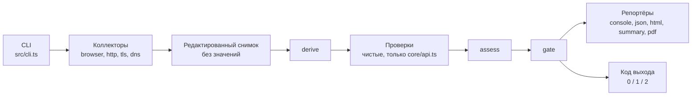
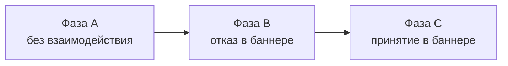
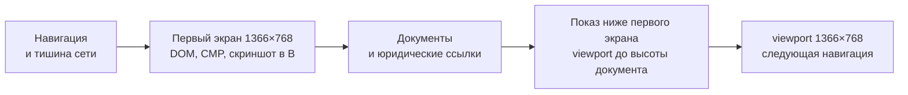

# Архитектура одним взглядом

`dsgvo-check` — пассивный CLI-сканер сайтов на TypeScript и Playwright: ищет признаки нарушений DSGVO/TDDDG/DDG и базовые проблемы безопасности, а по найденному роняет CI. Весь ввод-вывод делают коллекторы и редактируют данные до записи в снимок, всё остальное — чистые функции, а уровни находок задают данные в `test/data`, не код проверок.

Код выхода: `0` — причин для отказа нет; `1` — достигнут порог `--fail-on` (по умолчанию `critical`); `2` — сбой скана или записи отчёта (приоритетнее `1`), ошибка значимой проверки либо сработал `--strict`.

Правила для агентов — в [AGENTS.md](../AGENTS.md), документация для пользователей — в [README.md](../README.md).

## Схема



- Коллекторы — единственное место с I/O: значений cookies, Web Storage и TC-String нет ни в снимке, ни в отчёте, ни в логах (правило 2 [AGENTS.md](../AGENTS.md)).
- Заголовки ответов HTTP-коллектор и браузер записывают через один нормализатор [headers.ts](../src/core/redaction/headers.ts): значение остаётся только у заголовков безопасности и технических (`VALUE_HEADERS`), URL санитизируются, остальное — `[redacted]`. У заголовков продукта (`PRODUCT_HEADERS`: `Server`, `X-Powered-By`, `X-Generator`, `X-Redirect-By`, `X-AspNet-Version`, `X-AspNetMvc-Version`) значение тоже `[redacted]`, а рядом лежит `productVersions` — до четырёх пар `product/version` по грамматике токенов RFC 9110. Комментарии в скобках, строки в кавычках и текст, приклеенный к ним без пробела, имена продуктов с точкой или вида идентификатора (больше четырёх цифр, слово длиннее 20 символов, hex от восьми знаков), версии вида хоста, с hex-хешем в суффиксе или из четырёх чисел (IPv4, в том числе восьмеричная запись) и всё, что не проходит строгую форму, не сохраняются. Имя продукта из одного слова не отличить от имени хоста без точки. Пустой массив — значение разобрано и версии нет; поля нет — снимок старше, и HDR-02 даёт `inconclusive` (`values-not-stored`). У `<meta http-equiv>` с именем заголовка продукта `productVersions` не хранится: это текст страницы, а не заголовок ответа.
- `derive`, проверки, `assess` и `gate` — чистые функции; проверки импортируют только [api.ts](../src/core/api.ts), это проверяет [import-graph.test.ts](../test/unit/core/import-graph.test.ts).
- Уровни, `gating` и `crmCode` — данные в `test/data/ruleset`.
- Проверка получает секции из `requires` (нет секции — `skipped` или `error`) и, если они есть в снимке, секции из `optional`. Коллекторы выбираются только по `requires` ([scan-collect.ts](../src/scan-collect.ts), `requiredCollectors`): TLS-01 читает ссылки фазы A из `browser`, но `--checks TLS-01` браузер не запускает. `slice.unavailable` называет опциональные секции, которые скан собирался получить и не получил (коллектор пропущен, упал или срезан таймаутом); секция коллектора со статусом `not-run` просто отсутствует.

Браузерный коллектор проходит три фазы, каждую в свежем профиле Chromium: cookies и хранилище предыдущей фазы не переносятся.

DNS собирается в два этапа. Первый идёт параллельно с http и tls и опрашивает только сканируемый домен (`dns.queryBudget`). Второй ([collectDnsFollowUp](../src/collectors/dns/index.ts)) идёт после браузера и после подстановки конечного URL из HTTP, поэтому знает и конечный хост, когда браузер пропущен как `tls-blocked` или `tls-fallback-failed`; если браузер начал с цели http-редиректа (`plan.browserEntry`), Impressum и конечный хост берутся с неё. Он берёт цели из [mail-targets.ts](../src/collectors/dns/mail-targets.ts): регистрируемый домен конечного хоста, если редирект ведёт на другой домен (`final`), и точные домены адресов из Impressum (`contact`: текст документа без частей `hidden-irrelevant` и `mailto:` в содержимом страниц с ролью `impressum`, сначала адреса текста, потом получатели `mailto:`; не больше `dns.maxMailDomains`, без фримейла). У каждой цели свой бюджет `dns.mailDomainQueryBudget`; кэш, номера запросов, счётчик таймаутов и остановка по `--timeout` общие с первым этапом. Запросы дописываются в `dns.queries`, цели и их статус — в `dns.mailDomains`, сам этап — в `dns.mailDomainStage`. MAIL-01 и MAIL-02 оценивают каждую цель отдельно: у сканируемого домена subject прежний (`dmarc`, `spf`), у остальных — `dmarc@final`, `dmarc@contact:<домен>`, поэтому `assess` не сливает находки разных доменов, а отпечатки старых находок не меняются. Сбой ответа у сканируемого домена — ошибка проверки, у другой цели — ограничение `mail-domain-unresolved:<домен>`.

DKIM (MAIL-03) опрашивается в конце обработки каждой цели, после дерева SPF и из её же бюджета, поэтому не отнимает запросы у MAIL-01 и MAIL-02. План селекторов строит чистая [dkim.ts](../src/checks/dns/lib/dkim.ts) по уже полученным MX и SPF: сначала `dns.dkimSelectors` (`selector` для всех доменов или `domain/selector`), затем селекторы провайдера из [dkim.yaml](../test/data/dns/dkim.yaml), если совпали и суффикс MX, и include в дереве SPF, затем общие имена; без повторов, не больше `dns.dkimMaxSelectors` запросов; заданный селектор сверх предела остаётся в плане с `capped` и не опрашивается. Домен с Null MX или без MX и без SPF не опрашивается. План с причиной (`operator`, `provider:<id>`, `common`) и признаком `given` (селектор задал оператор или провайдер всегда им подписывает) пишется в `dns.dkimPlan` и сохраняется, даже если бюджет кончился, поэтому проверка отличает неопрошенный селектор от отсутствующего. По именам SPF и селекторов сохраняются записи SPF и записи ключей DKIM (тег версии DKIM или `p=`), потому что один ответ служит обоим разборам; остальной TXT отбрасывается с подсчётом в `filteredAnswers`. Таймауты запросов DKIM не считаются в предохранителе `resolver-unresponsive`: сервер, роняющий запросы к `_domainkey`, не должен лишать следующий домен ответов MX, DMARC и SPF. CNAME разрешает резолвер (c-ares отдаёт TXT цели, висячий CNAME — NXDOMAIN). Проверка читает теги по RFC 6376 §3.2 и длину модуля RSA из DER (SubjectPublicKeyInfo или PKCS#1), Ed25519 — ровно 32 байта, пустой `p=` — отозванный ключ; разбор никогда не бросает исключение. `key-too-short` — RSA короче `ctx.thresholds.dns.dkimMinRsaBits`; `given-selector-missing` — ни на одном опрошенном селекторе нет записи ключа, а заданные или фиксированные провайдером есть в плане; иначе `selectors-not-found` (info). Сбой ответа без найденного ключа — ошибка, неопрошенный из-за бюджета селектор — `inconclusive` `dns-budget-exhausted`, нечитаемый ключ (в том числе другой версии DKIM) — `inconclusive` `key-unparsable`, отозванный — `key-revoked`, заданный селектор сверх предела — `dkim-selectors-capped`, снимок без `dkimPlan` — `inconclusive` `dkim-not-collected`. Subject — `dkim` (наличие ключа) и `dkim:<селектор>` (длина), у других целей с суффиксом `@final` и `@contact:<домен>`.



На каждой странице сначала снимается первый экран, затем показывается остальное. В B и C стартовая страница доходит до показа только после клика (в B — после перезагрузки), контрольные страницы — после своих фактов.



- Показ — [reveal.ts](../src/collectors/browser/pages/reveal.ts): `page.setViewportSize` до высоты документа, не выше `browser.revealMaxHeightPx`, затем `waitForQuiet` не дольше `browser.revealDwellMs` и жёсткого предела фазы, затем прежний viewport. Событий прокрутки, колеса и ввода нет: баннер, считающий прокрутку согласием, не срабатывает. Не меняется страница, которая помещается в окно, не прокручивается (`overflow: hidden` у корня, как под блокирующим баннером) или сама прокрутилась вниз: смена размера может вернуть её наверх, а это событие прокрутки. Если браузер не подтвердил возврат 1366×768 (`viewportSize()` Playwright сообщает запрошенный размер ещё до подтверждения) или вызов размера не завершился вовремя (он ещё может сработать после возврата), фаза дальше не навигирует: `partial`, причина `viewport-not-restored`. Ошибки шага — только своими словами, без текста исключений страницы.
- Запросы после показа рекордер помечает `afterReveal: true` до следующей навигации; классификация по моменту (`timing`) не меняется, улика запроса несёт тот же флаг. Cookies и хранилище, появившиеся за время показа, снимаются ещё раз для той же страницы; ответы 429/503 целевого хоста считаются для троттлинга, как запросы самой страницы.
- `PageVisit.reveal` — исход (`revealed`, `fits-viewport`, `scroll-locked`, `scrolled`, `failed`), высота документа и окна, `capped`. EMBED-01, EMBED-02 и EMBED-03 дают ограничение `reveal-height-capped`, если в фазах A или B страница была выше предела; при `browser.revealDwellMs = 0` коллектор пишет пробел наблюдения `below-fold-not-revealed`.
- `affects` у `SCAN-BLOCKED` и `SCAN-THROTTLED` ([navigate.ts](../src/collectors/browser/pages/navigate.ts)) — проверки, которым не хватает фактов браузера. Заблокированная страница: проверки, читающие страницу её роли (`blockedAffects`), в фазе A ещё TLS-01 (читает ссылки каждой страницы фазы A) и для Impressum — MAIL-01, MAIL-02 и MAIL-03 (их домены из Impressum, `dns.mailDomains`). Сверх роли учитываются виды юридических документов, ради которых фаза A читает страницу (`PageQueue.legalKindsOf` → `VisitSpec.legalKinds`): все виды страницы в очереди (общая страница политики и Impressum сохраняет роль первого вида, второй — в `alsoKinds`), а на контактной и промежуточной страницах — ещё не найденные и не поставленные в очередь документы, чьи ссылки там ищут и чьим Impressum страница может стать сама. Impressum добавляет LEGAL-01 и MAIL-01–03, политика — LEGAL-01, PRIV-01 и PRIV-02. Дополнительное уведомление о данных политикой не считается. Троттлинг (`throttledAffects`): браузерные проверки, в фазе A ещё TLS-01 и MAIL-01–03. Ожидание теста выводится из `requires`/`optional` проверок и из того, чей результат зависит от `dns.mailDomainStage`.

Браузер стартует с цели, кроме одного случая: TLS-коллектор не принял сертификат цели ([scan-collect.ts](../src/scan-collect.ts), `tlsBlocked`).

- Тогда чистая `tlsFallbackEntry` смотрит только наблюдённую цепочку `http://` цели на стандартном порту. Вход есть, если цепочка закончилась на https другого DNS-хоста, у каждого https-хопа `tlsAuthorized === true`, запись рукопожатия этого хоста (если есть) принята, а ответ — 2xx или challenge (403, 429). Редирект, полученный по отвергнутому https-соединению, не считается; IP и явный порт — тоже.
- Сырой URL конца цепочки HTTP-коллектор передаёт только в памяти (`CollectorResult.handover.chainUrls`); в снимке — редактированный `plan.browserEntry`. Браузер получает `ctx.entry` и открывает его с обычной проверкой сертификатов; область сканирования, как при любом редиректе, задаёт хост стартовой страницы.
- Нет входа → `plan.tlsFallback` (`none`, `same-host`, `invalid`, `off`), браузер `skipped/tls-blocked`, `SCAN-TLS-BLOCKED` с параметром `fallback`.
- Вход не дал оцениваемой стартовой страницы (challenge, 5xx, 429 или другой 4xx, недоступность, ошибка сертификата, адрес не публичный, общий таймаут) или браузер до неё не дошёл (не запустился, исключение фазы A) → браузер `skipped/tls-fallback-failed` с кодом причины в `collection.browser.error`, `fallback: blocked`. Это не фатально: исход скана не хуже, чем без попытки.
- Вход сработал → `SCAN-TLS-FALLBACK`, `scan.entry` в отчёте, на первой странице `overview.tlsFallback` вместо `overview.redirect`. TLS-02 по-прежнему оценивает сертификат цели. Выключатель — `DSGVO_CHECK_SCAN_TLS_FALLBACK=off`.

## Дерево

Только каталоги и ключевые файлы, список сверен с `git ls-files`. `schema/` и `dist/` создаёт `corepack pnpm build`, в git их нет. `test/data/` входит в npm-пакет и в образ: там ruleset, тексты, словари, каталог сервисов и шаблон отчёта.

```text
dsgvo-check/
├── .github/
│   ├── scripts/               # TS-логика шагов CI: версия, релиз, проверки
│   └── workflows/             # ci.yml и release.yml
├── canary/
│   └── sites.example.yaml     # пример корпуса; настоящий sites.yaml локальный
├── docs/
│   └── architecture.md        # этот файл
├── examples/github-failing/   # пример «красной» сборки GitHub
├── scripts/
│   ├── canary/                # раннер канарейки: прогон, агрегация, сводка
│   ├── emit-env-example.ts    # .env.example из схемы настроек
│   ├── emit-registry.ts       # таблица вариантов в README.md из ruleset
│   └── emit-schema.ts         # schema/report.schema.json из zod-схемы
├── specs/                     # требования заказчика: идея, ТЗ, каталог проверок
├── src/
│   ├── cli.ts                 # CLI на commander: скан, report, install
│   ├── index.ts               # программный API: scan, gate, схема
│   ├── scan.ts                # оркестратор: сбор, derive, проверки, assess, gate
│   ├── scan-collect.ts        # сбор: коллекторы под общим дедлайном
│   ├── scan-options.ts        # опции скана: умолчания и проверка
│   ├── checks/                # проверки: чистые функции над срезом снимка
│   │   ├── browser/           # CONSENT, EMBED, LEGAL, PRIV, TRACK
│   │   ├── dns/               # MAIL-01–03; lib/ — разбор SPF, DMARC и DKIM, цели-домены
│   │   ├── http/              # HDR-01, TLS-01, TLS-02
│   │   └── index.ts           # явный реестр всех проверок
│   ├── cmp/                   # распознавание баннера CMP и клик по выбору
│   │   ├── adapters/          # адаптеры: Borlabs, Cookiebot, Usercentrics, Shopware, Wix, cookieman и др.
│   │   ├── page/              # код внутри страницы: замер баннера
│   │   ├── classify.ts        # первый слой: отказ, согласие, цель клика
│   │   └── lexicon.ts         # лексикон кнопок
│   ├── collectors/            # весь I/O; редактируют данные до записи
│   │   ├── browser/           # Chromium: фазы A, B, C
│   │   │   ├── in-page/       # код внутри страницы: DOM, хранилище, нажатия
│   │   │   ├── launch/        # запуск Chromium, SSRF-граница сети
│   │   │   ├── legal/         # Impressum и Datenschutzerklärung
│   │   │   ├── pages/         # выбор страниц, robots.txt, навигации, WAF, показ ниже первого экрана
│   │   │   ├── phases/        # phase-a.ts, consent-phase.ts (B и C)
│   │   │   ├── recording/     # запросы, cookies и Web Storage без значений
│   │   │   └── collector.ts   # сбор по фазам
│   │   ├── dns/               # MX, DMARC (Tree Walk), SPF, селекторы DKIM; второй этап — домены после браузера
│   │   ├── http/              # HTTP-пробы класса T: редиректы, заголовки
│   │   └── tls/               # рукопожатия; HTTP CONNECT для --proxy
│   ├── core/                  # контракты и чистая логика, проверок не знает
│   │   ├── api.ts             # единственный модуль ядра для проверок
│   │   ├── config/            # настройки: схема, env, .env, пороги
│   │   ├── data/              # загрузка test/data, тексты, дисклеймер
│   │   ├── evaluation/        # контракт проверки, assess, gate
│   │   ├── redaction/         # редактирование заголовков и текста
│   │   ├── report/            # схема отчёта, сборка, контракт репортёра
│   │   ├── runtime/           # ошибки, логгер, User-Agent, версия
│   │   ├── snapshot/          # снимок и контракт коллектора
│   │   └── url/               # цель, санитизация URL, e-mail, адреса
│   ├── derive/                # сторонний ли хост, какой сервис, стадия
│   └── reporters/             # console, json, html, summary, pdf, write.ts
├── templates/gitlab/          # шаблон GitLab CI на том же образе
├── test/
│   ├── data/                  # данные пакета: идут в npm и образ
│   │   ├── browser/, cmp/     # словари и сигнатуры браузерного коллектора
│   │   ├── http/, legal/      # слова HTTP-коллектора, юридические ссылки, данные Impressum
│   │   ├── dns/               # фримейл-домены второго этапа DNS, провайдеры и селекторы DKIM
│   │   ├── report/report.html # шаблон HTML-отчёта
│   │   ├── ruleset/de-2026/   # варианты, уровни, gating, коды CRM
│   │   ├── services/          # каталог сервисов (Apache-2.0)
│   │   ├── texts/{de,en}/     # все пользовательские строки
│   │   └── routing.yaml       # какая проверка владеет категорией сервиса
│   ├── unit/                  # L0–L1: без браузера и сети
│   ├── integration/           # L2: Chromium, undici, node:tls, DNS на loopback
│   ├── e2e/                   # L3: собранный CLI, образ, Action
│   ├── live/                  # живые сайты; в pnpm test не входит
│   ├── fixture-server/        # сервер виртуальных хостов с настоящим TLS
│   ├── fixtures/              # снимки HTTP-проверок, образец отчёта
│   └── utils/                 # общие помощники тестов
├── Dockerfile                 # образ: Node 26, Chrome for Testing, non-root
├── action.yml                 # composite Action: docker run образа
├── AGENTS.md                  # правила для агентов и людей, команды
├── README.md                  # документация для пользователей (Deutsch)
└── …                          # LICENSE, NOTICE, .env.example, package.json, vitest.config.ts
```

## Куда смотреть, если нужно …

| Нужно | Куда смотреть |
|---|---|
| Добавить проверку | `src/checks/<module>/<id>.ts` и строка в `index.ts` модуля; варианты, уровни и `crm` — `test/data/ruleset/de-2026/<module>.yaml`; тексты — `test/data/texts/{de,en}/<module>.yaml`; фикстуры — `test/unit/checks/browser/scenarios/`, [fixtures.ts](../test/unit/checks/dns/fixtures.ts) для DNS или `test/fixtures/snapshots/http/<ID>/`; затем `corepack pnpm registry`. Образец — [contract-example.test.ts](../test/unit/core/evaluation/contract-example.test.ts), шаги — в [AGENTS.md](../AGENTS.md); имена вариантов запланированной проверки — в таблице «Geplante Prüfungen» [README.md](../README.md) |
| Поменять уровень, `gating`, `crmCode` или имя варианта | [browser.yaml](../test/data/ruleset/de-2026/browser.yaml), [http.yaml](../test/data/ruleset/de-2026/http.yaml), [dns.yaml](../test/data/ruleset/de-2026/dns.yaml) в `test/data/ruleset/de-2026/`; затем `corepack pnpm registry` обновит таблицу вариантов в [README.md](../README.md), раздел «Was geprüft wird» |
| Поменять текст находки | [browser.yaml](../test/data/texts/de/browser.yaml), [http.yaml](../test/data/texts/de/http.yaml), [dns.yaml](../test/data/texts/de/dns.yaml) в `test/data/texts/de/` и их зеркало в `en/`; правила формулировок — правило 3 в [AGENTS.md](../AGENTS.md), их проверяют [stopwords.test.ts](../test/unit/core/data/stopwords.test.ts) и [wording.test.ts](../test/unit/checks/browser/wording.test.ts) |
| Поменять шаблон отчёта | разметка и стили — [report.html](../test/data/report/report.html); подписи — [report.yaml](../test/data/texts/de/report.yaml) (и в `en/`); какие данные попадают в шаблон — [report-view.ts](../src/reporters/report-view.ts), подача улик — [evidence-view.ts](../src/reporters/evidence-view.ts); язык шаблона — [template.ts](../src/reporters/template.ts); PDF печатает тот же HTML ([pdf.ts](../src/reporters/pdf.ts)). Консоль и Job Summary — [console.ts](../src/reporters/console.ts) и [summary.ts](../src/reporters/summary.ts) |
| Добавить сервис в каталог или сменить его категорию | `test/data/services/*.yaml` (формат записи — [_catalog.yaml](../test/data/services/_catalog.yaml)); какая проверка владеет категорией — [routing.yaml](../test/data/routing.yaml) |
| Поддержать новый CMP или подпись кнопки | id в `KNOWN_CMP_IDS` ([types.ts](../src/cmp/types.ts)), адаптер в `src/cmp/adapters/` (чтение API) и регистрация в [src/cmp/index.ts](../src/cmp/index.ts); признаки, версии и селекторы — [adapters.yaml](../test/data/cmp/adapters.yaml); подписи кнопок — [lexicon.yaml](../test/data/cmp/lexicon.yaml); ручной стенд — `test/fixture-server/sites/cmp/<имя>/` и [sites.ts](../test/fixture-server/sites.ts); тесты — `test/integration/cmp/`, сквозной скан с отказом, согласием и обзором отчёта — [consent-flow.test.ts](../test/integration/pipeline/consent-flow.test.ts) |
| Добавить или поменять слово, имя параметра или cookie, сигнатуру бот-защиты, ключевое слово страницы | YAML из таблицы «Словари и сопоставления» ниже: [browser/](../test/data/browser), [cmp/](../test/data/cmp), [http/](../test/data/http), [legal/](../test/data/legal); новый ключ верхнего уровня — со схемой (`dataSection`) и строкой в [sections.test.ts](../test/unit/core/data/sections.test.ts) |
| Добавить или изменить порог, таймаут, лимит | поле в схеме [schema.ts](../src/core/config/schema.ts) (умолчание, границы, описание); имя переменной выводится из пути; затем `corepack pnpm env:example`. Коллекторы читают значение из `ctx.config`, проверки — из `ctx.thresholds`; протокольные константы и защитные пределы остаются в коде |
| Понять или изменить код выхода и порог | [gate.ts](../src/core/evaluation/gate.ts) (чистая функция) и [gate.test.ts](../test/unit/core/evaluation/gate.test.ts) |
| Проверить, что в снимок не попали значения | [redact.ts](../src/core/redaction/redact.ts), [email.ts](../src/core/url/email.ts), [url.ts](../src/core/url/url.ts), [headers.ts](../src/core/redaction/headers.ts) (allowlist значений, `productVersions` заголовков продукта); редактирует коллектор до записи |
| CI проекта и релиз | [ci.yml](../.github/workflows/ci.yml), [release.yml](../.github/workflows/release.yml); логика шагов — в TypeScript, `.github/scripts/` |
| GitHub Action и GitLab | [action.yml](../action.yml), [шаблон GitLab](../templates/gitlab/dsgvo-check.gitlab-ci.yml), [пример](../examples/github-failing/README.md); контракты поставки проверяет [delivery-config.e2e.test.ts](../test/e2e/delivery-config.e2e.test.ts) |
| Docker | [Dockerfile](../Dockerfile): в образе песочница — сам контейнер (режим `--sandbox container`, только при `DSGVO_CHECK_CONTAINER=1`), своего профиля seccomp нет; описание для пользователей — [README.md](../README.md), раздел «Docker»; e2e образа — [docker.e2e.test.ts](../test/e2e/docker.e2e.test.ts), запускается только при `DSGVO_E2E_IMAGE` |
| Канарейка | [README.md](../README.md), раздел «Canary» (правила, этика, запуск); [sites.example.yaml](../canary/sites.example.yaml), раннер [main.ts](../scripts/canary/main.ts) и соседние файлы в [scripts/canary/](../scripts/canary/); настоящий `canary/sites.yaml` и `canary/results/` лежат только локально, в `.gitignore` |
| Запустить тесты, добавить сайт в стенд | [README.md](../README.md), раздел «Entwicklung» → «Tests»: уровни, параллельность (`DSGVO_TEST_WORKERS`), сеть в L2; сайт в стенд — [sites.ts](../test/fixture-server/sites.ts) и `test/fixture-server/sites/<модуль>/` |

## Общие помощники браузерных проверок

Что нужно нескольким проверкам, живёт в одном модуле `src/checks/browser/`, а не копируется: так одно и то же наблюдение везде даёт одинаковый вывод и одинаковые улики.

| Модуль | Что даёт | Кто пользуется |
|---|---|---|
| [signals.ts](../src/checks/browser/signals.ts) | `confirmedReject` — состояния CMP, доказывающие отказ: создано нашим кликом и прочитано после перезагрузки; `stateEvidence` — улика `consent-state` фазы B; `decisionInEffect` — действует ли решение клика на странице: нет, если последний факт после клика показывает баннер снова или состояние CMP без ответа (cookie согласия привязан к другому хосту); `pagesWithoutDecision` — контрольные страницы фазы B или C, где решение клика не действует (стартовая страница и её перезагрузка в список не входят), и `withoutDecision` — признак «запись сделана на такой странице» для запросов, cookies и хранилища и ограничения `reject-not-in-effect`/`accept-not-in-effect`; `dialogNotOpenedOutcome` — `inconclusive` с причиной `cmp-dialog-not-opened`, когда первый экран фазы B после ожидания баннера отмечен `dialogNotOpened` и ничего не нажато | CONSENT-03, CONSENT-04, CONSENT-05, TRACK-01, EMBED-01, EMBED-02, EMBED-03, PRIV-02 |
| [documents.ts](../src/checks/browser/documents.ts) | `usableDocument`; `policyDocuments` — HTML-документы Datenschutzerklärung (сначала политика, затем читаемые дополнительные уведомления) или причина, почему её нельзя прочитать; `isSupplement`; `policyText` — текст частей, видимое и скрытое отдельно; `policyEvidence` — улика `document`; `normalizeText` для поиска слов | LEGAL-01, PRIV-01, PRIV-02 |
| [impressum-details.ts](../src/checks/browser/impressum-details.ts) | блоки документа — раздел с подразделами внутри одного места (`content` или `chrome`) и одного фрейма, без скрытого текста; сколько видов данных Impressum в каждом | LEGAL-01 |
| [policy-claims.ts](../src/checks/browser/policy-claims.ts) | схема и разбор `legal/claims.yaml`; разбиение текста на предложения (сокращения, порядковые числа и точки в URL не конец предложения); поиск фраз (`*` в конце слова — продолжение); привязка предложения к сервису: имя в предложении, затем сервис в последнем заголовке раздела, затем в предыдущем предложении; слово категории («Schriften») или компания («Servern von Google») ограничивают унаследованный сервис, квантор («alle Schriftarten») делает утверждение о всей категории; отрицание рядом со словами утверждения или описания соединения отменяет их (кроме «nicht nur» и отрицания до «sondern»); описание соединения засчитывается только с внешним источником (компания вне названия продукта или слово `external`), а предложение, где есть и утверждение, и внешний источник, неоднозначно | PRIV-02 |
| [evidence.ts](../src/checks/browser/evidence.ts) | `requestEvidence` и `distinctRequestEvidence` (каждый запрос один раз; повтор после показа ниже первого экрана — тот же запрос); `requestEvidenceByMoment` — без повторов внутри момента (до взаимодействия, после отказа, после согласия) и с местами для запросов после отказа, чтобы те же URL фазы A их не вытеснили; `requestEvidencePerContext` — по одному запросу на пару (фаза, страница) | все браузерные проверки |
| [reject-moment.ts](../src/checks/browser/reject-moment.ts) | `loadMoment` — когда загружено: до взаимодействия, после отказа или в оба момента (`moment`), подтверждён ли отказ состоянием CMP на странице с загрузкой после него (`rejectConfirmed`), на скольких страницах отказ действовал (`afterRejectPageCount`); `rejectProof` и `momentEvidence` — запросы по моментам и две улики `consent-state`, как у CONSENT-05 | EMBED-01, EMBED-02, EMBED-03 |
| [embed-frame.ts](../src/checks/browser/embed-frame.ts) | что загрузил кадр карты или видеоплеера помимо самой вставки: `frameParams` — шрифты с их сервисами (`frameFontServices`, `frameFontRequestCount`) и хосты-помощники; `embedEvidence` — улики по моментам, в которых всегда есть один запрос шрифта кадра | EMBED-02, EMBED-03 |

`derive` добавляет для проверок три факта каталога, чтобы им не читать `derive/catalog.ts` с его загрузчиком файлов (правило 4):

- `ClassifiedRequest.resourceServiceId` и `resourceCategory` — у запроса из кадра встроенного сервиса (`source: embed-frame`) сервис каталога самого ресурса: шрифт кадра карты остаётся запросом карты (`serviceId: google-maps`), но известно, что это Google Fonts. У хоста без сервиса этих полей нет; EMBED-02 и EMBED-03 по ним называют шрифты кадра карты или плеера (`frameFontServices`, `frameFontRequestCount`), отдельной находки EMBED-01 для них нет.
- `DerivedSection.serviceNames` — имя, псевдонимы, компании и категория каждого сервиса каталога с `policyRelevance` `required` или `optional`, замеченного или нет: по ним проверка понимает, о каком сервисе предложение политики.
- `DerivedSection.frames` — iframe каждой посещённой страницы по его `src` с сервисом и категорией каталога: EMBED-03 по ним видит видеокадр в DOM, который за визит ничего не загрузил (ленивый кадр ниже первого экрана), и пишет ограничение `video-embed-not-loaded` вместо молчаливого «чисто».

EMBED-03 относит запрос к вставке по `frameServiceId`, когда кадр принадлежит видеосервису: хосты YouTube внутри плеера youtube-nocookie.com дают одну находку youtube-nocookie, а превью на самой странице остаётся YouTube. Страница запроса из кадра — страница документа этого кадра: поздний beacon плеера записан уже со следующей страницей.

## Юридические документы в снимке

Раздел `documents` пишет фаза A браузерного коллектора ([queue.ts](../src/collectors/browser/legal/queue.ts), [documents.ts](../src/collectors/browser/legal/documents.ts)).

- `documents` — страницы, прочитанные как Impressum или Datenschutzerklärung, `attempts` — каждая попытка их найти (ссылка, промежуточная страница, пробный путь) с исходом.
- `DocumentRecord.role` — `supplement` у дополнительного уведомления о данных того же сайта («Datenschutz Kurse»): после найденной политики фаза A читает до `browser.maxSupplementaryPolicies` таких страниц из ссылок той же страницы, откуда найдена политика, в порядке ранга `findLegalLink` (`privacySupplements` в [pages.ts](../src/collectors/browser/pages/pages.ts)). Берётся только ссылка с меткой не хуже «начинается с ключа» вне содержимого и боковой колонки; языковые версии определяет тот же `isLanguageAlternate` с данными `browser/pages.yaml`, что и у выбора страниц. Попытки таких страниц помечены `supplement: true`; языковая версия записывается попыткой с исходом `other-language` без навигации. Уведомления — юридические страницы: `--max-pages` они не расходуют, паузу, резерв времени и лимит запросов соблюдают. Страница, уже стоящая в очереди как контактная, промежуточная или дополнительная, сохраняет свою роль и читается ещё и как уведомление. Без `role` документ — политика, как в старых снимках.
- PRIV-01 ищет в политике и в читаемых уведомлениях (`policyDocuments` в [documents.ts](../src/checks/browser/documents.ts)); уведомление в PDF, на другом языке, обрезанное, не загруженное или только записанная языковая версия дают ограничение `supplement-not-evaluated`. Попытки сопоставляются с документами той же роли: уведомление с тем же отредактированным URL (`?page=[redacted]`) не дисквалифицирует политику. LEGAL-01 попытки и документы уведомлений не учитывает: неудачное уведомление — не битая ссылка на политику, данные Impressum в уведомлении не заменяют Impressum. PRIV-02 читает только политику: находка называет её страницей с утверждением, а описание загрузки в уведомлении не относится к утверждению политики.
- `DocumentPart.place` — `content` или `chrome` по тому же правилу, что и места заголовков (`outsideText` в [document.ts](../src/collectors/browser/in-page/document.ts)); где место меняется, начинается новая часть, поэтому текст подвала без своего заголовка не сливается с разделом содержимого перед ним. В старых снимках поля нет.
- `candidates` — страницы, прочитанные на данные Impressum, пока Impressum не найден: контактная и промежуточные страницы и стартовая без ссылки на Impressum. Страницы уже открыты, лишних навигаций нет; текст редактируется как у документов. Промежуточная страница, которую заголовки содержимого подтверждают как Impressum, становится документом `foundVia: hop`. Кандидаты — не документы: PRIV-01 и попытки их не читают, а когда Impressum найден, коллектор их убирает. Их читает только LEGAL-01 для варианта `provider-details-without-link`.

## Выбор страниц браузера

План фазы A и контрольные страницы фаз B и C выбирают чистые функции [pages.ts](../src/collectors/browser/pages/pages.ts); фаза A передаёт им ссылки стартовой страницы, sitemap, факты DOM и записанные запросы.

- `selectPages`: бюджет дополнительных страниц — `--max-pages` минус стартовая, юридические, контактная и промежуточные страницы; юридическая страница без ссылки занимает место пробы её обычного пути (`/impressum`, `/datenschutz`), ссылка на PDF места не занимает. Сначала по одной странице на группу ключевых слов из `browser/pages.yaml`, затем ссылки навигации и sitemap — по одной на шаблон URL (первый сегмент пути после префикса локали стартовой страницы). Страница группы несёт в плане причину `keyword:<слово>` и id группы `keywordGroup`: EMBED-03 узнаёт страницу видео по группе `video`, каким бы словом группы она ни выбрана; в старых снимках без поля — по причине `keyword:video`.
- `isLanguageAlternate` и `languageContext`: языковая версия сайта — `hreflang` другого языка, префикс локали, отличный от стартового или ведущий туда, куда ведёт переключатель языка стартовой страницы, корень локали без видимого текста, код языка подписью («EN»), название языка подписью («English») у ссылки в префикс локали или в корень. Страница, которую так помечает хотя бы одна ссылка, не бывает дополнительной ни по другим ссылкам, ни из sitemap.
- `controlSignals` и `chooseControlPages`: сигналы страницы — сторонние iframe (без фреймов поставщиков согласия и фреймов целиком вне документа), плейсхолдеры, новые сторонние хосты; встраивания каталога (`maps`, `video`, `fonts`, `widget`) весят больше неизвестных хостов. Категорию даёт каталог сервисов через `catalogCategoryOf` — здесь коллектор читает [catalog.ts](../src/derive/catalog.ts). Страницы с origin стартовой страницы, на которой B и C кликают, идут первыми; чужой origin — только когда своих не осталось, с причиной `other-origin`. Число страниц — `browser.maxControlPages`.

## Словари и сопоставления

Всё, что меняется вместе с внешним миром, лежит в YAML рядом с остальными данными, а не в константах кода: слова и фразы, имена параметров и cookies, сигнатуры бот-защиты, селекторы и признаки CMP, пути и расширения страниц.

| Каталог `test/data/` | Что внутри | Кто читает |
|---|---|---|
| `cmp/lexicon.yaml` | подписи кнопок первого слоя; отрицания, слова необходимости, ограничения и слова подписки или оплаты, при которых подпись не отказ и не согласие; слова «все» для согласия со словом необходимости; слова рекомендации («empfohlen»), с которыми отказ «только необходимые» остаётся отказом; слова баннера, Pur-Abo | коллектор (`loadLexicon`), CONSENT-04 |
| `cmp/adapters.yaml` | признаки, версии, селекторы баннера и кнопок, шаблон бота каждого адаптера; у CCM19 — `closedDialog`: контейнер и элементы управления виджета, который CCM19 кладёт в страницу скрытым и с отключёнными кнопками; у Shopware — `answerCookie` и `consentCookies`: имена cookie ответа и cookies разрешений самого Shopware, по наличию которых (без значений) подтверждаются отказ и согласие | адаптеры (`adapterData`), CONSENT-04 (список известных CMP) |
| `cmp/categories.yaml` | имена необходимых категорий согласия | CONSENT-04 |
| `cmp/probe.yaml` | атрибуты для селектора кнопки; имена контейнеров баннера (id и class), с которыми хватает одного слова баннера | замер баннера (в страницу — аргументом) |
| `legal/links.yaml` | подписи, ключи и пути юридических ссылок, пробные пути | коллектор, LEGAL-01 |
| `legal/provider-details.yaml` | слова пяти видов данных Impressum: регистр, USt-IdNr., представители, § 5 DDG, ответственный за содержание; схема — [sections.ts](../src/collectors/browser/legal/sections.ts) | LEGAL-01 |
| `legal/claims.yaml` | утверждения Datenschutzerklärung о встраивании сервиса (`self-hosted`, `no-connection`, `consent-gated`) с фразами, оборотами, отменяющими утверждение («nicht lokal»), оговорками («sofern»), описаниями внешнего соединения; кванторы, отрицания и их границы («nicht nur», «sondern»), общие оговорки («garantieren nicht»), слова внешнего источника, исключения (браузерное дополнение отказа, модальные глаголы), слова категорий, сокращения | PRIV-02 |
| `browser/identifiers.yaml` | имена параметров и cookies с идентификаторами, параметры Consent Mode | рекордер запросов |
| `browser/challenges.yaml` | сигнатуры WAF и бот-защиты | `detectChallenge` |
| `browser/dom.yaml` | словарь разметки для кода внутри страницы | `domFactsInPage`, `documentInPage`, `bannerBoxInPage` — аргументом `evaluate` |
| `browser/pages.yaml` | группы ключевых слов дополнительных страниц (по порядку, не больше одной страницы на группу); коды языков для префиксов локали и подписи переключателя языка; исключённые пути, расширения файлов | `selectPages`, `isLanguageAlternate` (и для языковых версий политики в `privacySupplements`) |
| `http/html.yaml` | слова поиска и юридических ссылок в префиксе HTML | `detectForm`, `findLegalLinks` |
| `dns/mail-domains.yaml` | фримейл-домены (точное совпадение), чьи адреса в Impressum не делают домен целью MAIL-01/02 | `selectMailTargets` |
| `dns/dkim.yaml` | провайдеры почты (суффиксы MX, у Microsoft 365 и `mx.microsoft` для входящего DANE с DNSSEC; include SPF, селекторы, `fixed`) и общие имена селекторов DKIM | `collectMailDns` и `collectMailDomains` (план MAIL-03) |
| `services/_catalog.yaml` | параметры, заданные при визите; буквы `gcd` | derive |

- У каждого файла свой ключ верхнего уровня со zod-схемой (`dataSection` в [parse.ts](../src/core/data/parse.ts)); [sections.test.ts](../test/unit/core/data/sections.test.ts) проверяет, что схема есть у каждого файла и ключа и каждая загружается.
- Коллектор читает секцию через `loadSection`, проверка — из `ctx.data.<каталог>` (`data: ['<каталог>']` в `defineCheck`), код страницы получает значения аргументом `evaluate`: он ничего не может импортировать.
- Ошибка в файле — `DataError` с каталогом и путём ключа, например `test/data/browser: challenges.titles.0.pattern: invalid regular expression`.
- В коде остаются таблицы логики (сопоставления внутренних типов, коды ошибок Node и Chromium, словарь протоколов HTTP, TLS и DNS, стандартная разметка) и всё, что защищает приватность: allowlist query в [url.ts](../src/core/url/url.ts), allowlist заголовков в [headers.ts](../src/core/redaction/headers.ts), скрытые поля в [report-view.ts](../src/reporters/report-view.ts). Правка словаря не должна ослабить правило 2.

## Настройки

- Все пороги, таймауты, паузы и лимиты описывает одна схема — [schema.ts](../src/core/config/schema.ts): у настройки есть умолчание, границы и описание, имя переменной — `DSGVO_CHECK_<РАЗДЕЛ>_<ИМЯ>` с единицей в конце (`_MS`, `_BYTES`, `_DAYS`, `_PX`, `_BITS`). Константы протоколов (SPF, DMARC) и защитные пределы (редактирование, размеры разбора чужого содержимого) остаются в коде.
- Приоритет: флаг CLI → переменная окружения → `.env` в текущем каталоге → умолчание. `.env` необязателен; его читает `util.parseEnv` и ничего не пишет в `process.env`, поэтому чужие переменные не доходят до Chromium.
- Неверное значение — код 2 (`invalid-config`): причина — id с параметрами ([problems.ts](../src/core/config/problems.ts)), текст `config.problem.<id>` лежит в `test/data/texts/{de,en}`.
- Паузы правила 1 (`DSGVO_CHECK_BROWSER_NAVIGATION_PAUSE_MS` ≥ 1500, `DSGVO_CHECK_BROWSER_RETRY_DELAY_MS` ≥ 3000, `DSGVO_CHECK_HTTP_MIN_INTERVAL_MS` ≥ 500) можно только ужесточать: нижняя граница равна умолчанию.
- Коллекторы берут значения из `ctx.config`, проверки — из `ctx.thresholds` и не импортируют конфиг; отличия от умолчаний попадают в отчёт (`scan.options.settings`, без секретов).
- [.env.example](../.env.example) генерирует `corepack pnpm env:example` (`env:example:check` ловит расхождение). В его конце блок `tests` с `DSGVO_TEST_WORKERS` — число параллельных файлов тестов, его читает только [vitest.config.ts](../vitest.config.ts), сканер нет.
