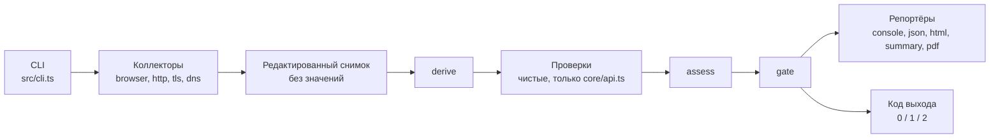
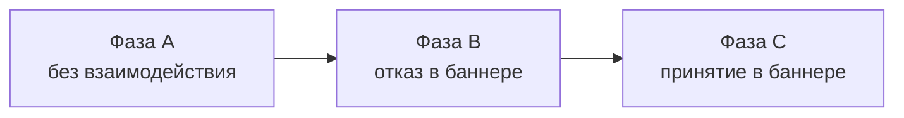
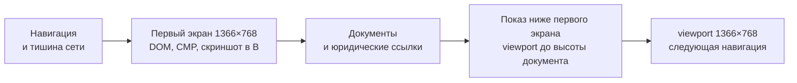

# Архитектура

`dsgvo-check` — пассивный CLI-сканер на TypeScript и Playwright. Весь ввод-вывод делают коллекторы и редактируют данные до записи в снимок; всё остальное — чистые функции.

Для пользователей — [README.md](../README.md), правила для агентов и людей — [AGENTS.md](../AGENTS.md).

## Конвейер



- **I/O только в коллекторах.** Значений cookies, Web Storage и TC-String нет ни в снимке, ни в отчёте, ни в логах (правило 2 AGENTS.md); где это обеспечено — [«Что не попадает в снимок»](#что-не-попадает-в-снимок).
- **Чистые функции.** `derive`, проверки, `assess` и `gate`. Проверки импортируют только [api.ts](../src/core/api.ts), это проверяет [import-graph.test.ts](../test/unit/core/import-graph.test.ts).
- **Уровни — данные.** Уровни, `gating` и `crmCode` лежат в `test/data/ruleset`, не в коде проверок.
- **Выбор коллекторов.** Коллекторы запускаются только по `requires` проверок ([scan-collect.ts](../src/scan-collect.ts), `requiredCollectors`). TLS-01 читает ссылки фазы A из `browser` как `optional`, поэтому `--checks TLS-01` браузер не запускает.
- **Код выхода** решает [gate.ts](../src/core/evaluation/gate.ts); сбой записи запрошенного отчёта после него поднимает код до 2 (`report-write-failed`, [write.ts](../src/reporters/write.ts)). Значения и приоритет — README, раздел «Exit-Codes».

## Модули

Только каталоги и ключевые файлы, список сверен с `git ls-files`. `schema/` и `dist/` создаёт `corepack pnpm build`, в git их нет.

```text
dsgvo-check/
├── .github/
│   ├── scripts/               # TS-логика шагов CI: версия, релиз, проверки
│   └── workflows/             # ci.yml и release.yml
├── canary/
│   └── sites.example.yaml     # пример корпуса; настоящий sites.yaml локальный
├── docs/
│   └── architecture.md        # этот файл
├── examples/github-failing/   # пример «красной» сборки GitHub
├── scripts/
│   ├── canary/                # раннер канарейки: прогон, агрегация, сводка
│   ├── test-impact/           # выбор тестов по diff для test:changed
│   ├── emit-env-example.ts    # .env.example из схемы настроек
│   ├── emit-registry.ts       # таблица вариантов в README.md из ruleset
│   └── emit-schema.ts         # schema/report.schema.json из zod-схемы
├── specs/                     # требования заказчика: идея, ТЗ, каталог проверок
├── src/
│   ├── cli.ts                 # CLI на commander: скан, report, install
│   ├── index.ts               # программный API: scan, gate, схема
│   ├── scan.ts                # оркестратор: сбор, derive, проверки, assess, gate
│   ├── scan-collect.ts        # сбор: коллекторы под общим дедлайном
│   ├── scan-options.ts        # опции скана: умолчания и проверка
│   ├── checks/                # проверки: чистые функции над срезом снимка
│   │   ├── browser/           # CONSENT, EMBED, LEGAL, PRIV, TRACK и общие модули
│   │   ├── dns/               # MAIL-01–03; lib/ — разбор SPF, DMARC и DKIM
│   │   ├── http/              # HDR-01, HDR-02, TLS-01, TLS-02
│   │   └── index.ts           # явный реестр всех проверок
│   ├── cmp/                   # распознавание баннера CMP и клик по выбору
│   │   ├── adapters/          # адаптеры: Borlabs, Cookiebot, Usercentrics, Shopware, Wix, cookieman и др.
│   │   ├── page/              # код внутри страницы: замер баннера, распознавание
│   │   ├── classify.ts        # первый слой: отказ, согласие, цель клика
│   │   └── lexicon.ts         # лексикон кнопок
│   ├── collectors/            # весь I/O; редактируют данные до записи
│   │   ├── browser/           # Chromium: фазы A, B, C
│   │   │   ├── in-page/       # код внутри страницы: DOM, хранилище, нажатия
│   │   │   ├── launch/        # запуск Chromium, SSRF-граница сети
│   │   │   ├── legal/         # Impressum и Datenschutzerklärung, вычистка значений
│   │   │   ├── pages/         # выбор страниц, robots.txt, навигации, WAF, показ ниже первого экрана
│   │   │   ├── phases/        # phase-a.ts, consent-phase.ts (B и C)
│   │   │   ├── recording/     # запросы, cookies и Web Storage без значений
│   │   │   └── collector.ts   # сбор по фазам
│   │   ├── dns/               # MX, DMARC, SPF, DKIM; второй этап после браузера
│   │   ├── http/              # пробы класса T: редиректы, заголовки, формы, http-близнецы
│   │   └── tls/               # рукопожатия; HTTP CONNECT для --proxy
│   ├── core/                  # контракты и чистая логика, проверок не знает
│   │   ├── api.ts             # единственный модуль ядра для проверок
│   │   ├── config/            # настройки: схема, env, .env, пороги
│   │   ├── data/              # загрузка test/data, тексты, дисклеймер
│   │   ├── evaluation/        # контракт проверки, assess, gate
│   │   ├── redaction/         # заголовки, имена со страницы, свободный текст
│   │   ├── report/            # схема отчёта, сборка, контракт репортёра
│   │   ├── runtime/           # ошибки, логгер, User-Agent, версия
│   │   ├── snapshot/          # снимок и контракт коллектора
│   │   ├── text/              # поиск имён по границам слов: общий для коллектора и проверок
│   │   └── url/               # цель, санитизация URL, e-mail, адреса
│   ├── derive/                # сторонний ли хост, какой сервис, стадия
│   └── reporters/             # console, json, html, summary, pdf, write.ts
├── templates/gitlab/          # шаблон GitLab CI на том же образе
├── test/
│   ├── data/                  # данные пакета: идут в npm и образ
│   │   ├── browser/, cmp/     # словари и сигнатуры браузерного коллектора
│   │   ├── http/, legal/      # слова HTTP-коллектора, юридические ссылки и тексты
│   │   ├── dns/               # фримейл-домены, провайдеры и селекторы DKIM
│   │   ├── report/report.html # шаблон HTML-отчёта
│   │   ├── ruleset/de-2026/   # варианты, уровни, gating, коды CRM
│   │   ├── services/          # каталог сервисов (Apache-2.0)
│   │   ├── texts/{de,en}/     # все пользовательские строки
│   │   └── routing.yaml       # какая проверка владеет категорией сервиса
│   ├── unit/                  # L0–L1: без браузера и сети
│   ├── integration/           # L2: Chromium, undici, node:tls, DNS на loopback
│   ├── e2e/                   # L3: собранный CLI, образ, Action
│   ├── live/                  # живые сайты; в pnpm test не входит
│   ├── fixture-server/        # сервер виртуальных хостов с настоящим TLS
│   ├── fixtures/              # снимки HTTP-проверок, образец отчёта, разметка баннеров
│   └── utils/                 # общие помощники тестов
├── Dockerfile                 # образ: Node 26, Chrome for Testing, non-root
├── action.yml                 # composite Action: docker run образа
├── AGENTS.md                  # правила для агентов и людей, команды
├── README.md                  # документация для пользователей (Deutsch)
└── …                          # LICENSE, NOTICE, .env.example, package.json, vitest.config.ts
```

## Сбор данных

Что сканер делает на сайте и что он отправляет, описывает README («Was geprüft wird», «Was der Scanner sendet»). Здесь — как это устроено и почему.

### Браузер: фазы и страницы

Три фазы, каждая в свежем профиле Chromium: cookies и хранилище предыдущей фазы не переносятся.



На каждой странице сначала снимается первый экран, затем показывается остальное. В B и C стартовая страница доходит до показа только после клика (в B — после перезагрузки), контрольные страницы — после своих фактов.



Показ ниже первого экрана — [reveal.ts](../src/collectors/browser/pages/reveal.ts):

- Только `page.setViewportSize`, без событий прокрутки, колеса и ввода: баннер, считающий прокрутку согласием, не срабатывает.
- Страница, которая сама прокрутилась вниз, не трогается: смена размера может вернуть её наверх, а это событие прокрутки.
- Если браузер не подтвердил возврат 1366×768 (`viewportSize()` Playwright сообщает запрошенный размер ещё до подтверждения) или вызов не завершился вовремя, фаза дальше не навигирует: `partial`, `viewport-not-restored`.
- Запросы после показа помечены `afterReveal: true` до следующей навигации; cookies и хранилище снимаются ещё раз для той же страницы.

Выбор страниц — чистые функции [pages.ts](../src/collectors/browser/pages/pages.ts) над ссылками, sitemap, фактами DOM и запросами фазы A:

- `selectPages` — план фазы A. Страница группы ключевых слов несёт `keywordGroup`: EMBED-03 узнаёт страницу видео по группе `video`, каким бы словом она ни выбрана.
- `isLanguageAlternate` и `languageContext` — языковые версии сайта; их же использует поиск дополнительных уведомлений о данных (`privacySupplements`).
- `controlSignals` и `chooseControlPages` — контрольные страницы B и C. Категорию встраивания даёт каталог через `catalogCategoryOf`: здесь коллектор читает [catalog.ts](../src/derive/catalog.ts).

`affects` у `SCAN-BLOCKED` и `SCAN-THROTTLED` считает [navigate.ts](../src/collectors/browser/pages/navigate.ts) (`blockedAffects`, `throttledAffects`). Виды юридических документов, ради которых фаза A читает страницу, приходят из `PageQueue.legalKindsOf` в `VisitSpec.legalKinds`. Ожидание теста выводится из `requires`/`optional` проверок и из того, чей результат зависит от `dns.mailDomainStage`.

### Юридические документы

Раздел `documents` пишет фаза A ([queue.ts](../src/collectors/browser/legal/queue.ts), [documents.ts](../src/collectors/browser/legal/documents.ts)):

- `documents` — прочитанные Impressum и Datenschutzerklärung; `attempts` — каждая попытка их найти с исходом.
- `role: supplement` — дополнительное уведомление о данных («Datenschutz Kurse»); без `role` документ — политика, как в старых снимках.
- `candidates` — контактная, промежуточные и стартовая страница, прочитанные на данные Impressum, пока он не найден. Когда Impressum найден, коллектор их убирает.
- `DocumentPart.place` — `content` или `chrome`: текст подвала без своего заголовка не сливается с разделом содержимого перед ним.

| Проверка | Читает |
|---|---|
| LEGAL-01 | документы и попытки без уведомлений; кандидаты — только для `provider-details-without-link` |
| LEGAL-02 | HTML-документы обоих видов и уведомления на немецком или английском, без `hidden-irrelevant`; кандидатов не читает |
| PRIV-01 | политику и уведомления (`policyDocuments`), затем сервисы диалога CMP |
| PRIV-02 | только политику: описание загрузки в уведомлении не относится к утверждению политики |

Попытки сопоставляются с документами той же роли: уведомление с тем же отредактированным URL (`?page=[redacted]`) не дисквалифицирует политику.

### Баннер и CMP

Клик идёт только через собственный адаптер ([src/cmp/index.ts](../src/cmp/index.ts), `src/cmp/adapters/`); эвристика лишь распознаёт.

Отказ через слой настроек (сейчас только Wix, `settingsLayer` в [adapters.yaml](../test/data/cmp/adapters.yaml)):

- Решают чистые функции [settings-layer.ts](../src/cmp/settings-layer.ts): `chooseSettingsOpener` и `chooseSettingsSave`. Переключатели не трогаются никогда.
- Заблокированный переключатель сам не говорит о назначении группы, поэтому включённых заблокированных может быть не больше `settingsLayer.essentialGroups`.
- Адаптер (`openSettings` в [base.ts](../src/cmp/adapters/base.ts)) измеряет слой по контейнерам `settingsLayer`: первый слой Wix остаётся открытым за ним. Переключатели читает тот же зонд в том же контейнере, что и кнопки, поэтому скрытая копия слоя не подменяет видимый.
- Момент клика — сохранение: запросы, пока настройки открыты, считаются до взаимодействия.
- Селекторы Wix сверяет с разметкой производителя [wix-captured-markup.test.ts](../test/integration/cmp/adapters/wix-captured-markup.test.ts).
- Вызывает слой [consent-phase.ts](../src/collectors/browser/phases/consent-phase.ts) (`rejectViaSettings`); путь клика — `cmp.phases[B].click.path: settings`, в отчёте `scan.coverage.consentActions[].path`.

Диалог, который CMP не открыла сканеру:

- CCM19 отмечает `firstLayer.dialogNotOpened`; `markDialog` в [src/cmp/index.ts](../src/cmp/index.ts) оставляет флаг только после истёкшего ожидания баннера.
- Если у адаптера есть тест производителя на краулеров (`dialogBotUserAgent`), [bot-user-agent.ts](../src/cmp/bot-user-agent.ts) читает `navigator.userAgent` самой страницы и при совпадении добавляет сигнал `bot-user-agent`. User-Agent в факты не попадает.
- Ссылка на репозиторий в User-Agent стоит после описания и без `+` ([user-agent.ts](../src/core/runtime/user-agent.ts)), чтобы тест CCM19 не принял сканер за поискового робота. Что User-Agent не совпадает с тестами краулеров из данных CMP (кроме Real Cookie Banner, который берёт любые `http` и `check`), проверяет [bot-user-agent.test.ts](../test/unit/cmp/bot-user-agent.test.ts).
- Бот- и гео-сигналы переводят проверки в `inconclusive` через `signalOutcome` в [signals.ts](../src/checks/browser/signals.ts).

Сервисы диалога CMP (`cmp.dialogMentions`) для PRIV-01:

- Текст диалога не хранится нигде: рядом с сервисами диалог печатает consent ID, UID или TC-String, а редактирование свободного текста не отличает их от слов.
- Текст живёт только в памяти моста ([cmp-bridge.ts](../src/collectors/browser/cmp-bridge.ts)); [dialog-mentions.ts](../src/collectors/browser/dialog-mentions.ts) ищет в нём сервисы каталога и пишет `{ serviceId, term }`, где `term` — строка каталога, а не страницы.
- Поиск тот же, что у PRIV-01 в политике ([search.ts](../src/core/text/search.ts)): коллектор импортирует его напрямую, проверки — через `api.ts`.
- Читается один раз за скан ([collector.ts](../src/collectors/browser/collector.ts), `readDialogMentions`); неудача не повторяется на следующих страницах, иначе каждая ждала бы тот же таймаут. Условия чтения — [dialog-mentions-read.test.ts](../test/unit/collectors/browser/dialog-mentions-read.test.ts).
- Предел `CMP_DIALOG_TEXT_MAX_CHARS`: обрезанный текст теряет последний токен, иначе обрезанное имя совпало бы с более коротким (`Google Ads` из `Google AdSense`).
- Схема и защитный предел — [cmp-dialog.ts](../src/core/snapshot/cmp-dialog.ts); снимок из `--from-snapshot` проверяется той же схемой (`parseCmpDialogMentions` в [scan.ts](../src/scan.ts)).

### HTTP: формы и http-близнецы

- HTTP-коллектор читает формы по всему прочитанному телу (512 KiB), а не по префиксу. Имена и значения полей не хранятся.
- Теги читает сканер, который держит значение атрибута в кавычках внутри тега: `<form` или `>` в значении поля не становятся формой.
- Браузер пишет `FormFact.takesInput` по тем же правилам; слова поиска из `html.yaml` передаются аргументом `evaluate`.
- После DNS-шага [form-twins.ts](../src/collectors/http/form-twins.ts) запрашивает `http://`-адреса страниц с формой, а остаток бюджета — пермалинки (`LinkFact.permalink`, `rel="bookmark"`). Это стандартная разметка HTML, поэтому правило в коде, а не в словаре.
- Шаг — не отдельный коллектор в `collection`, как и второй этап DNS: при сбое секция остаётся, а TLS-01 получает ограничение `http-form-twins-not-collected`.
- Результаты — `http.twins` и `http.formTwinStage`; пробы — в `plan.probes` с назначением `form-twin` или `permalink-twin`.

### TLS: вход через http-редирект

Браузер стартует с цели, кроме случая, когда TLS-коллектор не принял её сертификат ([scan-collect.ts](../src/scan-collect.ts), `tlsBlocked`).

- Чистая `tlsFallbackEntry` смотрит только наблюдённую цепочку `http://` цели на стандартном порту. Редирект, полученный по отвергнутому https-соединению, не считается.
- Сырой URL конца цепочки HTTP-коллектор передаёт только в памяти (`CollectorResult.handover.chainUrls`); в снимке — редактированный `plan.browserEntry`.
- Браузер открывает `ctx.entry` с обычной проверкой сертификатов; область сканирования задаёт хост стартовой страницы, как при любом редиректе.
- Неудачный вход не фатален: браузер `skipped/tls-fallback-failed`, исход скана не хуже, чем без попытки.
- Если стартовая страница там — challenge, подписи сигналов бот-защиты из `browser/challenges.yaml` попадают в `collection.browser.error.params.signals` и в `SCAN-TLS-BLOCKED`.

### DNS: два этапа

- Первый этап идёт параллельно с http и tls и опрашивает только сканируемый домен.
- Второй ([collectDnsFollowUp](../src/collectors/dns/index.ts)) идёт после браузера и после подстановки конечного URL из HTTP, поэтому знает конечный хост и Impressum. Цели выбирает [mail-targets.ts](../src/collectors/dns/mail-targets.ts).
- У каждой цели свой бюджет; кэш, счётчик таймаутов и остановка по `--timeout` общие.
- Subject у сканируемого домена прежний (`dmarc`, `spf`), у остальных — `dmarc@final`, `dmarc@contact:<домен>`: `assess` не сливает находки разных доменов, а отпечатки старых находок не меняются.

DKIM (MAIL-03):

- Опрашивается в конце обработки цели и из её бюджета, поэтому не отнимает запросы у MAIL-01 и MAIL-02.
- План селекторов строит чистая [dkim.ts](../src/checks/dns/lib/dkim.ts) по уже полученным MX и SPF. План сохраняется в `dns.dkimPlan`, даже если бюджет кончился: проверка отличает неопрошенный селектор от отсутствующего.
- Таймауты DKIM не считаются в предохранителе `resolver-unresponsive`: сервер, роняющий запросы к `_domainkey`, не должен лишать следующий домен ответов MX, DMARC и SPF.
- Разбор ключа (RFC 6376, длина модуля RSA из DER, Ed25519) никогда не бросает исключение.

## Контракты

### Снимок

Типы и схемы — [src/core/snapshot](../src/core/snapshot/index.ts); контракт коллектора — [collector.ts](../src/core/snapshot/collector.ts) (`CollectorResult`: статус, секции, диагностика, пробы, `fatal`, `handover` только в памяти).

| Секция | Пишет |
|---|---|
| `target`, `options`, `environment`, `plan` | оркестратор; есть всегда. `target.finalUrl` и `plan.browser` дописывает браузер, `plan.probes` — все коллекторы, `plan.browserEntry` — HTTP-коллектор через `handover` |
| `diagnostics` | диагностика коллекторов; при `--from-snapshot` выдаётся снова |
| `collection` | статус каждого коллектора; у коллектора `not-run` секции нет |
| `browser` | браузерный коллектор: фазы, страницы, запросы, cookies и хранилище без значений |
| `documents` | фаза A: Impressum, Datenschutzerklärung, уведомления, кандидаты |
| `cmp` | мост CMP: факты первого слоя и слоя настроек, клики, `dialogMentions` |
| `http` | HTTP-коллектор: цепочки, заголовки, формы, близнецы |
| `tls` | TLS-коллектор: рукопожатия и сертификаты |
| `dns` | DNS-коллектор: запросы, домены почты, план DKIM |
| `derived` | `derive()`; в файл не сохраняется |

Поле, которого нет в старых снимках, необязательно, и у его отсутствия есть смысл: документ без `role` — политика, HDR-02 без `productVersions` — `inconclusive`.

### Что не попадает в снимок

Правила для пользователя — README, раздел «Keine Werte». Здесь — где они живут; тесты — в `test/unit/core/redaction/`, `test/unit/core/url/` и в каталоге `test/unit/` того же модуля.

| Данные | Модуль | Почему так |
|---|---|---|
| URL и query | [url.ts](../src/core/url/url.ts) (`QUERY_ALLOWLIST`, `QUERY_VALUE_RULES`), [email.ts](../src/core/url/email.ts) | allowlist — только настройки сайта, никогда ID посетителя |
| Свободный текст: подписи ссылок, имена, заголовки, части документов, DNS TXT | [redact.ts](../src/core/redaction/redact.ts) | адреса маскируются; домены и имена сервисов остаются |
| Значения заголовков | [headers.ts](../src/core/redaction/headers.ts) | хранится только то, что допускает грамматика заголовка; HSTS и списки режутся так же, как их читают проверки, а имя директивы остаётся при недопустимом значении, поэтому вердикт не меняется |
| Версии продуктов | [headers.ts](../src/core/redaction/headers.ts) (`PRODUCT_HEADERS`, `productVersions`) | значение заголовка — `[redacted]`, рядом до четырёх пар `product/version`; `<meta http-equiv>` — текст страницы, не заголовок |
| Имена cookies, ключи хранилищ | [page-names.ts](../src/core/redaction/page-names.ts) (`storedKey`), `storedCookieName` в [headers.ts](../src/core/redaction/headers.ts) | имя задаёт сайт, по нему каталог и allowlist находят сервис, поэтому маскируется только форма ID посетителя; `setCookieName` отдаёт имя как есть только для сопоставления в памяти |
| Короткие значения страницы | [page-names.ts](../src/core/redaction/page-names.ts) (`NAME_RULES` для зонда), [page-values.ts](../src/collectors/browser/page-values.ts) | одно правило для id, классов, атрибутов, тегов, ключей категорий, схем ссылок, типов скриптов, событий, путей cookies |
| Факты CMP | [probe-result.ts](../src/cmp/page/probe-result.ts), [selector.ts](../src/cmp/page/selector.ts), `foldCategories` в [base.ts](../src/cmp/adapters/base.ts), [detection.ts](../src/cmp/detection.ts), [click-errors.ts](../src/cmp/click-errors.ts) | зонд работает в основном мире страницы, а она может подменить встроенные объекты, поэтому Node-сторона проверяет всё заново; ошибка клика пишется только кодом, потому что текст Playwright цитирует разметку |
| Текст диалога CMP | [dialog-mentions.ts](../src/collectors/browser/dialog-mentions.ts), [cmp-dialog.ts](../src/core/snapshot/cmp-dialog.ts) | хранятся только найденные сервисы каталога |
| Правовые тексты | [scrub.ts](../src/collectors/browser/legal/scrub.ts), `secretValues` в [jar.ts](../src/collectors/browser/recording/jar.ts), `storedText` в [documents.ts](../src/collectors/browser/legal/documents.ts) | значения посетителя ищутся сами; текст вычищается до и после редактирования свободного текста, потому что оно переписывает ссылку в форму парсера URL; поиск за один проход (Aho–Corasick), время растёт с длиной текста; номера после маркеров `legal/business-markers.yaml` защищены |
| Сертификаты | [probe.ts](../src/collectors/tls/probe.ts) | subject, issuer и имена DNS публичны, поэтому ID-подобный текст остаётся; адреса владельца маскируются; сверка имени хоста — по сырому сертификату |

В коде, а не в словарях, остаются allowlist query ([url.ts](../src/core/url/url.ts)), allowlist заголовков ([headers.ts](../src/core/redaction/headers.ts)) и скрытые поля отчёта ([report-view.ts](../src/reporters/report-view.ts)): правка словаря не должна ослабить правило 2.

### Проверка

Контракт — `Check` и `defineCheck` в [check.ts](../src/core/evaluation/check.ts); образец — [contract-example.test.ts](../test/unit/core/evaluation/contract-example.test.ts).

- `requires` — секции, без которых проверка не работает (`skipped` или `error`); только они решают, какие коллекторы запустить.
- `optional` — секции, которые проверка читает, если они есть; `slice.unavailable` называет те, что скан собирался получить и не получил.
- `data` — каталоги `test/data`, которые попадут в `ctx.data`; пороги — из `ctx.thresholds`.
- `run` — чистая функция. Исключение даёт статус `error` с причиной `exception`; для значимой проверки gate добавляет в `exitReasons` `check-error:<id>`.

Как добавить проверку — [AGENTS.md](../AGENTS.md), раздел «Как добавить проверку».

### Отчёт

- Схема — [schema.ts](../src/core/report/schema.ts): полный отчёт (`scan`, `checks`, `findings`, `evidence`, `summary` и др.) или минимальный, если скан не состоялся. Сборка — [build.ts](../src/core/report/build.ts).
- JSON Schema `schema/report.schema.json` пишет `corepack pnpm build` из той же zod-схемы ([emit-schema.ts](../scripts/emit-schema.ts)).
- `summary.exitReasons` — все причины кода выхода, не только решающая.
- `crmCode` выводится только в JSON (правило 3 AGENTS.md).
- Отличия настроек от умолчаний — `scan.options.settings`, без секретов.
- Контракт репортёра — [reporter.ts](../src/core/report/reporter.ts); PDF печатает тот же HTML ([pdf.ts](../src/reporters/pdf.ts)).

## Общие модули браузерных проверок

Что нужно нескольким проверкам, живёт в одном модуле `src/checks/browser/`: одно и то же наблюдение везде даёт одинаковый вывод и одинаковые улики.

| Модуль | Что даёт | Кто пользуется |
|---|---|---|
| [signals.ts](../src/checks/browser/signals.ts) | доказанный отказ, действует ли решение на странице, баннер не открыт или не распознан, бот- и гео-сигналы | CONSENT-01–05, TRACK-01, EMBED-01–03, LEGAL-01, PRIV-02 |
| [documents.ts](../src/checks/browser/documents.ts) | пригодные документы, текст политики и уведомлений, улика `document` | LEGAL-01, LEGAL-02, PRIV-01, PRIV-02 |
| [impressum-details.ts](../src/checks/browser/impressum-details.ts) | блоки документа и виды данных Impressum в каждом | LEGAL-01 |
| [policy-claims.ts](../src/checks/browser/policy-claims.ts) | разбор `legal/claims.yaml`, предложения, привязка предложения к сервису, отрицания и оговорки | PRIV-02; `splitSentences` — LEGAL-02 |
| [evidence.ts](../src/checks/browser/evidence.ts) | улики запросов без повторов, по моментам и по парам (фаза, страница) | все браузерные проверки |
| [reject-moment.ts](../src/checks/browser/reject-moment.ts) | когда загружено (до взаимодействия, после отказа, оба), подтверждён ли отказ, путь отказа | CONSENT-05, EMBED-01–03; `rejectFacts` — PRIV-02 |
| [embed-frame.ts](../src/checks/browser/embed-frame.ts) | шрифты и хосты-помощники в кадре встроенной карты или видео | EMBED-01–03 |
| [snapshot.ts](../src/checks/browser/snapshot.ts) | `pageIndex`: страница запроса из кадра — страница документа кадра | EMBED-01, EMBED-03, PRIV-02 |

`derive` добавляет три факта каталога, чтобы проверкам не читать `derive/catalog.ts` с его загрузчиком файлов (правило 4):

- `ClassifiedRequest.resourceServiceId`, `resourceCategory`, `resourceKind` — сервис самого ресурса у запроса из кадра встроенного сервиса: шрифт кадра карты остаётся запросом карты, но известно, что это Google Fonts.
- `DerivedSection.serviceNames` — имена, псевдонимы, компании и категория сервисов, которые политика должна называть.
- `DerivedSection.frames` — iframe страниц с сервисом каталога: так EMBED-03 видит видеокадр, который ничего не загрузил, и пишет `video-embed-not-loaded` вместо молчаливого «чисто».

Subject находки `fonts-in-embed-frame` — `google-fonts@google-maps` (`subjects.embedResource`), поэтому её отпечаток не совпадает с `fonts-loaded` того же сервиса.

## Словари и сопоставления

Правило — 13 в [AGENTS.md](../AGENTS.md): всё, что меняется вместе с внешним миром, лежит в YAML в `test/data/`.

| Файл `test/data/` | Что внутри | Кто читает |
|---|---|---|
| `cmp/lexicon.yaml` | подписи кнопок первого слоя, отрицания, слова необходимости, подписки и оплаты | коллектор (`loadLexicon`), CONSENT-04 |
| `cmp/adapters.yaml` | признаки, версии, селекторы баннера и кнопок каждого адаптера; `closedDialog` и `dialogBotUserAgent` у CCM19, `consentCookies` у Shopware, `settingsLayer` у Wix, `pageValues` у Complianz и Cookiebot | адаптеры (`adapterData`), CONSENT-04, сервисы диалога |
| `cmp/categories.yaml` | имена необходимых категорий согласия | CONSENT-04 |
| `cmp/probe.yaml` | атрибуты для селектора кнопки, имена контейнеров баннера | зонд баннера (аргументом), `isProbeSelector` |
| `legal/links.yaml` | подписи, ключи и пути юридических ссылок, пробные пути | коллектор, LEGAL-01 |
| `legal/provider-details.yaml` | слова пяти видов данных Impressum | LEGAL-01 |
| `legal/claims.yaml` | утверждения политики о встраивании, оговорки, отрицания, слова внешнего источника | PRIV-02 |
| `legal/outdated-references.yaml` | обозначения прежней правовой ситуации, преемники, признаки исторического предложения | LEGAL-02 |
| `legal/business-markers.yaml` | маркеры номеров регистра и налоговых номеров (HRB, USt-IdNr., VAT …) | `scrub.ts`: номер после маркера не вычищается |
| `browser/identifiers.yaml` | имена параметров и cookies с идентификаторами, параметры Consent Mode | рекордер запросов |
| `browser/challenges.yaml` | сигнатуры WAF и бот-защиты | `detectChallenge`, `httpChallenge` HTTP-коллектора |
| `browser/dom.yaml` | словарь разметки для кода внутри страницы | `domFactsInPage`, `documentInPage`, `bannerBoxInPage` |
| `browser/pages.yaml` | группы ключевых слов страниц, коды языков, исключённые пути и расширения | `selectPages`, `isLanguageAlternate` |
| `http/html.yaml` | слова поиска по сайту и юридических ссылок в HTML | `dataForms`, `detectForm`, `findLegalLinks` |
| `dns/mail-domains.yaml` | фримейл-домены | `selectMailTargets` |
| `dns/dkim.yaml` | провайдеры почты и общие имена селекторов DKIM | план MAIL-03 |
| `services/_catalog.yaml` | формат записи каталога; параметры, заданные при визите; буквы `gcd` Consent Mode; слова категорий; `allowlist` cookies | derive; `allowlist` — CONSENT-02, категории — PRIV-01 |

- Схема каждого ключа — `dataSection` в [parse.ts](../src/core/data/parse.ts). [sections.test.ts](../test/unit/core/data/sections.test.ts) проверяет, что в `browser/`, `cmp/`, `http/`, `dns/` и `legal/` схема есть у каждого файла и ключа; лексиконы читают свои загрузчики, а `ruleset/`, `texts/`, `services/` и `report/` проверяют свои тесты.
- Ошибка в файле — `DataError` с каталогом и путём ключа, например `test/data/browser: challenges.titles.0.pattern: invalid regular expression`.

## Настройки

Правило — 12 в [AGENTS.md](../AGENTS.md); для пользователя — README, раздел «Konfiguration».

- Схема — [schema.ts](../src/core/config/schema.ts): умолчание, границы и описание каждой настройки; имя переменной выводится из пути.
- `.env` читает `util.parseEnv` и ничего не пишет в `process.env`, поэтому чужие переменные не доходят до Chromium.
- Неверное значение — id причины с параметрами ([problems.ts](../src/core/config/problems.ts)), текст `config.problem.<id>` — в `test/data/texts/{de,en}`.
- Нижняя граница пауз правила 1 равна умолчанию.
- [.env.example](../.env.example) генерирует `corepack pnpm env:example`. Блок `tests` в его конце (`DSGVO_TEST_WORKERS`) читает только [vitest.config.ts](../vitest.config.ts), сканер нет.

## Куда смотреть

| Нужно | Куда смотреть |
|---|---|
| Добавить проверку | [AGENTS.md](../AGENTS.md), раздел «Как добавить проверку» |
| Поменять уровень, `gating`, `crmCode` или имя варианта | `test/data/ruleset/de-2026/*.yaml`, затем `corepack pnpm registry` |
| Поменять текст находки | `test/data/texts/{de,en}/*.yaml`; правила — правило 3 AGENTS.md, проверяют [stopwords.test.ts](../test/unit/core/data/stopwords.test.ts) и [wording.test.ts](../test/unit/checks/browser/wording.test.ts) |
| Поменять шаблон отчёта | [report.html](../test/data/report/report.html), подписи — [report.yaml](../test/data/texts/de/report.yaml), данные шаблона — [report-view.ts](../src/reporters/report-view.ts), улики — [evidence-view.ts](../src/reporters/evidence-view.ts), язык — [template.ts](../src/reporters/template.ts) |
| Консоль и Job Summary | [console.ts](../src/reporters/console.ts), [summary.ts](../src/reporters/summary.ts) |
| Добавить сервис в каталог | `test/data/services/*.yaml` (формат — [_catalog.yaml](../test/data/services/_catalog.yaml)); владелец категории — [routing.yaml](../test/data/routing.yaml) |
| Поддержать новый CMP | id в `KNOWN_CMP_IDS` ([types.ts](../src/cmp/types.ts)), адаптер в `src/cmp/adapters/` и регистрация в [src/cmp/index.ts](../src/cmp/index.ts); данные — [adapters.yaml](../test/data/cmp/adapters.yaml), подписи — [lexicon.yaml](../test/data/cmp/lexicon.yaml); стенд — `test/fixture-server/sites/cmp/<имя>/`; тесты — `test/integration/cmp/` и [consent-flow.test.ts](../test/integration/pipeline/consent-flow.test.ts) |
| Поменять слово, сигнатуру, ключевое слово страницы | [«Словари и сопоставления»](#словари-и-сопоставления) |
| Добавить порог, таймаут, лимит | [«Настройки»](#настройки) |
| Код выхода и порог | [gate.ts](../src/core/evaluation/gate.ts), [gate.test.ts](../test/unit/core/evaluation/gate.test.ts) |
| CI и релиз | [ci.yml](../.github/workflows/ci.yml), [release.yml](../.github/workflows/release.yml); логика шагов — `.github/scripts/` |
| Action и GitLab | [action.yml](../action.yml), [шаблон GitLab](../templates/gitlab/dsgvo-check.gitlab-ci.yml); контракты поставки — [delivery-config.e2e.test.ts](../test/e2e/delivery-config.e2e.test.ts) |
| Docker | [Dockerfile](../Dockerfile): `--sandbox container` разрешён только при `DSGVO_CHECK_CONTAINER=1`, своего профиля seccomp нет; e2e образа — [docker.e2e.test.ts](../test/e2e/docker.e2e.test.ts), только при `DSGVO_E2E_IMAGE` |
| Канарейка | README, раздел «Canary»; раннер — [scripts/canary/](../scripts/canary/) |
| Тесты и стенд | README, раздел «Entwicklung» → «Tests»; сайт стенда — [sites.ts](../test/fixture-server/sites.ts) и `test/fixture-server/sites/<модуль>/` |
