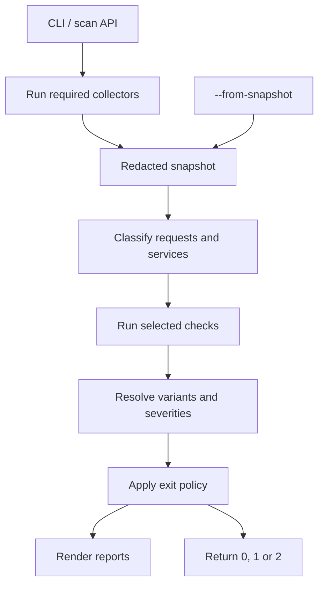
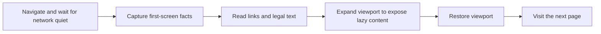

# Architecture

Start with the [scan overview](../README.md#ablauf-eines-scans) for the user flow, the
[scan reference](scan-reference.md) for edge cases, or the [development guide](development.md) for tests and CI.

## Pipeline

[scan.ts](../src/scan.ts) orchestrates the pipeline. [scan-collect.ts](../src/scan-collect.ts) runs collectors
under a shared deadline. Only a check's required sections start collectors. For example, TLS-01 can use HTTP links
from the browser when another check needs it. Running TLS-01 alone leaves the browser idle.

Checks run on redacted facts, with the same evaluation path for fresh and saved snapshots. The
[gate](../src/core/evaluation/gate.ts) applies the exit policy. A failed write of a requested report overrides that
result with code 2. [Exit reasons and precedence](scan-reference.md#exit-gründe)

## Find the code

| Area | Start here |
| --- | --- |
| CLI and public API | [cli.ts](../src/cli.ts), [index.ts](../src/index.ts) |
| Browser, HTTP, TLS and DNS | [collectors/](../src/collectors/) |
| Consent banner recognition, measurement and clicks | [cmp/](../src/cmp/) |
| Service classification | [derive/](../src/derive/) |
| Independent browser, HTTP and DNS checks | [checks/](../src/checks/) |
| Configuration, schemas and evaluation | [core/](../src/core/) |
| Console, JSON, HTML, summary and PDF | [reporters/](../src/reporters/) |
| Rules, labels, service catalog and fixtures | [test/data/](../test/data/), [test/fixtures/](../test/fixtures/), [fixture server](../test/fixture-server/) |

## Collection

### Browser

The [browser collector](../src/collectors/browser/collector.ts) starts Chromium with a temporary profile for each
phase. [Phase A](../src/collectors/browser/phases/phase-a.ts) observes the landing page, legal documents and
selected pages. [Phases B and C](../src/collectors/browser/phases/consent-phase.ts) test rejection and acceptance.

[reveal.ts](../src/collectors/browser/pages/reveal.ts) expands the viewport without scroll or pointer input.
Requests from this step carry `afterReveal: true`. A failed viewport reset stops further navigation in that phase.

[CMP adapters](../src/cmp/adapters/) own clicks. A heuristic can record an unknown banner, while the check remains
inconclusive. A settings-layer rejection records the moment the adapter saves the choice. The collector verifies
whether the decision applies on each control page before treating its requests as post-rejection or post-acceptance.
[Banner examples](../README.md#banner) · [Recognition and confirmation](scan-reference.md#banner)

### Network collectors

- **HTTP** records redirects, selected headers and static form facts. Its follow-up reads a bounded set of HTTP
  counterparts for browser pages with forms and linked permalinks. [HTTP collector](../src/collectors/http/)
- **TLS** inspects certificates. If the input certificate is rejected, the orchestrator can use an observed HTTP
  redirect to another host with a valid chain as the browser entry. [TLS collector](../src/collectors/tls/)
- **DNS** first queries the input domain, then uses the browser and HTTP results to find additional mail domains.
  DKIM lookups use the same per-domain budget after MX, SPF and DMARC. The saved selector plan distinguishes an
  unqueried selector from a missing key. [DNS collector](../src/collectors/dns/)

[Traffic inventory and request limits](../README.md#was-der-scanner-sendet)

## Contracts

### Snapshot

The [snapshot schema](../src/core/snapshot/index.ts) defines the saved data. The
[collector contract](../src/core/snapshot/collector.ts) separates sections, status, diagnostics, probe records and
transient handover. Handover can carry the URL a collector needs next. The saved plan receives its redacted form.

| Sections | Producer |
| --- | --- |
| `target`, `options`, `environment`, `plan`, `collection` | Orchestrator and collector contributions |
| `browser`, `documents`, `cmp` | Browser collector |
| `http`, `tls`, `dns` | Respective network collectors |
| `derived` | Evaluation-time classification, omitted from the saved file |

Keep compatibility with saved snapshots. A document without `role` is treated as a policy. HDR-02 without
`productVersions` is inconclusive.

### Redaction

Collectors redact before facts reach the snapshot. Cookie values, Web Storage values and TC-Strings never enter the
snapshot, report or logs. Raw CMP dialog text stays in the browser path and contributes only matching catalog
services. [What data the scanner stores](scan-reference.md#keine-werte)

| Input | Implementation |
| --- | --- |
| URLs, query parameters and email | [url.ts](../src/core/url/url.ts), [email.ts](../src/core/url/email.ts) |
| Headers | [headers.ts](../src/core/redaction/headers.ts), [CSP](../src/core/redaction/header-csp.ts), [product versions](../src/core/redaction/header-product-versions.ts) |
| Free text, cookie names and storage keys | [redaction/](../src/core/redaction/) |
| Legal text and known visitor values | [scrub.ts](../src/collectors/browser/legal/scrub.ts) |
| CMP measurements and click errors | [probe-result.ts](../src/cmp/page/probe-result.ts), [click-errors.ts](../src/cmp/click-errors.ts) |
| Fields hidden from human reports | [report-view.ts](../src/reporters/report-view.ts) |

### Check

A [check](../src/core/evaluation/check.ts) is a pure function with a small contract. At runtime it imports the
public [check API](../src/core/api.ts), which exposes the shared types and pure helpers. The
[import graph test](../test/unit/core/import-graph.test.ts) enforces that boundary.

- `requires` declares the sections needed to run the check.
- `optional` declares extra sections the check can use when present.
- `data` declares the directories made available in `ctx.data`. Configurable thresholds come from `ctx.thresholds`.
- `run` returns an outcome. An exception becomes an `error` outcome. A relevant error can affect the exit code.

Browser checks share [consent signals](../src/checks/browser/signals.ts), [document selection](../src/checks/browser/documents.ts),
[evidence](../src/checks/browser/evidence.ts) and [embedding attribution](../src/checks/browser/embed-frame.ts).
[Contract example](../test/unit/core/evaluation/contract-example.test.ts) · [Adding a check](../AGENTS.md#как-добавить-проверку)

### Report

The [report schema](../src/core/report/schema.ts) covers full and failed scans. The build generates
`schema/report.schema.json` from that same schema. JSON includes `crmCode` and every reason in `summary.exitReasons`.
The PDF renderer prints the same HTML that the HTML reporter writes.
[Report template](../test/data/report/report.html) · [Renderer contract](../src/core/report/reporter.ts)

## Dictionaries and matching

External signatures, selectors and wording live in YAML under [test/data/](../test/data/). Privacy allowlists
for URLs and headers stay in code.

| Directory | Data |
| --- | --- |
| [cmp/](../test/data/cmp/) | Adapter selectors, button labels and essential categories |
| [browser/](../test/data/browser/) | WAF signals, tracking identifier names, page selection and DOM matching |
| [legal/](../test/data/legal/) | Legal-document links, provider details, policy claims and outdated references |
| [http/](../test/data/http/) | Static form and link matching |
| [dns/](../test/data/dns/) | Free-mail domains, provider signatures and DKIM selectors |
| [services/](../test/data/services/) | Service fingerprints, aliases and cookies |
| [ruleset/](../test/data/ruleset/) and [texts/](../test/data/texts/) | Variants, severities, gating, CRM codes and localized report text |

Use [dataSection](../src/core/data/parse.ts) to validate dictionary sections. Collectors read them with
`loadSection`, checks use `ctx.data`, and scripts evaluated in the browser receive the required data as arguments.
[Section coverage test](../test/unit/core/data/sections.test.ts) · [Service routing](../test/data/routing.yaml)

## Settings

Set defaults, bounds and descriptions in [config/schema.ts](../src/core/config/schema.ts). The field path
determines the environment variable name. Run `corepack pnpm env:example` after editing the schema.
Collectors read `ctx.config`, while checks receive their thresholds through `ctx.thresholds`.
The `DSGVO_TEST_WORKERS` setting belongs to the test runner.
[User-facing settings](../README.md#einstellungen) · [Generated environment reference](../.env.example)
